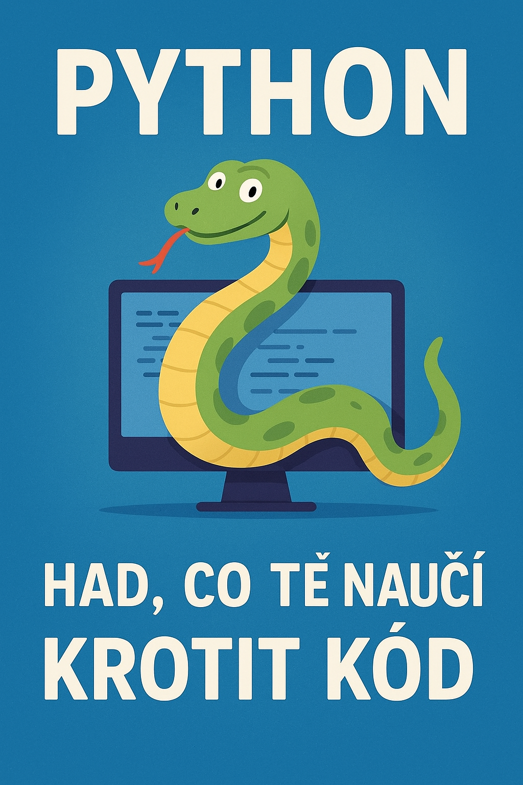
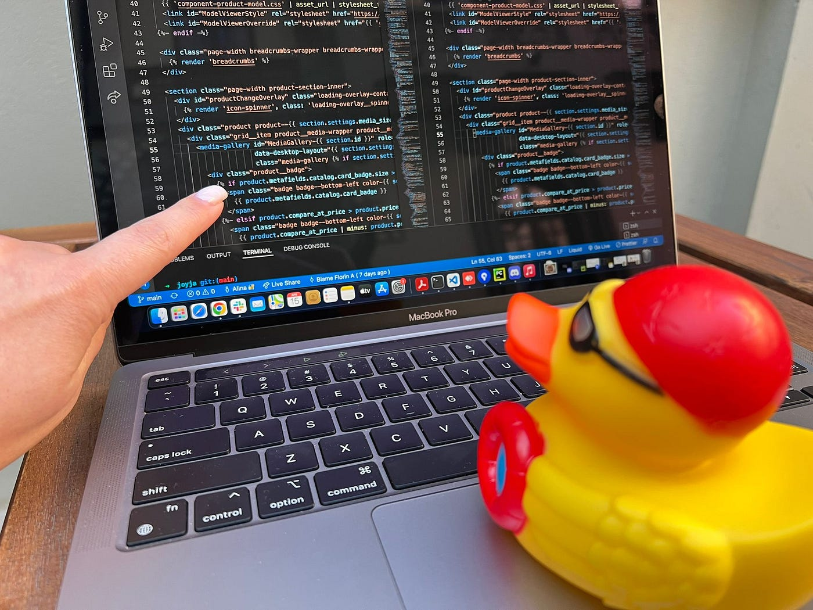
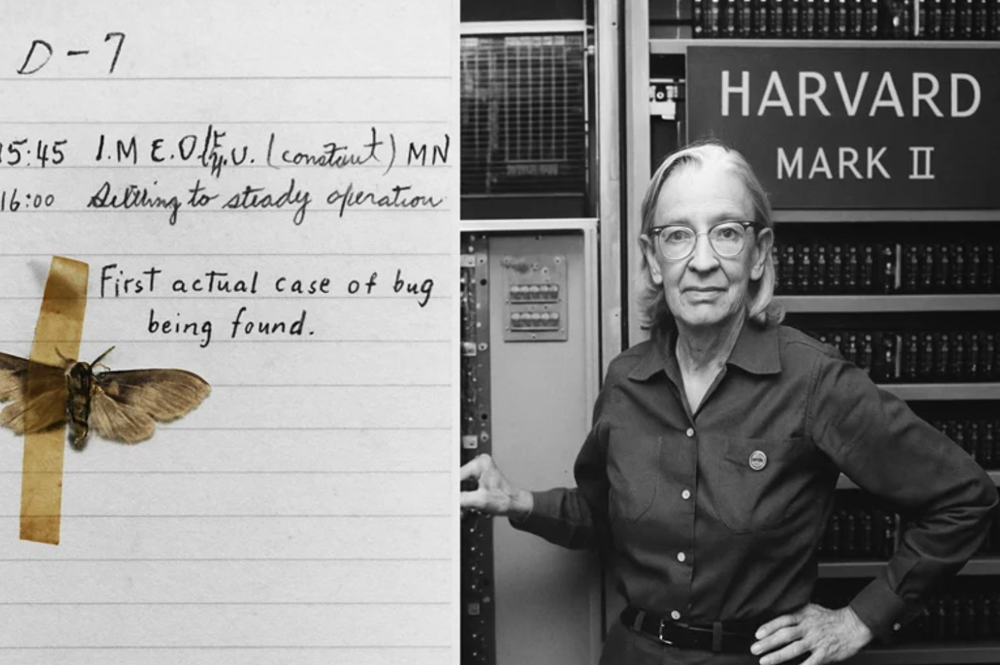
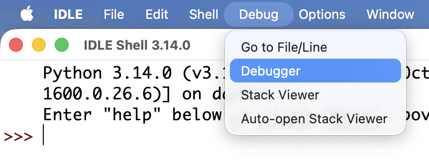


# Lekce 1: Úvod do předmětu <!-- omit in toc -->

---

- [1. O jazyku Python](#1-o-jazyku-python)
- [2. O učebnici](#2-o-učebnici)
- [3. Proč se učit programovat?](#3-proč-se-učit-programovat)
- [4. Chyby: první známka, že pracuješ](#4-chyby-první-známka-že-pracuješ)
- [5. Povinné pomůcky na hodiny](#5-povinné-pomůcky-na-hodiny)
- [6. Rubber duck debugging](#6-rubber-duck-debugging)
- [7. Brouk, který byl doslova... brouk](#7-brouk-který-byl-doslova-brouk)

---

# 1. O jazyku Python

Autorem Pythonu je _[Guido van Rossum](https://cs.wikipedia.org/wiki/Guido_van_Rossum)_ -- počítačový programátor, který se narodil a vyrostl v Nizozemsku. Python vznikl v roce 1991 a své jméno dostal podle _[Monty Pythonova létajícího cirkusu](https://cs.wikipedia.org/wiki/Monty_Python%C5%AFv_l%C3%A9taj%C3%ADc%C3%AD_cirkus)_ (autor je jeho velkým fanouškem).

V současné době patří Python mezi nejpopulárnější programovací jazyky na světě a jeho obliba stále roste. Je to moderní, vysokoúrovňový jazyk, který podporuje více programovacích paradigmat a je [open source](https://cs.wikipedia.org/wiki/Otev%C5%99en%C3%BD_software).

Python používají například CERN, NASA, Google, Facebook, YouTube, Mozilla a mnoho dalších. Funguje na všech běžných platformách (Linux, Windows, macOS). Na řadě špičkových univerzit (např. MIT, Berkeley) slouží jako úvodní jazyk pro výuku programování.

Python dnes patří mezi hlavní jazyky používané při vývoji umělé inteligence. Díky své jednoduché syntaxi a obrovskému množství knihoven – například **TensorFlow**, **PyTorch** nebo **scikit-learn** – umožňuje programátorům rychle vytvářet a trénovat neuronové sítě, zpracovávat obrovská množství dat a stavět moderní AI aplikace. Firmy, vědci i studenti po celém světě tak používají Python k tomu, aby posouvali hranice toho, co počítače dokážou.

Python se významně uplatňuje i při vývoji webových aplikací. Díky frameworkům, jako jsou **Django** nebo **Flask**, mohou programátoři rychle vytvářet moderní a bezpečné weby či online služby. Python zde vyniká svou jednoduchostí, čitelností a širokou nabídkou knihoven, což z něj dělá oblíbený nástroj pro malé projekty i rozsáhlé webové systémy.

# 2. O učebnici
 
Na začátku je důležité zdůraznit, že tato učebnice **není** primárně o jazyku Python, i když v něm budeš všechny programy psát. **Python je zde prostředkem – nikoli cílem**. Cílem je, aby ses naučil(a) **algoritmickému myšlení** a dokázal(a) své nápady převést do fungujícího programu.

Učebnice je názorná a plná praktických úloh. Budeš pracovat s grafickým prostředím knihovny `tkinter`. Grafický výstup je zvolen záměrně -- má několik výhod:

-   okamžitě vidíš, zda program dělá co má, a snáze najdeš chyby (a chybovat je normální),
-   obrázek na obrazovce je obvykle atraktivnější než jen seznam čísel,
-   vystačíš si se základní matematikou -- není třeba se bát složitých výpočtů.

Na začátku se naučíš kreslit jednoduché tvary, používat cykly a podmínky, ovládat program klávesnicí a myší. Později přibudou animace a vytvoříš si také malé hry.

**Důležité upozornění:** Programování je dovednost. Nelze ji zvládnout „hned“ – stejně jako se nenaučíš hrát na hudební nástroj během dvou dnů. Vyžaduje trénink, vytrvalost a ochotu dělat chyby a učit se z nich. Pokud ale vydržíš, zjistíš, že programování může být zábavné, tvořivé a že zvládnout základy není tak těžké, jak se na první pohled zdá.

# 3. Proč se učit programovat?

Možná si říkáš: „Tak to zvládnu za víkend, ne?“ – **Nezvládneš.** A není to špatná zpráva.

Programování je totiž jako učení se hrát na kytaru nebo jezdit na snowboardu. Za víkend možná zjistíš, kde má kytara struny, nebo jak se postavit na prkno… ale opravdové kouzlo přijde až časem, když si pohyby zautomatizuješ a začneš **tvořit**.

Na začátku budeš občas zmatený(á), občas se ti bude chtít počítač vyhodit z okna (nedělej to, je to drahé) a někdy si budeš myslet, že „programy mají vlastní hlavu“. Ale pak se stane něco skvělého: začneš chápat, jak věci fungují, a zjistíš, že tvoje nápady se na obrazovce mění ve skutečné výsledky.

Tohle je dovednost, kterou si neosvojíš hned – ale pokud vytrváš, dostaneš do rukou nástroj, se kterým můžeš vytvořit cokoliv: hru, aplikaci, animaci… nebo jen něco, co ti ušetří hodinu práce každý den.

# 4. Chyby: první známka, že pracuješ

Python je jazyk, který se dobře čte a píše, takže se hodí pro začátečníky i pokročilé. Umí spoustu věcí – od jednoduchých výpočtů přes práci s texty až po složité grafické aplikace. **Naučit se psát programy neznamená jen znát příkazy**. Znamená to hlavně **přemýšlet nad tím, jak úkol rozdělit na menší kroky a jak je postupně proměnit v kód**.

Takže – připrav se na chyby, hodně chyb. Napsat program, který poběží „na první dobrou“ bez jediné chybičky, je jako hodit šipku do středu terče se zavázanýma očima – možné to jde, ale opravdu vzácně. Většinou tě čeká několik pokusů, ladění, úpravy a hledání, proč se program chová jinak, než sis myslel. **A to je naprosto normální.**

Každá chyba, kterou najdeš a opravíš, tě posune o kus dál. Naučíš se číst vlastní kód, přemýšlet o tom, co se v něm děje, a postupně psát čistěji a přehledněji. Chyby nejsou nepřítel – jsou to lekce, které z tebe dělají lepšího programátora.

💡 _Malá rada_: Pokud tvůj první program funguje bez jediné chyby, gratuluji… ale buď opatrný(á). Možná to není proto, že jsi génius, ale proto, že se ještě neprojevil ten "bug", co se schovává v koutě a čeká na svou příležitost.

Až si na ten proces zvykneš, zjistíš, že i hledání chyb může být docela zábava. Je to jako detektivka, kde stopami jsou řádky kódu a ty jsi vyšetřovatel, který odhaluje, co se opravdu stalo.

# 5. Povinné pomůcky na hodiny

- **Čtverečkovaný** sešit A5/A4
- Tužka a guma
- Kalkulačka (stačí ta úplně základní)

---

# 6. Rubber duck debugging

Rubber duck debugging je technika hledání a opravování chyb ve zdrojovém kódu. Princip spočívá v tom, že gumové kachničce nahlas popisuješ funkci řádků ve svém kódu. Důležité přitom je, aby kachnička viděla na monitor. Při tomto vysvětlování přijdeš na chybu sám, jelikož ti dojde, že kód ve skutečnosti nedělá to, co by dělat měl a možná dělá to, co by naopak dělat neměl. Kachnička je spokojená, neboť ti poradila.

Většího efektu dosáhneš tím, že kachničce při vysvětlování ukazuješ jednotlivé řádky kódu prstem.

# 7. Brouk, který byl doslova... brouk

> Příběh první počítačové chyby

Když slyšíte pojem "počítačová chyba", pravděpodobně si vybavíte softwarové chyby nebo chyby v kódu. Ale úplně první "chyba" v historii výpočetní techniky nebyla metafora – byl to skutečný hmyz.

Dne 9. září 1947 narazil tým pracující na elektromechanickém počítači **Harvard Mark II** podivný problém. Stroj náhle selhal a výsledky byly nesprávné. Při inspekci inženýři zjistili příčinu: můra se zasekla v [relé](https://cs.wikipedia.org/wiki/Elektromagnetick%C3%A9_rel%C3%A9), což způsobilo zkrat v systému.

 *Grace Hopper - průkopnická počítačová vědkyně a kontraadmirálka amerického námořnictva*

Grace Hopper pečlivě odstranila můru a přilepila ji do svého deníku. Vedle něj napsala:

> *"První skutečný případ nalezení brouka."*

 *Tato stránka – včetně můry – je nyní uchovávána v Národním muzeu americké historie Smithsonian Institution.*

**Od doslovného k metaforickému**

Ačkoliv se slovo "bug" již dříve používalo k popisu mechanických vad (*Thomas Edison jej dokonce použil již koncem 19. století*), tato událost tento termín zpopularizovala v kontextu výpočetní techniky. Od té doby se "debugování" stalo standardním výrazem pro hledání a opravu chyb v kódu:

I my o něčem co nefunguje zcela správně říkáme, že to "má své mouchy". To je v přeneseném smyslu to samé.

**Proč je to dnes stále důležité**

Tento zvláštní kousek historie je víc než jen zajímavost. Je to připomínka, že technologie – bez ohledu na to, jak pokročilá – může selhat nečekanými způsoby. Ať už jde o doslovný hmyz nebo složitou softwarovou zranitelnost, **ladění zůstává klíčovou součástí vývoje technologií**.

