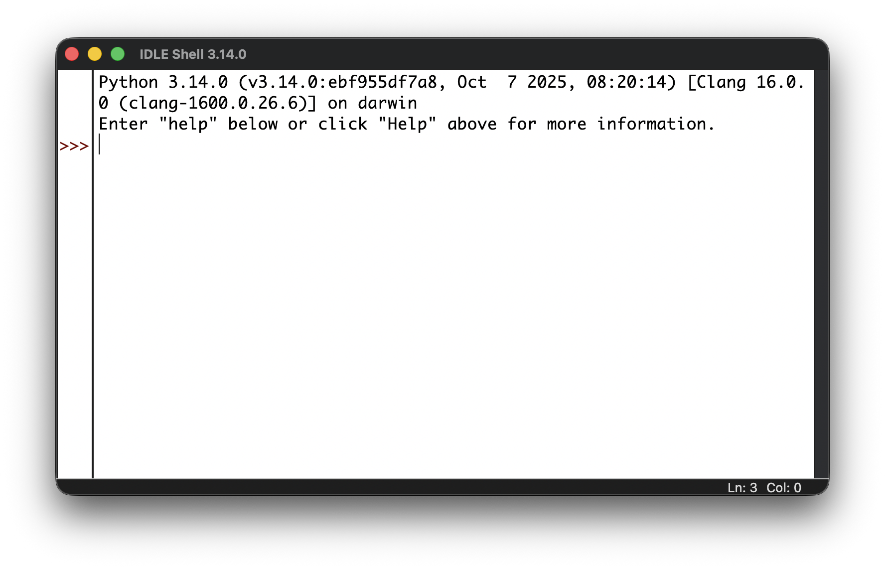
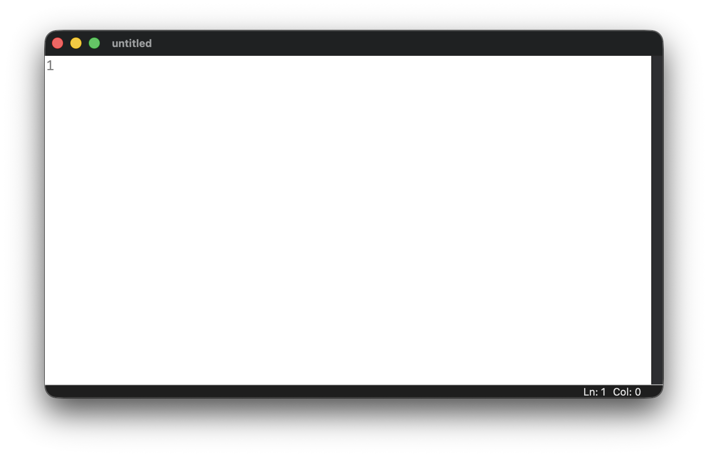
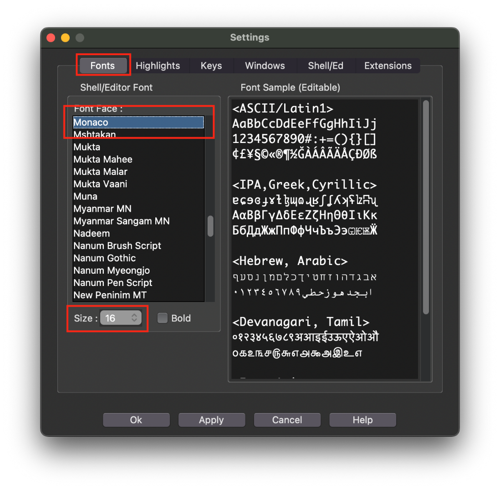
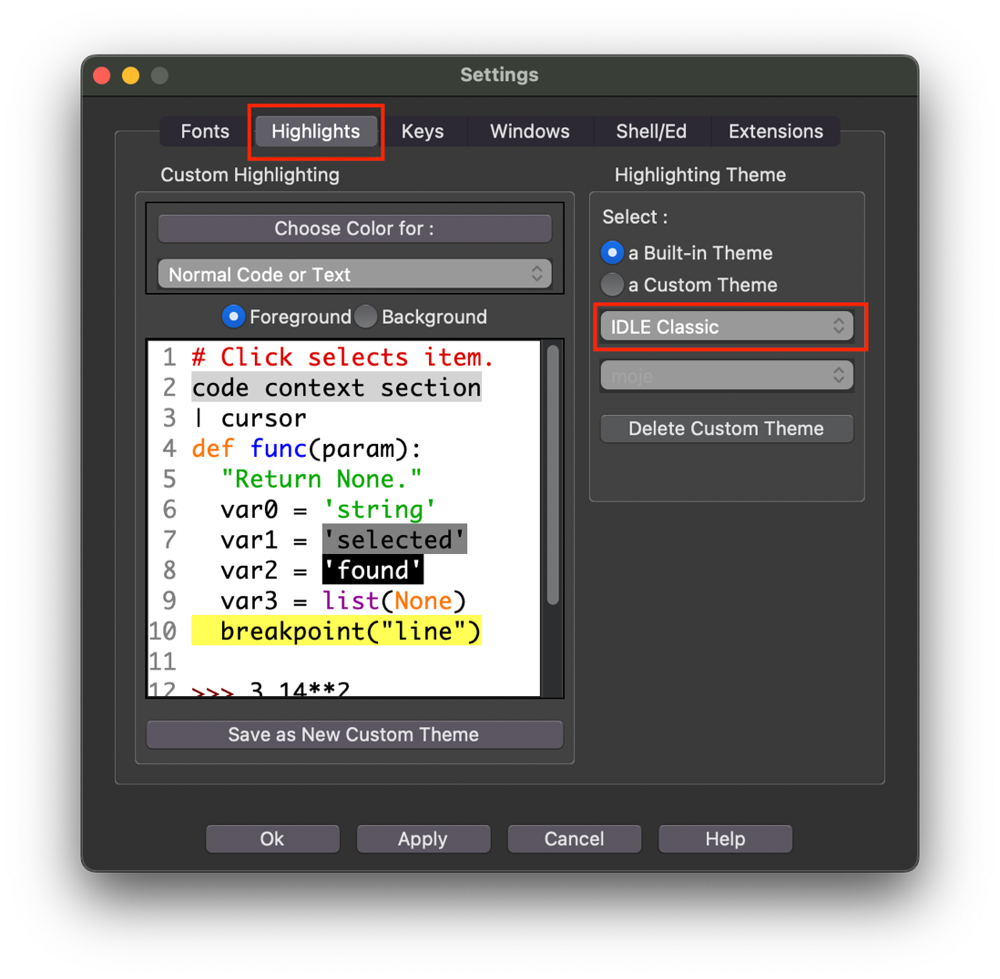
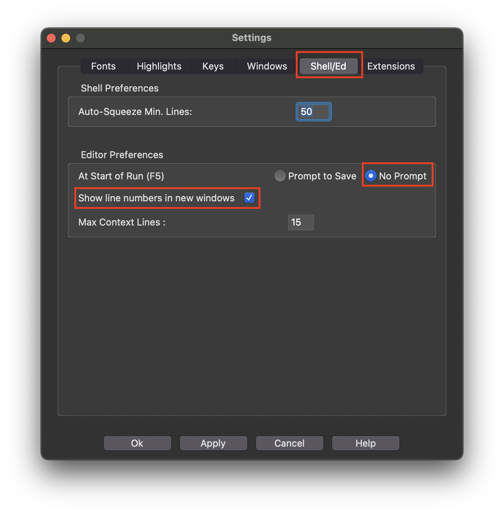


#  Lekce 2: IDLE Python <!-- omit in toc -->

---

- [1. Stažení a instalace](#1-stažení-a-instalace)
- [2. IDLE Python](#2-idle-python)
	- [2.1. Spuštění](#21-spuštění)
- [3. Nastavení prostředí programu](#3-nastavení-prostředí-programu)
	- [3.1. Písmo](#31-písmo)
	- [3.2. Téma vzhledu](#32-téma-vzhledu)
	- [3.3. Autosave](#33-autosave)
	- [3.4. Číslování řádků](#34-číslování-řádků)

---

# 1. Stažení a instalace

Domovská stránka projektu je na webu  [www.python.org](https://www.python.org). Z ní si stáhni variantu Pythonu pro svůj operační systém – Windows, macOS nebo Linux. 

- Ve Windows lze Python nejsnadněji nainstalovat i z MS Store. Hledej "Python".
- V Linuxu (Ubuntu) podle [tohoto návodu](https://linuxcapable.com/how-to-install-idle-python-on-ubuntu-linux/).

**Poznámka**: Vývojáři Python vydávají průběžně nové verze. Vůbec neřeš, jestli se číslo verze ve škole a doma bude lišit. 

# 2. IDLE Python

Součástí Pythonu je **IDLE Python** (**I**ntegrated **D**evelopment and  **L**earning  **E**nvironment). Z tohoto důvodu má jednoduché rozhraní, které obsahuje i editor pro psaní kódu. V horní části okna jsou nabídky a nástroje pro různé úkoly, jako je spouštění kódu, ladění a správa projektů.

IDLE poskytuje užitečné funkce jako zvýrazňování syntaxe, možnost rychle spustit kód přímo z editoru. Obsahuje **interaktivní terminál** Pythonu pro rychlé testování a experimentování s kódem (velmi užitečná a potřebná věc).

Díky své jednoduchosti a přehlednému rozhraní je IDLE Python **ideální pro začátečníky**, kteří se jazyk učí. Ačkoliv se ti to zpočátku nebude zdát příliš praktické, jeho  **velkou výhodou dvouokenní režim**: program + shell. 

⚠️ <mark>Upozornění</mark> Výuka bude probíhat v prostředí **IDLE Python**, které je optimalizované právě pro tyto potřeby. Plně podporuje práci s grafickými knihovnami (pro nás zejména `tkinter`). Používání jiných vývojových prostředí může vést k problémům při spouštění a zobrazování grafických výstupů, proto není pro účely této výuky doporučeno. Pokud se rozhodneš toto doporučení nerespektovat, technické potíže si řešíš **výhradně sám/sama**.

## 2.1. Spuštění

Po spuštění aplikace "**IDLE Python**" se otevře okno s názvem IDLE Shell:

V tomto okně lze příkazy psát přímo a po potvrzení enterem se automaticky provedou. Jedná se o **neinteraktivní prostředí**, označované také jako  **příkazový režim**  nebo jen  **shell** (seznámíme se s ním později).

Program se vytváří v programovacím režimu. To znamená, že v okně  shellu  vybereme nabídku  **File** >  **New  File**. Otevře se nám nové okno, ve kterém budeme program psát.

Program uložíme např. na Plochu (lépe však do nové složky "Python" na svém OneDrivu). Programy v Pythonu mají příponu  **.py**.

Chceme-li jej spustit, vybereme nabídku  **Run** >  **Run Module** nebo snadněji klávesu <kbd>F5</kbd>. Po spuštění se do  shellu  (toho okna  s `>>>`) zapíšou informace o tom, který program jsme spustili, a restartují se také všechna nastavení Pythonu v příkazovém režimu (shellu).

# 3. Nastavení prostředí programu

IDLE Python má jen několik nastavení, která jsou užitečná, a je dobré je provést (nebo o nich alespoň vědět).

## 3.1. Písmo

- Na Windows si nech buď výchozí font  **Courier New** nebo změň na **Consolas**.
- V macOS font **Monaco**.
- V Linuxu např. **Liberation Mono**  nebo  **Ubuntu Mono**.

⚠️ Nenastavujte jiné písmo než je zde doporučené!

Velikost písma nastav tak, aby byl pro tebe kód bez námahy čitelný.

## 3.2. Téma vzhledu

K dispozici je kromě výchozího světlého (IDLE  Classic) tmavý režim (IDLE  Dark).

## 3.3. Autosave

Volba  **No Prompt**  automaticky uloží soubor před spuštěním.  Velmi návykové, doporučuji zapnout.

## 3.4. Číslování řádků

Zobrazovat čísla řádků (viz obrázek výše). Toto není úplně nutné. Číslo aktivního řádku je vždy vidět v zápatí okna se skriptem `Ln: n`.

