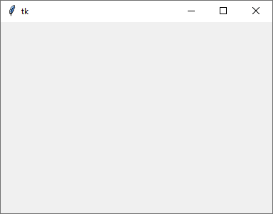
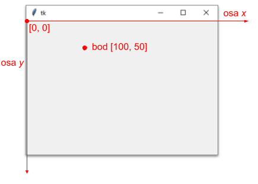


# Lekce 3: Grafická plocha a souřadnice <!-- omit in toc -->

---

- [1. Grafická plocha](#1-grafická-plocha)
- [2. Souřadnicový systém](#2-souřadnicový-systém)


---

# 1. Grafická plocha

Máme spuštěné prostředí IDLE Python a vytvořený nový soubor (**File** > **New File**) – jsme v programovacím režimu.

Když chceme pracovat s grafickou plochou, musíme nejprve do programu importovat **modul** (knihovnu) pro práci s grafickou plochou (to je nějaký program, ve kterém už někdo naprogramoval příkazy, které budeme používat). Pro práci s grafikou použijeme modul `tkinter`. Tento modul importujeme na začátku programu zápisem import  `tkinter`.

Po importu modulu vytvoříme grafickou plochu (canvas), do které budeme později kreslit `canvas = tkinter.Canvas()`. Příkaz `canvas.pack()` zobrazí nové okno s vytvořenou grafickou plochou. Celý program (zatím) vypadá takto:

```py
# 03_1.py

import tkinter
canvas = tkinter.Canvas()   # Canvas() s velkým C
canvas.pack()
```

Program musíme před spuštěním uložit pod názvem `03_1.py` do složky `Python`.

Když program spustíme (Menu  **Run**  >  **Run Module**  nebo klávesou <kbd>F5</kbd>), vytvoří se okno s grafickou plochou. V okně zatím nic nevidíme, protože jsme do něj ještě nic nenakreslili. 

Okno se zavírá klasicky jako jiné okno v prostředí daného OS.




# 2. Souřadnicový systém

V grafické ploše budeme kreslit čáry, obdélníky, elipsy a další objekty. Při jejich kreslení musíme zadat jejich souřadnice.

**Každý bod má dvě souřadnice**: `x` a `y`. Souřadnice `x` určuje  **vodorovnou**  polohu a souřadnice `y` určuje  **svislou**  polohu. Ale pozor, souřadnice `y` roste směrem dolů (ne tak, jak jsme zvyklí v matematice, kde roste nahoru). Souřadnice zapisujeme jako dvojici čísel, kde souřadnice `x` je vždy první v této dvojici a druhá je souřadnice `y`.




❓ **Otázky**

1. Jaké souřadnice má bod, který je 20 bodů nalevo od bodu se souřadnicemi `[100,50]`?

2. Jaké souřadnice má bod, který je 20 bodů napravo od bodu se souřadnicemi `[100,50]`?

3. Jaké souřadnice má bod, který je o 20 bodů výše od bodu se souřadnicemi `[100,50]`?

4. Jaké souřadnice má bod, který je o 20 bodů níže od bodu se souřadnicemi `[100,50]`?

5. Co mají společného všechny body nalevo nebo napravo od `[100, 50]`?

