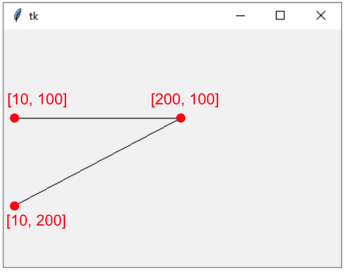
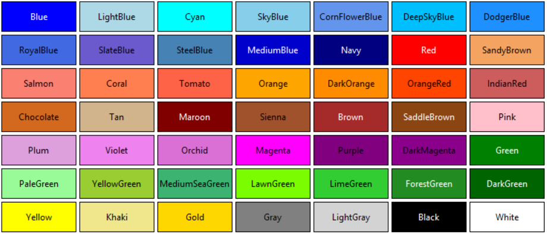
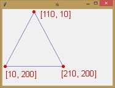
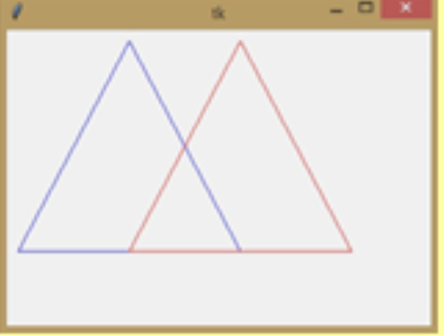
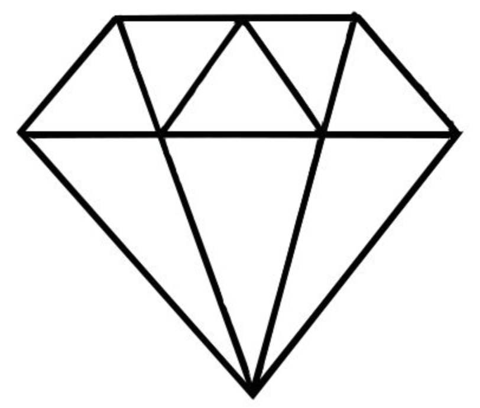
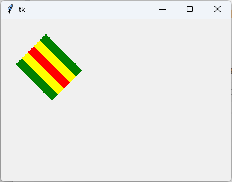

# Lekce 4: Kreslení čar <!-- omit in toc -->


---

- [1. Čáry](#1-čáry)
- [2. Úpravy čar](#2-úpravy-čar)
  - [2.1. Tloušťka čáry](#21-tloušťka-čáry)
  - [2.2. Barva čáry](#22-barva-čáry)
- [3. 💾 Úkoly](#3--úkoly)


---


# 1. Čáry

Pomocí příkazu  `canvas.create_line(10, 100, 200, 100)`  nakreslíme čáru, která začíná v bodě se souřadnicemi [10, 100] a končí v [200, 100]. Pomocí tohoto příkazu můžeme také kreslit čáry, které protínají více bodů. Do příkazu přidáme jednotlivé souřadnice bodů.

Například `canvas.create_line(10, 100, 200, 100, 10, 200)` přidáme k&nbsp;původní přímce další bod se souřadnicí [10, 200]. Po spuštění programu:

```py
# 04_1.py

import tkinter
canvas = tkinter.Canvas()
canvas.pack()

canvas.create_line(10, 100, 200, 100, 10, 200)
```



Uvidíme přímku, která začíná na [10, 100], pokračuje na [200, 10] a končí na [10, 200].

💾 Upravte tento program tak, aby tyto dvě čáry nakreslil do trojúhelníku.

# 2. Úpravy čar

Při kreslení můžeme čarám přizpůsobit **tloušťku** i **barvu**.

- `canvas.create_line(10, 100, 200, 100,  width=5)` -- Nakreslí čáru o tloušťce 5 bodů.
- `canvas.create_line(10, 100, 200, 100,  fill='red')` -- Nakreslí červenou čáru.
- `canvas.create_line(10, 100, 200, 100,  fill='red',  width=5)` -- Nakreslí červenou čáru o tloušťce 5 bodů.

## 2.1. Tloušťka čáry
Tloušťku nastavíme parametrem `width` a přiřadíme jí číselnou hodnotu (v&nbsp;pixelech). 

## 2.2. Barva čáry
Barvu nastavíme parametrem `fill` a do **apostrofů** nebo **uvozovek** napíšeme název barvy. Můžeme použít různé "pojmenované" barvy, například: `'white'`, `'red'`, `'blue'`, `'yellow'`, `'magenta'`, `'green'`, `'orange'`, `'brown'`, `'gray'`, `'violet'`, `'olive'` nebo přímo kód v notaci `'#RRGGBB'`.



---

Tento trojúhelník můžeme nakreslit různými způsoby:



```py
# 04_2.py

import tkinter
canvas = tkinter.Canvas()
canvas.pack()

canvas.create_line(110, 10, 10, 200, fill='blue')
canvas.create_line(10, 200, 210, 200, fill='blue')
canvas.create_line(210, 200, 110, 10, fill='blue')
```
nebo

```py
# 04_2a.py

import tkinter
canvas = tkinter.Canvas()
canvas.pack()

canvas.create_line(110, 10, 10, 200, 210, 200, 110, 10, fill='blue')
```

# 3. 💾 Úkoly

Lze vypočítat souřadnici `x` 110 vrcholu trojúhelníku ze souřadnic [10,&nbsp;200] a [210,&nbsp;200]?


Můžeme tento trojúhelník nakreslit i jinak?

---

Nakreslete stejný trojúhelník červenou barvou, posunutý podle ukázky na obrázku:




---

Pomocí čar nakreslete písmena L, T, H, E, K. Zkuste i jiné.

---

Pomocí čar nakreslete dva pravoúhlé trojúhelníky, které se dotýkají svými odvěsnami.

---

Pomocí čar nakreslete diamant.



---

Nakreslete symbol červeného kříže. 

---

Změnou barvy a tloušťky čáry nakreslete tento obrázek:



