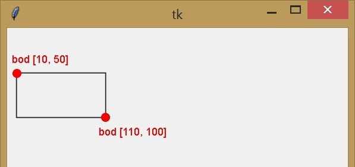
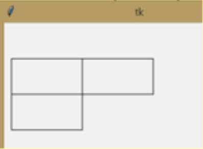
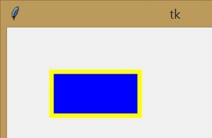
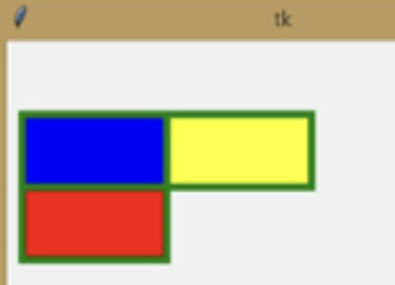
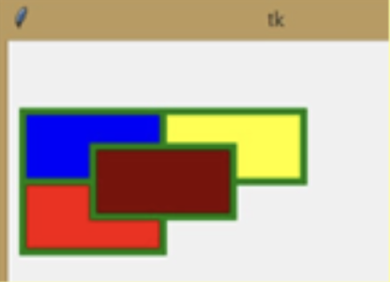
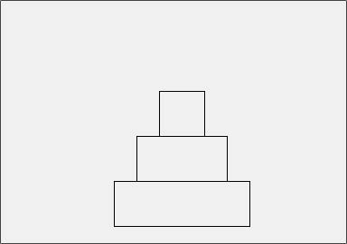
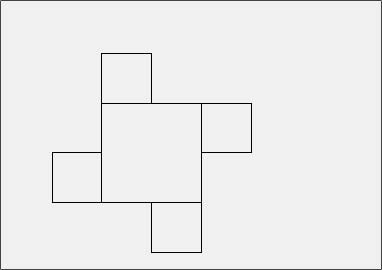
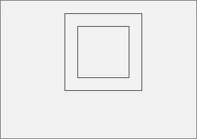
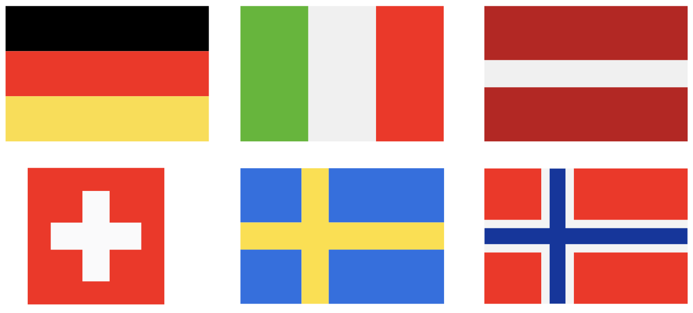
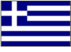


# Lekce 5: Kreslení obdélníků <!-- omit in toc -->

---

- [1. Obdélníky](#1-obdélníky)
	- [1.1. ❓ Otázky](#11--otázky)
	- [1.2. 💾 Úkol](#12--úkol)
- [2. Barva výplně a okraje](#2-barva-výplně-a-okraje)
	- [2.1. ❓ Otázky](#21--otázky)
- [3. 💾 Cvičení](#3--cvičení)
	- [3.1. Pyramida](#31-pyramida)
	- [3.2. Ornament](#32-ornament)
	- [3.3. Soustředné](#33-soustředné)
	- [3.4. Vlajky států](#34-vlajky-států)
	- [3.5. Vlajka Řecka](#35-vlajka-řecka)
	- [3.6. Oprava kódu](#36-oprava-kódu)


---

# 1. Obdélníky 

1. Vytvořte program `05_obdelniky.py` s podporou grafické plochy. 

2. Příkaz `canvas.create_rectangle(10, 50, 110, 100)` nakreslí obdélník, který je určen pomocí bodu se souřadnicemi [10, 50] a [110, 100]:

   

3. Nakreslete obdélník podle zadání výše.


## 1.1. ❓ Otázky

1) Jakou šířku a výšku v bodech má obdélník na obrázku výše?

2) Můžeme stejný obdélník také nakreslit tímto příkazem?  
`canvas.create_rectangle(110, 100, 10, 50)`

3) Můžeme nakreslit stejný obdélník (na stejném místě) pomocí jiných souřadnic?

4) Co nakreslím, když napíšu příkaz 
`canvas.create_rectangle(10, 50, 110, 50)`?

5) Co nakreslím, když napíšu příkaz  
`canvas.create_rectangle(10, 50, 10, 50)`?

6) Jakou výšku a šířku mají předchozí dva obdélníky?

## 1.2. 💾 Úkol

Pokračujte v programu `05_obdelniky.py`. Nakreslete napravo vedle obdélníku stejně velký obdélník, který se ho bude dotýkat. Přidejte vlevo dolu další:




# 2. Barva výplně a okraje

I při kreslení obdélníku můžeme pomocí parametru nastavit barvu stejným způsobem jako při nastavování barvy při kreslení čar. Při kreslení obdélníku parametr `fill` nastavuje vnitřní barvu, tj. výplň formuláře výkresu. Nemá to však vliv na barvu obrysu obdélníku, jak bychom si mohli myslet. Pomocí parametru `outline` můžeme nastavit barvu stran obdélníku. Příkaz tedy:

```py
canvas.create_rectangle(50, 50, 150, 100, fill='blue',  outline='yellow', width=5)
```

Pokračujte v programu `05_obdelniky.py`. Nakreslí modře vyplněný obdélník se žlutým obrysem o tloušťce 5 bodů. Připomeňme, že tyto parametry mohou být v různém pořadí.


Nastavte obdélníkům parametry, aby vypadaly takto:


Přidejte čtvrtý obdélník se středem v průsečíku a nastavte mu hnědou výplň:


## 2.1. ❓ Otázky

1) Co se stane, když "zamícháme" parametry pro úpravu barvy mezi souřadnicemi bodů?
	```py
	canvas.create_rectangle(outline='yellow', 50, 50, 150, 100, fill='blue')
	```
	
2) V předchozí úloze (`05_obdelniky.py`) jsme nakreslili čtyři obdélníky čtyřmi příkazy. Záleží na pořadí těchto příkazů? Co se stane, když nejprve nakreslíme hnědý obdélník? Které příkazy můžeme prohodit, abychom nakreslili stejný obrázek?

3) Co se stane, když nastavíme parametr `outline` takto: `outline=''`?

4) Co se stane, když nastavíme parametr `fill` takto: `fill=''`?

5) Co se stane, když nastavíme výplň i obrys takto: `fill='', outline=''`?

6) Kolik obdélníků uvidíme po spuštění těchto příkazů?

	```py
	canvas.create_rectangle(120, 100, 170, 150)
	canvas.create_rectangle(100, 100, 150, 150)
	canvas.create_rectangle(150, 100, 200, 150)
	canvas.create_rectangle(100, 150, 150, 200)
	```

7) Kolik obdélníků uvidíme po spuštění těchto příkazů?

	```py
	canvas.create_rectangle(120, 100, 170, 150, fill='white')
	canvas.create_rectangle(100, 100, 150, 150, fill='')
	canvas.create_rectangle(150, 100, 200, 150, fill='green')
	canvas.create_rectangle(100, 150, 150, 200, fill='', outline='')
	```

# 3. 💾 Cvičení


## 3.1. Pyramida

Vytvoř program `05_pyramida.py`, který ze tří obdélníků o rozměrech 150&times;50, 100&times;50 a 50&times;50 nakreslí následující pyramidu:



Uprav obrys a výplň obrazce podle svého uvážení.

## 3.2. Ornament

Vytvoř program `05_ornament.py`, který z pěti čtverců nakreslí následující ornament. Rozměry čtverců zvol podle svého uvážení (všechny menší čtverce budou stejně velké):




Uprav obrys a výplň obrazce podle svého uvážení.

## 3.3. Soustředné
Vytvoř program `05_soustredne.py`, který nakreslí dva velké čtverce – jeden se stranou délky 100 a druhý 150. Čtverce budou mít společný střed jako na
následujícím obrázku:



Uprav obrys a výplň obrazce podle svého uvážení.


## 3.4. Vlajky států
Nakreslete některou z vlajek: Německa, Itálie, Lotyšska, Svýcarska, Svédska, Norska nebo jinou dle vlastního výběru. Název souboru s kódem bude `05_nazev_statu.py`:




## 3.5. Vlajka Řecka
Nakreslete vlajku Řecka (`05_recko.py`):



Kolik příkazů `create_rectangle()` bude k&nbsp;nakreslení potřeba?

## 3.6. Oprava kódu
Program `05_francie.py` měl nakreslit vlajku Francie, ale obsahuje chyby. Opravte je:
```py
# 05_francie.py

import tkinter

canva= tkinter.Canvas()
canvas.pack()

canvas.create_rectangle(10,50,110,300, fill='blue', outline='')
canvas.create_rectangle(60,50,160,300, fill='white', outline='')
canvas.create_rectangle(110,50,210,300, fill='red', outline='')
```
