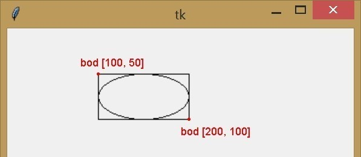
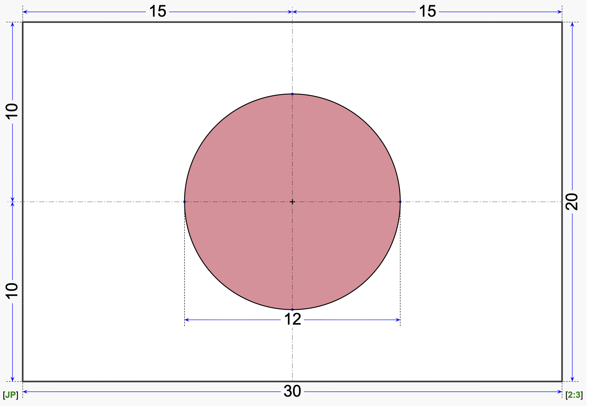
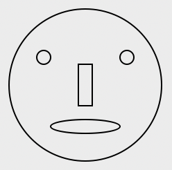
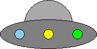
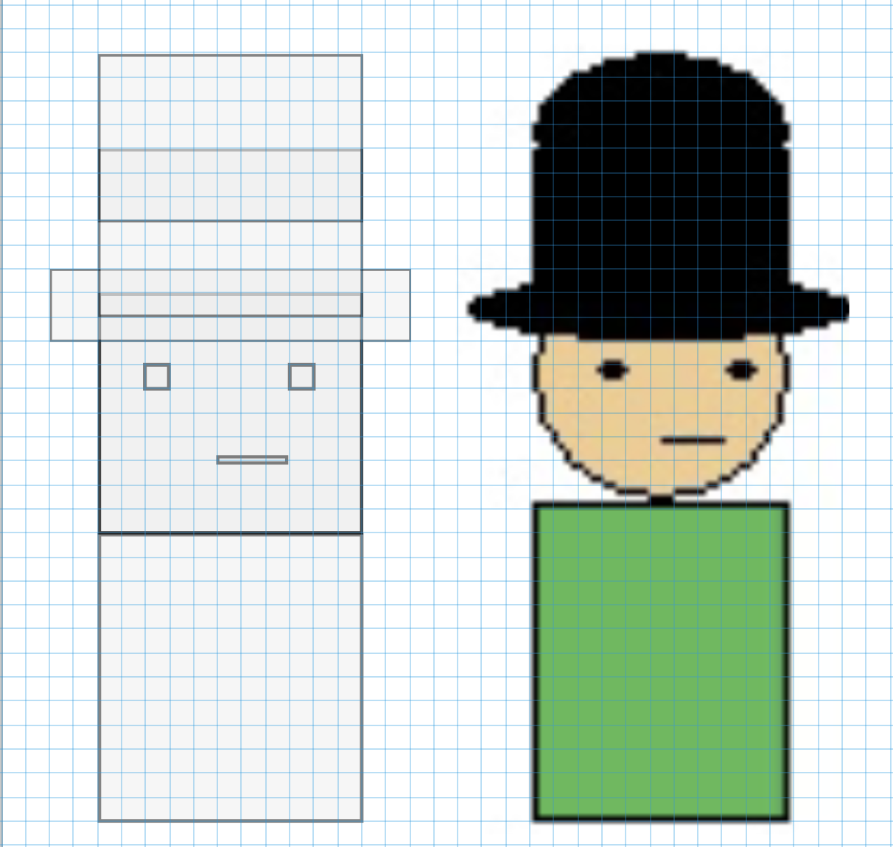
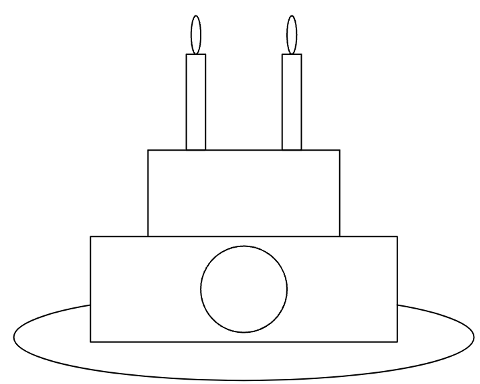
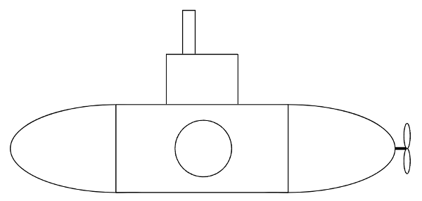


# Lekce 6: Kreslení elips <!-- omit in toc -->


---

- [1. Elipsy](#1-elipsy)
- [2. ❓ Otázky](#2--otázky)
- [3. Velikost plátna a jeho barva](#3-velikost-plátna-a-jeho-barva)
- [4. 💾 Cvičení](#4--cvičení)
	- [4.1. Dvě elipsy vedle sebe](#41-dvě-elipsy-vedle-sebe)
	- [4.2. Vlajka Japonska](#42-vlajka-japonska)
	- [4.3. Sněhulák](#43-sněhulák)
	- [4.4. Půlměsíc](#44-půlměsíc)
	- [4.5. Obličej](#45-obličej)
	- [4.6. UFO](#46-ufo)
	- [4.7. Postava s kloboukem](#47-postava-s-kloboukem)
	- [4.8. Dort](#48-dort)
	- [4.9. Nautilus](#49-nautilus)


---

# 1. Elipsy

Již víme, že příkaz `canvas.create_rectangle(100, 50, 200, 100)` nakreslí obdélník, jehož levý horní bod má souřadnici [100, 50] a pravý dolní bod má souřadnice [200, 100]. Použijeme-li stejné souřadnice, ale změníme-li příkaz `create_rectangle` na `create_oval`, nakreslí se elipsa.

Tento program se stejnými souřadnicemi, ale různými příkazy:

```py
# 06/1.py

import tkinter
canvas = tkinter.Canvas()
canvas.pack()

canvas.create_rectangle(100, 50, 200, 100)
canvas.create_oval(100, 50, 200, 100)
```

Nakreslí obdélník i elipsu.



Jak vidíme na obrázku, souřadnice bodů, které určují elipsu (oval), se nenacházejí na elipse, ale mimo ni. Tyto body jsou souřadnice obdélníku, ve kterém je nakreslena vepsaná elipsa (tj. největší možná elipsa, která se do tohoto pomyslného obdélníku vejde).

Pouze příkazem pro nakreslení elipsy program nakreslí pouze samotnou elipsu:

```py
# 06/2.py

import tkinter
canvas = tkinter.Canvas()
canvas.pack()

canvas.create_oval(100, 50, 200, 100)
```

Při kreslení elipsy nám může pomoci nejprve vymyslet souřadnice, abychom nakreslili správný obdélník (v něm si představíme největší elipsu) a teprve poté, až budeme mít správné souřadnice, změníme tento příkaz na elipsu.

# 2. ❓ Otázky

1) Jedním příkazem můžeme nakreslit obdélník.
    a) Potřebujeme speciální příkaz k nakreslení čtverce?
	b) Jak poznáme, že souřadnice v příkazu pro obdélník kreslí čtverec?

2) Můžeme použít příkaz  `create_oval`  ke kreslení kruhů? Potřebujeme speciální příkaz pro kreslení kruhů? Jak víme, že souřadnice v příkazu nakreslí kružnici?


# 3. Velikost plátna a jeho barva
V jednom programu můžeme také nakreslit více obrázků vedle sebe. Pokud nám **velikost plátna** nestačí, nebo chceme změnit barvu jeho pozadí, můžeme tak učinit na začátku programu při vytváření plátna. Výšku a šířku nastavíme parametry `height`, a `width`, **barvu pozadí** parametrem `bg`.

```py
import tkinter
canvas = tkinter.Canvas(bg='white', width=800, height=600)
canvas.pack()
```

Lze použít jen jeden parametr, dva nebo všechny tři. Na pořadí jejich zápisu nezáleží.

# 4. 💾 Cvičení

## 4.1. Dvě elipsy vedle sebe
1. K  elipse  `canvas.create_oval(100, 50, 200, 100)`  nakreslete stejně velkou elipsu hned vedle.
2. Pro  obě  elipsy nastavte různé barvy výplně, obrysy a také tloušťky čar.


## 4.2. Vlajka Japonska
Nakreslete vlajku Japonska. Její  rozměr bude 100&times;150 bodů.




## 4.3. Sněhulák
Nakreslete  sněhuláka ([jak na to](../img/06/snehulak-navod.png)). Přidejte mu na hlavu hrnec (obdélník nebo čtverec).


## 4.4. Půlměsíc
Nakreslete červený půlměsíc:


## 4.5. Obličej
Nakreslete  symetrický obličej ([jak na to](../img/06/oblicej-navod.png)):



Přidejte na obličej brýle nebo uši.


## 4.6. UFO



## 4.7. Postava s kloboukem
Nakreslete postavičku s kloboukem:




## 4.8. Dort

Vytvořte v grafické ploše tento narozeninový dort. Objekty nechť jsou symetrické podle osy `y`. Dort vhodně vybarvěte a nastavte obrys a výplň. Kdo si troufne, vloží do kruhu číslici 2.




## 4.9. Nautilus
 
Vytvořte v grafické ploše stylizovanou ponorku Nautilus. Vhodně ji vybarvěte a nastavte obrys a výplň. Kdo si troufne, vloží do kruhu na těle ponorky písmeno N.





