# Lekce 7: Kreslení textu do grafické plochy <!-- omit in toc -->


---

- [1. Kreslení textu](#1-kreslení-textu)
- [2. Typ písma a jeho velikost](#2-typ-písma-a-jeho-velikost)
- [3. Barva textu](#3-barva-textu)
- [4. Rotace textu](#4-rotace-textu)
- [5. Výrazy v příkazu](#5-výrazy-v-příkazu)
- [6. 💾 Cvičení](#6--cvičení)
  - [6.1. Název ulice](#61-název-ulice)
  - [6.2. Pozor schod](#62-pozor-schod)
  - [6.3. Nosnost](#63-nosnost)
  - [6.4. Omezená rychlost I](#64-omezená-rychlost-i)
  - [6.5. Nemocnice](#65-nemocnice)
  - [6.6. Konec obce](#66-konec-obce)
  - [6.7. Omezená rychlost II](#67-omezená-rychlost-ii)
  - [6.8. Rotovaný text](#68-rotovaný-text)


---

# 1. Kreslení textu
Příkaz `canvas.create_text(100, 70, text='Ahoj')` zapíše text "Ahoj" na souřadnice [100, 70]. Text se vykreslí tak, že svisle i vodorovně jsou souřadnice přesně vycentrovány ve středu psaného textu. Pomocí parametru `text` zadáme právě ten text, který chceme napsat.

```py
# 07_1.py

import tkinter
canvas = tkinter.Canvas()
canvas.pack()

canvas.create_text(100, 70, text='Ahoj')
```

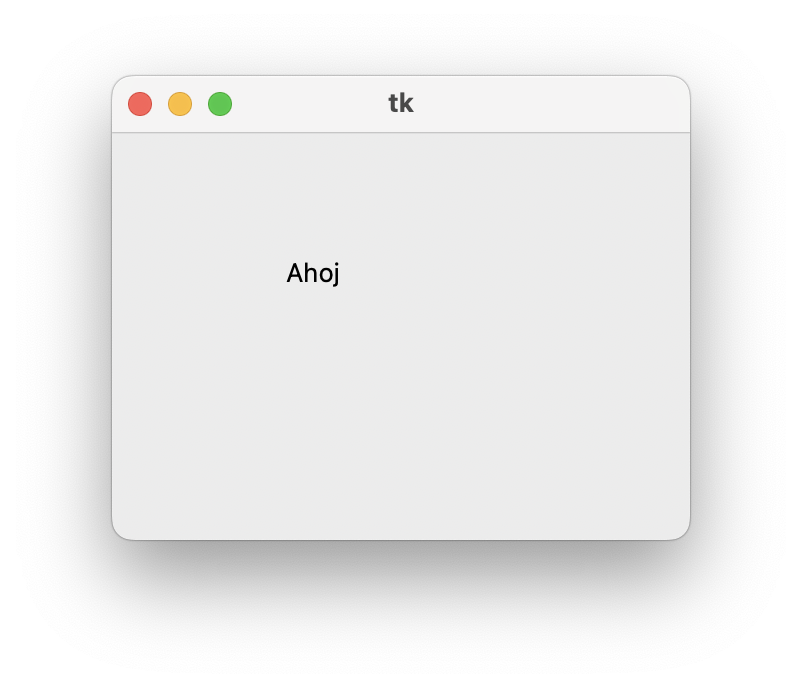


# 2. Typ písma a jeho velikost

V příkazu můžeme také pomocí parametru `font` určit typ, velikost a řez písma. Například `font='Arial 70 bold'`. Tímto způsobem můžeme zadávat pouze jednoslovné názvy písem. Víceslovný název se zadává složitějším způsobem. Nám postačí základní varianty, jako 

- název písma: `Arial`, `Times`, `Courier`, `Helvetica`,
- velikost: číslo v pixelech (např. `20`),
- styly: `bold`, `italic`, `underline`, `overstrike`. Styl může tvořit víc slov dohromady (oddělených mezerou). Pořadí stylů nehraje roli.

```py
canvas.create_text(100, 70, text='Ahoj')
canvas.create_text(100, 100, text='Světe', font='Arial 40 bold')
```

Program vypíše následující texty:


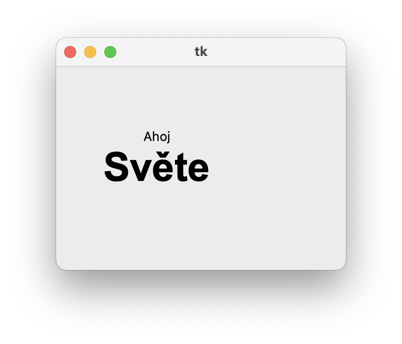


Existuje ještě alternativní zápis patrametrů textu:


Font zapisuje jako trojice:
```
font = (název_písma, velikost, styl)
```

Pokud ti stačí výchozí systémové písmo, můžeš název nechat prázdný řetězec. Styl se zadává jako "bold", "italic" nebo jejich kombinace (např. "bold italic"). Níže je několik příkladů:


```py
font = ("", 32)
font = ("", 32, "bold")
font = ("", 32, "bold italic")
```


# 3. Barva textu

Barvu výplně písma určíme parametrem `fill`, stejně jako v příkazech, které již známe:

```py
canvas.create_text(100, 70, text='Ahoj', fill='green')
canvas.create_text(100, 100, text='Světe', font='Arial 40 bold', fill='orange')
```


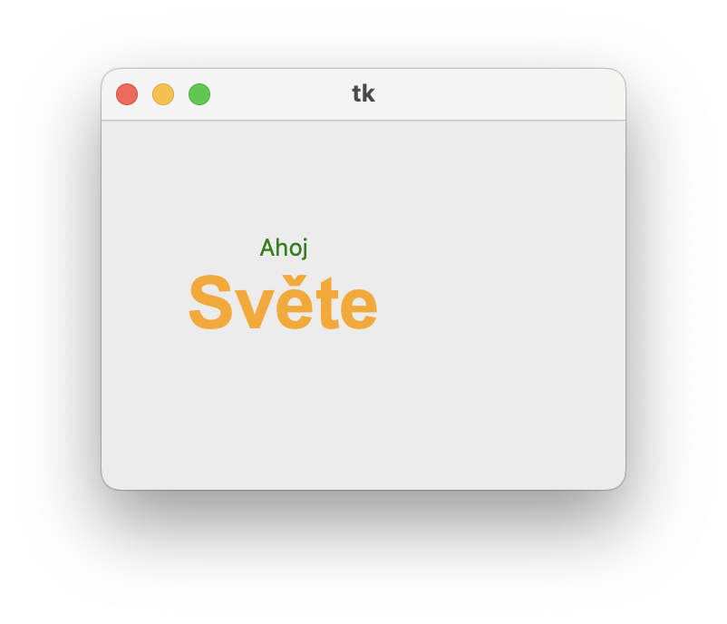


Snadno jde například vytvořit stínované písmo:

```py
canvas.create_text(122, 72, text='Ahoj Světe!', font='Arial 40 bold', fill='gray')
canvas.create_text(120, 70, text='Ahoj Světe!', font='Arial 40 bold', fill='gold')
```

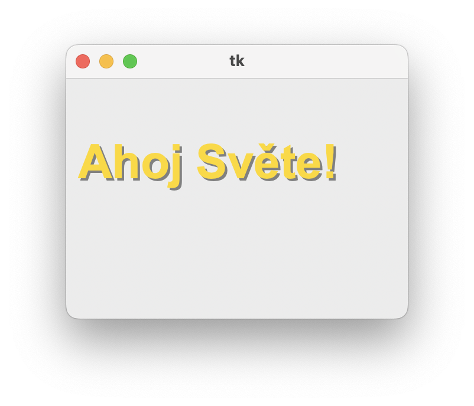


# 4. Rotace textu

Písmo můžeme také **otáčet** pomocí parametru `angle`:

```py
canvas.create_text(180, 100, text='Světe', font='Arial 70 bold', fill='orange', angle=90)
canvas.create_text(130, 90, text='Ahoj', fill='green', font='Arial 40 bold italic')
```


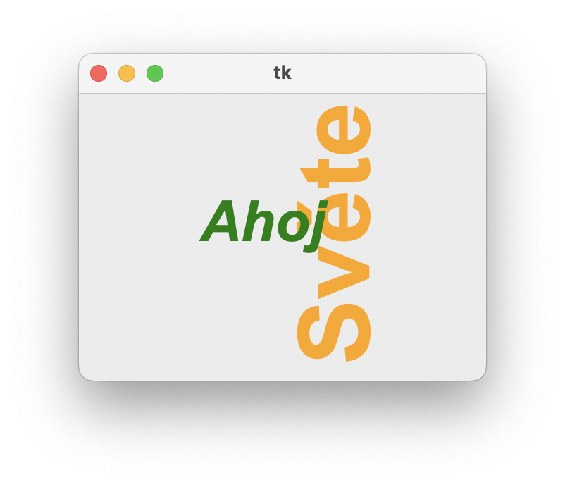

Nápis "Světe" jsme otočili o 90 stupňů. Nejprve se nakreslí tento nápis a poté se zeleně napíše "Ahoj". Když upravíte úhel, text se otočí kolem zadané souřadnice, což je přesný střed textu (fiktivně opsaný obdélník textu). Rotace určuje **úhel proti směru hodinových ručiček**. Úhel 180 stupňů obrátí text vzhůru nohama. Pokud chceme text otočit ve směru hodinových ručiček, můžeme použít záporný úhel.

# 5. Výrazy v příkazu

Příkaz `create_text` umí vypsat i čísla nebo hodnoty výrazů. Zjisti, co vypíšou následující příkazy: 

```py
canvas.create_text(100, 100, text=23+7)
canvas.create_text(100, 120, text="23+7")
```

# 6. 💾 Cvičení

Nakreslete tyto obrazce. Velikosti si zvolte podle vlastního uvážení. Snažte se co nejvíce přiblížit předloze:

## 6.1. Název ulice
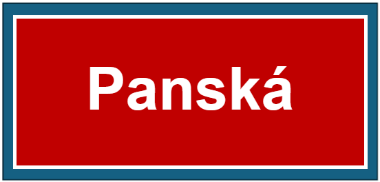

## 6.2. Pozor schod
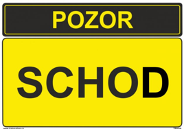

## 6.3. Nosnost
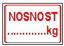

## 6.4. Omezená rychlost I
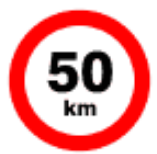

## 6.5. Nemocnice
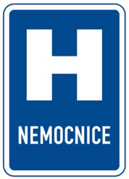

## 6.6. Konec obce
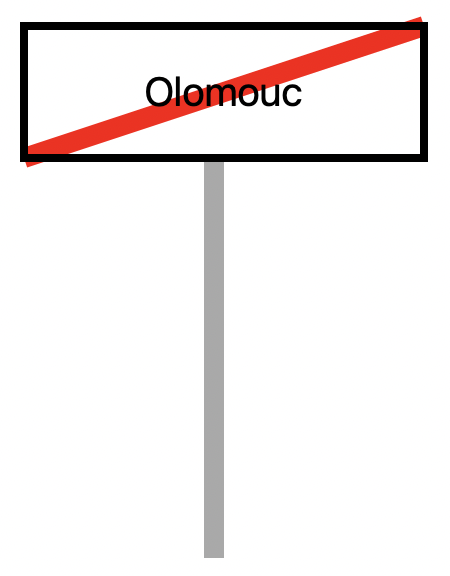


## 6.7. Omezená rychlost II
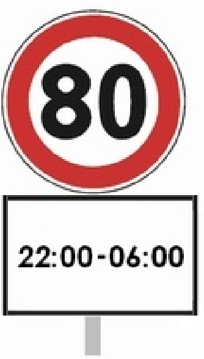

## 6.8. Rotovaný text
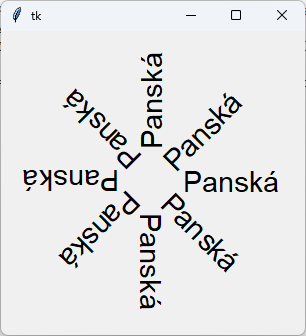

