# Lekce 8: Proměnné a náhodné hodnoty <!-- omit in toc -->


---

- [1. Náhodná čísla a příkazový režim](#1-náhodná-čísla-a-příkazový-režim)
- [2. Proměnné ](#2-proměnné)
  - [2.1. Matematické operace a práce s proměnnými](#21-matematické-operace-a-práce-s-proměnnými)
  - [2.2. Výpis obsahu proměnné](#22-výpis-obsahu-proměnné)
- [3. Náhodný výběr ze seznamu](#3-náhodný-výběr-ze-seznamu)
- [4. 💾 Cvičení](#4--cvičení)
  - [4.1. Čára 1](#41-čára-1)
  - [4.2. Čára 2](#42-čára-2)
- [5. Náhodné kreslení obrázků](#5-náhodné-kreslení-obrázků)
- [6. 💾 Cvičení](#6--cvičení)
  - [6.1. Dokončení robota](#61-dokončení-robota)
  - [6.2. Náhodné dopravní značky](#62-náhodné-dopravní-značky)
  - [6.3. Kružnice](#63-kružnice)
  - [6.4. Trasa v mapě](#64-trasa-v-mapě)
  - [6.5. Trojúhelník](#65-trojúhelník)
  - [6.6. Balíčky](#66-balíčky)
  - [6.7. Sportovní vlajka](#67-sportovní-vlajka)


---


# 1. Náhodná čísla a příkazový režim

Pro práci s náhodnými čísly potřebujeme použít modul `random`. Importujeme jej stejně jako modul `tkinter`, tedy na začátku programu. Nyní můžeme použít příkazy `random.randint()`, `random.randrange()` a další.

```py
# 08_1.py

import tkinter
import random

canvas = tkinter.Canvas()
canvas.pack()

canvas.create_text(100, 100, text=random.randint(10, 20))
canvas.create_text(150, 100, text=random.randint(5, 8))
```

Tento program vypíše dvě náhodná celá čísla. Jedno bude na souřadnici [100,&nbsp;100] a bude z intervalu <10,&nbsp;20>, druhé bude na souřadnici [150,&nbsp;100] a bude z intervalu <5,&nbsp;8>. 

---

**Otázky:**

1) Jaká čísla bude program zapisovat na souřadnici [150, 100]? 

2) Zjistěte, která čísla program vypíše na souřadnici [150, 100] nahrazením `random.randint(5,8)` za `random.randrange(5)`. 

3) Jaká čísla se vytisknou, pokud použijeme příkaz v příkazu: 
    - `random.randrange(2)`,
    - `random.randrange(1)`.

1) Jaký je rozdíl mezi `random.randrange(3,5)` a `random.randint(3,5)`?

---

Můžeme také **psát příkazy přímo v příkazovém režimu** (v okně prostředí Pythonu). Stačí napsat příkaz do příkazového řádku a po stisknutí klávesy <kbd>Enter</kbd> se zadaný příkaz okamžitě provede. Právě v příkazovém režimu můžeme otestovat, která náhodná čísla bude počítač "generovat". 


**TIP:** Pokud jsme nespustili žádný program, ve kterém importujeme modul na náhodná čísla, můžeme modul importovat i přímo z příkazové řádky. Tady je ukázka příkazů, které jsme zadali na příkazovém řádku: 

```py
>>> import random
>>> random.randint(10, 15)
11
>>>
```

Vyzkoušejte si, co tento program nakreslí: 

```py
# 08_2.py

import tkinter
import random

canvas = tkinter.Canvas()
canvas.pack()

canvas.create_line(0, 0, random.randrange(200), 100)
```

Abychom lépe viděli, kde jsou tyto čáry, které mají náhodné číslo v jedné ze souřadnic, nakresleny, můžeme také **zadávat příkazy přímo v  shellu**  (příkazový režim) i do běžícího programu (již existuje okno s grafickou plochou a importovaným modulem `random`). Jakmile je příkaz potvrzen, uvidíme, co se stane v grafické ploše. 

```py
>>> canvas.create_line(0, 0, random.randrange(200), 100)
>>> canvas.create_line(0, 0, random.randrange(200), 100)
>>> canvas.create_line(0, 0, random.randrange(200), 100)
```
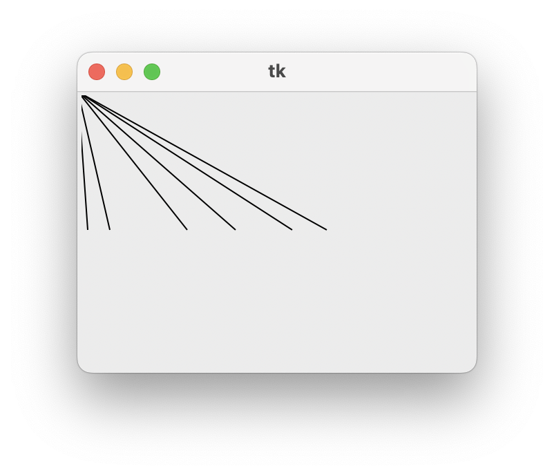

---

**Úkol:**

Nakreslete šest náhodných čísel od 1 do 49 vedle sebe v grafické ploše. Myslíte si, že takový program můžeme použít k losování čísel v loterii? Svou odpověď zdůvodněte. 

---

# 2. Proměnné 

**Konvence názvů proměnných v Pythonu:**

* Používáme **české názvy**, protože programy jsou určeny pro české prostředí.
* Název píšeme **malými písmeny**.
* Víceslovný název oddělujeme **podtržítkem `_`**.
* Název by měl stručně a srozumitelně popisovat, **co proměnná obsahuje**.

**Příklady:**

```python
jmeno = 'Petr'
vek = 17
prumerna_rychlost = 25
pocet_bodu = 10
```

**Pravidla a doporučení:**

* Volíme **srozumitelné a jednoznačné názvy**.
* Nepoužíváme zbytečně dlouhé názvy.
* Pro stejný význam používáme v různých programech **stejný název**.
* U počtů je vhodné použít například `pocet_studentu`, u částek `cena`, u textu `jmeno` apod.
* Nepoužíváme rozdílné názvy jen kvůli tomu, abychom „vymysleli něco jiného“.

**Omezení názvů proměnných:**

* **nesmí začínat číslicí**,
* může obsahovat **písmena, číslice a podtržítko `_`**,
* **nesmí obsahovat mezery**,
* nesmí být shodný s **klíčovým slovem Pythonu** (`if`, `for`, `while`, `class`, `import`…).

Například:

```python
jmeno = 'Petr'         # správně
pocet_studentu = 20    # správně

pocet studentu = 20    # ŠPATNĚ – mezera
2studenti = 20         # ŠPATNĚ – začíná číslicí
for = 10               # ŠPATNĚ – klíčové slovo
```

**Jednoduché pravidlo:** Malá písmena, více slov spojit podtržítkem, krátký a srozumitelný název.

---

Tento program nám nakreslí náhodný obdélník, který má levý horní bod na souřadnici [50, 100]. 

```py
# 08_3.py

import tkinter
import random

canvas = tkinter.Canvas()
canvas.pack()

canvas.create_rectangle(50, 100, 50+random.randint(30, 100), 100+random.randint(30, 100))
```

Jak bychom zajistili, že na souřadnici [50, 100] bude nakreslen náhodný čtverec? Co musí obdélník splňovat, aby byl čtvercem? Musí mít stejnou šířku a výšku. Metoda `random.randint()` však  nakreslí náhodnou hodnotu pokaždé, když ji použijete. Někdy se nám může stát, že hodnota bude stejná a bude to čtverec, ale často kreslí jiná čísla. Stačí si nakreslit číslo jednou, zapamatovat si ho a pak ho použít na místech, kde ho používáme. Můžeme si zapamatovat data v proměnné.

V programu vytvoříme proměnnou `velikost`, nakreslíme náhodné číslo a zapamatujeme si ho v této proměnné a tuto zapamatovanou hodnotu pak použijeme na místech, kde ji potřebujeme. 

```py
# 08_4.py

import tkinter
import random

canvas = tkinter.Canvas()
canvas.pack()

velikost = random.randint(30, 100)
canvas.create_rectangle(50, 100, 50+velikost, 100+velikost)
```

Můžeme si také zapamatovat souřadnice, na které kreslíme čtverec v proměnné, a pak při kreslení používat pouze proměnné.

```py
x = 50
y = 100
velikost = random.randint(30, 100)
canvas.create_rectangle(x, y, x+velikost, y+velikost)
```

Pokud k proměnným `x` a `y` přičteme tah náhodného čísla, nakreslíme náhodný čtverec na náhodném místě.

```py
x = random.randrange(200)
y = random.randrange(200)
velikost = random.randint(30, 100)
canvas.create_rectangle(x, y, x+velikost, y+velikost)
```
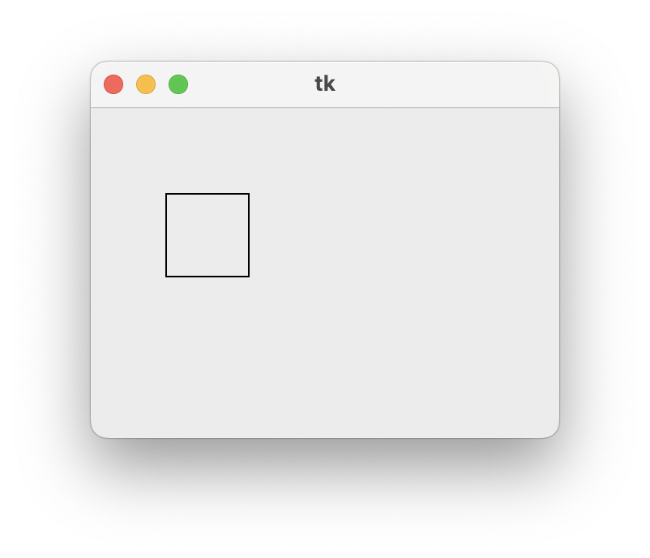 

Pokud jsme již program spustili a do příkazového řádku napíšeme název proměnné a stiskneme <kbd>Enter</kbd>, Python nám zapíše aktuální hodnotu proměnné.

```py
>>> x
61
>>> y
186
>>> velikost
42
```

V příkazové řádce můžeme také nastavit hodnoty proměnných.

```py
>>> velikost = 100
>>> canvas.create_rectangle(x, y, x+velikost, y+velikost)
2
>>>
```

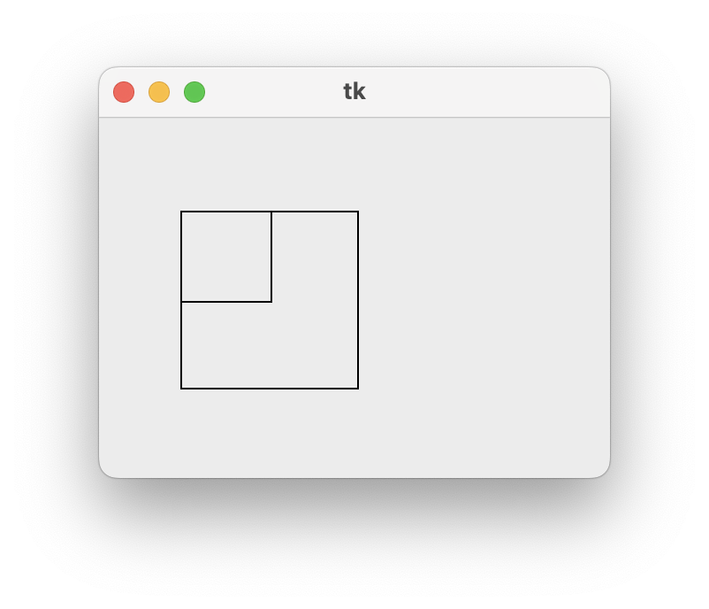 

## 2.1. Matematické operace a práce s proměnnými

S proměnnými můžeme provádět matematické operace. Mezi základní patří sčítání (`+`), odčítání (`-`), násobení (`*`) a dělení (`/`) a umocňování (`**`). Python umí mnohem víc operací, ale tyto nám pro začátek stačí.

```py
>>> a = 5
>>> b = 10
>>> c = a + b
>>> c
15
>>> d = c - 2 * a
>>> d
5
>>> d / 2
2.5
>>> 2 ** 3
8
>>> 81 ** (1/2)
9.0
```

Python samozřejmě **respektuje prioritu operací** jako v matematice.

Operace dělení zobrazí automaticky výsledek  jako desetinné číslo. Python, stejně jako všechny programovací jazyky používají **desetinnou tečku** nikoliv čárku, jako např. v Excelu.  

A můžeme také provést výpočet se samotnou proměnnou a výsledek si zapamatovat do stejné proměnné, tedy změnit její hodnotu podle výpočtu.

```py
>>> a = 5
>>> a = a + 1
>>> a
6
>>>
```

## 2.2. Výpis obsahu proměnné

V samotném programu (programovém režimu) nestačí napsat pouze název proměnné. Jakmile program spustí, Python nebude vědět, co má s proměnnou dělat. Na rozdíl od příkazového režimu musíme použít příkaz `print()` k zapsání nějaké hodnoty do okna  shellu. Například: `print(a)` vypíše hodnotu proměnné `a`. Pomocí příkazu `print()` můžete také vypsat různé výpočty, např. `print(a*3+5)`, `print(6+2*4)` nebo dokonce text (podobný `create_text`) `print('Ahoj')`. 

```py
x = random.randrange(200)
y = random.randrange(200)
velikost = random.randint(30, 100)
canvas.create_rectangle(x, y, x+velikost, y+velikost)

print(x, y, velikost)
```


# 3. Náhodný výběr ze seznamu

Pomocí `random.choice()` můžeme vybrat **náhodný prvek ze seznamu hodnot**. Tento příkaz můžeme použít k nakreslení náhodné barvy z uvedených barev. Obdélník z předchozího příkladu vyplníme nakreslenou barvou. Náhodně zvolenou barvu uložíme do proměnné `barva`. Zde je výsledný program:

```py
# 08_5.py

import tkinter
import random

canvas = tkinter.Canvas()
canvas.pack()

x = random.randrange(200)
y = random.randrange(200)
velikost = random.randint(30, 100)
barva = random.choice(['red', 'yellow', 'lime'])
canvas.create_rectangle(x, y, x+velikost, y+velikost, fill=barva)

print(x, y, velikost, barva)
```

Vysvětlení `random.choice(['red', 'yellow', 'lime'])`:


* `['red', 'yellow', 'lime']` je **seznam** – tedy kolekce několika hodnot (zde tři barvy). Hodnoty jsou oddělené čárkami a uzavřené do hranatých závorek.
* `random.choice(...)` znamená „**vyber jednu náhodnou položku** z toho seznamu“.

Výsledkem bude vždy právě jedna z těchto tří barev – buď `'red'`, `'yellow'` nebo `'lime'`.


# 4. 💾 Cvičení


## 4.1. Čára 1

Vytvořte program, který nakreslí náhodnou čáru náhodné tloušťky. Pomocí příkazu `print()` vypište do shellu také informaci o tloušťce čáry. Například:

```py
print("Tloušťka čáry je", d)
```

## 4.2. Čára 2

Vytvořte program, který nakreslí **vodorovnou** čáru o délce 50 bodů na náhodném místě. Pomocí příkazu `print()` vypište do shellu také informace o místě (`x1` a `x2`). Například:

```py
print("x1 =", x1)
print("x2 =", x2)
```


# 5. Náhodné kreslení obrázků

Doposud jsme kreslili obrázky na pevném místě plochy. Všechny zadané souřadnice byla konkrétní čísla. Můžeme kreslit jednoduché tvary na náhodném místě. Na náhodném místě můžeme nakreslit i složitější obrázky, pokud se zamyslíme nad  **relativními souřadnicemi bodů**. To znamená, že  **určíme jeden z bodů jako základní**  na obrázku a  **všechny ostatní souřadnice určíme relativně od tohoto referenčního bodu**. To, zda je další bod nalevo nebo napravo od tohoto bodu, označuje, zda je souřadnice `x` menší nebo větší. To znamená, zda něco odečteme od souřadnice referenčního bodu nebo k němu něco přidáme. A tak je to i na souřadnici `y`. 

Do programu můžeme také psát různé poznámky, kterých si Python nevšimne. Takovým textovým poznámkám říkáme **komentáře**. Komentář vždy začíná znakem `#` a končí na konci řádku.

💡 Někdy, když hledáme chybu, potřebujeme, aby program neprováděl některé řádky. Pak můžeme také použít `#` na začátku těchto řádků. Pokud je řádků více, vybereme je a v menu vybereme **Format** → **Comment Out Region**, který k řádkům přidá&nbsp;`#`. 

```py
# 08_6.py

import tkinter
canvas = tkinter.Canvas(width=640, height=320)
canvas.pack()

canvas.create_rectangle(100, 100, 160, 200, fill='skyblue') #telo
canvas.create_rectangle(110, 50, 150, 100, fill='skyblue') #hlava

#oci
canvas.create_rectangle(115, 60, 125, 70, fill='yellow')
canvas.create_rectangle(135, 60, 145, 70, fill='yellow')

#usta
canvas.create_rectangle(115, 80, 145, 90, fill='red')

#nohy
canvas.create_rectangle(100, 200, 120, 280, fill='skyblue')
canvas.create_rectangle(140, 200, 160, 280, fill='skyblue')

#ruce
canvas.create_line(100,110,60,150, width=15)
canvas.create_line(160,110,210,150, width=15)
```

Tento program nakreslí tohoto robota.

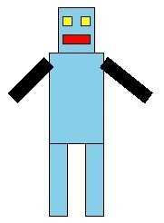

Pokud bychom chtěli nakreslit stejného robota na různých místech, **definujeme jeden bod jako základní**. Například můžeme určit jako referenční bod levý horní bod těla obdélníku, obecně jej označit jako bod se souřadnicemi `[x, y]` a všechny ostatní body budou mít souřadnici podle toho, **jak daleko jsou od tohoto bodu** (relativní vzdálenost). Na obrázku vidíme vyznačený vztažný bod a velikosti jednotlivých částí obrázku.

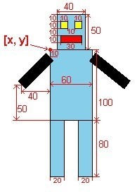 

Obdélník trupu robota lze určit pomocí základního bodu a pravého dolního bodu obdélníku trupu. Tento bod je 60 bodů dolů na ose  `x`  (protože obdélník je široký 60 bodů) a na ose  `y`  100 bodů dolů (protože má zadanou výšku 100 bodů). Vzhledem k tomu, že referenční bod má obecnou souřadnici `[x, y]`, pravý dolní roh trupu bude mít souřadnici `[x+60, y+100]`. Nakreslíme tedy trup příkazem

```py
canvas.create_rectangle(x, y, x+60, y+100)
```

Můžeme nakreslit obdélník hlavy pomocí levého horního bodu hlavy a pravého dolního bodu hlavy. Levý horní bod hlavy je 10 bodů vpravo na souřadnici  `x`  a 50 bodů nahoru od základního bodu na souřadnici  `y`. Je tedy na souřadnici  `[x+10, y-50]`. Pravý dolní bod hlavy je 50 bodů vpravo na ose  `x`  a má stejnou souřadnici  `y`  jako referenční bod, takže jeho souřadnice jsou  `[x+50, y]`  a hlavu nakreslíme příkazem

```py
canvas.create_rectangle(x+10, y-50, x+50, y)
```

Celý program, který kreslí tohoto robota na relativním místě, lze zapsat takto:

```py
# 08_7.py

import tkinter
canvas = tkinter.Canvas(width=600, height=600)
canvas.pack()

x = 100
y = 100

#telo
canvas.create_rectangle(x, y, x+60, y+100, fill='skyblue') #telo
canvas.create_rectangle(x+10, y-50, x+50, y, fill='skyblue') #hlava

#oci
canvas.create_rectangle(x+15, y-40, x+25, y-30, fill='yellow')
canvas.create_rectangle(x+35, y-40, x+45, y-30, fill='yellow')

#usta
canvas.create_rectangle(x+15, y-20, x+45, y-10, fill='red')

#nohy
canvas.create_rectangle(x, y+100, x+20, y+180, fill='skyblue')
canvas.create_rectangle(x+40, y+100, x+60, y+180, fill='skyblue')

#ruce
canvas.create_line(x, y+10, x-40, y+50, width=15)
canvas.create_line(x+60, y+10, x+110, y+50, width=15)
```

Pokud nastavíme hodnotu proměnných `x` a `y` na náhodnou hodnotu, robot bude vykreslen na náhodném místě.

---

V zásadě existují dva způsoby, jak dopočítat souřadnice objektu z **výchozího bodu** `x` a `y`:

- **(A)** Z levého horního rohu objektu (nebo zrcadlově z pravého dolního rohu): 

  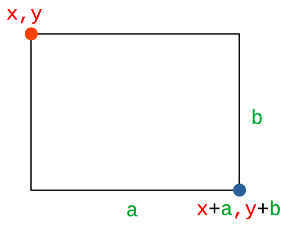


- **(B)** Ze středu objektu:

  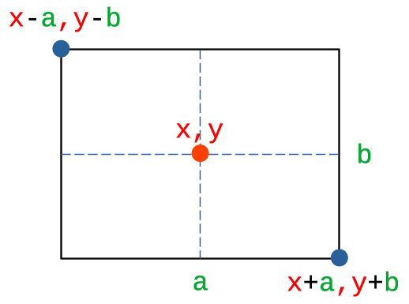

U čtverce a kružnice platí, že `a = b`.


# 6. 💾 Cvičení

## 6.1. Dokončení robota
Dokončete robota tak, aby měl anténu na hlavě (svislá čára 20 bodů) a na trupu své jméno (např. R.U.R., Karel...)

## 6.2. Náhodné dopravní značky

Nakreslete tuto značku na ploše tak, aby byl rychlostní limit náhodný: 30, 40, 60 nebo 80.

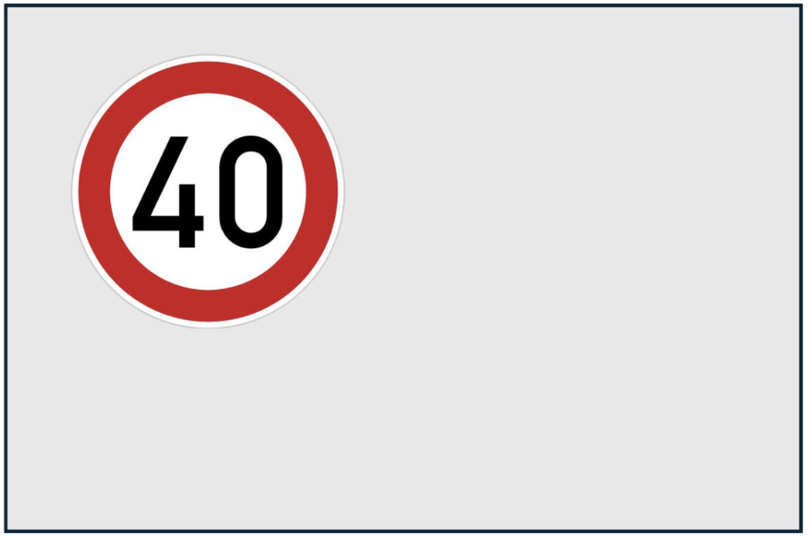


## 6.3. Kružnice

Vytvořte program `prijmeni-kruznice.py`, který na **náhodném místě** na ploše nakreslí znak **+**, který bude tvořit střed kružnice. Okolo tohoto středu nakreslete kružnici náhodné velikosti. Čarou vyznačte poloměr a pod ní uprostřed její poloměr číslem. Do terminálu vypište její poloměr, obvod a obsah. Příklad:  

```
r = 63
O = 395.64
S = 12462.66
```

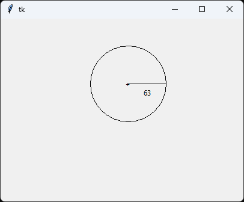


## 6.4. Trasa v mapě
Vytvořte program, který na náhodných místech nakreslí dva znaky **+**. Pod každým znakem budou jejich souřadnice vedle sebe. Mezi znaky **+** bude čára. Do okna se vypíše také informace o vzdálenosti v&nbsp;kilometrech mezi body. Bude se hodit funkce `abs()`, v&nbsp;matematice známá jako `|x|`. 

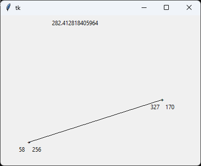


## 6.5. Trojúhelník

Napište program `prijmeni-trojuhelnik.py`, který z výchozího bodu `[50, 250]` nakreslí svislou čáru směrem nahoru náhodné délky. Ze stejného výchozího bodu nakreslí vodorovnou čáru náhodné délky směrem doprava. Konce obou čar spojí čarou, která bude představovat přeponou trojúhelníku. Do terminálu (shellu) se vypíšou délky obou stran a také plošný obsah trojúhelníku.

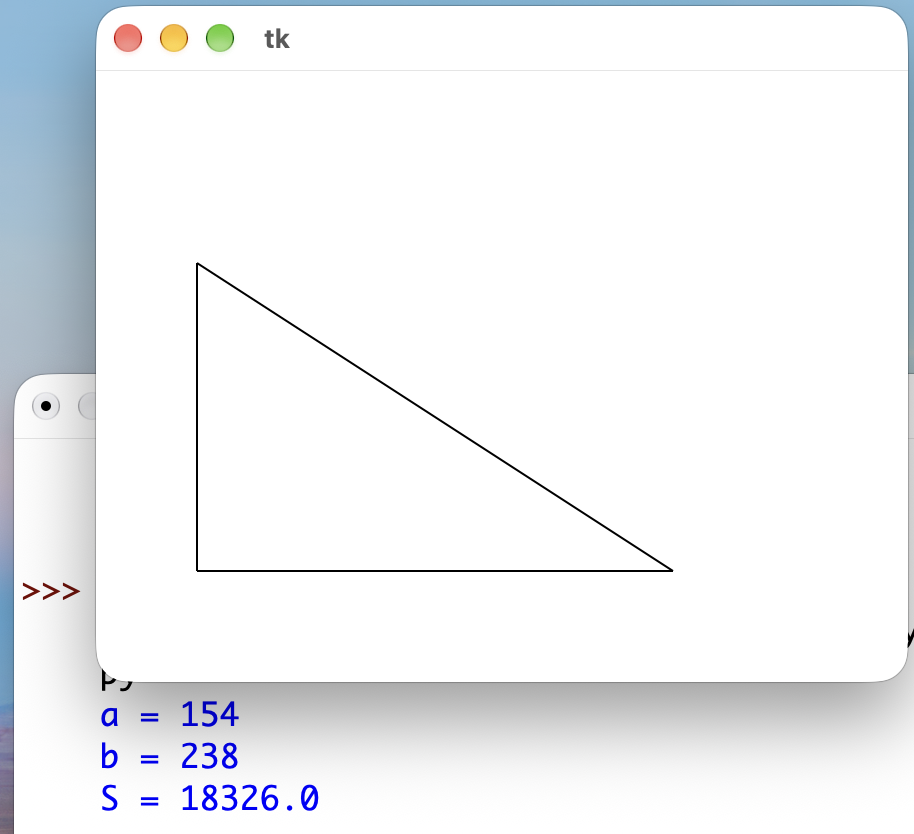

## 6.6. Balíčky

Na stole stojí těsně vedle sebe tři balíčky obdélníkových tvarů různých barev. Šířka každého z nich je 100, výška každého je náhodná od 10 do 200. Napište program prijmeni-balicky.py, který je nakreslí.

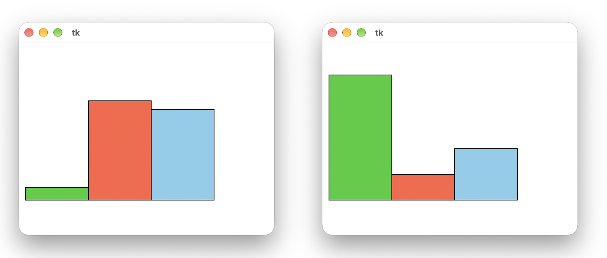


## 6.7. Sportovní vlajka

Vytvořte nový program, který bude kreslit vlajku sportovního klubu. Vlajka bude tvořena čtyřmi barevnými obdélníky, které se vzájemně dotýkají v jediném bodě jako na obrázku. Program si náhodně zvolí souřadnice `x` a `y`, které představují místo dotyku všech čtyř obdélníků. Vnější rozměry vlajky budou 200&times;150; barvy na vlajce si urči podle svého uvážení.

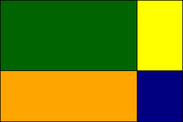


