# Lekce 9: Opakování části programu (cyklus) <!-- omit in toc -->


---
- [1. Opakujeme provádění příkazů](#1-opakujeme-provádění-příkazů)
  - [1.1. ❓ Otázky](#11--otázky)
- [2. For cyklem kreslíme obrázky s pravidelností](#2-for-cyklem-kreslíme-obrázky-s-pravidelností)
- [3. Zpomalení výpisu a aktualizace obsahu okna](#3-zpomalení-výpisu-a-aktualizace-obsahu-okna)
- [4. 💾 Cvičení](#4--cvičení)
  - [4.1. Úprava kódu](#41-úprava-kódu)
  - [4.2. Co dělá](#42-co-dělá)
  - [4.3. Svislé čáry](#43-svislé-čáry)
  - [4.4. Schody](#44-schody)
  - [4.5. Sudá a lichá čísla](#45-sudá-a-lichá-čísla)
  - [4.6. Posloupnosti](#46-posloupnosti)
  - [4.7. Dokončení obrazce](#47-dokončení-obrazce)
  - [4.8. Křížky cyklem](#48-křížky-cyklem)
  - [4.9. Zlatý poklad](#49-zlatý-poklad)
  - [4.10. Mozaika](#410-mozaika)


---

# 1. Opakujeme provádění příkazů

```py
# 09_1.py

import tkinter
from random import *

canvas = tkinter.Canvas()
canvas.pack()

n = 200

canvas.create_text(randrange(n), randrange(n), text='1')
canvas.create_text(randrange(n), randrange(n), text='2')
canvas.create_text(randrange(n), randrange(n), text='3')
canvas.create_text(randrange(n), randrange(n), text='4')
canvas.create_text(randrange(n), randrange(n), text='5')
```

📌 Všimněte si dalšího způsobu importu knihovny `random`. Když importujeme modul zápisem `from random import *`, nemusíme zapisovat název knihovny `random.randrange(n)`, ale zapíšeme pouze `randrange(n)`. Tento zápis znamená: „_importujte vše z modulu random_“.


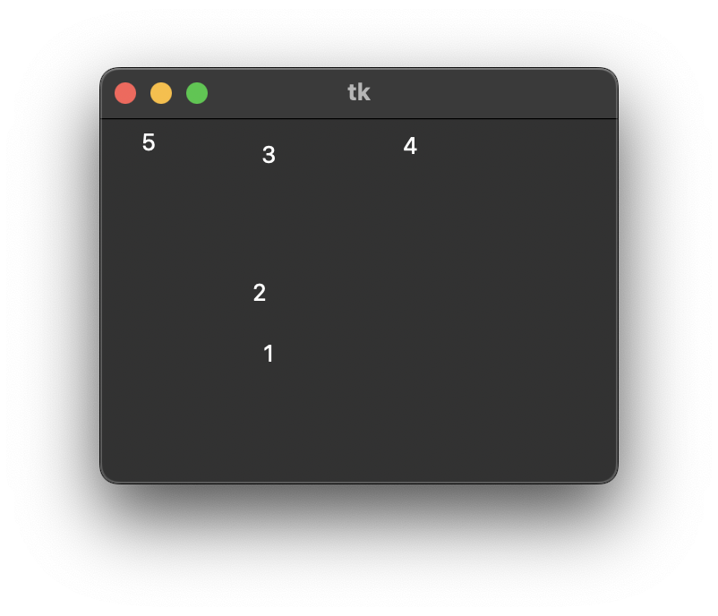

Tento program postupně vypíše čísla 1, 2, 3, 4 a 5 na náhodném místě grafické plochy. Pokud bychom chtěli zapisovat čísla do 10, stačí příkaz k zápisu textu několikrát zkopírovat a postupně měnit zadaná čísla na 6, 7, 8, 9 a 10. Představme si, že bychom tímto způsobem chtěli zapsat až 50 čísel, to by už byl náš program velmi dlouhý a neustále bychom kopírovali příkazy. Existuje i jednodušší řešení. Chceme-li příkaz nebo sekvenci příkazů opakovat několikrát, můžeme použít `for` cyklus. Program píšeme takto:

```py
# 09_2.py

import tkinter
from random import *

canvas = tkinter.Canvas()
canvas.pack()

n = 200

for i in range(1,6):
    canvas.create_text(randrange(n), randrange(n), text = '1')
```

Nyní program zopakuje příkaz `create_text` pětkrát a zatím pokaždé zapíše 1. Zápisem `for i in range(1, 6):` jsme definovali, že další část programu se bude opakovat a postupně si budeme pamatovat  čísla v závorkách v proměnné `i`, tj. 1 až 5. I když je tam zapsáno 1 až 6, pro hodnotu 6 se tělo cyklu nebude opakovat. Takto bude vypadat naše okno: 

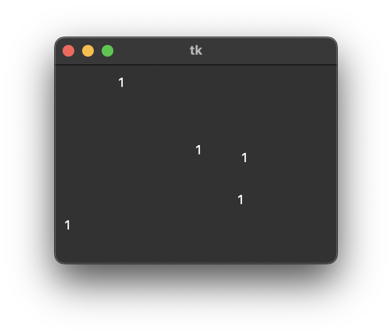 

Pokud zápis `text = '1'` nahradíme zápisem `text = i`, místo čísla 1 vypíšeme hodnotu v proměnné `i`, tedy postupně čísla 1 až 5.  

```py
for i in range(1,6):
    canvas.create_text(randrange(n), randrange(n), text=i)
```

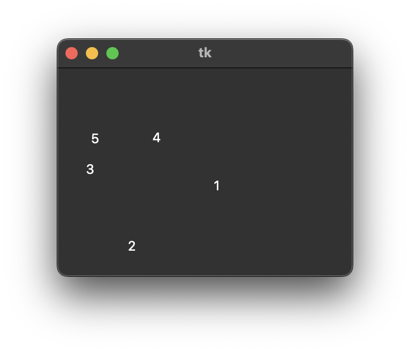 


## 1.1. ❓ Otázky


1. Co bude dělat program, když  `text=i`  změníme na  `text='1'`?

2. Upravte program tak, aby vypisoval:
	- čísla od 15 do 19 včetně,
	- čtyři čísla od čísla 23.

3. Zjistěte, která čísla vypíše program, když mu zadáte rozsah:

   - `range(50, 60)`,
   - `range(15, 16)`,
   - `range(10, 10)`,
   - `range(15, 10)`,
   - `range(5)`,
   - `range(3)`,
   - `range(-10, -5)`,
   - `range(-10, 3)`.

4. Co bude dělat tento program:
	```py
	for i in range(20,25):
	    print(i*10)
	```

---

Porovnejte následující dva programy:

```py
for  i in range(10,16):
    x = randint(0, 300)
    y = randint(0, 300)
    canvas.create_rectangle(x-10, y-10, x+10, y+10)
    canvas.create_text(x, y, text=i)
```
```py
for i in range(10,16):
    x = randint(0, 300)
    y = randint(0, 300)
    canvas.create_rectangle(x-10, y-10, x+10, y+10)
canvas.create_text(x, y, text=i)
```

Při psaní cyklu `for` si musíme dát velký pozor na **odsazení začátku řádku** - mezeru na začátku. Ve smyčce `for` se opakují pouze příkazy, které jsou odsazeny stejným způsobem. Pokud má některý řádek méně mezer nebo text začíná hned na začátku řádku, program již tento příkaz umístí mimo smyčku, a proto se nebude opakovat. Druhý program už za nás poslední řádek neopakuje. Počítač rozumí zápisu tak, že tento řádek je již mimo smyčku. Proto nakreslí pět čtverečků, ukončí smyčku a teprve poté jednou provede příkaz `create_text` a vypíše aktuální hodnotu proměnné `i`, číslo 15.


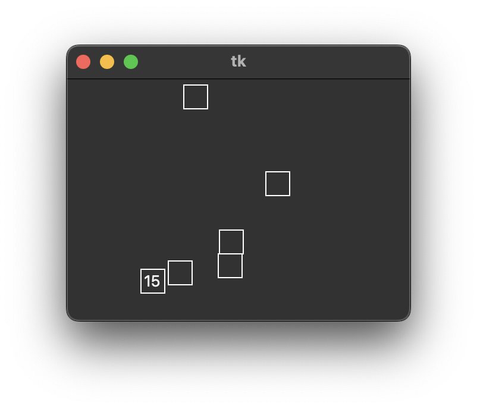

# 2. For cyklem kreslíme obrázky s pravidelností

Zjistěte, co nakreslí tento program:

```py
# 09_3.py
import tkinter

canvas = tkinter.Canvas()
canvas.pack()

y = 0
for i in range(1,6):
    y = y + 10
    canvas.create_line(10, y, 200, y)
```

Před smyčkou nastavíme proměnnou `y` na nulu. Pak se smyčka bude opakovat postupně pro `i` s hodnotami 1, 2, 3, 4 a 5. Program pokaždé zvýší hodnotu proměnné `y` o deset, takže `y` bude mít postupně hodnoty 10, 20, 30, 40, 50 a pro tyto hodnoty bude pokaždé nakreslena vodorovná čára. Tato přímka má stejnou souřadnici `y` jako hodnota proměnné `y` a přímka začíná na souřadnici `x` 10 a končí na souřadnici `x` 200. V tomto případě se bude jednat o přímku, která bude mít stejnou souřadnici `y` jako hodnota proměnné `y`. Budeme-li postupně dosazovat hodnoty, které budou proměnné nabývat, budeme skutečně kreslit přímky s těmito hodnotami souřadnic.

```py
canvas.create_line(10, 10, 200, 10)
canvas.create_line(10, 20, 200, 20)
canvas.create_line(10, 30, 200, 30)
canvas.create_line(10, 40, 200, 40)
canvas.create_line(10, 50, 200, 50)
```

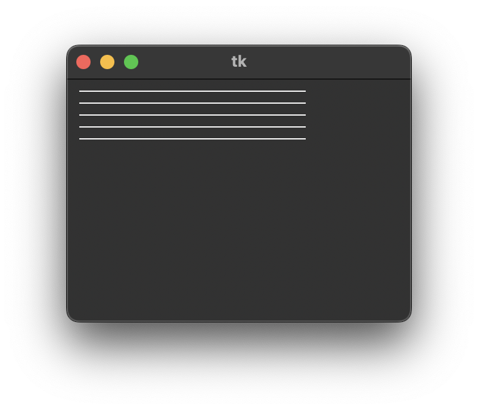

Stejného efektu - vykreslení stejného výsledku - dosáhneme následujícími dvěma zápisy. Zamyslete se a zdůvodněte, proč i tyto programy vykreslují totéž.

```py
for i in range(1,6):
    canvas.create_line(10, i*10, 200, i*10)
```
```py
for i in range(10,60,10):
    canvas.create_line(10, i, 200, i)
```

V tomto programu jsme použili tři čísla v zápisu rozsahu. Třetí číslo slouží k určení kroku, o který se má změnit hodnota proměnné `i`. Pokud jej nezadáme jako dříve, krok se automaticky nastaví na hodnotu&nbsp;1.

# 3. Zpomalení výpisu a aktualizace obsahu okna

Smyčka `for` opakuje příkazy velmi rychle, takže výsledek vidíme hned. Pokud bychom chtěli vykreslování zpomalit, můžeme v cyklu použít příkaz `canvas.after(1000)`. Tento příkaz zpozdí provádění programu o dobu uvedenou v závorce. Čas zadáváme v milisekundách, takže `canvas.after(1000)` počká 1 sekundu. 

Kromě tohoto příkazu musíme použít příkaz `canvas.update()`, abychom zajistili aktualizaci grafického plátna i mezi jednotlivými čekáními. Kdybychom jej nepoužili, program by běžel pomaleji (s čekáním) a grafické plátno by se překreslovalo až po ukončení cyklu `for`. Hotový program zapíšeme následovně:

```py
# 09_4.py
import tkinter

canvas = tkinter.Canvas()
canvas.pack()

for i in range(1,6):
    canvas.create_line(10, i*10, 200, i*10)
    canvas.update()
    canvas.after(1000)
```

Do programu přidáme příkaz `print()`, abychom v příkazovém režimu (v okně shellu) viděli jednotlivé hodnoty `y`-ových  souřadnic řádků.

```py
for i in range(1,6):
    print(i*10)
    canvas.create_line(10, i*10, 200, i*10)
    canvas.update()
    canvas.after(1000)
```

# 4. 💾 Cvičení

## 4.1. Úprava kódu
Pokuste se vymyslet jiný zápis programu, který kreslí stejný obrázek jako tento program:

```py
x = 0
for i in range(1, 11):
    x = x + 20
    canvas.create_rectangle(x, 10, x + 15, 20)
```

## 4.2. Co dělá
Zkuste uhodnout, co nakreslí následující program:

```py
x = 0
for i in range(1, 11):
    x = x + 20
    canvas.create_rectangle(x, 10, x + 15, 20)
```

Experimentujte s čísly v předchozím programu, abyste zjistili, jak změní nakreslený obrázek. Své postřehy zdůvodněte:

1. Co se stane, když do řádku  `x = 0`  zadáme jiné číslo?
2. Co se stane, když do řádku  `x = x + 20`  zadáme místo 20 jiné číslo?
3. Co se stane, když v příkazu  `create_rectangle`  změníme číslo 15 na jiné?


Experimentujte s původním programem a zkuste nakreslit tyto obrazce:

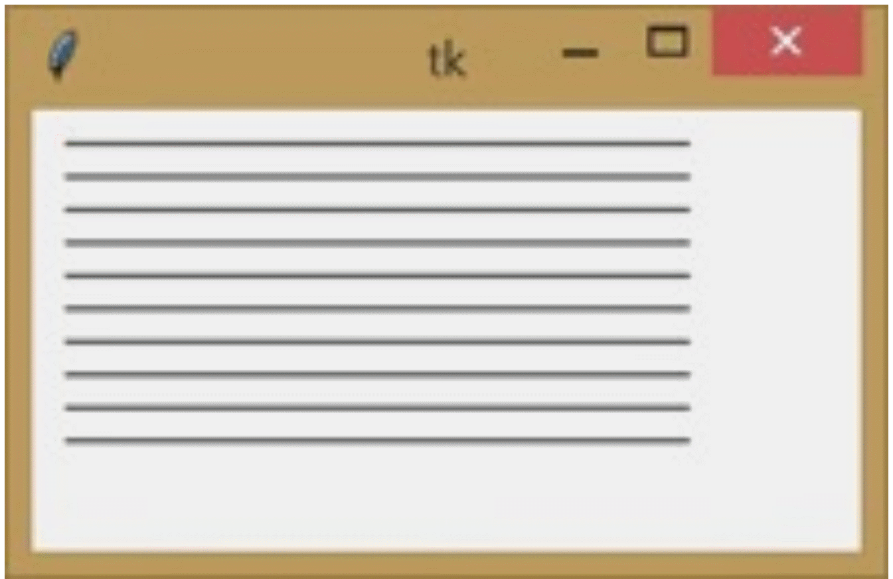
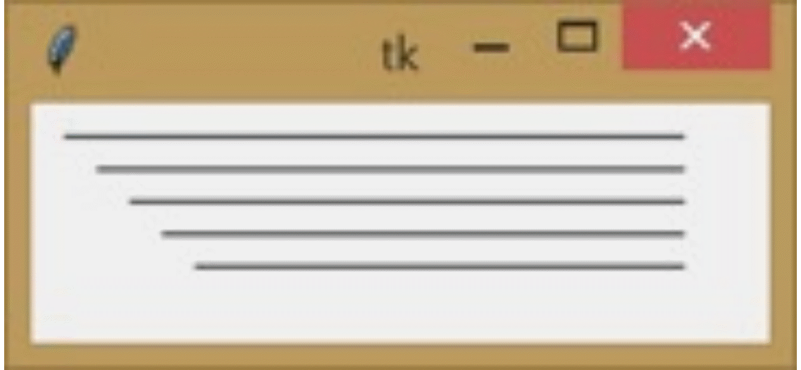
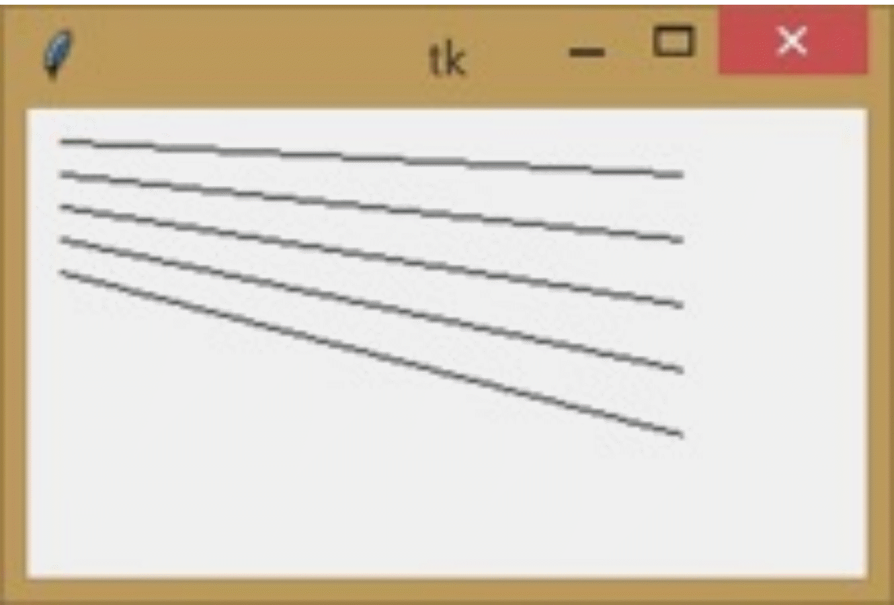


## 4.3. Svislé čáry
Cyklem  `for`  nakreslete tyto obrazce:

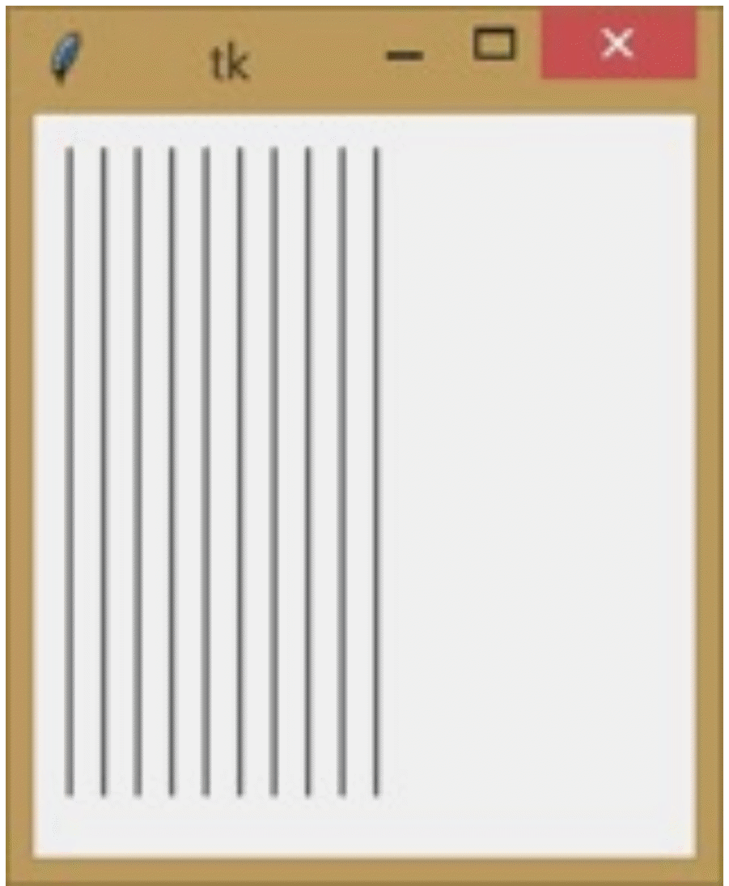
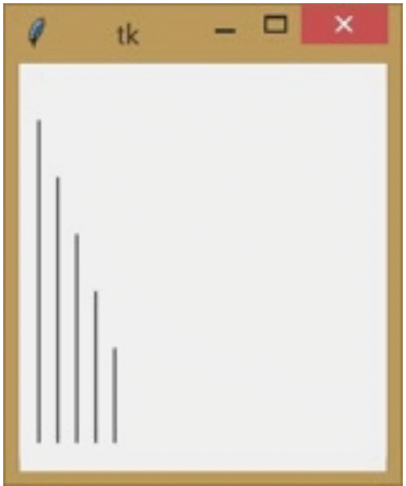
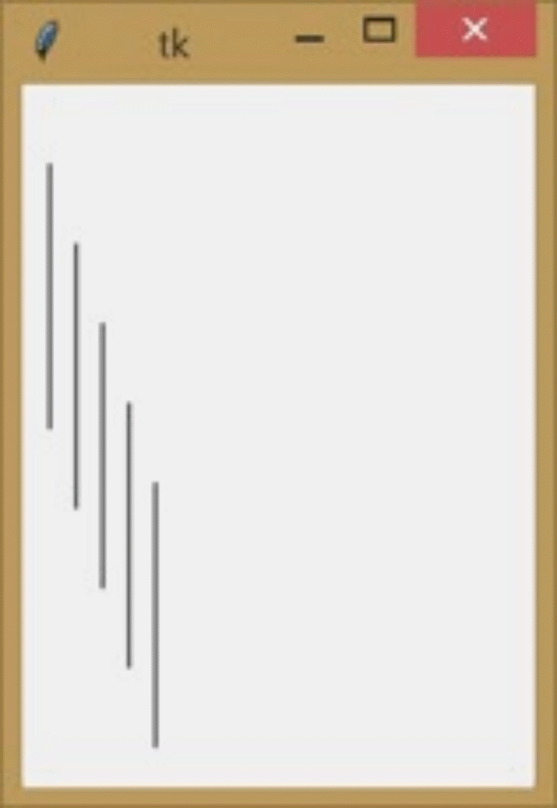


## 4.4. Schody
Pomocí cyklu  `for`  nakreslete schody:

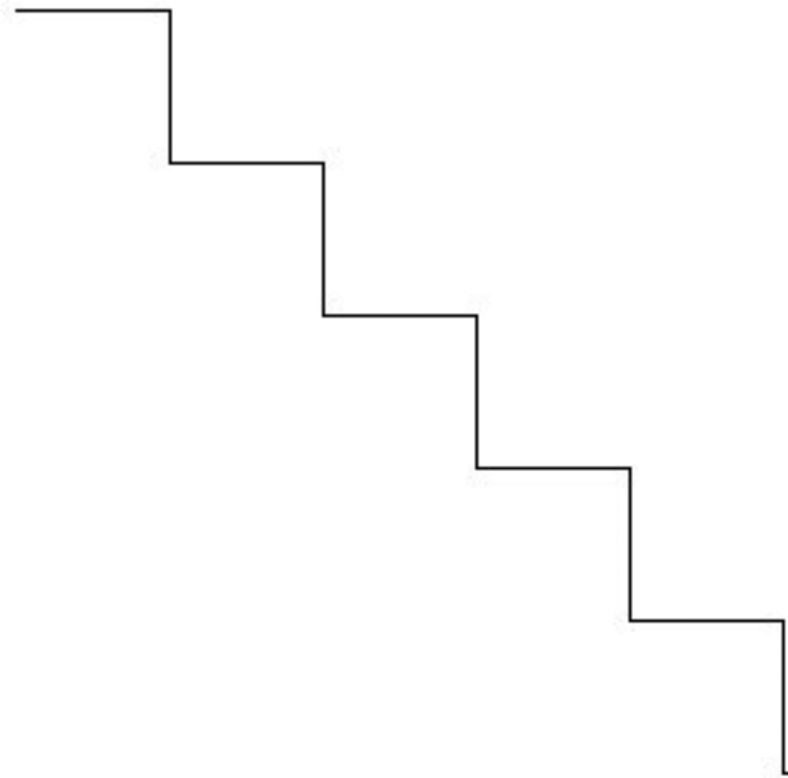


## 4.5. Sudá a lichá čísla
Pomocí cyklu `for` vypište do okna shellu:
1. všechna sudá čísla od 20 do 40,
2. všechna lichá čísla od 20 do 40.

## 4.6. Posloupnosti
Pomocí cyklu `for` vypište do okna shellu:
1. `1, 2, 4, 8, 16, 32, 64, 128, 256, 512`
2. `3, 2, 1, 0, -1, -2, -3`


## 4.7. Dokončení obrazce
Tento program nakreslí obrázek v ukázce:

```py
# 09_obrazec.py

import tkinter
canvas = tkinter.Canvas(width=1000, height=800, bg='black')
canvas.pack()

x = 10
y = 10
for i in range(1,27):
    canvas.create_line(x, 10, 510, y, fill='white', width=2)
    canvas.update()
    canvas.after(100)
    x = x + 20
    y = y + 20
```

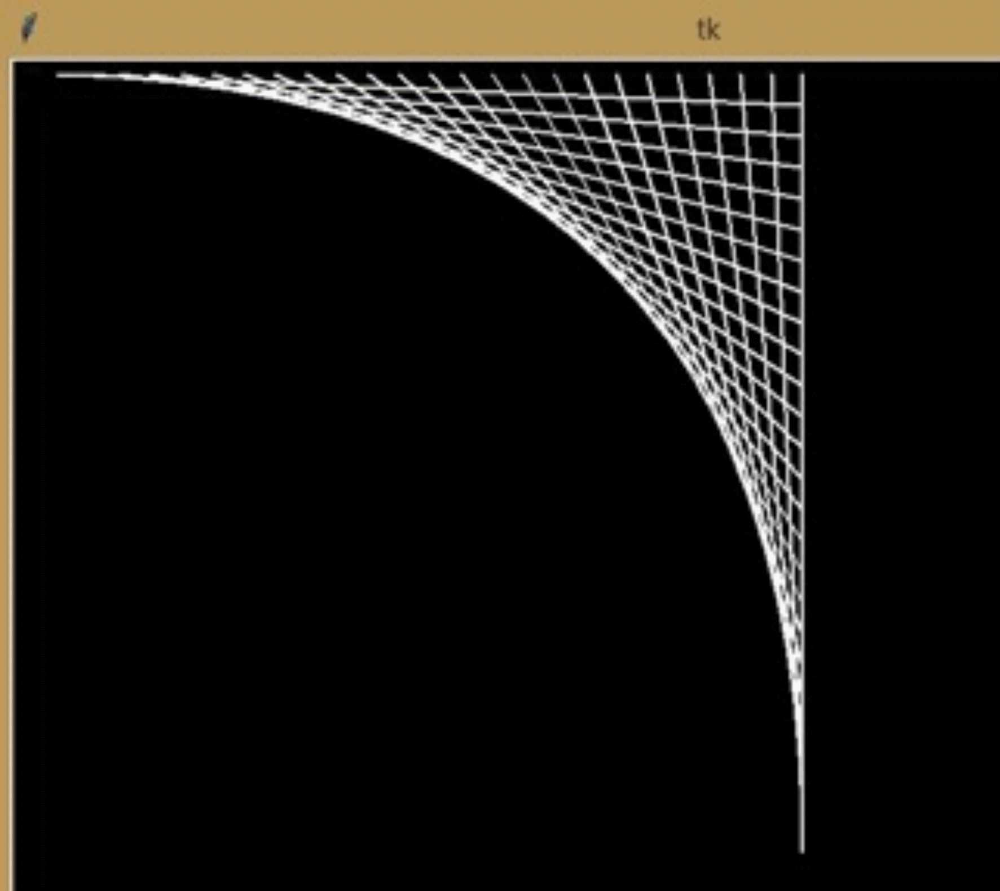

Doplňte program tak, aby nakreslil i zbylé části obrázku:

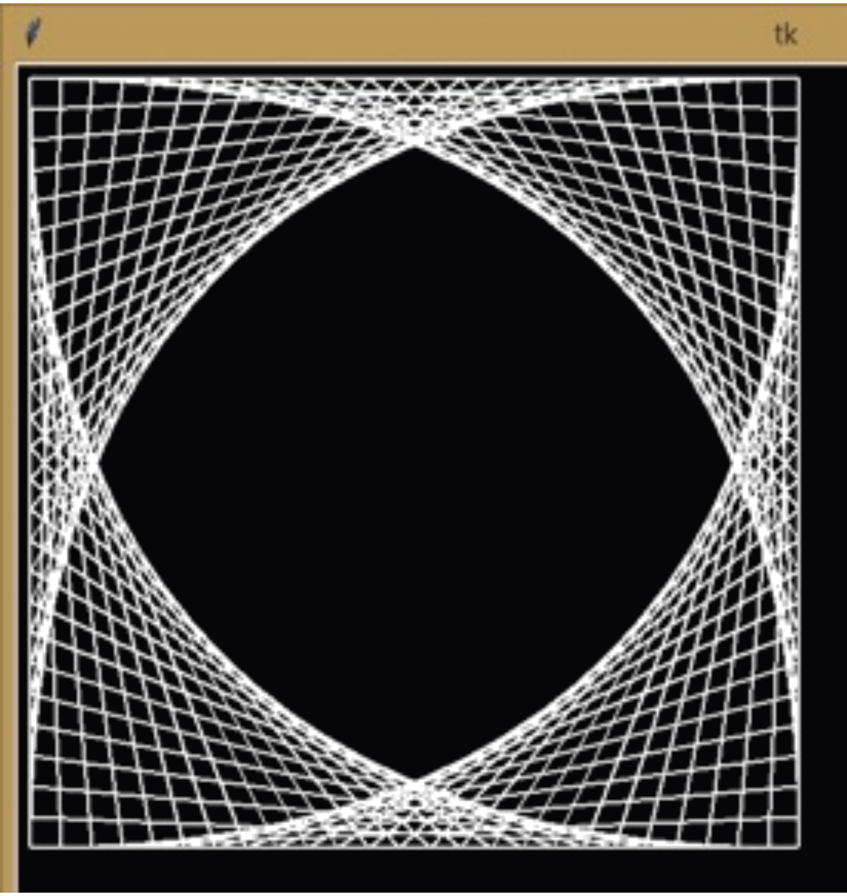


## 4.8. Křížky cyklem
Pomocí čar nakreslete tyto křížky.

1. bez mezery:
    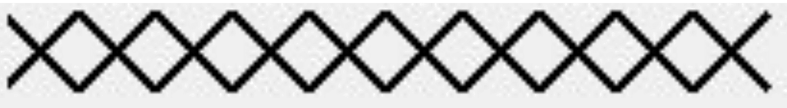

2. s mezerou:
    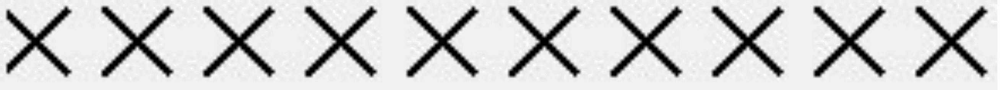

## 4.9. Zlatý poklad

Zlatokop našel poklad: 10 zlatých nugetů různých velikostí. Ty postupně ukládal na stůl vedle sebe.

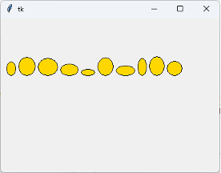

Vytvoř program `prijmeni-poklad.py`, který takový poklad pomocí cyklu nakreslí. Každý nuget (elipsa) má náhodně zvolenou velikost z rozsahu od 10 do 40. Použij proměnné, do kterých budeš ukládat náhodnou šířku a výšku pro velikost elipsy v daném rozsahu. Kromě ní použij další proměnnou, ve které bude výchozí x-ová souřadnice první elipsy. Velikost y-ové souřadnice bude pro všechny nugety stejná, např. 100 bodů. Mezi zlatými nugety bude mezera o velikosti 5 bodů.


## 4.10. Mozaika 

Obkladač bude obkládat stěnu v šatně městského bazénu. Aby byla stěna hezčí, budou kromě bílých některé obkladačky dvou světle modrých odstínů např. `lightblue` a `lightcyan`. Budou tak vytvářet pěknou mozaiku. Než se pustí do práce, chce si nejprve vytvořit vhodný návrh.

Vytvořte program `prijmeni-mozaika.py`, který vykreslí na plátno barevnou mozaiku. Mozaika bude tvořena 20 řádky a 20 sloupci čtverců. Každý čtverec bude mít velikost 25&times;25 bodů. Na jeden modrý odstín připadnou tři bílé. V součtu 6 bílých ku dvěma modrým. 

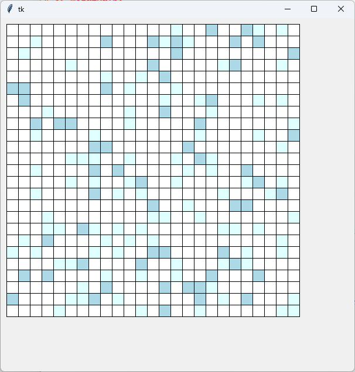

Nápověda: 

1.	Nastavte počet řádků a sloupců na 20.
2.	Nastavte velikost čtverce na 25 bodů.
3.	Připravte proměnné pro počáteční souřadnice kreslení.
4.	Pomocí vnořených cyklů postupně vykreslete všechny čtverce.
5.	Pro každý čtverec náhodně vyberte jednu barvu ze seznamu.
6.	Po vykreslení jednoho čtverce posuňte souřadnici `x` o velikost čtverce.
7.	Po dokončení jednoho řádku vraťte `x` na počáteční hodnotu a posuňte `y` o velikost čtverce.

Budete potřebova dva zanořené cykly. Vnější pro řádky (osa `y`), zanořený pro sloupce (osa `x`):

```python
for i in range(kolikrát): # posun v ose y (řádky)
    for j in range(kolikrát): # posun v ose x (sloupce)
        # výběr náhodné barvy
        # vykreslení čtverce
```

**Rozšíření:** Změňte počet řádků, počet sloupců nebo velikost čtverců tak, aby se výsledná mozaika změnila.


