
# Lekce 10: Podprogramy <!-- omit in toc -->


---

- [1. Podprogramy (vlastní funkce)](#1-podprogramy-vlastní-funkce)
- [2. 💾 Cvičení](#2--cvičení)
  - [2.1. Bankovky](#21-bankovky)
  - [2.2. Domino](#22-domino)
  - [2.3. Vagóny](#23-vagóny)
  - [2.4. Lokomotiva](#24-lokomotiva)
  - [2.5. Obličej](#25-obličej)
  - [2.6. Postava](#26-postava)
  - [2.7. Hrad](#27-hrad)


---

# 1. Podprogramy (vlastní funkce)
Při kreslení složitějších obrázků se náš program stává nepřehledným, protože obsahuje velké množství příkazů. Použití komentářů nám pomůže program zpřehlednit.

Dalším způsobem je použití **podprogramu**. Jedná se o menší část programu, kterou pojmenujeme, a když ji chceme použít, stačí v programu zadat jeho název. V podstatě tak vytváříme vlastní příkazy, které můžeme v programu použít. Odborně se takovým podprogramům v jazyce Python říká  **funkce**  (v jiných programovacích jazycích se s nimi můžete setkat také pod názvem  **procedury**  nebo  **funkce**, případně obojí). Nyní nakreslíme dům a vytvoříme k němu funkci (příkaz) `dum()`.

```py
# 10_1.py

import tkinter

canvas = tkinter.Canvas()
canvas.pack()

canvas.create_rectangle(100, 100, 150, 150)
canvas.create_line(100, 100, 125, 50, 150, 100)
```

Program nakreslí dům se střechou z obdélníku a lomené čáry. V dalším příkladu jsme si definovali vlastní funkci s názvem `dum()`. Funkci definujeme slovem `def`, za kterým následuje název funkce, pak závorky a na konci dvojtečka (stejně jako v cyklu `for`).

```py
# 10_2.py

import tkinter

canvas = tkinter.Canvas()
canvas.pack()

def dum():
    canvas.create_rectangle(100, 100, 150, 150)
    canvas.create_line(100, 100, 125, 50, 150, 100)
```

Přesunutí příkazů od levého okraje pomůže Pythonu pochopit, co všechno patří do naší funkce. Stejné odsazení jsme použili při psaní cyklu `for`. Tento program po spuštění ještě nic neudělá, protože jsme pouze definovali, co bude naše funkce (náš příkaz) dělat, ale ještě jsme ji nikde nepoužili (nespustili, neprovedli, nezavolali). Výsledkem programu bude prázdné okno. Chcete-li tuto funkci spustit, zadejte v programu příkaz `dum()` (na místě v programu, kde se má funkce spustit).

```py
# 10_3.py

import tkinter

canvas = tkinter.Canvas()
canvas.pack()

def dum():
    canvas.create_rectangle(100, 100, 150, 150)
    canvas.create_line(100, 100, 125, 50, 150, 100)

dum()
```

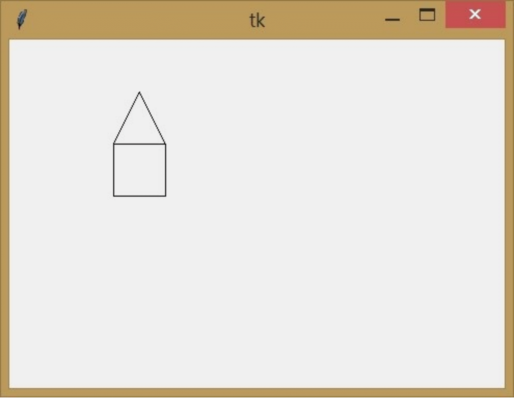

Tento program již provede funkci `dum()`. Zatím nevidíme smysl v definování vlastního příkazu, ale změňme funkci `dum()` tak, aby nakreslila dům na náhodném místě.

```py
# 10_4.py

import tkinter
import random

canvas = tkinter.Canvas()
canvas.pack()

def dum():
    x = random.randint(100, 300)
    y = random.randint(100, 300)
    canvas.create_rectangle(x, y, x+50, y+50)
    canvas.create_line(x, y, x+25, y-50, x+50, y)

dum()
dum()
dum()
```

V tomto programu jsme zavolali podprogram `dum()` třikrát. Tím se nakreslili tři domy na náhodném místě.

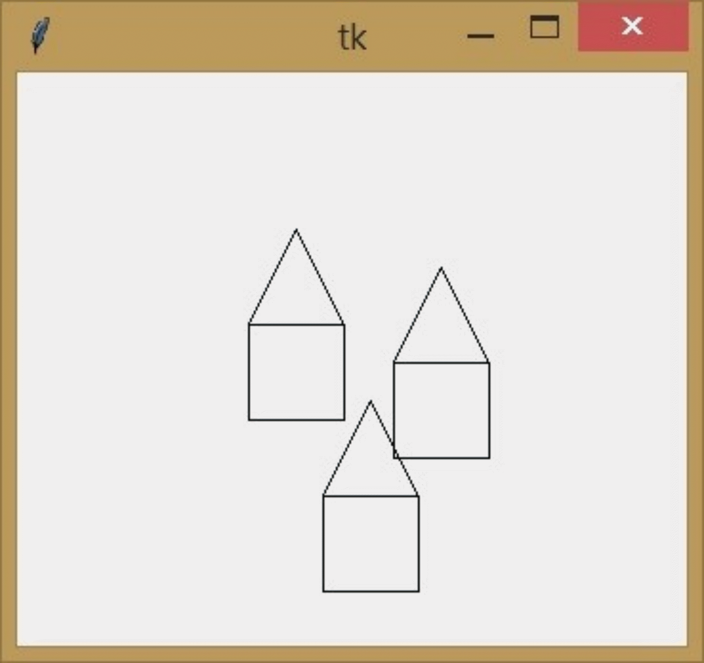

Pokud bychom použili smyčku `for`, mohli bychom snadno nakreslit 10 domů:

```py
# 10_5.py

import tkinter
import random

canvas = tkinter.Canvas()
canvas.pack()

def dum():
    x = random.randint(100, 300)
    y = random.randint(100, 300)
    canvas.create_rectangle(x, y, x+50, y+50)
    canvas.create_line(x, y, x+25, y-50, x+50, y)

for i in range(10):
    dum()
```

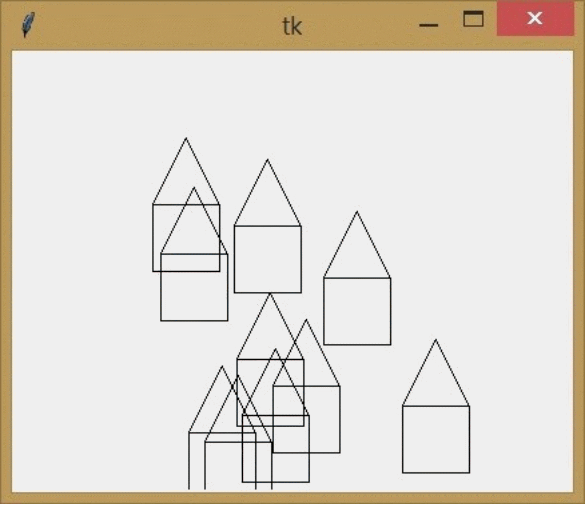

Funkci (podprogram) lze také upravit tak, abychom při jejím použití mohli zadat místo, kam chceme dům nakreslit. Podobně jako při použití funkce `create_rectangle` ovlivníme místo, kam se má dům nakreslit, pomocí čísel v závorkách -- říkáme jim  **parametry**  nebo  **argumenty**. Při definici funkce s parametrem uzavíráme názvy jednotlivých parametrů do závorek oddělených čárkou (pokud jich chceme mít více). Tato jména lze v naší funkci použít (jsou to vlastně jakési proměnné, které lze použít pouze v této funkci) a mají hodnotu, kterou jsme zadali při použití funkce.

```py
# 10_6.py

import tkinter
import random

canvas = tkinter.Canvas()
canvas.pack()

def dum(x, y):
    canvas.create_rectangle(x, y, x+50, y+50)
    canvas.create_line(x, y, x+25, y-50, x+50, y)

dum(100, 100)
dum(180, 100)
dum(260, 100)
```

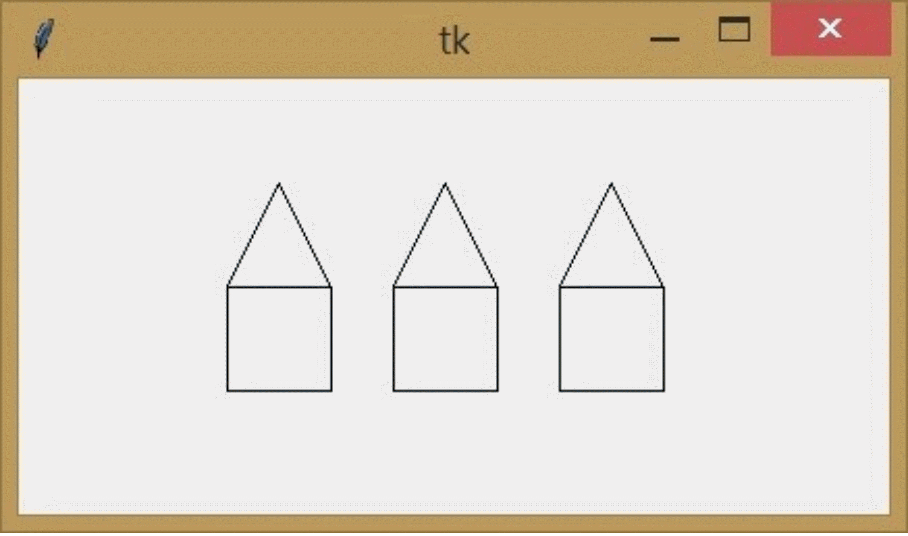

```py
# 10_7.py

import tkinter
import random

canvas = tkinter.Canvas()
canvas.pack()

def dum(x, y):
    canvas.create_rectangle(x, y, x+50, y+50)
    canvas.create_line(x, y, x+25, y-50, x+50, y)

for i in range(1, 7):
    dum(i*60, 100)
```

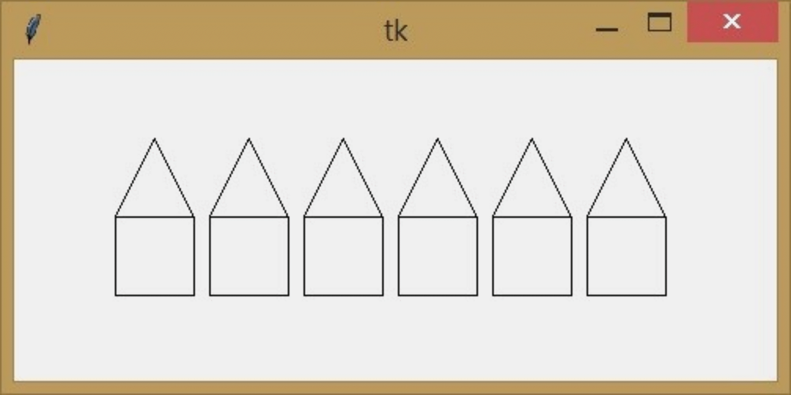

# 2. 💾 Cvičení

## 2.1. Bankovky

Na chodníku je rozhozených pět cizokrajných bankovek s hodnotami 10, 20, 30, 40 a 50. Vytvořte program `prijmeni_bankovky.py` s  funkcí `bankovky()`, která takové bankovky nakreslí pomocí `for` cyklu.

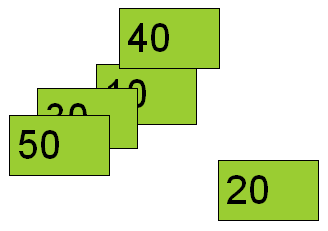

**Pro zdatnější**: bankovky budou "skutečné" s hodnotami 100, 200, 500 a 1000. Jejich počet bude náhodně zvolený. Program je vykreslí a do shellu vypíše jejich počet a celkovou částku v korunách.  

## 2.2. Domino

Vytvořte program `prijmeni_domino.py` s  funkcí `domino(n)`, která pomocí cyklu a obdélníku nakreslí `n` obdélníků vedle sebe. V ukázce je `n = 6`.

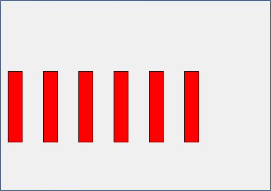

**Pro zdatnější**: Některé dominové kostky budou o kousek kratší.

## 2.3. Vagóny
Vytvořte program `prijmeni_vagony.py` s  funkcí `vagon()`, která nakreslí vagón na zadané místo. Funkci použijte ve smyčce `for`, abyste nakreslili vlak složený ze šesti vagónů (v ukázce jsou jen čtyři). Všimněte si pozic nárazníků:

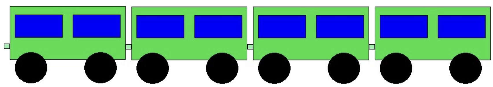

**Pro zdatnější**:
1. Některé vagóny budou zelené, jiné oranžové.
2. Pod vagóny budou koleje (silnější černá čára přes celé okno).

## 2.4. Lokomotiva
Vytvořte funkci, která na zadaném místě nakreslí lokomotivu. Nakreslete tuto lokomotivu na začátek vlaku z předcházející úlohy:

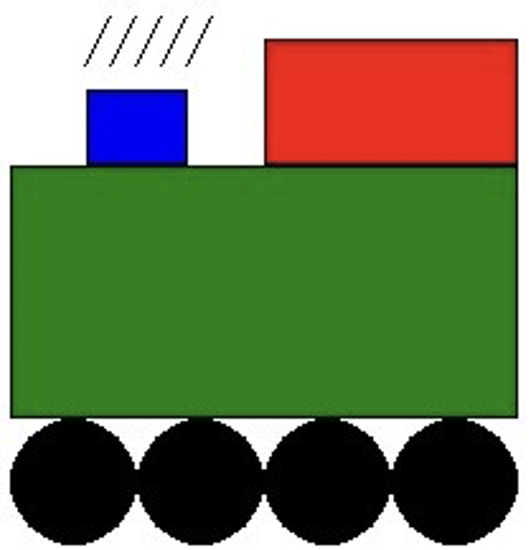

## 2.5. Obličej
Vytvořte program `prijmeni_oblicej.py` s  funkcí `oblicej()`, která na zadaném místě nakreslí "obličej" čtvercového robota, který má oči, nos a ústa náhodné velikosti a náhodné barvy (ze seznamu definovaných barev) a zároveň je jeho tvář symetrická. Funkci využijte ve `for` cyklu, abyste nakreslili vedle sebe několik různých tváří. Příklady:

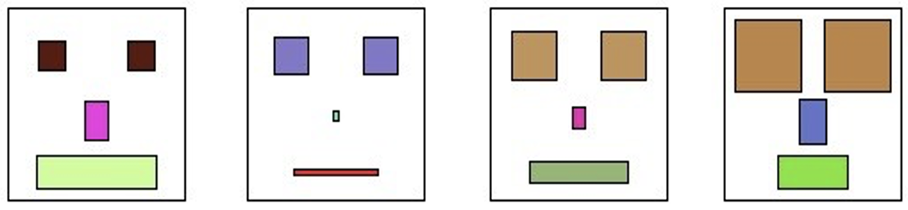
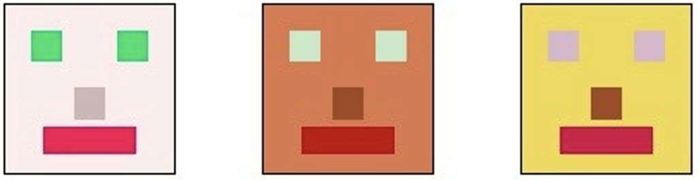

## 2.6. Postava

Vytvořte program `prijmeni_postava.py` s  funkcí `postava()`, která na zadaném místě nakreslí stylizovanou postavu:

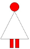

## 2.7. Hrad
Vytvořte program `prijmeni_hrad.py` s  funkcí `hrad()`, která na zadaném místě nakreslí hrad:

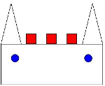
