# Lekce 11: Opakovací cvičení 1  <!-- omit in toc -->


---

<mark>**Upozornění:** Toto jsou **opakovací** cvičení. Význam tohoto slova znamená, že programy budou vytvořené pouze z dříve probraných prvků a konstrukcí jazyka Python!</mark>


- [1. Jeskyně](#1-jeskyně)
- [2. Zahrádka](#2-zahrádka)
- [3. Rostliny](#3-rostliny)
- [4. Podmořský svět](#4-podmořský-svět)
- [5. Krajina se stromy a květy](#5-krajina-se-stromy-a-květy)
- [6. Noční město](#6-noční-město)


---


# 1. Jeskyně

Napište program `prijmeni_jeskyne.py`, který vykreslí tuto stylizovanou jeskyni:
 
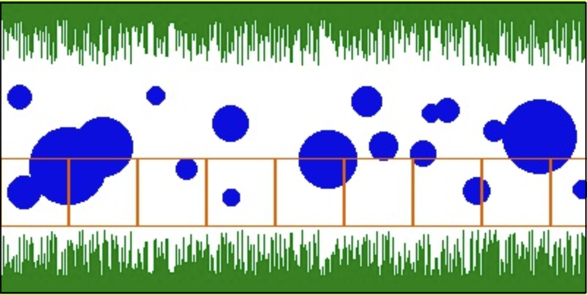

Program bude sestaven ze třech podprogramů:

1. **Zelené krápníky**: jejich tloušťka je 1 bod, délka 20–70 bodů. Jsou symetrické podle osy x.
2. **Kapky vody**: modré kruhy 20–100 bodů v náhodných pozicích. Podmínkou je, že ani jeden nesmí dotýkat krápníků. Jejich počet bude také náhodný (20–30).
3. **Žebřík**: hnědý s deseti stupni. Bude procházet celým obrázkem těsně nad spodní řadou krápníků.


# 2. Zahrádka

Napište program `prijmeni_zahradka.py`, který vykreslí stylizovanou zahrádku:

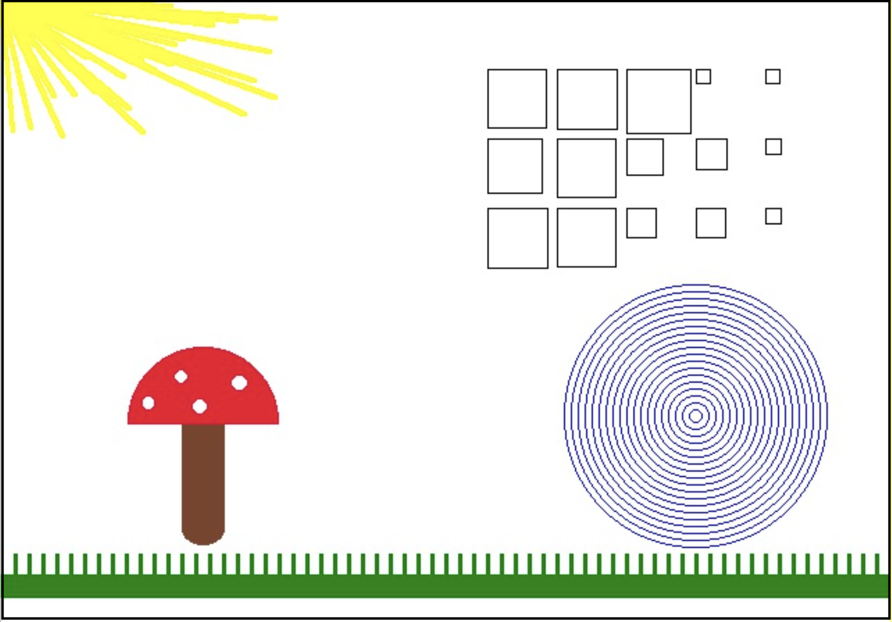

Program bude sestaven z pěti podprogramů:

	
1. **Muchomůrka**: Její vzhled a pozice viz výsledný obrázek programu nahoře.

2. **Tráva**: Přidejte do programu funkci, která pod muchomůrku nakreslí zelenou trávu.

3. **Slunce**: Přidejte do programu příkazy, které nakreslí 40 náhodných slunečních paprsků. Sluneční paprsky jsou žluté a vycházejí z levého horního rohu obrazovky, ale nekreslí se přes celé plátno, ale pouze do vzdálenosti, kterou navrhnete.

4. **Parcely**: Přidejte do programu funkci, která vykreslí mapu zastavěného území v pravé horní části obrázku. Každý pozemek je čtverec a velikost strany každého pozemku je náhodná, maximálně však 50 bodů. Mapa má tvar obdélníku. V jedné řadě mapy je pět parcel a na mapě jsou tři řady.

5. **Jezírko**: Přidejte do programu funkci, která do obrázku nakreslí modré jezírko. Je nakresleno pomocí dvaceti soustředných modrých kruhů.


# 3. Rostliny

Napište program `prijmeni_rostliny.py`, který vykreslí stylizované rostliny:
 
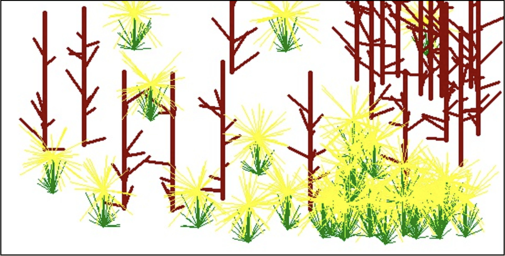

1. **Květy**: Na náhodných místech se vykreslí květ. Každý květ se skládá ze třech částí: trsu trávy, stonku a květu. Trs trávy obsahuje 20 náhodných stébel. Každé stéblo je od kořene vzdálené na  `x`-ové souřadnici maximálně 20 bodů vlevo nebo vpravo. Na  `y`-ové  souřadnici je od kořene vzdálené maximálně 40 bodů vždy směřuje od kořene směrem nahoru. Ukázka náhodných trsů:

    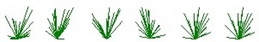

2. **Stonek** má délku 50 bodů a jeho barva je mírně odlišná od barvy trávy. Květ je žlutý, obsahuje 40 čar, které vycházejí ze středu květu, jejich délka je náhodná. Každá čára květu je v obou osách (x,y) nejvíce 40 bodů od středu květu. Ukázka náhodných květů:


    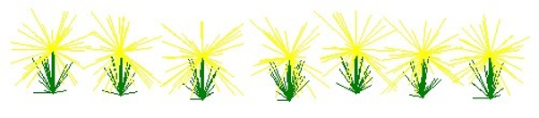

3. **Stromy**: Na náhodných místech se kreslí strom. Kmen je vysoký 150 bodů a je široký 5 bodů. Strom má 10 náhodných větví širokých 2 body. Všechny větve směřují nahoru. Ukázka náhodných stromů:

    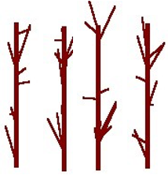


# 4. Podmořský svět

Napište program `prijmeni_more.py`, který vykreslí stylizovaný podmořský svět:
 
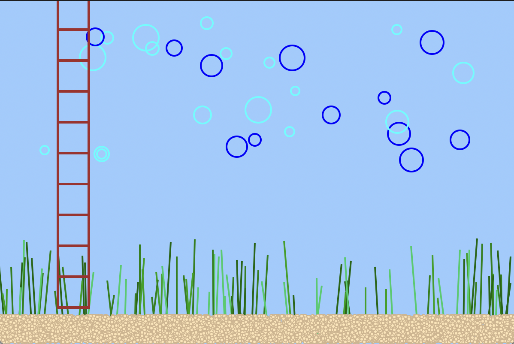

Velikost okna bude **600&times;400** se světle modrým pozadím. Program bude sestaven ze čtyř podprogramů:

1. **Bubliny**: kružnice s průměrem 10-30 bodů tloušťkou 2 body na náhodných pozicích. Budou náhodně světle nebo tmavě modré. Podmínkou je, že nesmí zasahovat do řas. Jejich počet bude mezi 20-30.
2.	**Žebřík**: Bude hnědý s deseti stupni v pozici dle předlohy. Bude končit nad vrstvou písku. Podmínkou je, že bude vytvořený pomocí cyklu.
3.	**Řasy**: Svislé čáry v počtu 50-100, tloušťky 2 body a výšce 50-150 bodů. Barva každého stonku bude náhodně zvolená ze seznamu 4 odstínů zelené. Ze svislé osy budou náhodně vychýlené od –10 do +10 bodů.
4.	**Písek**: 10000 kruhů o průměru 4 body po celé délce spodní části okna a výšce 30 bodů. Barva výplně je světle písková a obrysu o něco tmavší.

# 5. Krajina se stromy a květy

Napište program `prijmeni_krajina.py`, který vykreslí stylizovanou krajinu se stromy:

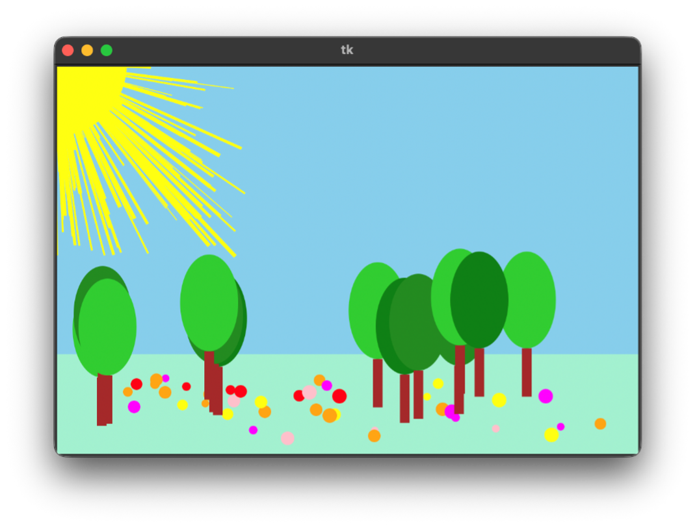


Vytvořte program podle předlohy. Velikost okna bude 600&times;400 se světle modrým pozadím (obloha). Spodní čtvrtina bude světle zelená (tráva).

Program bude sestaven ze třech podprogramů:

1.	**Květy**: kruhy 8-15 bodů na náhodných pozicích. Podmínkou je, že všechny musí být na trávníku. Jejich počet bude mezi 30-50. Barva každého květu bude náhodně zvolená ze seznamu alespoň čtyř [odstínů](https://www.w3schools.com/cssref/css_colors.php).

2.	**Stromy**: Náhodný počet mezi 5-15. Paty kmenů budou ve výšce 20-60 bodů nad spodním okrajem okna. Korunu stromu nakresli jako zelenou elipsu se šířkou 60 a výškou 100. Barvy korun budou náhodně zvolené z několika odstínů zelené. Kmen bude představován hnědým obdélníkem, který bude široký 10 a vysoký 50. Pozor, mezi kmenem a korunou nesmí být mezera.

    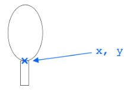


3.	**Slunce**: 100 paprsků délky 0-200 bodů. Jejich šířka bude 1-4 body. Všechny paprsky vychází z levého horního rohu okna. Kromě paprsků bude vidět 1/4 slunečního kotouče, který má poloměr 75 bodů.


# 6. Noční město

Napište program `prijmeni_mesto.py`, který vykreslí stylizované noční město:

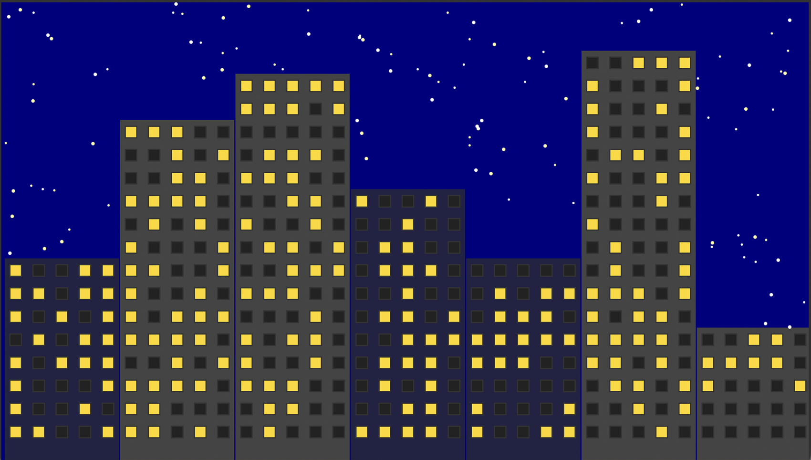
 
Velikost okna bude 700&times;400. Barva pozadí bude "navy". 

- Pojmenované barvy: https://www.w3schools.com/cssref/css_colors.php

Program bude sestaven ze čtyř podprogramů: `budovy()`, `okna()`, `obloha()` a `hvezdy()`. Funkce `hvezdy()` je volaná z funkce `obloha()`.

Program bude sestaven v odlišném pořadí objektů, než by vás nejspíš intuitivně napadlo: pozadí - domy - okna. Důvodem je zjednodušení konstrukcí a výpočtů.


**Budovy**

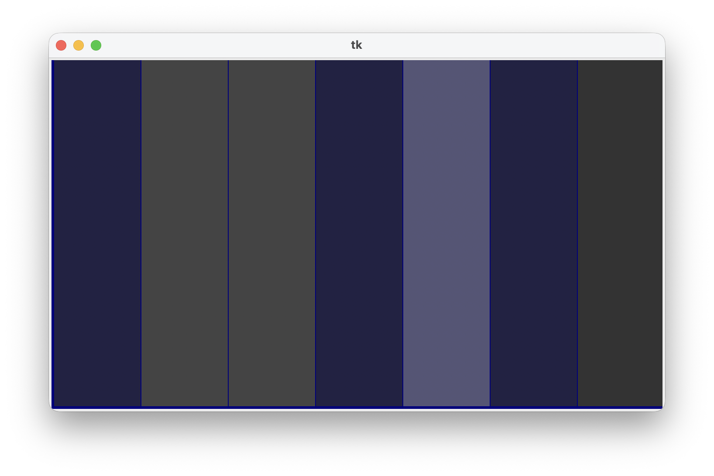

Jako první se vytvoří a zavolá funkce, která pomocí cyklu nakreslí 7 budov na plnou výšku okna. Barva výplně 4 náhodné "noční", obrys "navy" (jako pozadí) v defaultní šířce 1 bod.


**Okna**
 
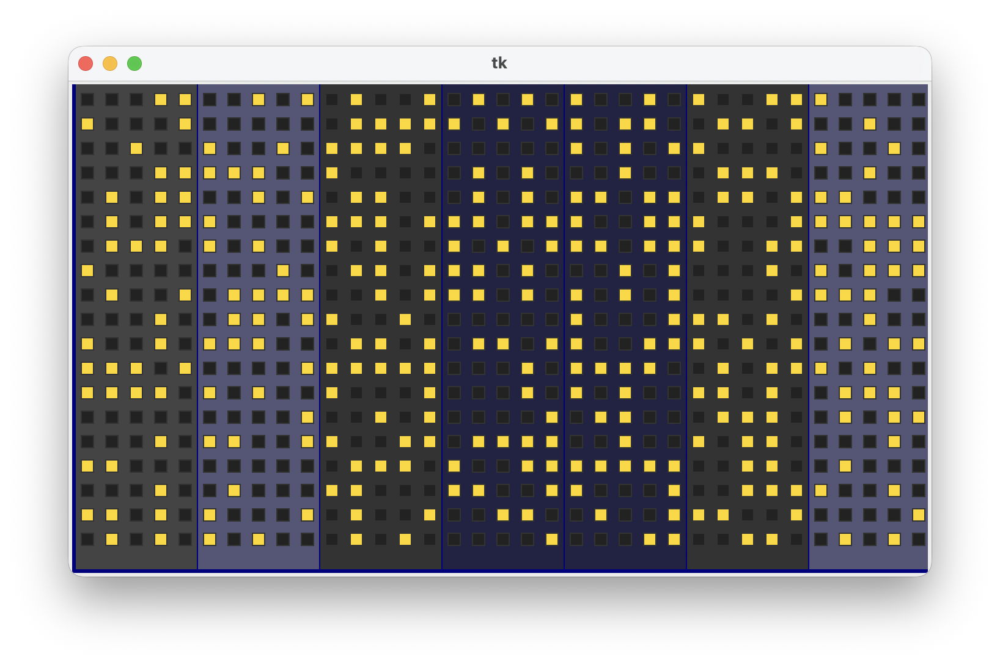


Každé okno má 10×10 bodů. Mezi nimi je vzdálenost 10 bodů. Všechna okna jsou v matici 35×19 oken (poslední řádek dole je bez oken). Barva okna se náhodně volí mezi "svítí" a "nesvítí". Okna se kreslí pomocí dvou cyklů. Druhý je zanořený do prvního. První má 19 kroků a definuje řádky (osa `y`), zanořený má 35 kroků a definuje sloupce (osa `x`). Nezapomeň, že `range()` může mít tři parametry (`start`, `stop`, `step`). Je praktičtější si pomocí nich generovat přímo souřadnice `x` a `y`:


```python
for i in range():         # sloupce
    for i in range():     # řádky
        barva = choice()  # svítí / nesvítí
        canvas.create_rectangle(x, y, x+10, y+10, fill=barva, outline="#333333") 
```


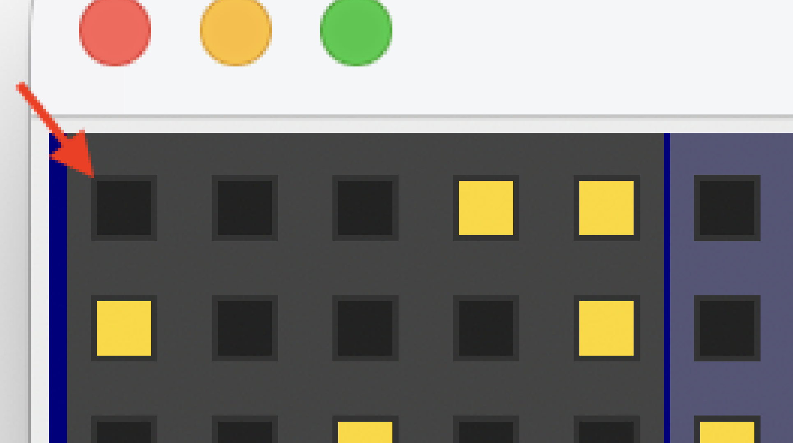

 
**Obloha**

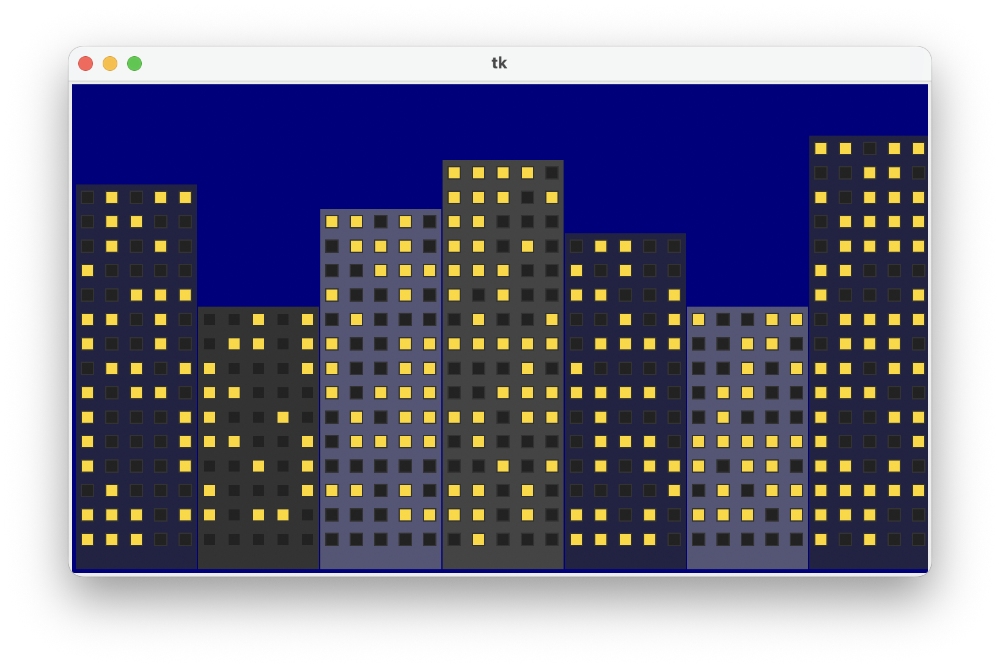

Snížení výšky budovy se vytvoří tak, že se horní část každé budovy překreslí obdélníkem šířky 100 bodů "náhodné" výšky a to tak, že musí být po krocích 10 (5, 15, 25, 35 ... 305). To zajistí `randrange(10, 306, 20) - 5`. Barvy i obrys obdélníku bude "navy". 

Pozor: Po vykreslení prvního obdélníku si do proměnných `x1`, `y1`, `x2` a `y2` uložte jeho aktuální souřadnice:

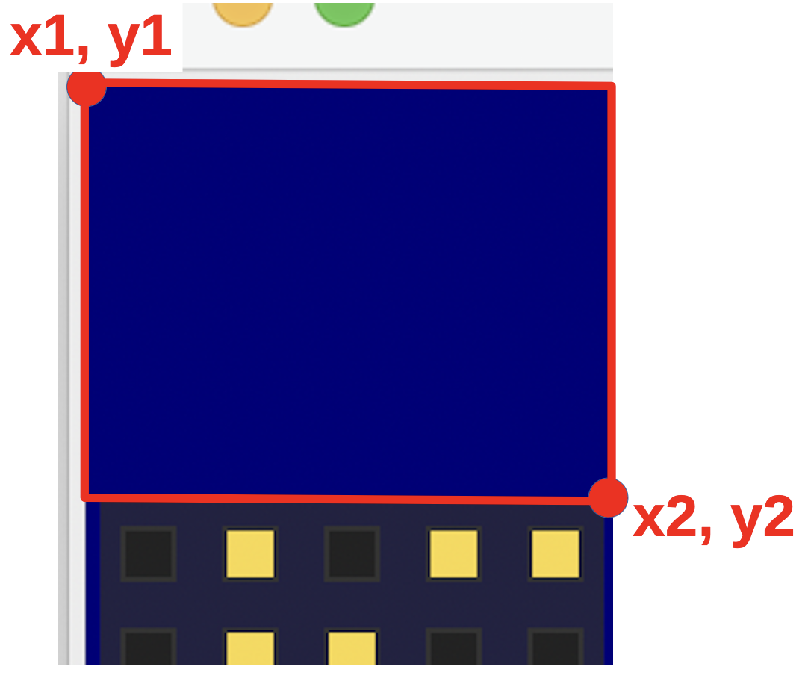


Nyní zavoláte funkci `hvezdy` s těmito souřadnicemi `hvezdy(x1, y1, x2, y2)`. Ta si je převezme aby "věděla", v jakém rozsahu má hvězdy vykreslit.


**Hvězdy**

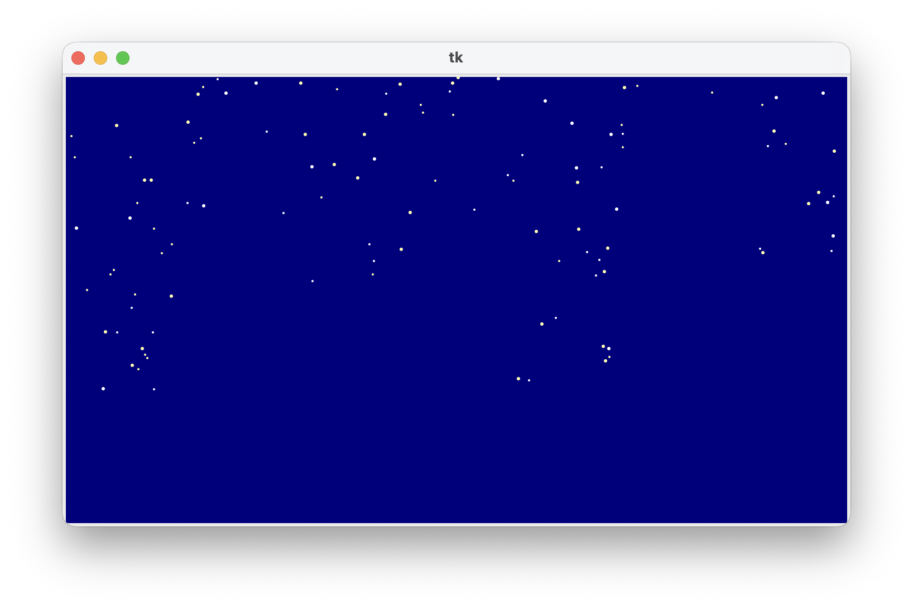


Funkce si převezme ty tři souřadnice `x1`, `x2`, `y2`:

```python
def hvezdy(x1, x2, y2):
    pocet = ... # vypočet plochy zmenšený 1000x
    for i in range(pocet):
        x = randint()  # rozsah pro x
        y = randint()  # rozsah pro y
        r = randint(2,3)
        barva = choice(["white", "yellow"])
        canvas.create_oval(x, y, x+r, y+r, fill=barva, outline='')
```

Jejich počet se bude odvíjet od velikosti tohoto obdélníku: čím větší, tím více hvězd a opačně. Jejich počet bude číslo definující velikost plochy obdélníku (`S = a×b`) zmenšená 1000×. Jinak by jich bylo příliš mnoho. To zmenšení se musí provést nikoli běžným dělením (`/`), ale celočíselným (`//`), neboť funkce `range()` vyžaduje celé číslo:


```python
>>> 58567 / 1000
58.567
>>> 58567 // 1000
58
>>>
```

Nyní už stačí vygenerovat pocet hvězd na náhodných pozicích ve velikosti 2 nebo 3 body bez obrysu v náhodné barvě bílá nebo žlutá.

Tento proces proběhne 7× pro každý dům:

```python
def hvezdy(x1, x2, y2):
    #
    # kód pro kreslení hvězd
    #  

def pozadi():
    for i in range(7):
        #
        # kód pro kreslení modrého pozadí nad domem
        #
        hvezdy(x1, x2, y2)   
```

  
**Pro zdatnější**
    
Jsou 3 hodiny ráno, většina slušných lidí už spí. Svítí výrazně méně oken než hned po setmění. Upravte program tak, aby to v něm bylo poznat, ovšem **bez použití příkazů pro větvení**.
 
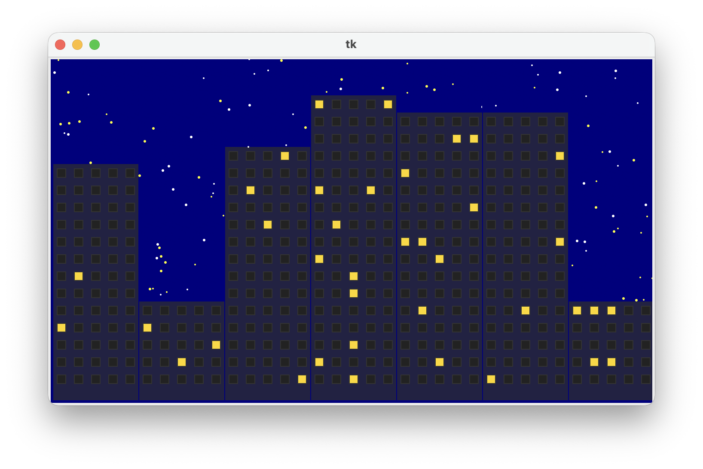
