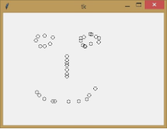
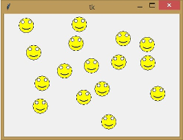
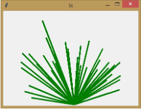
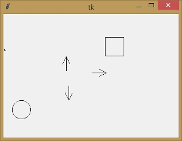
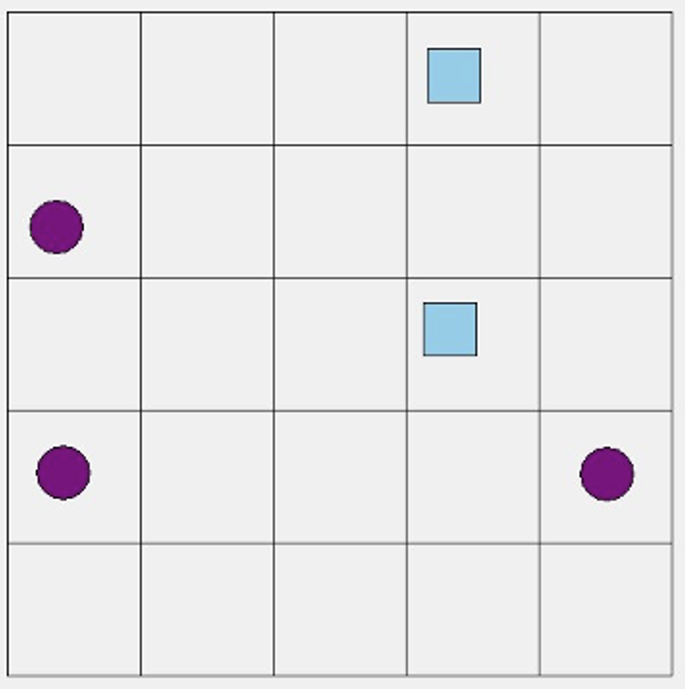


# Lekce 12: Ovládání programu myší nebo klávesnicí <!-- omit in toc -->


---

- [1. Reakce levého tlačítka myši](#1-reakce-levého-tlačítka-myši)
- [2. 💾 Cvičení](#2--cvičení)
  - [2.1. Křížek](#21-křížek)
  - [2.2. Smajlík](#22-smajlík)
  - [2.3. Čára](#23-čára)
- [3. Reakce pravého tlačítka myši](#3-reakce-pravého-tlačítka-myši)
- [4. Reakce na stisk klávesy](#4-reakce-na-stisk-klávesy)
- [5. 💾 Cvičení](#5--cvičení)
  - [5.1. Piškvorky](#51-piškvorky)
- [6. Libovolná klávesa s jedinou funkcí](#6-libovolná-klávesa-s-jedinou-funkcí)


---

Při používání programů jsme zvyklí ovládat je myší klikáním na různé prvky v programu. Při interakci uživatele s programem vznikají tzv.  **události**  (**eventy**), na které můžeme v programu reagovat.

# 1. Reakce levého tlačítka myši

Pomocí příkazu  `bind`  můžeme v programu nastavit, na které události chceme reagovat a jakou funkci chceme v této situaci provést.  **Události mají přesně definovaný název**. Například událost kliknutí levým tlačítkem myši se jmenuje  `<Button-1>`.

Nyní vytvoříme program, který v místě kliknutí levým tlačítkem myši nakreslí kruh.

```py
# 12_1.py

import tkinter
canvas = tkinter.Canvas()
canvas.pack()

def krouzek(souradnice):
    x = souradnice.x
    y = souradnice.y
    canvas.create_oval(x-5, y-5, x+5, y+5)

canvas.bind('<Button-1>', krouzek)
```

Vytvořili jsme novou funkci  `krouzek`. Pomocí  `canvas.bind('<Button-1>', krouzek)`  jsme nastavili, že na událost  `<Button-1>`  (tj. kliknutí levým tlačítkem myši) bude reagováno provedením funkce  `krouzek`. Tato událost také automaticky odešle do této funkce informaci o souřadnicích myši. My jsme získanou informaci ve funkci  `krouzek`  označili parametrem nazvaným  `souradnice`. Parametr  `souradnice`  obsahuje souřadnice  `x`  i  `y`. Ke každé souřadnici můžeme přistupovat tak, že zapíšeme buď  `souradnice.x`  nebo  `souradnice.y`. Ve funkci  `krouzek`  jsme si tyto jednotlivé souřadnice uložili do lokálních proměnných  `x`  a  `y`, které od této chvíle můžeme ve funkci běžně používat.



Další program nakreslí dům na místě kliknutí.

```py
# 12_2.py

import tkinter
canvas = tkinter.Canvas()
canvas.pack()

def dum(souradnice):
    x = souradnice.x
    y = souradnice.y
    canvas.create_rectangle(x, y, x+50, y+50)
    canvas.create_line(x, y, x+25, y-50, x+50, y)
	
canvas.bind('<Button-1>', dum)
```

# 2. 💾 Cvičení

## 2.1. Křížek
Vytvořte program `12_krizek.py`, ve kterém kliknutím myši nakreslíme křížek. Samotný střed křížku bude přesně v místě kliknutí.

## 2.2. Smajlík
Vytvořte program `12_smajlik.py`, který v místě kliknutí nakreslí smajlíka:



## 2.3. Čára
Vytvořte program `12_cara.py`, který v místě kliknutí vykreslí silnější čáru směřující do středu spodní části okna:




# 3. Reakce pravého tlačítka myši

Pravé tlačítko myši vyvolá událost s názvem  `'<Button-3>'`. Když tuto událost pomocí příkazu  `bind`  svážeme s funkcí, můžeme na ni reagovat. Následující program při stisknutí pravého tlačítka nakreslí domek a při stisknutí levého tlačítka nakreslí kruh:

```py
# 12_3.py

import tkinter
canvas = tkinter.Canvas()
canvas.pack()

def krouzek(souradnice):
    x = souradnice.x
    y = souradnice.y
    canvas.create_oval(x-5, y-5, x+5, y+5)

def dum(souradnice):
    x = souradnice.x
    y = souradnice.y
    canvas.create_rectangle(x, y, x+50, y+50)
    canvas.create_line(x, y, x+25, y-50, x+50, y)

canvas.bind('<Button-1>', krouzek)
canvas.bind('<Button-3>', dum)
```

V programu můžeme také **reagovat na pohyb myši**. Pohyb myši bez stisknutí tlačítka vyvolá událost nazvanou  `'<Motion>'`. Pohyb myši se stisknutým levým tlačítkem vyvolá událost s názvem  `'<B1-Motion>'`  a pravým tlačítkem s pohybem  `'<B3-Motion>'`.

Příležitostně můžeme také použít událost  `'<ButtonRelease-1>'`  (uvolnění stisknutého levého tlačítka)  nebo  `'<Double-Button-1>'`  (dvojklik).

# 4. Reakce na stisk klávesy

Na události stisku kláves reagujeme pomocí  `canvas.bind_all('key', funkce)`.  `Key`  je konkrétní znak na klávesnici, například  `'a'`  nebo  `'d'`, nebo název ovládací klávesy. Můžeme například použít následující klávesy:  `'<Up>'`,  `'<Down>'`,  `'<Left>'`,  `'<Right>'`,  `'<space>'`,  `'<Return>'` je klávesa <kbd>Enter</kbd>. Pozor, existuje i událost  `'<Enter>'`, ale ta znamená něco jiného.

Parametr  funkce  je název funkce, která se má spustit. Volaná funkce však musí mít jeden parametr, například  `event`  (událost), ve kterém se do funkce posílají podrobnější informace o události. Stejně jako událost kliknutí myší i stisknutí klávesy odešlou v parametru souřadnice aktuální pozice myši. I když s tímto parametrem v naší funkci nepracujeme, musíme jej při definici funkce zadat.

Následující příklad nakreslí při stisknutí kláves se šipkami doprava, nahoru a dolů čtverec, při stisknutí klávesy "c" čtverec a při stisknutí klávesy "k" kruh na náhodném místě.



```py
# 12_4.py

import tkinter
import random
canvas = tkinter.Canvas()
canvas.pack()

def ctverec(event):
    x = random.randrange(300)
    y = random.randrange(250)
    canvas.create_rectangle(x, y, x+50, y+50)

def kruh(event):
    x = random.randrange(300)
    y = random.randrange(250)
    canvas.create_oval(x, y, x+50, y+50)

def sipka_nahoru(event):
    x = random.randrange(300)
    y = random.randrange(250)
    canvas.create_line(x-10, y+20, x, y, x+10, y+20)
    canvas.create_line(x, y, x, y+40)

def sipka_dolu(event):
    x = random.randrange(300)
    y = random.randrange(250)
    canvas.create_line(x-10, y-20, x, y, x+10, y-20)
    canvas.create_line(x, y, x, y-40)

def sipka_vpravo(event):
    x = random.randrange(300)
    y = random.randrange(250)
    canvas.create_line(x-20, y-10, x, y, x-20, y+10)
    canvas.create_line(x, y, x-40, y)

canvas.bind_all('c', ctverec)
canvas.bind_all('k', kruh)
canvas.bind_all('<Up>', sipka_nahoru)
canvas.bind_all('<Down>', sipka_dolu)
canvas.bind_all('<Right>', sipka_vpravo)
```

# 5. 💾 Cvičení

## 5.1. Piškvorky
Vytvořte program `12_piskvorky.py`, ve kterém budete moct hrát piškvorky. Hráč 1 má kolečko a hraje levým tlačítkem myši, hráč 2 má čtvereček a hraje pravým tlačítkem myši. Hráči se pravidelně střídají. Vyhrává ten, kdo má 4 znaky vedle sebe buď svisle, vodorovně nebo diagonálně. Klikejte co nejvíce do středu čtverců. Po spuštění programu je možné zvolit tři hrací pole: 4&times;4 (klávesou <kbd>4</kbd>), 5&times;5 (klávesou <kbd>5</kbd>) nebo 6&times;6 (klávesou <kbd>6</kbd>). Pokud některý hráč vyhrál, stiskněte klávesu <kbd>k</kbd> (jako "konec").




# 6. Libovolná klávesa s jedinou funkcí

Dosud jsme vytvářeli programy, ve kterých je každá ze stisknutých kláves spojena s jinou funkcí. Existují situace, kdy chceme  **událost stisku libovolné klávesy spojit s jedinou funkcí**. Taková událost se označuje názvem  `"<Key>"`. Ve volané funkci, která na tuto událost reaguje, můžeme také zjistit konkrétní stisknutou klávesu prostřednictvím vstupního parametru a jeho součásti (atributu)  `.keysym`. Následující program při stisknutí klávesy zapíše tuto klávesu na náhodné místo v plátně a vypíše ji také do okna shellu.

```py
# 12_5.py

import tkinter
import random
canvas = tkinter.Canvas(width=640, height=320)
canvas.pack()

def pis(event):
    print(event.keysym)
    x = random.randrange(300)
    y = random.randrange(300)
    canvas.create_text(x, y, text=event.keysym)

canvas.bind_all('<Key>', pis)
```

V předchozím příkladu jsme k informacím o stisknuté klávese přistupovali prostřednictvím komponenty (atributu) `.keysym`  vstupního parametru, který jsme pojmenovali `event`. To znamená, že jsme k ní přistupovali pomocí popisku `event.keysym`. 

Zjistěte, co se změní, když k ní budeme přistupovat prostřednictvím zápisu
- `event.char`
- `event.keycode` 

Zkuste tuto informaci zapsat do okna shellu také pomocí příkazu  `print()`.


