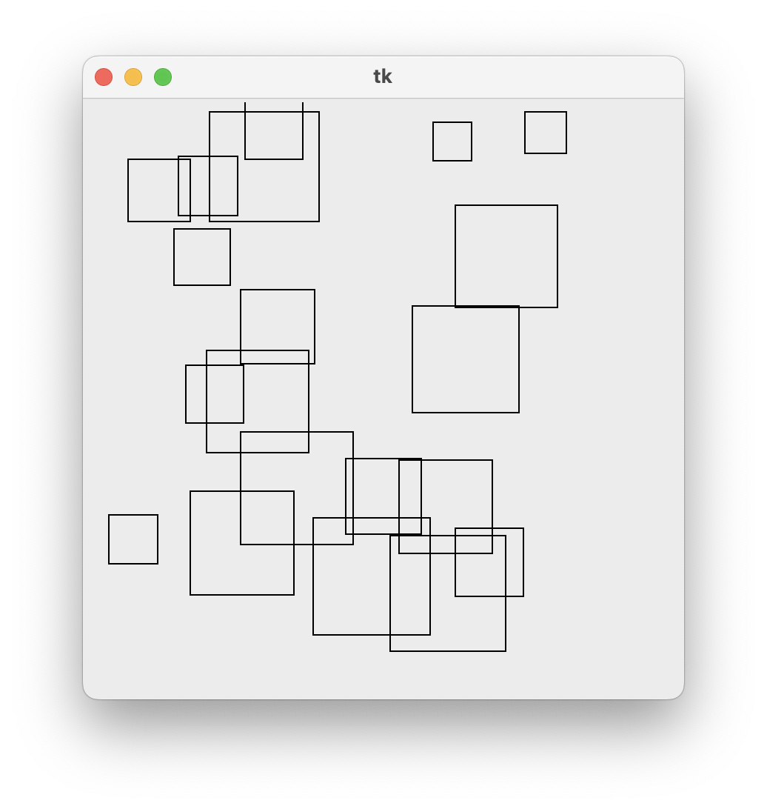
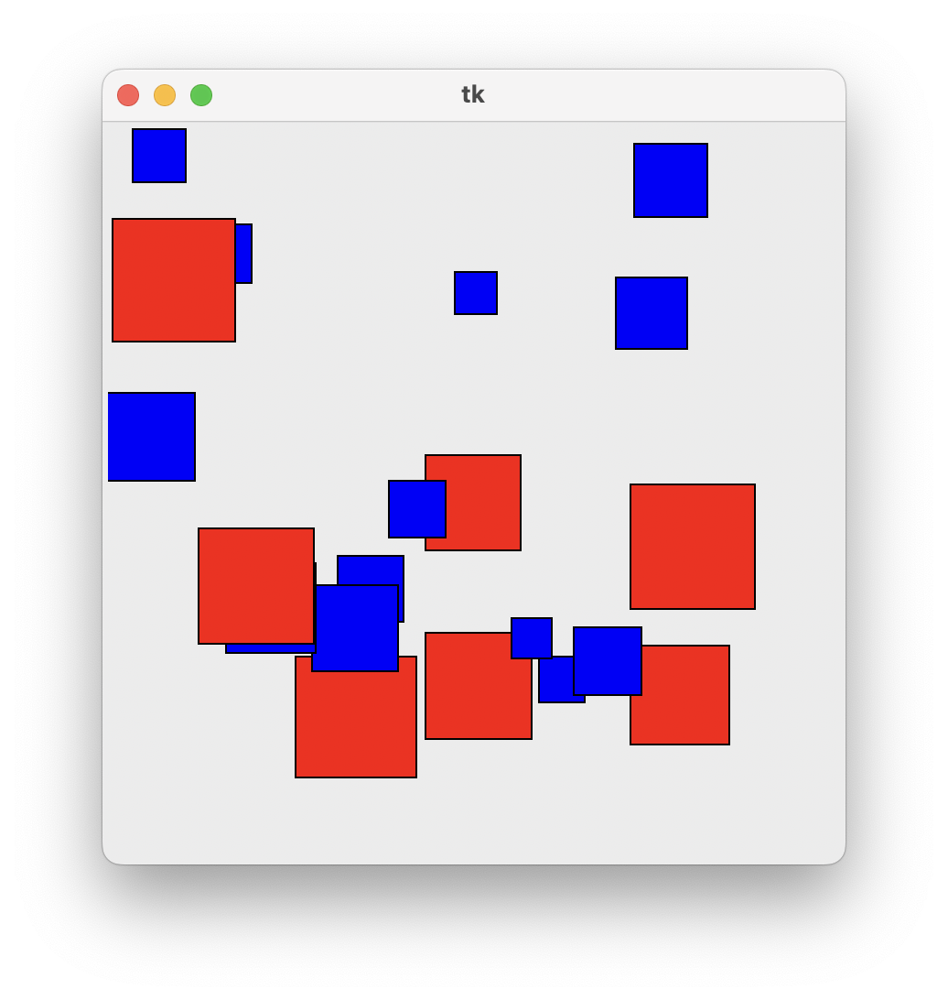
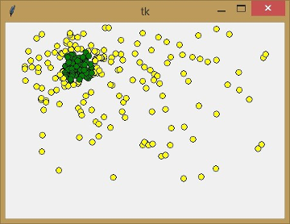
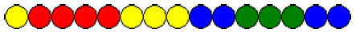
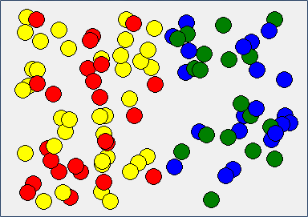
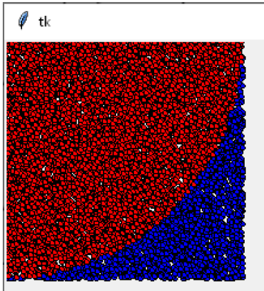
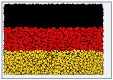
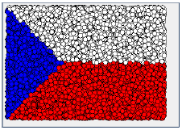
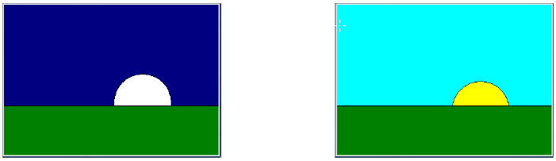


# Lekce 13: Podmíněné příkazy <!-- omit in toc -->


---

- [1. Podmíněné příkazy](#1-podmíněné-příkazy)
  - [1.1 ❓ Otázky](#11--otázky)
  - [1.2. 💾 Cvičení](#12--cvičení)
    - [1.2.1. Čtverec nebo kolečko 1](#121-čtverec-nebo-kolečko-1)
    - [1.2.2. Čtverec nebo kolečko 2](#122-čtverec-nebo-kolečko-2)
- [2. Více podmínek najednou](#2-více-podmínek-najednou)
  - [2.1. ❓ Otázky](#21--otázky)
  - [2.2. 💾 Úkoly](#22--úkoly)
    - [2.2.1. Korálky v řadě](#221-korálky-v-řadě)
    - [2.2.3. Korálky v ploše](#223-korálky-v-ploše)
    - [2.2.4. Výpočet čísla pi metodou Monte Carlo](#224-výpočet-čísla-pi-metodou-monte-carlo)
    - [2.2.5. Vlajka Německa](#225-vlajka-německa)
    - [2.2.6. Vlajka ČR](#226-vlajka-čr)
    - [2.2.7. Den nebo noc](#227-den-nebo-noc)


---

# 1. Podmíněné příkazy
Program níže vykreslí 20 náhodných čtverců na náhodných pozicích:

```py
# 13_1.py

import tkinter
import random

canvas = tkinter.Canvas(width=400, height=400)
canvas.pack()

def nahodny_ctverec():
    x = random.randrange(300)
    y = random.randrange(300)
    a = random.randint(20, 80)
    canvas.create_rectangle(x, y, x+a, y+a)

for i in range(1, 21):
    nahodny_ctverec()
    canvas.update()
    canvas.after(500)
```




Předpokládejme, že chceme program upravit tak, aby kreslil větší čtverce červeně a menší modře. V takových situacích musíme do programu zapsat podmínku. Určité příkazy se provedou pouze tehdy, když je podmínka splněna, a naopak určité příkazy se provedou, když podmínka splněna není. Například: zadali bychom, že čtverce větší než 50 pixelů budou červené a menší čtverce modré.

Náš podmíněný příkaz by mohl znít: "_pokud je velikost větší než 50, vykresli červený čtverec, v opačném případě vykresli modrý čtverec_". Zapíšeme to takto:

```py
if a > 50:
    canvas.create_rectangle(x, y, x+a, y+a, fill='red')
else:
    canvas.create_rectangle(x, y, x+a, y+a, fill='blue')
```



```py
# 13_2.py

import tkinter
import random

canvas = tkinter.Canvas(width=400, height=400)
canvas.pack()

def nahodny_ctverec():
    x = random.randrange(300)
    y = random.randrange(300)
    a = random.randint(20,80)
    if a > 50:
        canvas.create_rectangle(x, y, x+a, y+a, fill='red')
    else:
        canvas.create_rectangle(x, y, x+a, y+a, fill='blue')

for i in range(1,21):
    nahodny_ctverec()
    canvas.update()
    canvas.after(500)
```

Všimněte si, že za příkazem `if` a podmínkou následuje dvojtečka (stejně jako v cyklu `for` nebo po definici funkce). Dvojtečka následuje také za příkazem `else`, za který zapisujeme příkazy, které se mají provést, pokud podmínka není splněna. Důležité je také odsazení příkazů v zápise větvení. Všechny odsazené příkazy spadají pod větev `if`, resp. `else`. Pokud bychom některé řádky neodsadili, program by je provedl, jako by nebyly v příkazech `if` nebo `else`, nebo by ohlásil chybu odsazení.

Místo `a > 50` mohou být jiné podmínky (podle toho, co chceme, aby bylo splněno). Můžeme použít i takové zápisy:

| Příklad | Význam |
| --- | --- |
| `a < 50` |  podmínka je splněna, pokud `a` je menší než 50 |
| `a <= 50` |  podmínka je splněna, pokud `a` je menší nebo rovno 50 |
|  `a >= 50` |  podmínka je splněna, pokud `a` je větší nebo rovno 50 |
|  `a == 50` |  podmínka je splněna, pokud `a` je rovno 50 |
|  `a != 50` |  podmínka je splněna, pokud `a` není rovno 50 |
|  `50 < a < 60` |  podmínka je splněna, pokud `a` je mezi 50 a 60 (s výjimkou 50 a 60) |
|  `50 <= a <= 60` |  podmínka je splněna, pokud `a` je mezi 50 a 60 (včetně 50 a 60) |


Upravme funkci `nahodny_ctverec()` následujícím způsobem:

```py
def nahodny_ctverec():
    x = random.randrange(300)
    y = random.randrange(300)
    a = random.randint(20,80)
    if 40 < a < 60:
        canvas.create_rectangle(x, y, x+a, y+a, fill='red')
        canvas.create_text(x+10, y+10, text=a, fill="white")
    else:
        canvas.create_rectangle(x, y, x+a, y+a, fill='blue')
```

## 1.1 ❓ Otázky

1) K čemu bude tento program sloužit?
2) Jak bychom mohli tento program zjednodušit?

## 1.2. 💾 Cvičení

### 1.2.1. Čtverec nebo kolečko 1
Vytvořte program, ve kterém je nejprve nakreslena čára ve středu obrazovky. Pokud klikneme myší nad tuto čáru, program nakreslí modrý čtverec; pokud klikneme pod tuto čáru, program nakreslí žluté kolečko.

### 1.2.2. Čtverec nebo kolečko 2
V předchozí úloze zkuste vynechat zápis s celou částí `else:` a příkazy ve větvi `else`. Bude toto neúplné `if` také fungovat?


# 2. Více podmínek najednou

V podmíněném příkazu můžeme také zadat více podmínek a spojit je pomocí logických operátorů `and` a `or`. 

- Chceme-li, aby **všechny** podmínky byly splněny současně, použijeme operátor `and`.
- Operátor `or` použijeme tehdy, když stačí splnit **alespoň jednu** z podmínek.

```py
# 13_3.py

import tkinter
import random

canvas = tkinter.Canvas(width=400, height=400)
canvas.pack()

def krouzek(souradnice):
    x = souradnice.x
    y = souradnice.y
    if 100 < x < 150 and 50 < y < 100:
        canvas.create_oval(x-5, y-5, x+5, y+5, fill='green')
    else:
        canvas.create_oval(x-5, y-5, x+5, y+5, fill='yellow')

canvas.bind('<Button-1>', krouzek)
```

Program vykreslí zelené kroužky pouze tehdy, pokud je `x` v rozmezí 100 až 150 a zároveň `y` v rozmezí 50 až 100. Pokud na plátno mnohokrát klikneme, uvidíme, kde jsou nakresleny zelené a žluté kroužky.




## 2.1. ❓ Otázky

1) Co udělá tento program, když změníme operátor `and` na operátor `or!?
2) Co udělá tento program, změníme-li podmínku na `x < 150` nebo `y > 150`?

## 2.2. 💾 Úkoly

### 2.2.1. Korálky v řadě
Vytvořte program `13_koralky_rada.py`, ve kterém pomocí jediného cyklu s vnořeným větvením nakreslí 15 korálků jako na obrázku. Prvních 8 korálků bude červených nebo žlutých a zbylých 7 modrých nebo zelených.



### 2.2.3. Korálky v ploše
Vytvořte program  `13_koralky_plocha.py`a v něm nadefinujte funkci `koralek`. V této funkci vygenerujte náhodné pozice x, y pro střed korálku. Program potom podle x-ové souřadnice nakreslí červený nebo žlutý korálek, pokud je `x < 200`, modrý nebo zelený korálek pro ostatní čísla.

Využijte kreslení korálků z předchozí úlohy. Když zavoláte funkci `koralek` v cyklu 100&times;, můžete dostat například takovýto obrázek:



### 2.2.4. Výpočet čísla pi metodou Monte Carlo
Vytvořte program `13_pi.py`, který bude generovat náhodně rozmístěné tečky v ploše 200&times;200 (náhodné souřadnice nechť jsou od 1 do 200). Tečky vytvořte jako malé barevné kroužky s poloměrem 2 a vygenerujte jich 10000. Červené tečky budou ty, pro které platí x<sup>2</sup>+y<sup>2</sup> <= 200<sup>2</sup>, ostatní budou modré. Program vypočítá podíl počtu červených teček vzhledem k počtu všech teček. Tento podíl vynásobí 4 a výsledek na závěr vypíše do okna shellu. Matematici by uměli dokázat, že tento podíl se blíží číslu Pi. Zkontrolujte, zda tomu tak skutečně je.




TIP: Zkuste i jiný čtverec než 200 × 200 nebo jiný počet teček. Jaké bude Pi?

### 2.2.5. Vlajka Německa
Vytvořte program `13_nemecko.py`, který na plátno nakreslí německou vlajku. Tu budete vytvářet tak, že pomocí cyklu vygenerujete 10000&times; náhodné souřadnice `x`,`y`. Souřadnice `x` bude z intervalu od 10 do 350 a souřadnice y bude z intervalu od 10 do 250. Na tyto souřadnice `x`,`y` nakreslíte barevný kroužek s poloměrem 5. Barvu kroužku zvolíte podle y-ové souřadnice následovně: když je `y < 90`, nakreslí se černý kroužek, když je `y < 170`, nakreslí se červený kroužek, jinak se nakreslí žlutý kroužek. Výsledek by měl vypadat podobně jako na obrázku:




Vyzkoušejte, jak bude výsledek vypadat, jestliže se bude generovat menší počet barevných kroužků (například 100 nebo 1000).

### 2.2.6. Vlajka ČR
Vytvořte program `13_cr.py`, který podobnou technikou, jako byla použita v předchozí úloze, nakreslí českou vlajku. Obrázek může vypadat například takto:



Modrý klín se kreslí na dvou místech:
- Pro část v horní polovině vlajky (pro níž platí `y < 130`) musí platit `x < y`, tedy modré kroužky jsou pod úhlopříčkou.
- Pro část v dolní polovině vlajky (pro níž neplatí `y < 130`, neboli platí `y >= 130`) musí být modré kroužky nad otočenou uhlopříčkou `130 − x > y − 130`.

### 2.2.7. Den nebo noc

Vytvořte program `13_den_noc.py`, který podle zadaného času v hodinách nakreslí do grafické plochy slunce nebo měsíc. Do terminálu se bude vypisovat čas v hodinách (pro kontrolu). Noc nastává ve 20.00 hodin a končí v 6.00 hodin ráno. Kruh reprezentující měsíc/slunce se bude nad krajinou zobrazovat v různé výšce.




