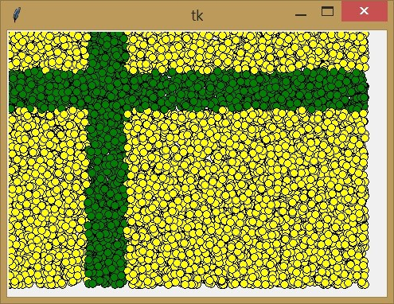
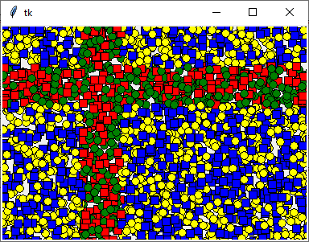
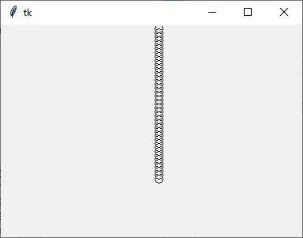
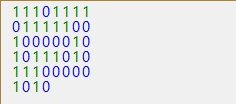
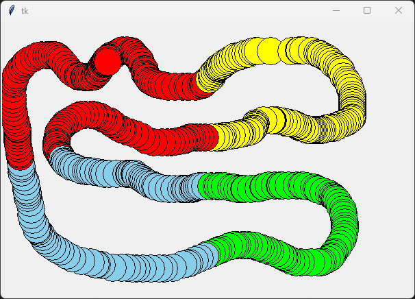
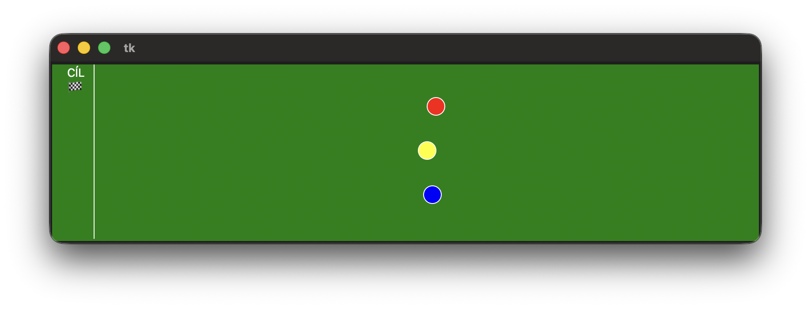


# Lekce 14: Časovač <!-- omit in toc -->

---

- [1. Úvod](#1-úvod)
- [2. Časovač](#2-časovač)
- [3. Globální proměnná](#3-globální-proměnná)
  - [3.1. ❓ Otázky](#31--otázky)
- [4. 💾 Cvičení](#4--cvičení)
  - [4.1. Kulička vodorovně vpravo](#41-kulička-vodorovně-vpravo)
  - [4.2. Kulička svisle dolů](#42-kulička-svisle-dolů)
  - [4.3. Kulička šikmo dolů](#43-kulička-šikmo-dolů)
- [5. Co program dělá (1)](#5-co-program-dělá-1)
- [6. Co program dělá (2)](#6-co-program-dělá-2)
  - [6.1. Jedničky a nuly](#61-jedničky-a-nuly)
  - [6.2. Kolize](#62-kolize)
  - [6.3. Barevná hadice](#63-barevná-hadice)
  - [6.4. Dostihy](#64-dostihy)


---

# 1. Úvod
V předchozí kapitole jsme v místě kliknutí nakreslili barevné kroužky podle určité podmínky. Abychom nakreslili více kroužků, museli jsme kliknout myší vícekrát. To můžeme prozatím vyřešit pomocí cyklu `for`: nakreslíme více kroužků najednou na náhodném místě.

```py
# 14_1.py

import tkinter
import random

canvas = tkinter.Canvas()
canvas.pack()

def krouzek():
    x = random.randrange(450)
    y = random.randrange(320)
    if 100<x<150 or 50<y<100:
        canvas.create_oval(x-5, y-5, x+5, y+5, fill='green')
    else:
        canvas.create_oval(x-5, y-5, x+5, y+5, fill='yellow')

for i in range(1, 1000):
    krouzek()
```



Cyklus `for` již můžeme upravit tak, aby se jednotlivé iterace prováděly postupně s určitým časovým zpožděním. K tomu jsme použili `canvas.after()` a `canvas.update()`. Takto upravíme smyčku `for`, aby se vykreslovala postupně.

```py
for i in range(1, 1000):
    krouzek()
    canvas.update()
    canvas.after(10)
```

Cyklus `for` používáme v situacích, kdy předem víme počet opakování. Proto se jí říká **cyklus s pevným počtem opakování**. 

# 2. Časovač

Existují však situace, kdy potřebujeme akci opakovat, ale přesný počet opakování předem neznáme. K řešení takového problému můžeme použít tzv. **časovač**, který v pravidelných časových intervalech opakuje zadanou posloupnost příkazů. K tomu slouží příkaz

```py
canvas.after(time, function)
```

Zadáme mu nejen čas v milisekundách, ale také název funkce, která se má provést.

Náš program po úpravě pomocí časovače:

```py
# 14_2.py

import tkinter
import random

canvas = tkinter.Canvas(width=450,height=320)
canvas.pack()

def krouzek():
    x = random.randrange(450)
    y = random.randrange(320)
    if 100<x<150 or 50<y<100:
        canvas.create_oval(x-5, y-5, x+5, y+5, fill='green')
    else:
        canvas.create_oval(x-5, y-5, x+5, y+5, fill='yellow')
    canvas.after(10, krouzek)

def ctverec():
    x = random.randrange(450)
    y = random.randrange(320)
    if 100<x<150 or 50<y<100:
        canvas.create_rectangle(x-5, y-5, x+5, y+5, fill='red')
    else:
        canvas.create_rectangle(x-5, y-5, x+5, y+5, fill='blue')
    canvas.after(30, ctverec)

ctverec()
krouzek()
```

Program po nějaké době vykreslí takový obrázek:




---

Následující program postupně nakreslí několik kuliček.


```py
# 14_3.py

import tkinter

canvas = tkinter.Canvas(width=400,height=300)
canvas.pack()

def micek():
    global x
    global y
    canvas.create_oval(x-5, y-5, x+5, y+5)
    y = y + 5
    if y < 200:
        canvas.after(100, micek)
	
x = 200
y = 5

micek()
```

# 3. Globální proměnná

Všimněte si, že jsme v předchozím programu nastavili proměnnou `x` na 200 a `y` na 5. V těchto proměnných jsou souřadnice, na kterých je nakreslena první kulička. Po nastavení proměnných spustíme funkci `micek`. Tato funkce nakreslí kuličku (kruh) na souřadnice podle hodnot proměnných `x` a `y`. Další kuličku chceme nakreslit na souřadnice, které jsou uvedeny v proměnných `x` a `y`. Další chceme nakreslit o 5 bodů níže. Proto zvýšíme `y` o 5, takže napíšeme `y = y + 5`. Protože jsme ve funkci `micek`, nemůžeme zde normálně měnit hodnotu proměnné, která se používá v hlavním programu mimo naši funkci. Jak `y`, tak `x` jsou **globální** proměnné, nikoli **lokální** proměnné ve funkci, kde je chceme změnit. V takových situaci musíme použít příkaz `global` a název proměnné, abychom funkci sdělili, že chceme pracovat s proměnnou, která je mimi tělo funkce. Nyní má `y` hodnotu 10. V dalším řádku se ptáme, zda je `y` menší než 200, a to pouze v případě, že je tato podmínka splněna, naplánujeme další provedení funkce micek na 100 milisekund. Vidíme, že jsme vytvořili časovač, který neopakuje příkazy donekonečna, ale jen tak dlouho, dokud je splněna podmínka. Po spuštění programu uvidíme, že se pod sebou vykresluje několik kuliček.



---

Pomocí `canvas.delete('all')` můžeme odstranit vše, co jsme nakreslili. Pokud tento příkaz napíšeme na začátku funkce, funkce pokaždé vymaže vše nakreslené a my uvidíme **pouze poslední nakreslený objekt**. To je princip animace. Nejprve vymažeme původní obrázky a nakreslíme stejný tvar v posunuté poloze. A tak stále dokola.

```py
def micek():
    global x
    global y
    canvas.delete('all')
    canvas.create_oval(x-5, y-5, x+5, y+5)
    y = y + 5
    if y < 200:
        canvas.after(100, micek)
```

## 3.1. ❓ Otázky

1) Co tento program udělá, když obrátíme pořadí `create_oval` a `delete`?

2) Na které souřadnici bude nakreslen poslední obrazec?

3) Co udělá tento program, pokud nahradíme podmínku touto `y == 200`?

4) Co program udělá, jestliže zvětšíme `y` o 6 (`y = y + 6`) a nahradíme podmínku následující: `y == 200`?

# 4. 💾 Cvičení


## 4.1. Kulička vodorovně vpravo
Vytvořte program `14_vodorovne.py`, který přesune kuličku vodorovně od levého okraje k pravému okraji.

## 4.2. Kulička svisle dolů
Vytvořte program `14_svisle.py`, ve kterém bude kulička padat svisle shora dolů, a až dosáhne spodní hrany, bude opět padat shora dolů.

## 4.3. Kulička šikmo dolů
Vytvořte program `14_sikmo.py`, ve kterém se bude kulička pohybovat šikmo dolů.


# 5. Co program dělá (1)
Zjistěte, co udělá následující program:

```py
# 14_4.py

import tkinter

canvas = tkinter.Canvas(width=400,height=300)
canvas.pack()

def micek():
    global x
    global y
    global pokracovat
    canvas.delete('all')
    canvas.create_oval(x-5, y-5, x+5, y+5)
    y = y + 5
    if y > 250:
        y = 5
    if pokracovat == 1:
        canvas.after(100, micek)

def stop(souradnice):
    global pokracovat
    pokracovat = 0
	
pokracovat = 1
x = 200
y = 5
micek()

canvas.bind('<ButtonPress-1>', stop)
```

# 6. Co program dělá (2) 
Zjistěte, co udělá následující program:

```py
# 14_5.py

import tkinter

canvas = tkinter.Canvas(width=400,height=300)
canvas.pack()

def micek():
    # úspornější zápis pro více proměnných
    global x, y, pokracovat
    canvas.delete('all')
    canvas.create_oval(x-5, y-5, x+5, y+5)
    y = y + 5
    if y > 250:
        y = 5
    if pokracovat == 1:
        canvas.after(100, micek)

def stop(souradnice):
    global pokracovat
    if pokracovat == 1:
        pokracovat = 0
    else:
        pokracovat = 1
        micek()

pokracovat = 1
x = 200
y = 5
micek()
canvas.bind('<ButtonPress-1>', stop)
```

## 6.1. Jedničky a nuly
Vytvořte program `14_jednicky_nuly.py`, který bude postupně zapisovat na plátno 0 nebo 1 (náhodně vybrané):



Program bude mít následující vlastnosti:

- program začne zapisovat od levého horního rohu v jednom řádku, dokud ho nezaplní,
- když se jeden řádek zaplní, bude pokračovat v zápisu na další řádek. Můžete určit, kolik čísel má být na řádku (v ukázce je jich 8),
- barvy číslic 0 a 1 jsou odlišné,
- po stisknutí klávesy <kbd>P</kbd> se výstup zastaví (pauza),
- opětovným stisknutím klávesy <kbd>P</kbd> se pozastavený výstup obnoví,
- po zaplnění celé obrazovky program skončí,
- program po ukončení do terminálu vypíše počty zapsaných jedniček a nul.


## 6.2. Kolize
Vytvořte program `14_kolize.py`, který má následující vlastnosti:

- modrá kulička se pohybuje vodorovně od levého okraje vpravo,
- od pravého okraje se červená kulička pohybuje vodorovně doleva,
- v každém kroku posunu kuličky (každá zvlášť) zvolí program velikost posunu od 5 do 10 pixelů (náhodně),
- animace se zastaví, když se kuličky setkají,
- v místě srážky se něco zobrazí, například "BUM",
- animace bude naprogramována v jedné funkci (použijte pouze jeden časovač).


## 6.3. Barevná hadice

Vytvoř program `14_hadice.py`, který bude tažením myší se stisknutým levým tlačítkem kreslit barevné kroužky. Plocha bude rozdělena na čtyři stejně velké sektory. V každém bude mít hadice jinou barvu. Pro větší efekt požijte časovač. Stisknutím pravéh tlačíčka se plocha smaže.




## 6.4. Dostihy

Vytvoř program `14_dostihy.py` simulující dostihový závod, který má následující vlastnosti:



- Kousek od pravého okraje grafické plochy stojí tři koně na startu -- tři kolečka různých barev svisle pod sebou (s rozestupy). 
- Kousek od levého okraje je svislá čára představující cílovou pásku. 
- Koně se v každém kroku posunují směrem doleva (k cíli) o náhodný krok od 1 do 15 pixelů.
- Animace se zastaví, když jeden kůň vyhraje - doběhne do cíle.
- Cílová páska se zobrazuje po celou dobu závodu. 
- **Pro zdatnější**:  Do grafické plochy se vypíše vítězný kůň, např. "Vyhrál žlutý kůň".

