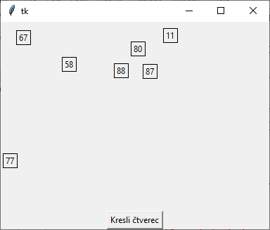
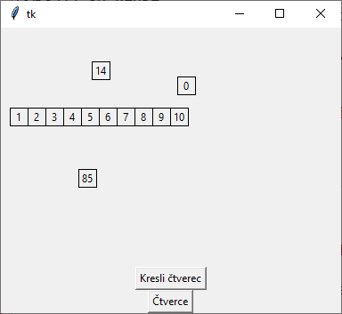
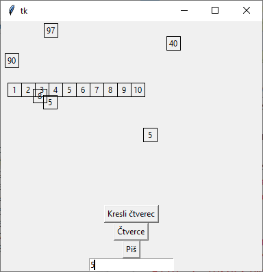
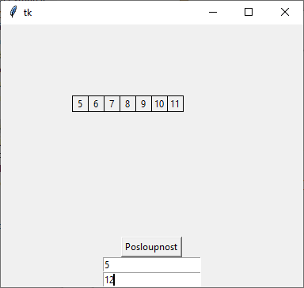
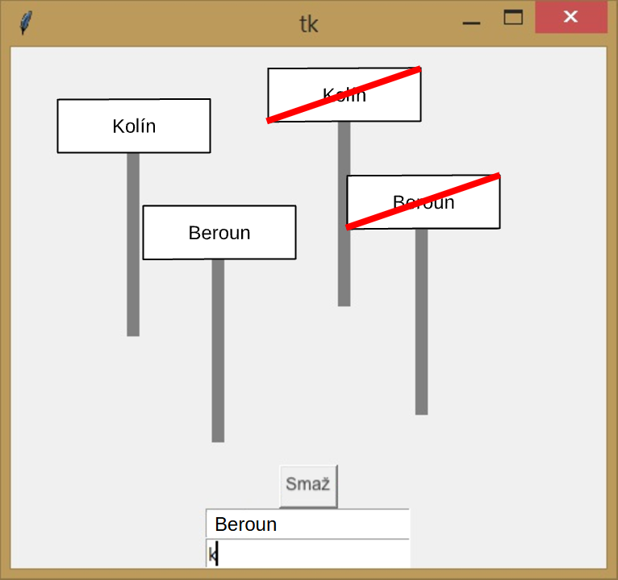
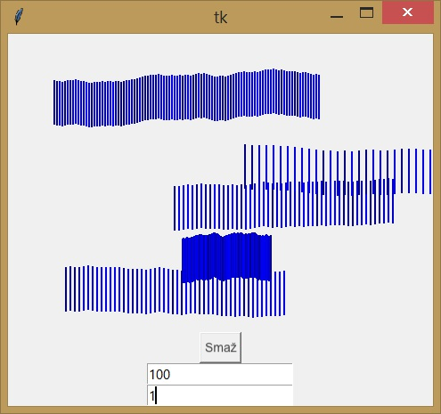
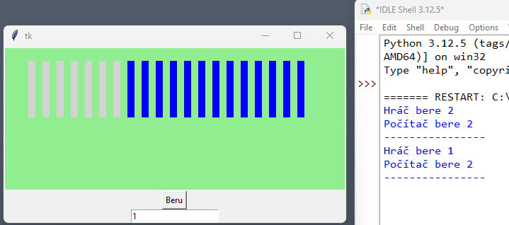


# Lekce 15: Tlačítka a vstupní pole <!-- omit in toc -->

---

- [1. Tlačítko](#1-tlačítko)
- [2. Textové pole](#2-textové-pole)
- [3. 💾 Cvičení](#3--cvičení)
  - [3.1. Značka začátek a konec obce](#31-značka-začátek-a-konec-obce)
  - [3.2. Svislé čáry](#32-svislé-čáry)
  - [3.3. Kalkulačka](#33-kalkulačka)
  - [3.4. Hra Nim](#34-hra-nim)


---

# 1. Tlačítko
V okně programu můžeme vytvářet různé prvky, na které jsme zvyklí při používání běžných programů. Nyní si ukážeme, jak vytvořit tlačítko a jak mu nastavit, co má po kliknutí udělat.

```py
# 15_1.py

import tkinter
import random

canvas = tkinter.Canvas(width=400,height=300)
canvas.pack()

def ctverec(x, y, info):
    canvas.create_rectangle(x-10, y-10, x+10, y+10)
    canvas.create_text(x, y, text=info)

def button1_klik():
    x = random.randrange(300)
    y = random.randrange(200)
    text = random.randrange(100)
    ctverec(x, y, text)
    
button1 = tkinter.Button(text='Kresli čtverec', command=button1_klik)
button1.pack()
```



Pomocí příkazu `tkinter.Button` vytvoříme **tlačítko**. V příkazu nastavíme text zobrazený na tlačítku a příkaz, který se provede po kliknutí na tlačítko. Odkaz na nové tlačítko jsme uložili do proměnné `button1`. Položka `button1.pack()` zajišťuje zobrazení nového tlačítka. V programu jsme ještě vytvořili funkci `button1_click`, která je nastavena jako příkaz pro toto tlačítko `command = button1_click`. V tomto funkci zapíšeme, co všechno se má stát po stisknutí tlačítka.

Další program již obsahuje dvě tlačítka, přičemž druhé z nich vykreslí hned vedle sebe 10 čtverečků, postupně s čísly 1 až 10.

```py
# 15_2.py

import tkinter
import random

canvas = tkinter.Canvas(width=400,height=300)
canvas.pack()

def ctverec(x, y, info):
    canvas.create_rectangle(x-10, y-10, x+10, y+10)
    canvas.create_text(x, y, text=info)

def button1_klik():
    x = random.randrange(300)
    y = random.randrange(200)
    text = random.randrange(100)
    ctverec(x, y, text)

def button2_klik():
    for i in range(1, 11):
        ctverec(i*20, 100, i)

button1 = tkinter.Button(text='Kresli čtverec', command=button1_klik)
button1.pack()

button2 = tkinter.Button(text='Čtverce', command=button2_klik)
button2.pack()
```




# 2. Textové pole

Kromě tlačítek můžeme mít v programu také prvek `Entry`, který slouží k **zadávání vstupních údajů do programu** (textové pole):

```python
# 15_3.py

import tkinter
import random

canvas = tkinter.Canvas(width=400,height=300)
canvas.pack()

def ctverec(x, y, info):
    canvas.create_rectangle(x-10, y-10, x+10, y+10)
    canvas.create_text(x, y, text=info)

def button1_klik():
    x = random.randrange(300)
    y = random.randrange(200)
    text = random.randrange(100)
    ctverec(x, y, text)

def button2_klik():
    for i in range(1, 11):
        ctverec(i*20, 100, i)

def button3_klik():
    x = random.randrange(300)
    y = random.randrange(200)
    text = entry1.get()
    ctverec(x, y, text)

button1 = tkinter.Button(text='Kresli čtverec', command=button1_klik)
button1.pack()

button2 = tkinter.Button(text='Čtverce', command=button2_klik)
button2.pack()

button3 = tkinter.Button(text='Piš', command=button3_klik)
button3.pack()

entry1 = tkinter.Entry()
entry1.pack()
```

Zápisem `entry1 = tkinter.Entry()` jsme vytvořili okno, do kterého můžeme zadávat text (někdy se mu říká **vstupní** nebo **textové pole**). Odkaz na toto vstupní pole jsme uložili do proměnné `entry1`. Potřebujeme jej také zobrazit příkazem `pack()`. Při vykreslování čtverce po kliknutí na tlačítko 3 použijeme funkci `entry1.get()`, která vyhledá aktuální údaje v našem `entry1` a vykreslí je do čtverce:



---

Následující program vykreslí posloupnost čtverců vedle sebe podle informací na vstupu. vstupních polích `entry1` a `entry2`. V prvním poli zadáme, od kterého čísla chceme smyčku opakovat, ve druhém, do kterého čísla chceme smyčku opakovat (kromě tohoto). V programu jsme ještě museli použít funkci `int()`, která převádí číslo v textové podobě na celé číslo (jako číselnou hodnotu), se kterou můžeme pracovat jako s běžným číslem.

```python
# 15_4.py

import tkinter

canvas = tkinter.Canvas(width=800,height=200)
canvas.pack()

def ctverec(x, y, info):
    canvas.create_rectangle(x-10, y-10, x+10, y+10)
    canvas.create_text(x, y, text=info)

def button1_klik():
    od = int(entry1.get())
    do = int(entry2.get())
    for i in range(od, do):
        ctverec(i*20, 100, i)

button1 = tkinter.Button(text='Posloupnost', command=button1_klik)
button1.pack()

entry1 = tkinter.Entry()
entry1.pack()

entry2 = tkinter.Entry()
entry2.pack()
```


# 3. 💾 Cvičení


## 3.1. Značka začátek a konec obce
Vytvořte program `15_znacka_obce.py`, který na místo kliknutí vykreslí dopravní značku začátek/konec obce. V programu jsou dvě vstupní pole. Do jednoho zadáváme název obce a do druhé zadáváme, zda se má vykreslit značka začátku nebo konce obce. Značka konec obce se vykreslí, pokud do druhého pole zadáme písmeno „k“. V programu bude také tlačítko, které vymaže grafickou plochu:



## 3.2. Svislé čáry
Vytvořte program `15_svisle_cary.py`, ve kterém můžeme kreslit sousedící svislé čáry v místě kliknutí myší. V programu jsou dvě vstupní pole. V jedné zadáváme počet čar. Ve druhé velikost mezery mezi čarami. Začátek čáry je posunut od předchozí čáry o náhodný posun z intervalu &minus;1 až +1. Barva čar je náhodně vybrána z předem definovaných hodnot. V ukázce jsou 4 různé odstíny modré (`blue1`, `blue2`, `blue3` a `blue4`). V programu bude také tlačítko, které vymaže grafickou plochu.




Přidejte do předchozího programu další pole, kterou lze použít k určení délky čar.


## 3.3. Kalkulačka
Napište program `15_kalkulacka.py`, který bude obsahovat tři vstupní pole: pro zadání dvou čísel a pro operaci: `+`, `-`, `*` a `/`. Dále dvě tlačítka "Vypočítat" a "Smazat". Program do  grafické plochy  vypíše celý příklad, např. 4 + 7 = 11.

## 3.4. Hra Nim
-   Na stole leží 20 zápalek.    
-   Hráči se střídají a v každém tahu musí odebrat 1, 2 nebo 3 zápalky.
-   Vyhrává ten, kdo odebere poslední zápalky (tj. udělá poslední tah).



Napište program `15_nim.py`, který takovou hru vytvoří.

1.  Zápalky ležící na "stole" tvoří silnější čáry s mezerami mezi sebou. Budou mít nějakou výraznější barvu. Pod nimi je tlačítko <kbd>Beru</kbd> a vstupní pole pro zápis počtu odebraných zápalek.
2.  Hru začíná "živý hráč". Poté hraje počítač – náhodně odebere 1, 2 nebo 3 zápalky. Tento počet se vypisuje do okna shellu.    
3.  Po odebrání všech zápalek se do okna shellu vypíše vítěz hry.    
4.  V každém tahu se odebrané zápalky směrem zleva přebarvují světle šedou barvou (viz obrázek).    
 
**Rozšíření (pro zdatnější)**:
1.  Přidat tlačítko <kbd>Nová hra</kbd> – resetuje hru a vygeneruje novou.    
2.  Program odmítne jiný počet než 1, 2 nebo 3.
3.  Existuje strategie, kolik zápalek program odebere, aby si zajistil šanci na výhru. Aplikuj ji.

**Verze pro ty, co si netroufají na grafickou verzi**:  
-   Hra bude kompletně v textovém terminálu (bez knihovny `tkinter`).
-   Pro vstup použijte funkci `input()` s přetypováním na celé číslo `int()`:
	```python
	>>> pocet = int(input(Beru: ))
	Beru: 3
	>>> pocet
	3
	```
- Jelikož není vidět počet zbývajících zápalek, program v každém tahu hráče i počítače vypíše počet zbývajících zápalek.
- Ostatní prvky hry budou stejné.
- Můžeš přidat rozšíření číslo 2 a 3.
