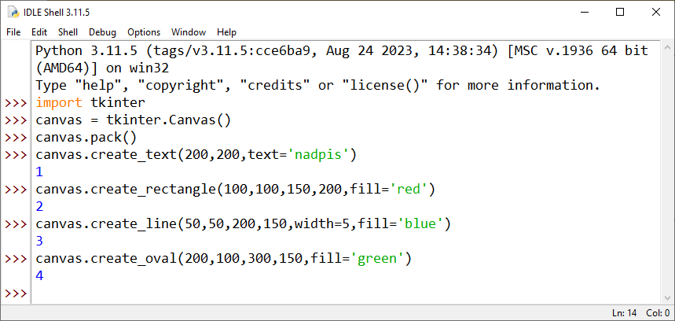
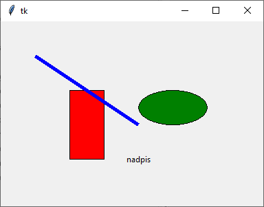
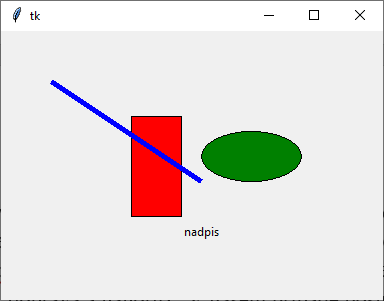
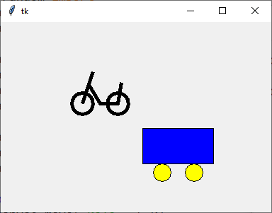


# Lekce 16: Posouvání objektů na plátně <!-- omit in toc -->

---

- [1. Přesun objektu](#1-přesun-objektu)
- [2. Přesun všech objektů najednou](#2-přesun-všech-objektů-najednou)
  - [2.1. ❓ Otázky](#21--otázky)
- [3. Tagování objektů](#3-tagování-objektů)
- [4. Zjištění souřadnic objektu na plátně](#4-zjištění-souřadnic-objektu-na-plátně)
  - [4.1. 💾 Cvičení: Gravitace](#41--cvičení-gravitace)
- [5. Změna vlastností vykresleného objektu](#5-změna-vlastností-vykresleného-objektu)
  - [5.1. 💾 Cvičení: Křížení](#51--cvičení-křížení)

---


# 1. Přesun objektu

Z předchozích lekcí již víme, že příkazy můžeme psát i v okně shellu. Takto jsme postupně napsali příkazy pro import modulu `tkinter` a nakreslili text, obdélník, čáru a elipsu. Proces v okně shellu je vidět na obrázku:



Výsledek by byl **stejný**, i kdybychom tento program spustili:

```py
# 16_1.py

import tkinter
canvas = tkinter.Canvas()
canvas.pack()

canvas.create_text(200,200,text='nadpis')
canvas.create_rectangle(100,100,150,200,fill='red')
canvas.create_line(50,50,200,150,width=5,fill='blue')
canvas.create_oval(200,100,300,150,fill='green')
```

Nakreslily se tyto objekty:




Podívejte se znovu do okna shellu na prvním obrázku. Po nakreslení každého z obrazců se na další řádek napíše **číslo vytvořeného obrazce** (objektu). Všechny objekty, které vytvoříme pomocí příkazů začínajících na `canvas.create_`, mají po vytvoření přiřazeno číslo. Python čísluje vytvořené objekty plátna postupně od 1. Tato čísla lze použít pro různé změny objektu. 

Příkazem `canvas.move` můžeme přesouvat objekty vytvořené na plátně. Například `canvas.move(2, 30, -15)` posune objekt s číslem 2 o +30 bodů na ose `x` a o &minus;15 bodů na ose `y` (tj. doprava a nahoru) . V našem případě posuneme červený obdélník (má číslo 2).

```py
>>> canvas.move(2, 30, -15)
>>>
```


---

Čísla vytvořených objektů si můžeme uložit do proměnných a pak použít proměnnou, ve které si pamatujeme číslo objektu při pohybu. 


Následující program si pamatuje proměnné pro každý vytvořený objekt a po stisku šipky doprava zavolá funkci, která jednotlivé objekty posune doprava.

```py
# 16_2.py

import tkinter
canvas = tkinter.Canvas()
canvas.pack()

nadpis = canvas.create_text(200,200,text='nadpis')
obdelnik = canvas.create_rectangle(100,100,150,200,fill='red')
cara = canvas.create_line(50,50,200,150,width=5,fill='blue')
oval = canvas.create_oval(200,100,300,150,fill='green')

def posun_vpravo(event):
    canvas.move(nadpis, 5, 0)
    canvas.move(obdelnik, 5, 0)
    canvas.move(cara, 5, 0)
    canvas.move(oval, 5, 0)

canvas.bind_all('<Right>',posun_vpravo)
```

Vzhledem k tomu, že vytvořené objekty jsou číslovány kontinuálně od jedničky, je zbytečné pamatovat si ty nakreslené v předchozím programu. Číslování lze také použít k přesunu objektů pomocí cyklu `for`. Předchozí program lze také napsat následovně:

```py
# 16_3.py

import tkinter
canvas = tkinter.Canvas()
canvas.pack()

canvas.create_text(200,200,text='nadpis')
canvas.create_rectangle(100,100,150,200,fill='red')
canvas.create_line(50,50,200,150,width=5,fill='blue')
canvas.create_oval(200,100,300,150,fill='green')

def posun_vpravo(event):
    for i in range(1,5):
        canvas.move(i,5,0)

canvas.bind_all('<Right>',posun_vpravo)
```

# 2. Přesun všech objektů najednou

Když přesunujeme všechny objekty najednou, můžeme místo konkrétního čísla použít zápis `'all'`, `canvas.move('all',5,0)`. S tímto zápisem jsme se již setkali v příkazech `canvas.delete('all')`. Teď už nejspíš správně tušíme, že pokud chceme smazat jen jeden objekt, můžeme příkazem `canvas.delete('all')` zadat místo parametru `'all'` číslo konkrétního objektu. 

Následující program přesune všechny nakreslené objekty doprava a doleva jeden náhodně vybraný, jehož počet je mezi 1 a 5 (včetně).

```py
# 16_4.py

import tkinter
import random
canvas = tkinter.Canvas()
canvas.pack()

canvas.create_text(200,200,text='nadpis')
canvas.create_rectangle(100,100,150,200,fill='red')
canvas.create_line(50,50,200,150,width=5,fill='blue')
canvas.create_oval(200,100,300,150,fill='green')

def posun_vpravo(event):
    canvas.move('all',5,0)

def posun_vlevo(event):
    objekt = random.randint(1,4)
    canvas.move(objekt,-5,0)

canvas.bind_all('<Right>', posun_vpravo)
canvas.bind_all('<Left>', posun_vlevo)
```

## 2.1. ❓ Otázky
1) Co udělá předchozí program, když v příkazovém režimu `>>>` vytvoříme další objekty? Budou se i tyto přesouvat?

2) Jaký je rozdíl v posouvání pomocí parametru `'all'` a posouváním pomocí cyklu v případě, že bychom v příkazovém řádku vytvořili nové objekty?

3) Co se stane, když budeme posouvat nebo mazat objekt, který jsme už smazali?


# 3. Tagování objektů

Pokud jsme vytvořili obrázek z více objektů, je obtížnější procházet celý obrázek najednou. Potřebovali bychom znát číslo prvního nakresleného objektu tohoto obrázku a počet nakreslených částí. Za předpokladu, že jsme je nakreslili správně za sebou, můžeme takový obrázek posouvat ve smyčce `for` od čísla prvního objektu k číslu podle počtu částí. 


Existuje však i jednodušší možnost. Můžeme označit všechny části obrázku nějakou společnou značkou a pak můžeme procházet objekty, které tuto společnou značku mají. Objekt označíme při jeho vytváření parametrem `tags`, například

```py
canvas.create_oval(x,y,x+10,y+10, tags='auto')
```

Při posouvání pak můžeme místo čísla tohoto objektu použít jeho značku. Například tag `canvas.move('auto', 5, 0)` lze použít i při mazání objektu. V následujícím programu jsme nakreslili auto a vozik a jednotlivé části těchto obrázků jsme označili tagy. Poté je pomocí časovače přesuneme každý zvlášť.


```py
# 16_5.py

import tkinter

canvas = tkinter.Canvas()
canvas.pack()

canvas.create_rectangle(100,150,200,200,fill='blue',tags='vozik')
canvas.create_oval(115,200,140,225,fill='yellow',tags='vozik')
canvas.create_oval(160,200,185,225,fill='yellow',tags='vozik')

canvas.create_oval(200,100,230,130, fill='',width=5,
        outline='black',tags='kolo')
canvas.create_oval(250,100,280,130, fill='',width=5,
        outline='black',tags='kolo')
canvas.create_line(215,115,230,70, width=5,tags='kolo')
canvas.create_line(225,90,240,115,265,115,270,85, width=5,tags='kolo')

def posouvej():
    canvas.move('kolo',-5,0)
    canvas.move('vozik',5,0)
    canvas.after(100,posouvej)

posouvej()
```




Vozik i auto po určité době opustí obrazovku. Můžeme je chtít zobrazit na opačném konci. Toto lze vyřešit různými způsoby. Protože to chceme řešit pomocí příkazů, které již známe, je nejjednodušší vypočítat aktuální pozici každého obrázku a uložit do proměnné. V případě, že již bude mimo obrazovku, posuneme obrázek o celou šířku obrazovky na opačnou stranu.


```py
# 16_6.py

import tkinter

sirka = 600
canvas = tkinter.Canvas(bg='white', width=sirka, height=250)
canvas.pack()

x_vozik = 100
canvas.create_rectangle(100,150,200,200,fill='blue',tags='vozik')
canvas.create_oval(115,200,140,225,fill='yellow',tags='vozik')
canvas.create_oval(160,200,185,225,fill='yellow',tags='vozik')

x_kolo = 200
canvas.create_oval(200,100,230,130, fill='',width=5,
        outline='black',tags='kolo')
canvas.create_oval(250,100,280,130, fill='',width=5,
        outline='black',tags='kolo')
canvas.create_line(215,115,230,70, width=5,tags='kolo')
canvas.create_line(225,90,240,115,265,115,270,85, width=5,tags='kolo')

def posouvej():
    global x_vozik, x_kolo
    x_kolo = x_kolo-5
    canvas.move('kolo',-5,0)
    if x_kolo<0:
        x_kolo = x_kolo + sirka
        canvas.move('kolo',sirka,0)
    x_vozik = x_vozik+5
    canvas.move('vozik',5,0)
    if x_vozik>sirka:
        x_vozik = x_vozik - sirka
        canvas.move('vozik',-sirka,0)
    #informace si muzeme vypsat i do shellu
    print("vozik:", x_vozik, "kolo:", x_kolo) 
    canvas.after(100,posouvej)

posouvej()
```

# 4. Zjištění souřadnic objektu na plátně

V lekci 14 byl program, který animoval míček padající shora. Jeho kód vypadal nějak takto:

```py
# 16_7.py

import tkinter

vyska = 300
canvas = tkinter.Canvas(width=400,height=vyska)
canvas.pack()

def micek():
    global x, y, vyska
    canvas.delete('all')
    canvas.create_oval(x-5, y-5, x+5, y+5,fill="green")
    y = y + 5

    # Pokud míček spadne pod plátno, vrať ho nahoru
    if y > vyska:
        y = 5

    canvas.afrer(30, micek)

x = 200
y = 5
micek()
```

S využitím metody `move` by vypdal nějak takto:

```py
# 16_8.py

import tkinter

vyska = 300
canvas = tkinter.Canvas(width=400, height=vyska)
canvas.pack()

micek = canvas.create_oval(190, 0, 210, 20, fill="green")

def padani():
    global vyska
    canvas.move(micek, 0, 5)
    x1, y1, x2, y2 = canvas.coords(micek)

    # Pokud míček spadne pod plátno, vrať ho nahoru
    if y1 > vyska:
        canvas.move(micek, 0, -vyska)

    canvas.after(30, padani)

padani()
```

V programu `16_8.py` máme další užitečnou metodu `coords` pro získání souřadnic objektu (`x1, y1, x2, y2`). Tato čísla udávají vzdálenost od výchozích souřadnic okna [0,0]. Metoda `coords` toho umí víc, prozatím toto stačí.

Později se dozvíme, že konstrukce funkce `padani()` by šla napsat i bez dodatečných proměnných `x1`, `y1`, `x2` a `y2`:

```py
def padani():
    canvas.move(micek, 0, 5)

    # Pokud míček spadne pod plátno, vrať ho nahoru
    if canvas.coords(micek)[1] > 300:
        canvas.move(micek, 0, -vyska)
```


##  4.1. 💾 Cvičení: Gravitace

Vytvoř program `prijmeni_gravitace.py`, který po spuštění zobrazí u horního okraje okna tři různé objekty (čtverec, obdélník, kruh). 30-50 pixelů od spodního okraje okna bude vodorovná linka představující zem. Objekty budou **různou rychlostí** padat dolů (pomocí různých "random" na začátku animace). Jakmile objekt dosáhne země, jeho padání se zastaví. Ostatní stále padají dokud také nedosáhnou země.


# 5. Změna vlastností vykresleného objektu

Následující program posouvá kuličku vodorovně po plátně tam a zpět. Rychlost je zvolena náhodně. V levé polovíně je oranžová, v pravé je zelená. Inverzně se mění barva pozadí:

```py
# 16_9.py

import tkinter
import random

sirka = 400
vyska = 300

canvas = tkinter.Canvas(width=sirka, height=vyska)
canvas.pack()

# vytvoření dvou čtverců
ctverec = canvas.create_oval(50, 130, 90, 170, fill="green")
krok = random.randint(2, 4)

def pohyb():
    global ctverec, krok, sirka
    # pohyb vodorovného čtverce
    canvas.move(ctverec, krok, 0)
    x1, y1, x2, y2 = canvas.coords(ctverec)

    # odraz od okraje
    if x1 < 0 or x2 > 400:
        krok = -krok

    if x1 < sirka // 2:
        canvas.itemconfig(ctverec, fill="orange")
        canvas.config(bg="green")
    else:
        canvas.itemconfig(ctverec, fill="green")
        canvas.config(bg="orange")
    canvas.after(20, pohyb)

pohyb()
```

V programu je využita metoda `itemconfig`. Ta umožňuje **změnit vlastnosti už existujícího objektu na plátně** (například barvu, tloušťku čáry, text, font...). Nemusíme objekt mazat a kreslit znovu – jen mu změníme nastavení.

Naopak metoda `config` umí měnit vlastnosti samotného plátna. V ukázkovém programu `canvas.config(bg="orange")`.

##  5.1. 💾 Cvičení: Křížení

Vytvoř program `prijmeni_krizeni.py`. Na plátně se pohybují dvě kuličky, každá jedné barvy. Jedna se pohybuje vodorovně tam a zpět konstantní rychlostí danou random na začátku programu. Druhá dělá totéž, jen se pohybuje svisle. Pohyby budou pomalejší (random mezi 2-5, časovač kolem 20). V okamžiku, kdy se potkají, změní barvu. Pak se jim barvy vrátí zpět na původní.


