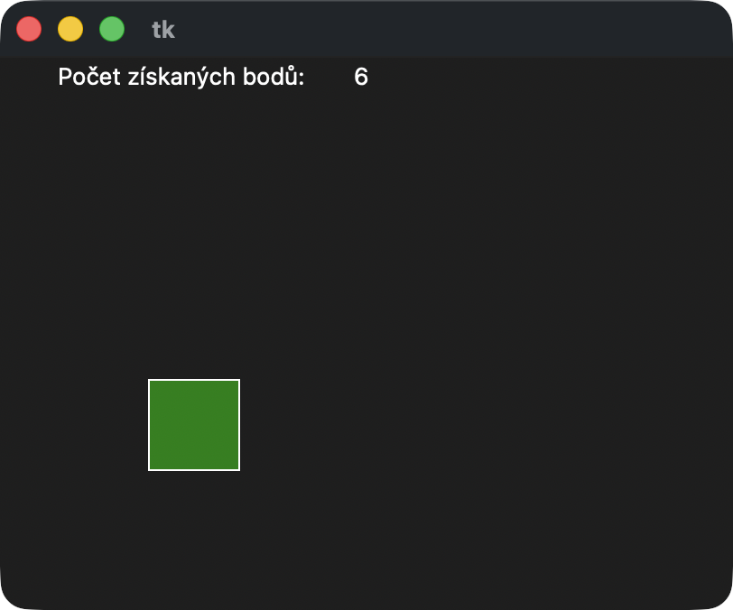
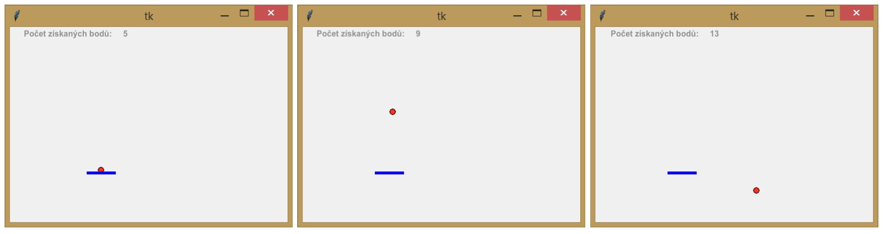
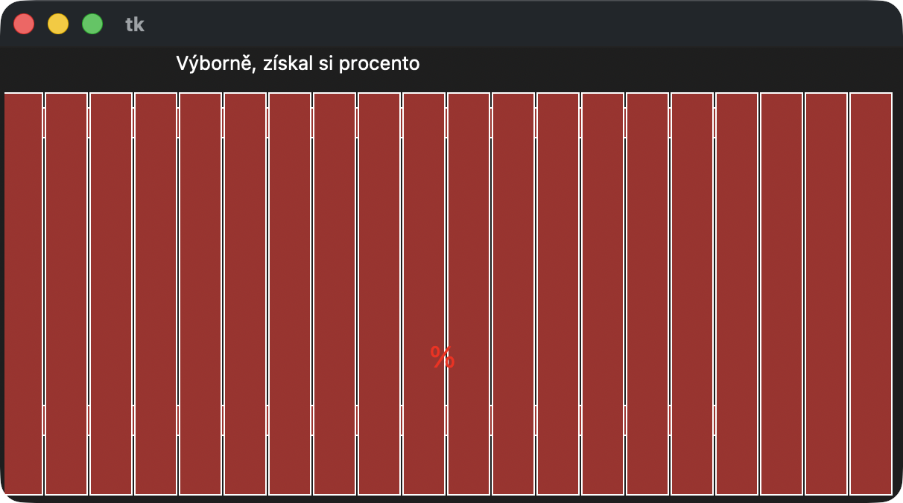
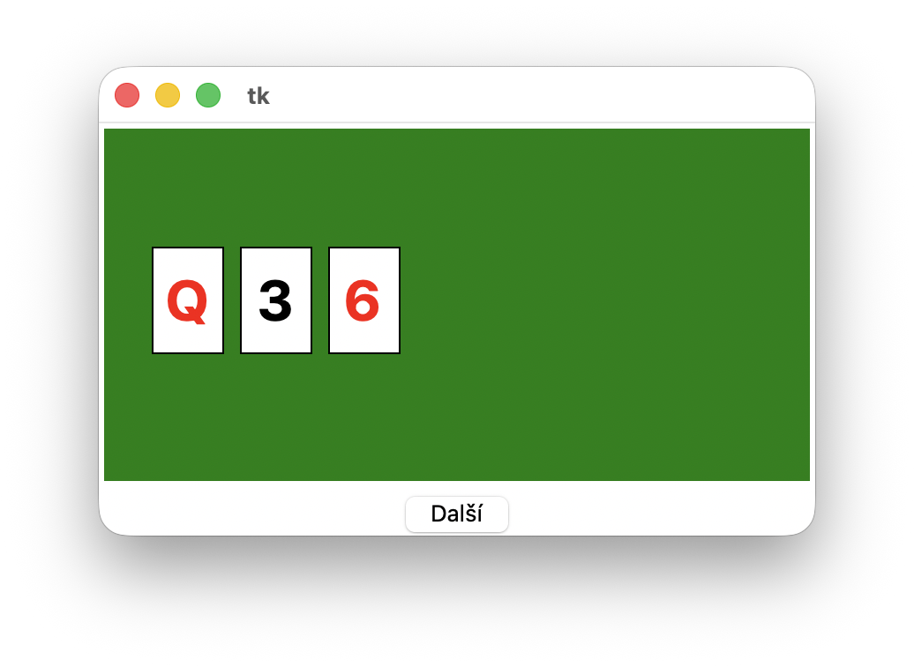


# Lekce 17: Jednoduché hry  <!-- omit in toc -->


---

- [1. Tester pozornosti](#1-tester-pozornosti)
  - [1.1. 💾 Úkoly](#11--úkoly)
- [2. Chytání kuličky](#2-chytání-kuličky)
  - [2.1. 💾 Úkoly](#21--úkoly)
- [3. Hledej procento](#3-hledej-procento)
  - [3.1. 💾 Úkoly](#31--úkoly)
- [4. Hra 21](#4-hra-21)
  - [4.1. 💾 Úkoly](#41--úkoly)

---

# 1. Tester pozornosti

Vytvoř hru (program) `prijmeni_pozornost.py`, která nám bude v pravidelných intervalech náhodně vykreslovat zelený čtverec, do kterého by měl hráč klikat. Musí to udělat, dokud čtverec nezmění místo. Pokud se trefí do čtverce, získá 1 bod, pokud pole netrefí, naopak o jeden bod přijde. V horní části obrazovky hráč vidí počet získaných bodů.



Řešení programu:

```py
# tester_pozornosti.py

import tkinter
import random

canvas = tkinter.Canvas(width=400, height=300)
canvas.pack()

def ctverec():
    global d, body, sx, sy, id_ctv, id_txt1, id_txt2

    # vygeneruj nové souřadnice
    nsx = random.randint(0, 300)
    nsy = random.randint(20, 250)

    # kolik se má čtverec posunout?
    x0, y0, x1, y1 = canvas.coords(id_ctv)
    dx = nsx - x0
    dy = nsy - y0

    # posun čtverce
    canvas.move(id_ctv, dx, dy)

    # posun textu s body (aby byl staticky na stejném místě → neposouváme)
    canvas.itemconfig(id_txt2, text=body)

    # ulož nové souřadnice
    sx, sy = nsx, nsy

    canvas.after(500, ctverec)


def klik(mys):
    global body, d, sx, sy
    x = mys.x
    y = mys.y
    if sx < x < sx+d and sy < y < sy+d:
        body += 1
    else:
        body -= 1


body = 0
d = 50
sx = 0
sy = 0

# vytvoření objektů JEDNOU
id_ctv = canvas.create_rectangle(sx, sy, sx+d, sy+d, fill='green')
id_txt1 = canvas.create_text(100, 10, text='Počet získaných bodů:')
id_txt2 = canvas.create_text(200, 10, text=body)

ctverec()
canvas.bind('<Button-1>', klik)
```


## 1.1. 💾 Úkoly

1) Uprav program tak, aby se zastavil, pokud jsme získali více než 10 bodů, a pogratuluje nám.

2) Uprav program tak, aby se zastavil, pokud jsme získali méně než -10 bodů, a napsal, že je to s našimi reakcemi trochu horší.

3) Uprav program tak, aby někdy kreslil červený čtvereček, do kterého nesmíme kliknout. Pokud se trefíme do červeného čtverečku, program odečte 2 body. Zastaví se tento upravený program na -10 bodech (pokud bychom řešili i úlohu 2)?

4) Uprav program tak, aby se obtížnost měnila podle stavu bodů - například za určitý počet získaných bodů se častěji posouvá čtverec, nebo se kreslí menší, nebo se častěji kreslí červený čtverec.

# 2. Chytání kuličky

Vytvoř hru (programu) `prijmeni_chytani_kulicky.py`, ve které bude shora obrazovky padat červená kulička. Ve spodní části obrazovky bude modrý kurzor – vodorovná čára. Pohybem myši pohybujeme modrým kurzorem doleva nebo doprava. Cílem hry je chytit padající míč pomocí kurzoru. Za chycení míče získáváme 1 bod. Když míč chytíme nebo nechytíme, začne míč opět padat shora, ale na náhodném místě. Stav našeho bodu je uveden v horní části obrazovky.




Řešení programu:

```py
# chytani_kulicky.py

import tkinter
import random

canvas = tkinter.Canvas(width=500, height=300)
canvas.pack()

# vytvoření objektů jen jednou
micek = canvas.create_oval(0, 0, 10, 10, fill='red')
kurzor = canvas.create_line(0, 0, 50, 0, fill='blue', width=5)
text1 = canvas.create_text(100, 10, text='Počet získaných bodů:')
text2 = canvas.create_text(200, 10, text='0')

def nastav_micek(x, y):
    canvas.coords(micek, x-5, y-5, x+5, y+5)

def nastav_kurzor(x, y):
    canvas.coords(kurzor, x, y, x+50, y)

def nastav_body(hodnota):
    canvas.itemconfig(text2, text=str(hodnota))

def hra():
    global micek_x, micek_y, pocet_bodu

    # posun míčku dolů
    micek_y += 5
    nastav_micek(micek_x, micek_y)

    # kolize s „pálkou“
    if kurzor_x < micek_x < kurzor_x + 50 and kurzor_y - 10 < micek_y < kurzor_y:
        pocet_bodu += 1
        nastav_body(pocet_bodu)
        micek_x = random.randrange(300)
        micek_y = 20
        nastav_micek(micek_x, micek_y)

    # když spadne mimo
    if micek_y > 300:
        micek_x = random.randrange(300)
        micek_y = 20
        nastav_micek(micek_x, micek_y)

    canvas.after(20, hra)

def posun_mysi(souradnice):
    global kurzor_x
    kurzor_x = souradnice.x
    nastav_kurzor(kurzor_x, kurzor_y)

# Start
pocet_bodu = 0
micek_x = random.randrange(300)
micek_y = 20
kurzor_x = 150
kurzor_y = 250

# nastavení objektů poprvé
nastav_micek(micek_x, micek_y)
nastav_kurzor(kurzor_x, kurzor_y)
nastav_body(pocet_bodu)

hra() # start hry

canvas.bind('<Motion>', posun_mysi)
```

## 2.1. 💾 Úkoly

1) Uprav program tak, aby nám odečítal body, pokud míč nechytíme.

2) Uprav program tak, aby se obtížnost měnila podle získaných  bodů: například  rychlost pádu míče nebo šířka kurzoru.

3) Uprav program tak, aby nám blahopřál k úspěchu s určitým počtem získaných bodů. Případně může nakreslit veselého smajlíka (větší velikosti):
    ```py
    create_text(x, y, text="😃", font=("", 40))
    ```

4) Uprav program tak, aby se při nízkých nebo záporných bodech zastavil a řekl nám, že máme určité rezervy. Případně může nakreslit smutného smajlíka:
    ```py
    create_text(x, y, text="😩", font=("", 40))
    ```

# 3. Hledej procento

Vytvoř hru (program) `prijmeni_procento.py` pro hledání procenta. Nejprve se na ploše nakreslí velký červený znak **%**. Program ho na 100 milisekund zobrazí a ihned poté se překreslí hnědým laťkovým plotem, který procento zakryje. Může se stát, že někdy kousek procenta prosvítá skrz laťky. Úkolem hráče je kliknout na laťku, za kterým se procento skrývá. Program poradí hráči, zda má kliknout více doprava nebo doleva. Když hráč klikne poblíž skrytého procenta, program mu řekne, že vyhrál.




Řešení programu:

```py
# hledej_procento.py

import tkinter
import random

canvas = tkinter.Canvas(width=600, height=300)
canvas.pack()

def nakresli_procento(x, y):
    canvas.create_text(x, y, text='%', font=("", 20), fill='red')

def nakresli_plot():
    canvas.create_rectangle(0, 40, 500, 60, fill='brown')
    canvas.create_rectangle(0, 240, 500, 260, fill='brown')
    x = 0
    for i in range(0, 20):
        canvas.create_rectangle(x, 30, x+28, 300, fill='brown')
        x = x + 30

def klik(souradnice):
    x = souradnice.x
    y = souradnice.y
    canvas.delete('all')
    nakresli_procento(procento_x, procento_y)
    nakresli_plot()
    if procento_x - 10 < x < procento_x + 10:
        canvas.create_text(200, 10, text='Výborně, získal si procento')
        nakresli_procento(procento_x, procento_y)
    if x < procento_x - 10:
        canvas.create_text(200, 10, text='Jdi více vpravo')
    if procento_x + 10 < x:
        canvas.create_text(200, 10, text='Jdi více vlevo')

procento_x = random.randrange(500)
procento_y = random.randint(40, 280)
nakresli_procento(procento_x, procento_y)
canvas.update()
canvas.after(100)
nakresli_plot()

canvas.bind('<Button-1>', klik)
```

## 3.1. 💾 Úkoly

1) Přidej do programu tlačítko, které zapne novou hru. Znovu vylosuje místo, kde se vykreslí procento a vše je připraveno ke spuštění hry.

2) Uprav program tak, aby počítal počet pokusů o uhodnutí a průběžně je uváděl v horní části obrazovky.

3) Uprav program tak, aby nám po vyčerpání určitého počtu pokusů napsal nějakou smutnou zprávu a nedovolil nám dále hádat.

# 4. Hra 21

Vytvoř hru (program) pro jednoho hráče `prijmeni_hra21.py`.  Při spuštění hry vykreslí program jednu náhodnou kartu: 2, 3, 4, 5, 6, 7, 8, 9, 10, J, Q, K nebo A. Tlačítkem <kbd>Další</kbd> zobrazí vedle další náhodnou kartu. Karty 2 až 10 jsou za tyto body, J, Q, K, A jsou za 10 bodů. Cílem hry je získat co nejvíc bodů, ideálně 21. Pokud máš víc než 21 bodů, prohráváš. 



Řešení programu:

```py
# hra21.py

import tkinter, random

canvas = tkinter.Canvas(width=400,height=200,bg="green")
canvas.pack()

# --- nakreslí jednu náhodnou kartu ---
def otoc_kartu():
    global dx
    barva = random.choice(["red","black"]) # "barva" karty (jen pro efekt)
    hodnota = random.choice([2,3,4,5,6,7,8,9,10,10,10,10,10]) # hodnota karty
    # --- pokud je 10 zobraz jednen symbol z rozsahu (jen pro efekt) ---
    if hodnota == 10:
        hodnota = random.choice(["10","J","Q","K","A"])
    # --- pozadí karty a její hodnota ---
    canvas.create_rectangle(dx-20,100-30,dx+20,100+30, fill="white")
    canvas.create_text(dx,100,text=hodnota,font=("" ,32, "bold"),fill=barva)
    dx += 50 # posun x-ové souřadnice pro další kartu

# --- "otočí" další kartu ---
def dalsi():
    otoc_kartu()


button1 = tkinter.Button(text="Další", command=dalsi)
button1.pack()

dx = 50 # výchozí x-ová pozice první karty

# --- Zahájení hry ---
otoc_kartu()
```


## 4.1. 💾 Úkoly

1. Přidej průběžné počítadlo bodů, které se bude zobrazovat na grafické ploše.

2. Přidej programovou konstrukci, která po zisku 21 bodů zobrazí v grafické ploše gratulaci.

3. Přidej do programu tlačítko, které zapne novou hru.

4. Pod tlačítko <kbd>Další</kbd> přidej tlačítko <kbd>Dost</kbd>, které ukončí hru a v grafické ploše zobrazí, kolik bodů do 21 hráči chybělo. 

5. **Pro zdatnější**: Na kartách se kromě jejich hodnot a barev bude zobrazovat i jedem ze symbolů ♥️ ♦️ ♣️ ♠️ v odpovídajících barvách.
