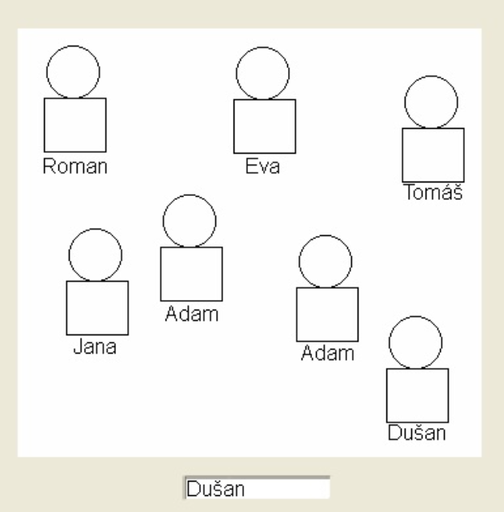
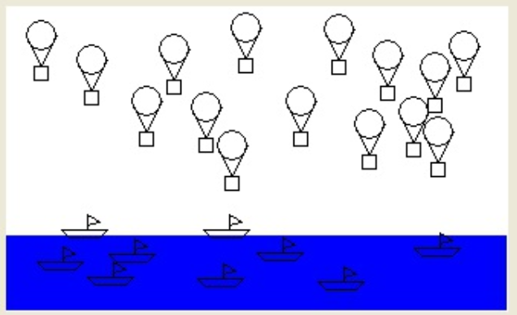
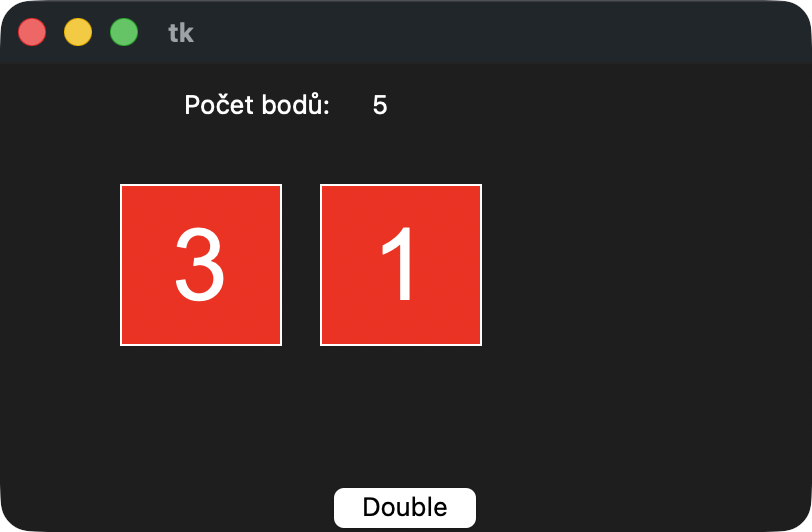
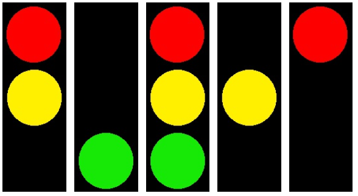
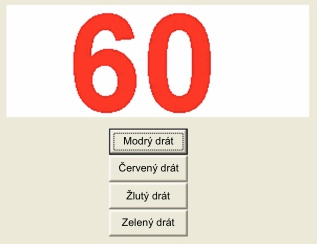
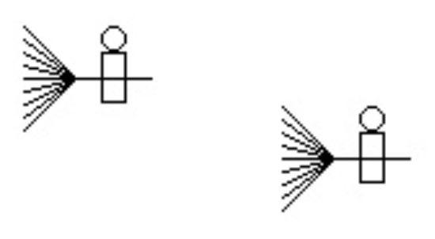
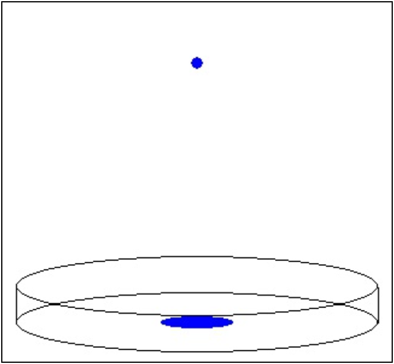


# Lekce 18: Opakovací úkoly 2 <!-- omit in toc -->

---

- [1. Zasedací pořádek ve třídě](#1-zasedací-pořádek-ve-třídě)
- [2. Balóny a lodě](#2-balóny-a-lodě)
- [3. Double](#3-double)
- [4. Rozbitý semafor](#4-rozbitý-semafor)
- [5. Titulky do televize](#5-titulky-do-televize)
- [6. Pyrotechnik](#6-pyrotechnik)
- [7. Čarodějnice](#7-čarodějnice)
- [8. Petriho miska](#8-petriho-miska)

---

# 1. Zasedací pořádek ve třídě
> `prijmeni_trida.py`
 
Vytvořte nástroj pro učitele k vytvoření zasedacího pořádku. Pomocí  vstupního pole zadáme jméno studenta, kterého chceme usadit. Kliknutím na plochu nakreslíme jméno tohoto studenta na místo kliknutí.

# 2. Balóny a lodě
> `prijmeni_balony_lode.py`
 
Vytvořte program, ve kterém můžeme kliknutím myši kreslit létající balóny na obloze a plovoucí lodě na moři. Program vykreslí hladinu moře ihned po spuštění. Když klikneme myší nad mořem, nakreslí se balón. Klikneme-li na moře, nakreslí se loď.

# 3. Double
> `prijmeni_kruznice.py`
 

Vytvořte hru s hracími kostkami. Hra zobrazuje náhodné hodnoty dvou hracích kostek. Hodnoty se v pravidelných intervalech mění. Úkolem hráče je stisknout tlačítko "Double", pokud jsou na obou kostkách stejné hodnoty. Pokud stiskl tlačítko ve správný okamžik, přičtou se mu +2 body. Když se hodnoty na kostkách liší, hráč jeden bod ztrácí. V horní části obrazovky je uveden aktuální stav bodů. Hra končí po předem nastaveném počtu kol hry.

# 4. Rozbitý semafor
> `prijmeni_semafor.py`
 

Na křižovatce se porouchal semafor (obsahuje červenou, žlutou a zelenou barvu). Nyní na něm svítí různá světla v pravidelných časových intervalech následovně:

- někdy svítí všechna tři světla,
- někdy svítí pouze jedno náhodné světlo,
- někdy červené a žluté světlo současně.

Náhled všech možností rozbitého semaforu je zobrazen na obrázcích:

# 5. Titulky do televize
> `prijmeni_titulky.py`
 

Vytvořte program, který bude v pravidelných intervalech kreslit na plochu text zadaný v textovém poli. Text se bude postupně posouvat z pravého dolního okraje okna k levému dolnímu okraji. Po dosažení levého okraje se opět ukáže vpravo.

# 6. Pyrotechnik
> `prijmeni_pyrotechnik.py`
 

Velké číslo na ploše odpočítává sekundy (např. od 60 do 0) a vy musíte v časovém limitu přestřihnout správný kabel, aby bomba nevybuchla. Program má čtyři tlačítka – modrý, žlutý, zelený a červený kabel. Kliknutí na tlačítko znamená, že jsme se rozhodli daný kabel přestřihnout. Po spuštění program náhodně vybere správný kabel a zapamatuje si ho. Hráč jej musí stisknout (přerušit) v časovém limitu.

Jsou dvě možná řešení – pokud včas nestiskne správný kabel, napíše "Bomba vybuchla" a nemůže stisknout nic jiného, nebo může stisknout i další kabely, dokud bombu nezničí.

# 7. Čarodějnice
> `prijmeni_carodejnice.py`
 
Vytvořte program, který bude simulovat přistání dvou čarodějnic vedle sebe. Při přistání se čarodějnice pohybují směrem dolů. V každém kroku animace se každá čarodějnice pohybuje náhodnou rychlostí od 0 do 10 bodů (v jednom kroku). Na konci program na obrazovku vypíše informaci o pořadí přistání čarodějnic.

**Pro zdatnější**: Každá čarodějnice bude jiné barvy. 

# 8. Petriho miska

> `prijmeni_miska.py`
 
Vytvořte program, ve kterém do Petriho misky postupně kapou kapky vody. Miska je na začátku prázdná. Po spadnutí kapky do misky se nakreslí loužička, která má stejný, jen zmenšený tvar misky. Louže se zvětšuje s každou další kapkou. Pokud louže již pokrývá celé dno mísy, louže se po pádu další kapky nezvětší. V programu je také tlačítko, pomocí kterého můžeme kapání zastavit, nebo opět spustit a kapaní bude pokračovat. Program nám sděluje v horní části obrazovky počet kapek.

