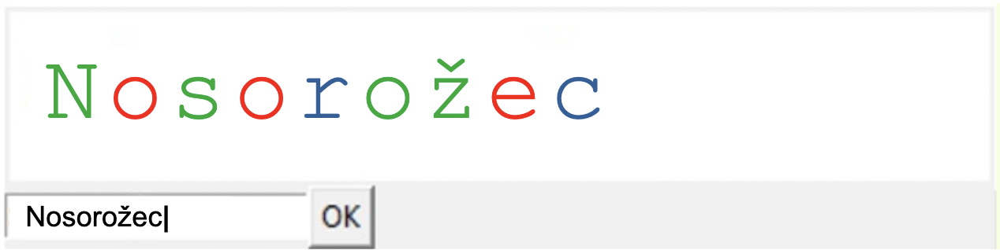
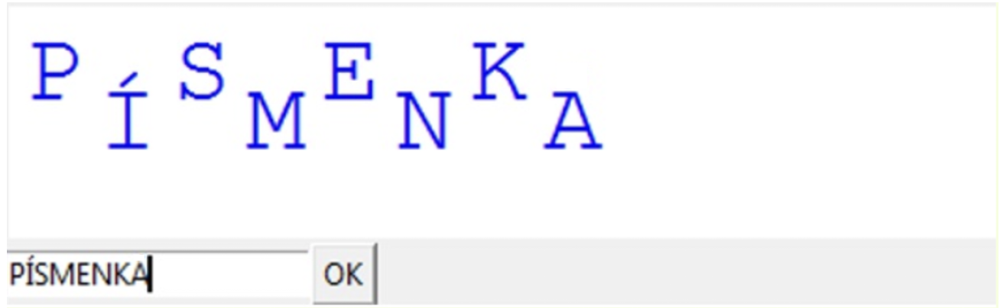
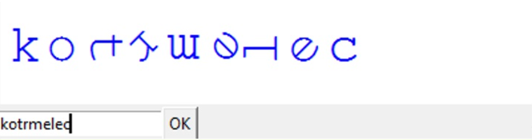
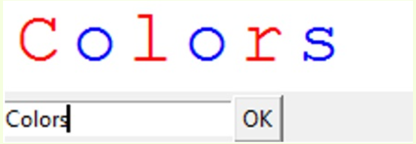
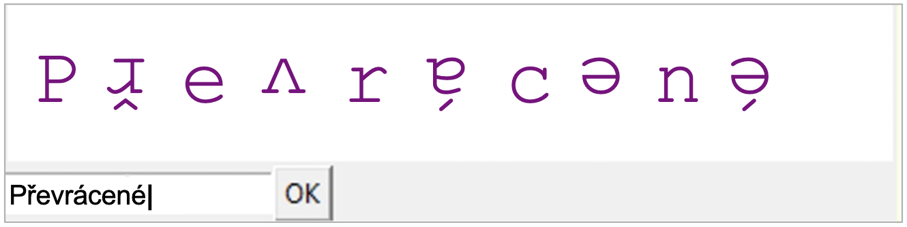
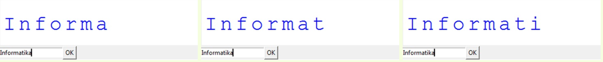
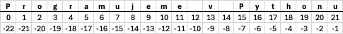
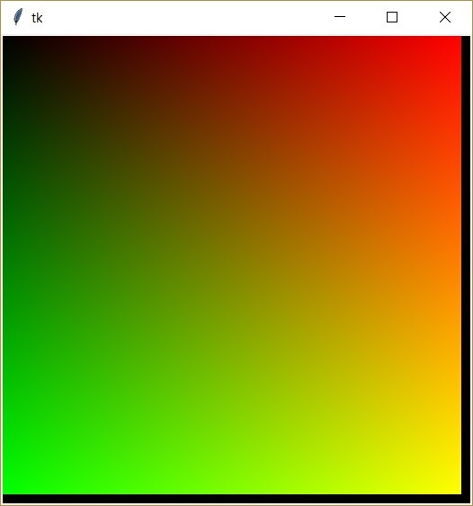

# Lekce 21: Textové řetězce <!-- omit in toc -->

---

- [1. Čísla vs. textové retězce, načítání vstupu](#1-čísla-vs-textové-retězce-načítání-vstupu)
- [2. Funkce `type()`](#2-funkce-type)
  - [2.1. 💾 Cvičení](#21--cvičení)
- [3. Iterace přes znaky řetězce, konstrukce nového řetězce](#3-iterace-přes-znaky-řetězce-konstrukce-nového-řetězce)
  - [3.1. 💾 Cvičení](#31--cvičení)
- [4. Podřetězce, řezy](#4-podřetězce-řezy)
  - [4.1. 💾 Cvičení](#41--cvičení)
- [5. Znaky a jejich kódy](#5-znaky-a-jejich-kódy)
  - [5.1. 💾 Cvičení](#51--cvičení)
- [6. Práce s textovými řetězci](#6-práce-s-textovými-řetězci)
  - [6.1. 📝 Výukový program: Césarova šifra](#61--výukový-program-césarova-šifra)
  - [6.2. 💾 Cvičení](#62--cvičení)
- [7. Náhodné prohazování znaků v textovém řetězci](#7-náhodné-prohazování-znaků-v-textovém-řetězci)
  - [7.1. 💾 Cvičení](#71--cvičení)
- [8. Operátor `in` a pravdivostní hodnoty](#8-operátor-in-a-pravdivostní-hodnoty)
- [9. Některé metody textových řetězců](#9-některé-metody-textových-řetězců)
  - [9.1. 💾 Cvičení](#91--cvičení)
- [10. Formátování řetězců (`format`)](#10-formátování-řetězců-format)
  - [10.1. 💾 Cvičení](#101--cvičení)

---

# 1. Čísla vs. textové retězce, načítání vstupu


V minulosti sme už pracovali se znakovými retězci a tvořili jsme náhodné věty. V této kapitole se podíváme na textové retězce podrobněji. Zatím umíme:

1. Spojovat textové řetězce operátorem `+`:

    ```py
    >>> slovo = 'Py' + 'thon'
    >>> slovo
    ```

2. Používat funkci `int()`, která z řetězce vytvoří číslo (pokud obsahuje pouze znaky, které může obsahovat číslo). Toto jsme již použili při čtení vstupu z textového pole: `int(entry1.get())`:

    ```py
    >>> a = '1250'
    >>> b = int(a)
    >>> b = b + 10
    >>> b
    ```

Pokud jsme chtěli napsat `canvas.create_text(100, 200, text = 'Počet bodů:' + body),` museli  jsme body (číslo) převést na text. Zatím se nám to dařilo řešit tak, že jsme text vypsali jedním příkazem a číselnou hodnotu jiným příkazem.

V takových případech můžeme použít funkci `str()`, která z čísla vytvoří textový řetězec `canvas.create_text(100, 200, text = 'Počet bodů:' + str(body))`:

```py
>>> body = 12
>>> vypis = 'Vaše skóre:' + str(body)
>>> vypis
```

---

❓  Jak poznáme, zda je v proměnné číslo nebo řetězec znaků?

❓ Co se stane, když použijeme operaci `+` na text a číslo současně? Například: `'abc'+4`, `4+'abc'`.

❓  Co se stane, když použijeme operaci `*` na text a číslo současně? Například: `'abc'*4`, `4*'abc'`

---


#  2. Funkce `type()`

Abychom přesně zjistili, zda se do proměnné uložilo číslo nebo řetězec znaků, použijeme funkci `type()`. Funkce vypíše datový typ proměnné:

```py
>>> a = 12
>>> type(a)
<class 'int'>
>>>
```

Vidíme, že číslo je datového typu `int`, což je zkratka anglického _integer_, čili **celé číslo**.

```py
>>> s = 'Python'
>>> type(s)
<class 'str'>
>>>
```

Proměnná `s` je  datového typu `str`, což je zkratka anglického _string_, čili **řetězec**.

---


❓  Proměnné `m`  jsme přiřadili tzv, "prázdný řetězec" `m = ''`. Jakého datového typy bude?

❓  Provedli jsme následující příkazy:

```py
pocet = '12'
vysledek = pocet * 5
```

Co bude v proměnné `vysledek` a jakého datového typu bude?  

❓ Provedli jsme následující příkazy:
```py
pocet = '12'
vysledek = pocet * 5
```
Co se změní, když nahradíme  `pocet * 5`  za např.  `pocet * -1` nebo `pocet * -5`?

---

Většinu úloh jsme zatím řešili v grafickém prostředí  knihovny `tkinter`. Mnoho programů však nepotřebuje okno s grafickým rozhraním, stačí jim textový režim (shellové okno). S takovým programem jsme se již v minulosti setkali při vytváření náhodných vět. V textovém režimu můžeme zadat vstup (od uživatele programu) do programu s funkcí vstupu. Vstupní  funkce má jeden parametr -- je v ní zapsán text, který se uživateli zobrazí, a program čeká na zadání vstupu, zadávání ukončíme stisknutím klávesy "Enter". 


```py
# 21_1.py

from random import *

jmeno = input('Jak se jmenuješ? ')
print('Ahoj ' + jmeno + '. Rád Tě poznávám.')
roknarozeni = input(jmeno + ', ve kterém roce ses narodil?')
jmeno2 = choice(['Alena', 'Barbora', 'Eva', 'Sofie'])
print('Ano, vzpomínám si. V roce ' + roknarozeni + ' se narodila i ' + jmeno2 + '.')
```

---

❓ Co bude dělat předchozí program?

❓ Jaký datový typ jsou proměnné: `jmeno`, `roknarozeni` a `jmeno2`?

---

## 2.1. 💾 Cvičení

**[1]** Upravte chatovací program  tak, aby nám počítač vypočítal a zapsal náš věk (přibližně, protože nezadáváme přesné datum narození).

**[2]** Přidejte  další otázky a odpovědi do agendy rozhovoru.

**[3]** Vytvořte program, který vyzve uživatele k zadání jména a věku. Program pak uživatele pozdraví, např. _Ahoj Filipe_ a napíše, kolik let mu chybí do 100&nbsp;let.

**[4]** Vytvořte program, do kterého uživatel zadá své jméno. Program pak vytiskne "štítek" ve tvaru:

```
+========+
| Andrea |
+========+
```

---

# 3. Iterace přes znaky řetězce, konstrukce nového řetězce

Vypišme jednotlivé znaky řetězce pod sebou, každý znak na samostatném řádku. Pro pohyb v řetězci po jednom znaku můžeme použít cyklus `for`:

```py
for znak in "Python":
    print(znak)
```

nebo

```py
retezec = "Python"
for znak in retezec:
    print(znak)
```

---

❓ Co vypíše následující program? Jaká bude hodnota proměnné `poradi` na konci programu? Nejprve odhadněte, pak otestujte.

```py
retezec = "Python"
poradi = 0

for znak in retezec:
    poradi += 1 
    print(znak)

print(poradi)
```
---

Funkce `len()` zjistí délku řetězce.

```py
veta = input("Napiš nějakou větu:")
delka = len(veta)
print("Počet znaků věty je", delka, "znaků")
```

K jednotlivým znakům řetězce jde přistupovat pomocí **indexu**. Znaky jsou číslované (indexované) od 0 po _n_&minus;1. Číslo, pomocí kterého přistupujeme ke znaku se nazývá "index". Zapisujeme jej do hranatých závorek. Příklad:

```py
>>> s = "Python" 
>>> s[0]
>>> 'P'
>>> s[3]
>>> 'h'
>>>
```

Celý řetězec můžeme vypsat i takto:

```py
retezec = "Python"
for i in range(len(retezec)):
    print(i, retezec[i])
```

V Shellu uvidíme:

```
0 P
1 y
2 t
3 h
4 o
5 n
```

První znak řetězce má index `0` a  poslední má `len(s)-1`. 

| P | y | t | h | o | n |
|--|--|--|--|--|--|
| 0 | 1 | 2 | 3 | 4 | 5 |


Někdy potřebujeme získat přístup k poslednímu znaku. Pro přístup ke znakům z opačné strany řetězce (od konce) můžeme pro indexování použít i záporná čísla. **Záporné indexy označují znaky od konce řetězce**:

| P | y | t | h | o | n |
|--|--|--|--|--|--|
| 0 | 1 | 2 | 3 | 4 | 5 |
| -6 | -5 | -4 | -3 | -2 | -1 |

---

❓  Proč poslední znak z řetězce `s` nezjistíme zápisem `s[len(s)]`, ale zápisem `s[len(s-1)]`?


❓  Co se stane, když použijeme index, který je mimo rozsah délky řetězce? Například:
```py
>>> s = "Python"
>>> s[6]
>>> s[-7]
``` 


❓ Co se stane, když se pokusíme změnit znak řetězce? Například:
```py
>>> s = "Python"
>>> s[0] = "p"
``` 
---

Řetězec (_string_) je v Pythonu **neměnný typ** (_immutable_). Změna znaku v řetězci se provede jedině **vytvořením nového řetězce**, klidně se stejným názvem:

```py
>>> jmeno = 'Hana'
>>> jmeno = 'J' + jmeno[1] + jmeno[2] + meno[3]
>>> jmeno
'Jana'
>>>
```

V následujícím příkladu vytvoříme nový řetězec, který nahradí všechny znaky `o` hvězdičkou `*`.

```py
# 20_2.py

veta1 = 'Programujeme v Pythonu'
veta2 = ''

for i in range(len(veta1)):
    if veta1[i] == 'o':
    veta2 = veta2+'*'
else:
    veta2 = veta2+veta1[i]

print(veta1)
print(veta2)
```

Nebo můžeme také vynechat některé znaky (například mezery):

```py
# 20_3.py

veta1 = 'Programujeme v Pythonu'
veta2 = ''

for i in range(len(veta1)):
    if veta1[i] != ' ':
        veta2 = veta2+veta1[i]

print(veta1)
print(veta2)
```

💡 V Pythonu to jde i jinak -- snáze. Jak a čím se v tuto chvíli zabývat nebudeme. Pokud jste zvídaví, zjistěte si to sami.

---

## 3.1. 💾 Cvičení


**[5]** Vytvořte program, do kterého na vstupu zadáte dva stejně dlouhé řetězce a program z nich vytvoří jeden sdružený řetězec, ve kterém se střídají znaky z prvního a druhého řetězce. Například zadáme `'Andrea'` a `'Michal'` a vznikne: `'AMnidcrheaal'`.
 

**[6]** Vytvoříte program, do kterého na vstupu zadáte řetězec, který vznikl překladem písmen ze dvou různých řetězců (viz předchozí úloha), a program nám vypíše dva původní řetězce. Například napíšeme  `'AMnidcrheaal'` a program vypíše  `'Andrea'`  a  `'Michael'`.


**[7]** Vytvořte program, do kterého na vstupu zadáte dva různě dlouhé řetězce a program z nich vytvoří jeden propojený řetězec, ve kterém se střídají znaky z prvního a druhého řetězce. Vzhledem k tomu, že jeden z nich je kratší, přilepí se na konec pouze zbývající znaky z delšího řetězce. Například zadáme  `'Diana'` a `'Ferdinand'`  a vytvoří se: `'DFiearndainand'`. 


**[8]** Vytvořte program, ve kterém uživatel zadá větu zakončenou interpunkčním znaménkem (tečka, otazník nebo vykřičník). Na základě koncového znaménka program zapíše, zda se jedná o větu oznamovací, tázací nebo rozkazovací.


**[9]** Vytvořte program, ve kterém uživatel zadá slovo. To se vypíše do grafické plochy znak po znaku v intervalu 1 vteřiny.


**[10]** Vytvořte program, ve kterém uživatel zadá slovo. Toto slovo se vypíše do grafické plochy fontem "Courier" v podobě "reklamního nápisu", kde každý znak zadaného slova bude vypsaný náhodně vybranou barvou, např. z konkrétně určené sady barev (`choice`). 




**[11]** Vytvořte program, ve kterém uživatel zadá slovo. Toto slovo se do grafického plátna vypíše fontem "Courier" tak, že písmena v sudých pozicích budou napsané níž jako písmena na lichých pozicích:




**[12]** Vytvořte program, ve kterém uživatel zadá slovo. Toto slovo se do grafického plátna vypíše fontem "Courier" tak, že písmena budou pootočené tak, aby poslední písmeno bylo opět natočené "normálně": 




**[13]** Vytvořte program, ve kterém uživatel zadá slovo. Toto slovo se do grafického plátna vypíše fontem "Courier" tak, že se ve vypsaném slově budou střídat dvě barvy:




**[14]** Vytvořte program, ve kterém uživatel zadá slovo. Toto slovo se do grafického plátna vypíše fontem "Courier" tak, že písmena na sudých pozicích budou otočené "hlavou dolů":




**[15]** Vytvořte program, ve kterém uživatel zadá slovo. Toto slovo se vypíše fontem "Courier" postupně po jednotlivých znacích tak, že po každej sekundě se objeví další písmeno:




**[16]** Vytvořte program, ve kterém uživatel zadá slovo. Toto slovo se vypíše fontem "Courier".  Jednotlivá písmena se postupně po sekundách přidávají k výslednému slovu tak, že přicházejí zprava.


**[17]** Vytvořte program, ve kterém uživatel zadá slovo. Toto slovo se vypíše fontem "Courier".  Jednotlivá písmena se postupně po sekundách přidávají k výslednému slovu tak, že přicházejí zprava (viz předchozí úloha). Když už se vypíše celé slovo, po chvíli nápis "zhasne" a začne se vypisovat znovu.


**[18]** Vytvořte program, ve kterém uživatel zadá větu. Program vypíše:
1. počet slov ve větě,
2. délku a pořadové číslo nejdelšího slova ve větě -- pokud jich je víc, stačí vypsat jedno.
3. nejdelší slovo ve větě -- pokud jich je víc, vypíše všechny. 


**[19]**  Vytvořte program, ve kterém uživatel zadá slovo. Program ho vypíše do shellu v tomto tvaru:
```
A
H
O
J
```


# 4. Podřetězce, řezy


Nové řetězce můžeme vytvářet také pomocí řezů (_slices_) -- indexování znaků s více indexy -- `string[od:do]`. Znak s indexem `do` se už nebude ve výsledku nacházet. Vždy zde musíme zapsat index ještě o jeden vyšší (podobně jako dáváme limity do cyklu `for` pro rozsah).

```py
>>> s = 'Programujeme v Pythonu'
>>> s[3:7]
'gram'
>>>
```




```py
>>> s = 'Programujeme v Pythonu'
>>> s[15:21]
'Python'
>>> s[15:22]
'Pythonu'
>>>
```

Řezy můžeme použít i při změně formátu data. Například chci přepsat datum `31. 12. 2017` jako RRRR-MM-DD, tedy `2017-12-31`:

```py
>>> datum = '31. 12. 2017'
>>> datum_en = datum[8:12]+'-'+datum[4:6]+'-'+datum[0:2]
>>> datum_en
'2017-12-31'
>>>
```

---

❓  Který formát data je lepší pro informatiku? Proč?

❓  Takové zápisy se také často používají v programech. Vyzkoušejte je a zjistěte, co znamenají:
   - `s[:5]`, `s[:2]`
   - `s[2:]`, `s[3:]`
   - `s[:]`

❓  Který z těchto zápisů bude fungovat a který vrátí neprázdný řetězec? `s[-5:-2]`,  `s[5:2]`,  `s[-2:-5]`,  `s[-2:]`,  `s[:-2]`.

---

V řezu můžeme určitť i krok indexů (podobně jako v příkazu `range()`, který jsme používali ve `for` cyklu). Krok určuje, o kolik se budeme v indexech posouvat od prvního uvedeného indexu. Pokud krok neuvedeme, je krok standardně 1.

```py
>>> s = 'Programujeme v Pythonu'
>>> s[0:10:2]
'Pormj'
>>> s[0:22:2]
'Pormjm yhn'
>>> s[-1:-10:-1]
'unohtyP v'
>>> s[::-1]
'unohtyP v emejumargorP'
>>>
```

Kromě konkrétních čísel, může řez obsahovat i proměnné nebo výraz, kterého výsledkem je číslo použitelné v řezu. Můžeme je vytvářet i takto:

```py
# 21_1.py

s = 'Python'
for i in range(len(s)):
    print(s[:i+1])
```

Výsledek:

```
P
Py
Pyt
Pyth
Pytho
Python
```

```py
# 21_2.py

s = 'Python'
    for i in range(len(s)):
        ns = '-'*i+s[:i+1]
        print(ns)
```
Výsledek:

```
P
-Py
--Pyt
---Pyth
----Pytho
-----Python
```

Pomocí řezů vytvoříme nový řetězec, ve kterém můžeme nahradit některý znak nebo více znaků. Například:

```py
>>> s = 'Python'
>>> s = s[:2] + 'T' + s[3:]
>>> s
'PyThon'
>>>
```

---

## 4.1. 💾 Cvičení


**[20]**  Na vstup zadáme řetězec, který vznikl prokládáním písmen z dvou různých řetězců se stejnou délkou. Například zadáme `'AMnidcrheaal'`. Pomocí řezů (**bez použití `for` cyklu**) vytvořte ze vstupu první a druhé slovo, tedy: `'Andrea'` a `'Michal'`.


**[21]**  Vytvořte program, který ze vstupního řetězece vypíše retězce takto. Ukázka pro vstupní řetězec `'Python'`):
```
......P
.....Py
....Pyt
...Pyth
..Pytho
.Python
```


**[22]**  Napište program, ve kterém uživatel zadá platnou e-mailovou adresu. Program následně vypíše doménu nejvyšší úrovně (TLD) i s tečkou, adresu e-mailového serveru, jméno uživatele, seznam všech domén v pořadí od domény první úrovně až po doménu nejnižší úrovně. Příklad:

```
Zadej email: info@mail.jahoda.cz

TLD: .cz
Server: mail.jahoda.cz
User: info
Domény:
- Doména 1. úrovně je: cz
- Doména 2. úrovně je: jahoda
- Doména 3. úrovně je: mail
```


**[23]** Napište program, ve kterém uživatel zadá platné rodné číslo ([online generátor](https://www.daytl.com/cs/birthnumber/)). Program následně vypíše:
 - datum narození v tvaru `den.mesic.rok`,
 - pohlaví (ženy mají k číslu měsíce připočtené číslo 50)

  Ukázka:

  ```
  Rodné číslo: 806202/5675
  Dátum narození: 2.12.1980
  Pohlaví: Žena
  ```


**[24]**  Napište program, ve kterém uživatel zadá platnou URL adresu. Program následně vypíše protokol použité služby, doménu nejvyšší úrovně, doménovou adresu serveru. Příklad:

```
Zadej URL: https://malina.jahoda.cz

Protokol: https
TLD: cz
Adresa: malina.jahoda.cz
```


**[25]**  Napište program, ve kterém uživatel zadá slovo. Program určí, zda je jedná o palindrom -- čte se stejně zleva doprava a opačně. Příklad:

```
Zadaný text: anna
anna JE palindrom

Zadaný text: otakar
otakar NENÍ palindrom

Zadaný text: oto
oto JE palindrom

Zadaný text: 123321
123321 JE palindrom
```

# 5. Znaky a jejich kódy

Již v dříve jsme se naučili zjistit tři různé informace o klávese v reakci na stisknutí klávesy na klávesnici:

```py
import tkinter
canvas = tkinter.Canvas()
canvas.pack()

def klavesa(event):
    print(event.keysym)
    print(event.keycode)
    print(event.char)

canvas.bind_all('<Key>', klavesa)
```

Každý znak má svůj číselný kód. Počítač si všechna data ukládá jako **čísla**, a proto si i znaky pamatuje právě pomocí jejich kódů. Tyto kódy jsou zapsány v tzv. **tabulkách kódování znaků**. Různé tabulky se mohou lišit, nejčastěji u znaků národních abeced.

❓ Víte, jak se jmenuje nejznámější a historicky nejstarší tabulka kódování znaků, která obsahuje základní anglickou abecedu, číslice a základní symboly?

- Funkce `ord('a')` vrátí číslo, které odpovídá znaku `a`.  
- Naopak funkce `chr(97)` vrátí znak, který má kód 97.

```py
>>> ord('a')
97
>>> ord('b')
98
>>> chr(97)
'a'
>>> chr(98)
'b'
```

Znaky mají čísla přidělená rozumně, tak aby byly přirozeně za sebou seřazeny. Například za sebou jdou znaky velké abecedy, za sebou jdou znaky malé abecedy, za sebou jdou číslice 0, 1 až 9. Znak "a" má kód 97, za znakem "z" následuje "{" (v tabulce kódování znaků) a má kód 123. Znaky malé abecedy si můžeme vypsat také pomocí cyklu for:

```py
for i in range(97, 123):
    print(chr(i))
```
Pokud si nepamatujeme, kde začíná malá abeceda v tabulce kódování znaků, můžeme to udělat i takto:

```py
for i in range(ord('a'), ord('z')+1):
    print(chr(i))
```

nebo si můžeme vytvořit textový řetězec, ve kterém budou pouze znaky malé abecedy:

```py
s = ''
for i in range(97, 123):
    s = s + chr(i)
    print(s)
```

---

❓  O kolik znaků je v tabulce kódování znaků vzdálený znak ‚A‘ a ‚a‘?

❓ O kolik znaků je v tabulce kódování znaků vzdálený znak ‚B‘ a ‚b‘?

❓ O kolik znaků je v tabulce kódování znaků vzdálený znak ‚Z‘ a ‚z‘?

❓ Jak bychom mohli z velkého písmene vytvořit malé písmeno?

❓ Jak bychom mohli z malého písmene vytvořit velké písmeno?

❓ Jak bychom mohli vygenerovat náhodné malé písmeno (bez použití funkce `choice`)?

---

Znaky můžeme také porovnávat. Počítač porovná jejich číselné hodnoty podle tabulky kódování znaků. Například pomocí podmínky v `if` můžeme zjistit, zda je nějaký znak mezi ‚a‘ a ‚z‘.

```py
jmeno = input('Zadej své jmémo:')

if 'a' <= meno[0] <= 'z':
    pismeno = chr(ord(jmeno[0])-32)
    nove_jmeno = pismeno + jmeno[1:]
    print(nove_jmeno+', jména píšeme s velkým písmenem...')
else:
    print(jmeno + ', vidím, že jméno píšeš správně :)')
```


## 5.1. 💾 Cvičení


**[26]**  Vytvořte program, který vygeneruje náhodné 8 místné heslo, které obsahuje pouze malá písmena.


**[27]**  Vytvořte program, který vygeneruje náhodné 8 místné heslo, nejprve tři velká písmena, poté dvě číslice a poté tři malá písmena.


**[28]**  Vytvořte program, který vygeneruje náhodné 8 místné heslo tak, že nejprve bude obsahovat pouze malá písmena a následně některá z písmen (alespoň 1) změní na velká písmena.


**[29]**  Pomocí programu vytvořte řetězec, který bude obsahovat postupně všechna malá písmena abecedy oddělená čárkou.

`a, b, c, d, e, f, g, h, i, j, k, l, m, n, o, p, q, r, s, t, u, v, w, x, y, z`


**[30]**  Alespoň dvěma způsoby (pomocí cyklu `for`) vytvořte řetězec, který obsahuje posloupnost všech číslic od 0 do 9 oddělených čárkou:

`0, 1, 2, 3, 4, 5, 6, 7, 8, 9`


# 6. Práce s textovými řetězci


## 6.1. 📝 Výukový program: Césarova šifra

Césarova šifra je nejznámější a nejstarší šifra. Její vznik sahá do dob vlády římského císaře Caesara. Nyní vytvoříme program, kterým zašifrujeme zadaný text Caesarovou šifrou. Tato šifra je založena na tom, že každé písmeno zprávy je nahrazeno písmenem, které je v abecedě posunuto o zadaný posun. Například zpráva "abeceda" by po zašifrování Caesarovou šifrou s posunem 1 byla "bcfdfeb". Při šifrování s posunem 1 se písmeno "a" změní na "b", "b" na "c" atd. Poslední písmeno "z" v abecedě se změní na "a".

```
abcdefghijklmnopqrstuvwxyz (vstupní abeceda)
bcdefghijklmnopqrstuvwxyza (příslušné písmeno s posunem 1)

abcdefghijklmnopqrstuvwxyz (vstupní abeceda)
cdefghijklmnopqrstuvwxyzab (příslušné písmeno s posunem 2)
```

```py
vstup = input('Zadej text:')
sifra = ''
for znak in vstup:
    novyznak = znak
    if 'a' <= znak <= 'y':
        novyznak = chr(ord(znak)+1)
    if znak == 'z':
        novyznak = 'a'
    sifra = sifra + novyznak
print(sifra)
```

---

## 6.2. 💾 Cvičení


**[31]**  Upravte program tak, aby šifroval vstup s posunem 2, později 3.


**[32]**  Upravte program tak, aby dešifroval šifru, kterou jsme zašifrovali s posunem 1.


**[33]**  Upravte program tak, aby dešifroval šifru, kterou jsme zašifrovali s posunem 2, později 3.


**[34]**  Upravte program tak, abychom mu kromě vstupu zadali i posun a program zašifroval vstup se zadaným posunem.

---

❓ Jaký je vztah mezi posunem při šifrování a dešifrování zprávy Caesarovým šifrováním?

❓ Je možné vytvořit program pro šifrování Caesarovým šifrováním, který při určitých posunech dešifruje již zašifrovanou zprávu?

---

# 7. Náhodné prohazování znaků v textovém řetězci


❓ Jak bychom mohli vytvořit nový řetězec, ve kterém jsou znaky náhodně zamíchány? Například ze slova "python" by vzniklo "typonh".

❓ Jak bychom mohli vytvořit nový řetězec, ve kterém bude chybět jeden náhodný znak?


Nejprve vytvoříme program, který z řetězce odstraní jeden zadaný znak:

```py
s = 'Python'
ktery = int(input('Zadej index znaku, který mám odstranit:'))
s = s[:ktery]+s[ktery+1:]
print(s)
```

Nyní upravíme program tak, aby náhodně vybral index odstraňovaného znaku a vypsal odstraněný znak:

```py
from random import *

s = 'Python'
ktery = randrange(len(s))
print('Odstraňuji znak', s[ktery])
s = s[:ktery]+s[ktery+1:]
print(s)
```

Nyní stačí odstranit všechny znaky (náhodně) a odstraněné znaky přidat do nového řetězce.

```py
from random import *

s = 'Python'
novy = ''

for i in range(len(s)):
    ktery = randrange(len(s))
    print('Odstraňuji znak', s[ktery])
    novy = novy+s[ktery]
    print('Zatím jsem vytvořil:', novy)
    s = s[:ktery]+s[ktery+1:]
    print('Ještě zbývají tyto znaky:', s)

print('Zamíchané slovo:', novy), s)
```

A takto může vypadat výstup programu:

```
Odstraňuji znak o
Zatím jsem vytvořil: o
Zbývají tyto znaky: Pythn
Odstraňuji znak y
Zatím jsem vytvořil: oy
Zbývají tyto znaky: Pthn
Odstraňuji znak t
Zatím jsem vytvořil: oyt
Zbývají tyto znaky: Phn
Odstraňuji znak P
Zatím jsem vytvořil: oytP
Zbývají tyto znaky: hn
Odstraňuji znak n
Zatím jsem vytvořil: oytPn
Zbývají tyto znaky: h
Odstraňuji znak h
Zatím jsem vytvořil: oytPnh
Zbývají tyto znaky:
Zamíchané slovo: oytPnh
```

---

❓ Může se stát, že po zamíchání budeme mít stejný text jako na začátku? Pokud ano, můžeme to také považovat za náhodné zamíchání?

❓ Může se stát, že by se v zamíchaném textu některé písmeno opakovalo? Za jakých okolností? Je tedy program správný?

---

## 7.1. 💾 Cvičení

**[35]**  Upravte program tak, abychom mu mohli na vstup zadat jakýkoli řetězec.

**[36]**  Upravte program tak, aby nám vypsal více náhodných zamíchání řetězce.

---

# 8. Operátor `in` a pravdivostní hodnoty

> Logické operace a textové řetězce

Pomocí operátoru `in` můžeme zjistit, zda se nějaký podřetězec nachází v řetězci. Tuto operaci můžeme podobně jako porovnání použít například pro rozhodování (`if`):

```py
s = 'Python'
if 'o' in s:
    print('je tam')
else:
    print('není tam')
```

Pokud tento výraz (`"o" in "Python"`) zapíšeme přímo do shellu, Python nám napíše `True` nebo `False`, tedy zda je to pravda nebo nepravda:

```py
>>> 'o' in 'Python'
True
>>> 'yt' in 'Python'
True
>>> 'ty' in 'Python'
False
>>>
```

Stejně tak i zadání jiných výrazů do shellu, které jsme použili v `if`, Python okamžitě vyhodnotí a napíše nám, zda je jejich výsledek pravda nebo nepravda:

```py
>>> x = 10
>>> x > 7
True
>>> 9 < x < 12
True
>>> x == 7
False
>>>
```

Výsledek takového vyhodnocení výrazu si také můžeme zapamatovat do proměnné. Takový typ, který obsahuje pouze hodnoty `True` nebo `False`, nazýváme _boolean_ (pravdivostní hodnoty). Můžeme to ověřit funkcí `type()`:

```py
>>> jetam = 'o' in 'Python'
>>> jetam
True
>>> type(jetam)
<class 'bool'>
>>> x = 5
>>> vysledek = x > 7
>>> vysledek
False
>>> type(vysledek)
<class 'bool'>
>>>
```


# 9. Některé metody textových řetězců

> Další užitečné funkce pro práci s textovými řetězci


Zatím jsme se seznámili s některými funkcemi pro práci s řetězci. Některé z funkcí používají speciální zápis ve formě  `řetězec.funkce(parametry)` a jsou v Pythonu definovány přesně pro práci s řetězci. Takové funkce se nazývají **metody**. Nejčastěji budeme používat tyto metody:


- `řetězec.find(podřetězec)` -- vrátí index prvního výskytu podřetězce v řetězci,

- `řetězec.lower()` -- vrátí řetězec, ve kterém jsou všechna velká písmena nahrazena malými,

- `řetězec.upper()` -- vrátí řetězec, ve kterém jsou všechna malá písmena nahrazena velkými,

- `řetězec.replace(podřetězec1, podřetězec2)` -- vrátí řetězec, ve kterém nahradí všechny výskyty
`podřetězec1` řetězcem `podřetězec2`.

```py
>>> s = 'Programujeme v Pythonu'
>>> s = s.lower()
>>> print(s)
programujeme v pythonu
>>>
```

```py
>>> s = 'Programujeme v Pythonu'
>>> s = s.upper()
>>> print(s)
PROGRAMUJEME V PYTHONU
>>>
```
Novou hodnotu nemusíme vždy uložit do proměnné, někdy stačí ji pouze vypsat:

```py
>>> print('Programujeme v Pythonu'.upper())
PROGRAMUJEME V PYTHONU
>>>
```

Pomocí metody `replace` můžeme nahradit různé dlouhé podřetězce jinými, klidně i jinak dlouhými:

```py
>>> s = 'Malý král koupil krásný koberec do komnaty.'
>>> s = s.replace('ko','*')
>>> print(s)
Malý král *upil krásný *berec do *mnaty.
>>>
```

Můžeme ji také použít k odstranění části řetězce tak, že podřetězec nahradíme prázdným řetězcem:

```py
>>> s = 'Malý král koupil krásný koberec do komnaty.'
>>> s = s.replace('ko','')
>>> print(s)
Malý král koupil krásný berec do mnaty.
>>>
```

V následujícím příkladu nahradíme všechny samohlásky pomlčkou:

```py
samohlasky = 'aáeéiíoóuúyý'
s = 'Malý král koupil krásný koberec do komnaty.'
for znak in samohlasky:
    s = s.replace(znak, '-')
    s = s.replace(znak.upper(), '-')
print(s)
```

Program vypíše:

```
M-l- kr-l k--p-l kr-sn- k-b-r-c d- k-mn-t-.
```
---

❓ V řetězci `s` máme `Malý král koupil krásný koberec do komnaty.`. Jakou hodnotu vrátí metoda `s.find(' ')`, pokud je v řetězci `s` nějaká věta?

❓ Jaký bude výsledek řezu `s[:s.find(' ')]`?

---

## 9.1. 💾 Cvičení

**[38]**  Vytvořte program, který v dané větě nahradí všechny výskyty znaků `y`, `Y`, `i` a `I` pomlčkami. Naším úkolem je napsat větu se správným `i` a `y`. Program zkontroluje naši odpověď a nesprávné doplňky označí vykřičníkem za tímto znakem.


**[39]**  Pomocí programu vytvoříme řetězec, který bude obsahovat postupně všechny znaky malé abecedy od "a" do "z", přičemž jednotlivé znaky budou odděleny čárkou a mezerou. Za písmenem "z" není ani mezera, ani čárka. Vymyslete několik řešení tohoto problému a diskutujte o tom, které řešení je lepší, hezčí, efektivnější.


**[40]**  Otočte řetězec zadaný v zadání (pište pozpátku), ale při otáčení nepoužívejte řezy.


**[41]**  Vytvořte upravenou hru "oběšenec". Program vybere jedno náhodné slovo (z předem zadaných slov). Vytvoří slovo stejné délky, které obsahuje pouze pomlčky. Toto slovo bude animováno tak, aby postupně padalo od horního okraje obrazovky ke spodnímu okraji. Během padání je naším úkolem uhodnout slovo stisknutím písmen. Pokud se v hádaném slově vyskytuje zadané písmeno, budou příslušné pomlčky tohoto písmene nahrazeny hádaným písmenem. Po uhodnutí celého slova padá další slovo a my získáváme bod. Pokud slovo neuhádneme, hra končí.


**[42]**  Při psaní textu jsme měli místo klávesnice QWERTZ zapnutou klávesnici QWERTY. Tedy místo `y` jsme napsali `z` a místo `z` jsme napsali `y`. Vytvořte program, kterému zadáme větu a program vypíše větu, kde se `z` a `y` zaměňují.

```
zuzana byla v zoo, kde videla zebru a dala si rizoto
yuyana bzla v yoo, kde videla yebru a dala si riyoto
```

```
zebra zije v zoologicke zahrade a zere zelene listy
yebra yije v yoologicke yahrade a yere yelene listz
```

# 10. Formátování řetězců (`format`)

Před časem jsme vytvářeli program rozhovor. Na základě odpovědí uživatelů jsme vytvořili nové otázky, ve kterých jsme odpověď zkombinovali s dalším textovým řetězcem.

```py
# program rozhovor.py
from random import *

jmeno = input('Jak se jmenuješ? ')
print('Ahoj ' + jmeno + '. rád tě poznávám.')
roknarozeni = input(jmeno + ', ve kterém roce ses narodil?')
jmeno2 = choice(['Alena', 'Barbora', 'Eva', 'Sofie'])
print('Ano, vzpomínám si. V roce ' + roknarozeni + ' se narodila i ' + jmeno2 + '.')
```

Metodu `format` můžeme použít k úpravě nebo doplnění řetězců s odpověďmi. Metoda `format`  vloží zadané parametry do zadaného umístění. Počet parametrů je různý. Metoda nahradí  první výskyt `{}` prvním parametrem, druhý výskyt `{}` druhým parametrem, třetí výskyt `{}` třetím parametrem  atd. Například:

```py
>>> jmeno = 'Adam'
>>> 'Ahoj {}, rád tě poznávám :)'.format(jmeno)
"Ahoj Adam, rád tě poznávám :)" 
>>> 
```

Podívejte se na příklad programu, který používá  metodu `format`  se třemi parametry:

```py
from random import *
meno = input('Jak se jmenuješ?')
rok = input('Ve kterém roce ses narodil?')
vek = 2025 - int(rok)
jmeno2 = choice(('Alena','Barbora','Eva','Sofie'))
jmeno2 = jmeno2[:-1]+'u'
s = 'Ahoj {}, rád tě poznávám :). Znáš {}? I ona má {} let. jmeno2, vek)
print(s)
```

Vidíme, že parametr může být také číslo. Pro čísla lze použít i jiné zápisy v `{}`. Tímto způsobem můžeme změnit formát čísel podobně, jako v tabulkovém kalkulátoru. Například zápis `{:b}` vytiskne číslo v binární soustavě, `{:x}` vytiskne číslo v šestnáctkové soustavě.

```py
>>> 'V mém oblíbeném binárním formátu mi je {:b} let.'. format(vek)
"V mém oblíbeném binárním formátu mi je 10 000 let"
>>> 'Je mi {:x} let v hexadecimálním zápisu.'.format(vek)
"Je mi {:x} let v hexadecimálním zápisu."
>>> vek = 4
>>> 'Je vám {:05x} let v hexadecimální notaci.'.format(vek) 
'Je vám 00004 let v hexadecimální notaci.'
```

---

❓ Zjistěte, jakým zůsobem mění formát čísla zápisy: `{:05x}`, `{:04x}`, `{:02x}`.

❓ Zjistěte, jakým zůsobem mění formát čísla zápisy: `{:4}`, `{:3}`, `{:2}`.

❓ Zjistěte, jakým zůsobem mění formát čísla zápisy: `{:04}`, `{:03}`, `{:02}`.

---

Pomocí  metody `format`  můžeme vytvořit barevný zápis ve formě hexadecimálního textového řetězce z jednotlivých barevných složek (RGB) uvedených v desítkové soustavě.

```py
r = 100 
g = 200 
b = 100 
barva = '#{:02x}{:02x}{:02x}'.format(r, g, b)
print(barva)
```

Nyní můžeme také systematicky generovat a kreslit různé barvy pro cykly:

```py
import tkinter
from random import *
canvas = tkinter.Canvas(width=520, height=520, bg='black')
canvas.pack()

for r in range(256):
    for g in range(256):
        f = '#{:02x}{:02x}{:02x}'.format(r, g, 0)
        canvas.create_rectangle(r*2, g*2, r*2+2, g*2+2, fill=f, outline='')
```



Metodu `format`  lze také použít při formátování desetinných míst (datový typ `float`).

```py
>>> cislo = 10/3
>>> cislo
3.3333333333333335
>>> '{:5.2f}'.format(cislo)
' 3,33'
>>> '{:5.0f}'.format(cislo)
' 3'
>>> '{:.0f}'.format(cislo)
'3'
>>> '{:.4f}'.format(cislo)
'3.3333'
>>> type(cislo)
<class 'float'>
```

Zápisem `.2f` určíme, že se `float` zobrazí na dvě desetinná místa. Zápis  `:7.3f` znamená, že desetinné číslo bude zobrazeno na 3 desetinná místa a celkem 7 míst bude vyhrazeno pro zobrazení. Ve výchozím nastavení jsou desetinná místa zobrazena na 6 míst  `'{:f}'.format(cislo)`.

---

## 10.1. 💾 Cvičení

**[43]**  Vyplňte celé plátno barevnými čtverci. Každý čtverec bude mít náhodnou barvu "smíchanou" z hodnot RGB.


**[44]**  Vytvořte program, který zobrazí pruh se všemi odstíny modré. Pás bude vytvořen z tenkých čar. Modrá složka barvy čáry se bude postupně zvětšovat.


---