# Lekce 22: N-tice <!-- omit in toc -->


---

- [1. N-tice textových řetězců](#1-n-tice-textových-řetězců)
- [2. Body v rovině](#2-body-v-rovině)
  - [2.1. 💾 Cvičení](#21--cvičení)
  - [2.2. 💾 Cvičení](#22--cvičení)
- [3. N-tice jako parametr](#3-n-tice-jako-parametr)
  - [3.1. 💾 Cvičení](#31--cvičení)
- [4. Více přiřazení](#4-více-přiřazení)


---


# 1. N-tice textových řetězců

Při výběru náhodné barvy pomocí funkce `choice` jsme zadali barvy do jakéhosi seznamu barev a všechny barvy byly zapsány do závorek. Stejně tak při tvorbě náhodných vět jsme si zapisovali jednotlivá slova, ze kterých jsme skládali věty, do jakéhosi seznamu a z něj jsme také  vybrali jedno náhodné slovo podle funkce výběru.

```py
barva = choice(('red', 'green', 'yellow', 'blue'))
```

Tuto informaci můžeme také zapsat do proměnné a pomocí funkce `type()` můžeme zjistit typ takové proměnné. Tento typ nazýváme `n-tice` nebo `tuple`. Zkusme to v shellu:

```py
>>> from random import *
>>> barvy = ('red', 'green', 'yellow', 'blue')
>>> type(barvy)
<class 'tuple'>
>>> choice(barvy)
'blue'
>>> choice(barvy)
'yellow'
>>>
```

S textovým řetězcem už umíme pracovat a víme, že řetězec je posloupnost znaků. N-tice je také posloupnost, ale ne elementárních znaků, ale různých informací. Prvkem n-tice může být textový řetězec, ale také číslo nebo něco jiného.

```py
>>> data = ('red', 'Pavel', 42, 1.5, 'abc')
>>> type(data)
<class 'tuple'>
>>>
```

Vzhledem k tomu, že textový řetězec i n-tice jsou posloupnosti (sekvence), mohly by mít některé vlastnosti stejné a možná s nimi můžeme pracovat pomocí stejných funkcí.

---


❓  Které z funkcí a operací používaných pro práci s řetězci můžeme použít pro práci s n-ticemi?

❓  Zkuste indexovat prvky. Můžeme ho použít i na n-tice? Je v tom nějaký rozdíl?

❓ Jak je to s použitím řezů (slice)?

❓ For cyklem lze procházet prvky řetězce. Funguje to také pro n-tice?

---

Následující program vykreslí čtverce postupně se všemi barvami z n-tice:

```py
# 22_1.py

import tkinter
canvas = tkinter.Canvas(width=400, height=100)
canvas.pack()

barvy = ('red','green','blue','yellow','orange','grey')
x = 10
for b in barvy:
    canvas.create_rectangle(x, 10, x+40, 50, fill=b)
    x += 50
```

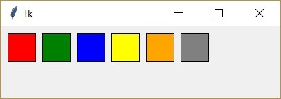
 
Stavební firma nabízí zákazníkům různé kombinace barev střechy a fasády domu. Pro barvu střech a fasád použijte úplně jinou paletu barev. Následující program je vykreslí všechny barevné kombinace podle nabízených barev střechy a barevné palety pro fasádu:

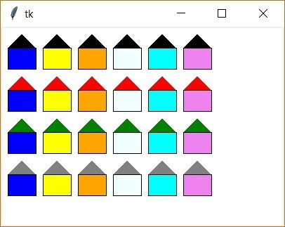

```py
# 22_2.py

import tkinter
canvas = tkinter.Canvas(width=400, height=280, bg='white')
canvas.pack()

barvy1 = ('black', 'red', 'green', 'gray') 
barvy2 = ('blue', 'yellow', 'orange', 'azure', 'cyan', 'violet') 
x = 10
y = 30
for f1 in barvy1:
    for f2 in barvy2:
        canvas.create_polygon(x, y, x+20, y-20, x+40, y, fill=f1)
        canvas.create_rectangle(x, y, x+40, y+30, fill=f2)
        x += 50
    x = 10
    y += 60
```

Společnost se rozhodla rozšířit škálu barev a každou z dosud nabízených barev lze použít jak pro střechu, tak fasádu. V programu stačí vytvořit jednu ze dvou n-tic, která vznikne spojením `barvy1` a `barvy2`:

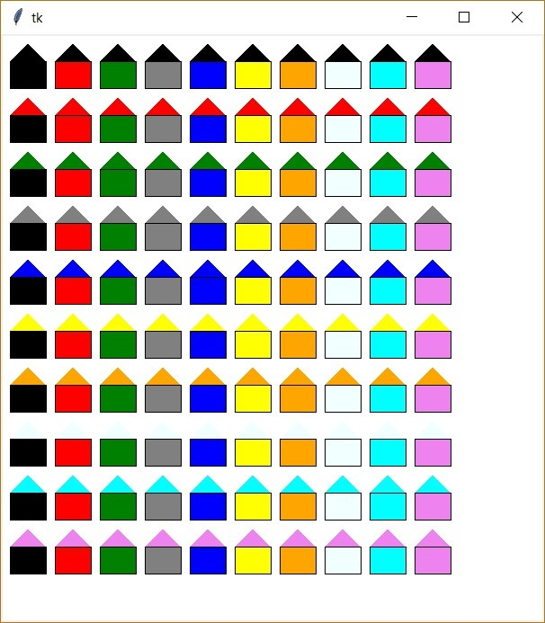
  
```py
# 22_3.py

import tkinter
canvas = tkinter.Canvas(width=400, height=280, bg='white')
canvas.pack()

barvy1 = ('black', 'red', 'green', 'gray') 
barvy2 = ('blue', 'yellow', 'orange', 'azure', 'cyan', 'violet')
cela_nabidka = barvy1 + barvy2
x = 10
y = 30
for f1 in cela_nabidka:
    for f2 in cela_nabidka:
        canvas.create_polygon(x, y, x+20, y-20, x+40, y, fill=f1)
        canvas.create_rectangle(x, y, x+40, y+30, fill=f2)
        x += 50
    x = 10
    y += 60
```

---

❓ Co se změní v nabídce firmy, pokud hned za řádek `cela_nabidka = barvy1 + barvy2` přidáme řádek `cela_nabidka = cela_nabidka[::2]`?

---


V programu vytvoříme tři n-tice nazvané `kdo`, `delal` a `co`.

```py
kdo = ('Přítel', 'Spolužák', 'Ondřej', 'Roman') 
delal = ('viděl', 'odhalil', 'řekl', 'napsal', 'zjistil', 'nakreslil')
co = ('záhadu', 'překvapení', 'předsevzetí')
```

Vytvořte program, který vypíše všechny možné věty se slovosledem: `kdo`, `delal` a `co`.

---

# 2. Body v rovině

Pomocí n-tic můžeme také definovat body v rovině. Souřadnice bodů jsou dvojice čísel (tj. n-tice s `n = 2`). Vytvoříme body A, B, C a D se souřadnicemi A = (100, 100), B = (200, 100), C = (250, 150), D = (150, 300) a z nich nakreslíme trojúhelníky ABC, ABD a ACD, každý v jiné barvě.

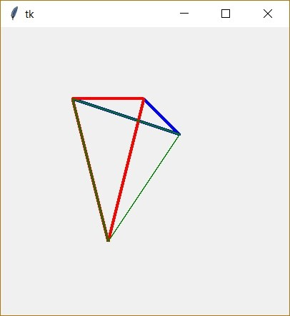

```py
# 22_4.py

import tkinter
canvas = tkinter.Canvas(width=400, height=400)
canvas.pack()

A = (100, 100)
B = (200, 100)
C = (250, 150)
D = (150, 300)
canvas.create_line(A, B, C, A, fill='blue', width=4)
canvas.create_line(D, B, A, D, fill='red', width=4)
canvas.create_line(A, C, D, A, fill='green', width=2)
```

Program doplníme. Při pohybu myší změníme souřadnice bodu D na aktuální souřadnice myši, smažeme původní trojúhelníky (tj. čtyřstěn) a znovu je nakreslíme s novými souřadnicemi bodu D. Nyní můžeme interaktivně změnit jeden z vrcholů čtyřstěnu pohybem myši.

```py
# 22_5.py

import tkinter
canvas = tkinter.Canvas(width=400, height=400)
canvas.pack()

A = (100, 100)
B = (200, 100)
C = (250, 150)
D = (150, 300)

def kresli():
    canvas.delete('all')
    canvas.create_line(A, B, C, A, fill='blue', width=4)
    canvas.create_line(D, B, A, D, fill='red', width=4)
    canvas.create_line(A, C, D, A, fill='green', width=2)

def zmenD(mys):
    global D
    D = (mys.x, mys.y)
    kresli()
    
kresli()
canvas.bind('<Motion>', zmenD)
```

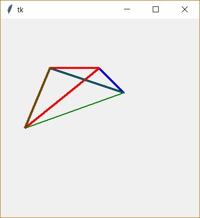
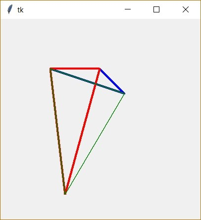
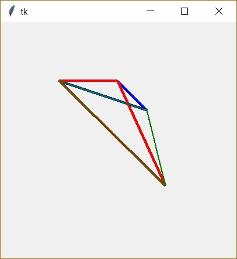

---

## 2.1. 💾 Cvičení

**[1]** Vylepšete program čtyřstěnů. Vymyslete například způsob ovládání, pomocí kterého můžeme měnit polohu jiných vrcholů.

---

N-tice můžeme použít i při zadávání souřadnic při kreslení jiných útvarů (ovál, obdélník, mnohoúhelník). Mohou být použity jako jednotlivé body, nebo se celá posloupnost souřadnic skládá z jedné n-tice. Například:

```py
# 22_6.py

import tkinter
canvas = tkinter.Canvas(width=400, height=400)
canvas.pack()

A = (100, 100)
B = (200, 100)
C = (250, 150)
D = (150, 300)
canvas.create_rectangle(A, C, fill='orange')
obdelnik1 = C+D
canvas.create_rectangle(obdelnik1, fill='red')
obdelnik2 = (50, 300, 350, 320)
canvas.create_rectangle(obdelnik2, fill='blue')
```

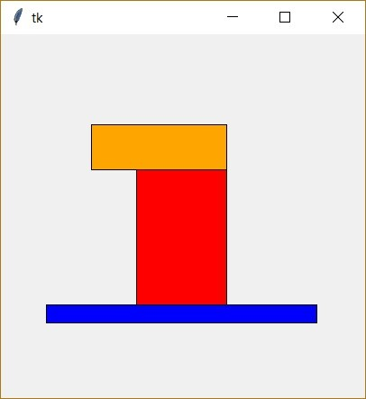

---

Nyní vytvoříme program pro kreslení čáry kliknutím myši. Na začátku budeme mít prázdnou n-tici. N-tice bude posloupnost souřadnic řádků. Pokaždé, když klikneme myší, přidáme k této n-tici souřadnice `x` a `y` myši, tedy dvě čísla. Takovou novou posloupnost bodů nakreslíme jako čáru.

```py
# 22_7.py

import tkinter
canvas = tkinter.Canvas(width=400, height=400)
canvas.pack()

cara = ()

def kresli():
    canvas.delete('all')
    if len(cara) >= 4:
        canvas.create_line(cara, fill='blue', width=4)

def pridejbod(suradnice):
    global cara
    cara = cara + (suradnice.x, suradnice.y)
    kresli()

canvas.bind('<Button-1>', pridejbod)
```

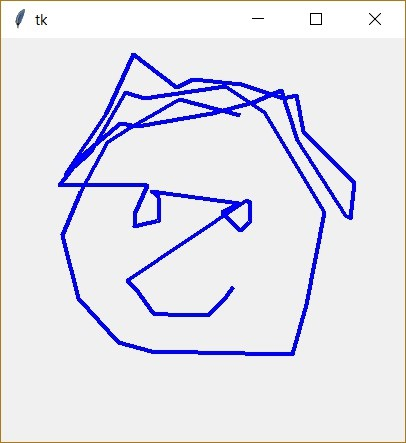


---

❓ Proč je  ve  funkci `kresli` příkaz `if`? Co by se změnilo na funkčnosti programu, kdybychom jej vynechali?

---

Nakreslili jsme nějaký obrázek. Nyní budeme experimentovat v příkazovém řádku. Nejprve si vypíšeme celou n-tici:

```py
>>> cara
(239, 77, 178, 61, 126, 91, 106, 104, 79, 154, 61, 197, 77, ...)
>>>
```

Připravíme  si prázdnou n-tici `cara_zmensena`, do které postupně vkládáme polovinu hodnot čísel z původní n-tice. 

Pozor, jednoprvkovou n-tici píšeme do závorek a za každým prvkem musí být čárka. Například: `(10,)` je jednoprvková n-tice. Vše zapíšeme do shellu, abychom hned viděli, co se bude dít.

```py
>>> cara_zmensena = ()
>>> for i in cara:
...    cara_zmensena += (i/2,)
...
...
>>> cara_zmensena
(119.5, 38.5, 89.0, 30.5, 63.0, 45.5, 53.0, 52.0, 39.5, 77.0, 30.5, 98.5, 38.5)
```

Vidíme, že v n-tici `cara_zmensena` máme poloviční hodnoty původních souřadnic. Nyní smažeme vše nakreslené a nakreslíme novou čáru, ale již podle zmenšené n-tice `cara_zmensena`. Nakreslíme ji jinou barvou a označíme tak, abychom s ní mohli pohybovat, poté čáru nakreslíme znovu jinou barvou podle n-tice `cara_zmensena`.


```py
>>> canvas.delete('all')
>>> canvas.create_line(cara_zmensena, fill='red', width=4, tags='foto1')
57
>>> canvas.move('foto1', 200, 0)
>>> canvas.create_line(cara_zmensena, fill='green', width=4, tags='foto2')
58
>>>
```

Na obrázku vidíme výsledek:

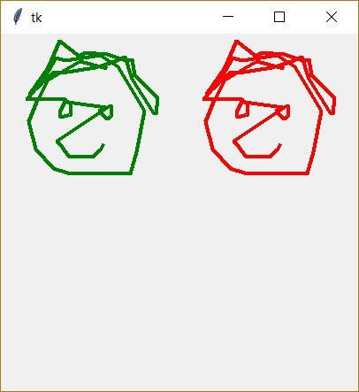

---

## 2.2. 💾 Cvičení

**[2]**   Dokončete program tak, aby se po stisknutí tlačítka obrázek zmenšil.

**[3]**  Změňte program tak, aby se na polovinu zmenšila pouze šířka nebo výška obrázku.

---

# 3. N-tice jako parametr

Dosud jsme při nastavování  písma v příkazu `canvas.create_text`  mohli zadat pouze jednoslovný název písma. Jsou to n-tice, které nám pomohou zadat víceslovný název písma. Ve skutečnosti v parametru `font` určíme n-tici. Jeho prvním prvkem je název písma, druhým prvkem je jeho velikost a dalšími mohou být nastavení pro `bold`, `italic` a `underline`.

```py
import tkinter
canvas = tkinter.Canvas(width=400, height=400)
canvas.pack()
canvas.create_text(200, 50, text='ABCDEFHIJ abcdefghij', font=('Times New Roman', 20))
canvas.create_text(200, 100, text='ABCDEFHIJ abcdefghij', font=('Times New Roman', 20, 'bold', 'italic'))
canvas.create_text(200, 150, text='abcd ABCD', font=('', 20))
```
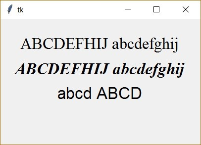

Pomocí spojování jednoprvkových n-tic můžeme také vytvořit příklady různých velikostí písma:

```py
# 22_8.py

import tkinter
canvas = tkinter.Canvas(width=600, height=400)
canvas.pack()
y = 10
for i in range(10, 30, 2):
    canvas.create_text(300, y, text='ABCDEFHIJ abcdefghij', font=('Times New Roman',) + (i,))
    y += i*2
```

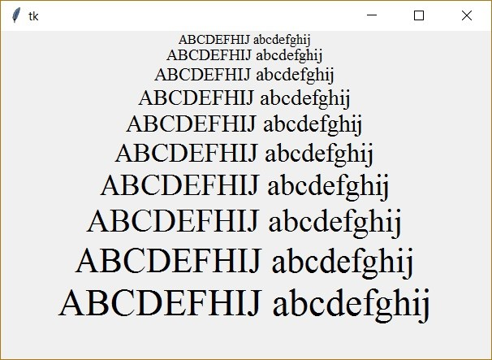


Také z názvů písma můžeme vytvořit n-tici. Tím, že projdeme prvky této n-tice a vytvoříme novou n-tici pro nastavení písma, vytvoříme ukázky písem:

```py
# 22_9.py

import tkinter
canvas = tkinter.Canvas(width=800, height=400)
canvas.pack()
pisma = ('Times New Roman', 'Courier New', 'Brush Script', 'Comic Sans MS', 'Impact')
x = 100
    for j in range(len(pisma)):
    y = 10
        for i in range(10, 30, 2):
        canvas.create_text(x, y, text='ABCDE', font=(pisma[j],)+(i,))
        y += i*2
    x += 150
```

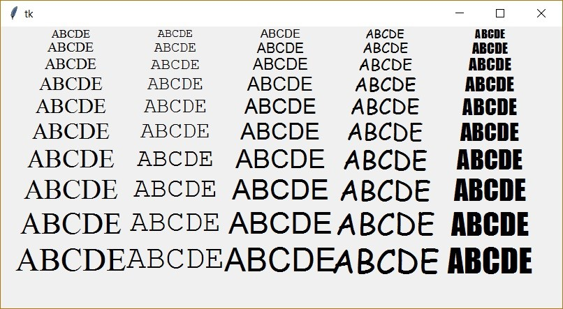

---

## 3.1. 💾 Cvičení

**[4]**  Definujte si vlastní n-tici se souřadnicemi bodů tvořících vhodnou lomenou čáru – výškový profil turistické trasy (souřadnice `x` představují ujetou vzdálenost a souřadnice `y` nadmořskou výšku bodu). Vytvořte program, který:

1. zobrazuje tuto lomenou čáru,
2. vypočítá celkovou délku sestupu na trase (počet výškových metrů, které turista v sestupných úsecích celkem ztratí),
3. vypočítá reálnou délku trasy.


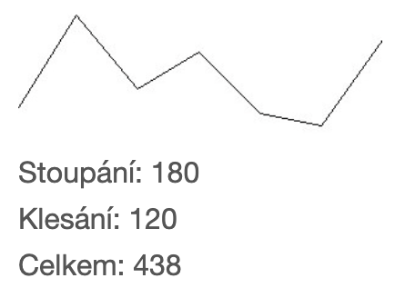


**[5]**  Vytvořte program, který simuluje plynulý pohyb míče kutálejícího se po dráze. Definujte dráhu jako n-tici bodů na klesající přerušované přímce. Po spuštění simulace se míč bude pohybovat po přímce. Zastaví se na konci přímky.

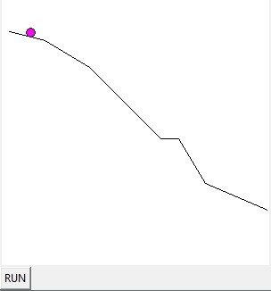
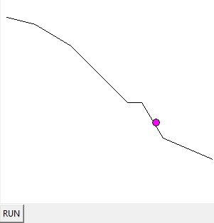


**[6]**  Vytvořte program, který simuluje popelářské auto jedoucí po určené trase ulicemi města. Ulice jsou navzájem kolmé a na každém rohu trasy je popelnice, kterou je třeba vyprázdnit (popelnice nemusíte zobrazovat). Po vyprázdnění každé popelnice ("na každém rohu") se kruh představující popelářské auto zvětší, což znázorňuje rostoucí objem odpadu, který veze. Definujte trasu popelářského vozu jako vlastní n-tici bodů tak, aby jednotlivé úseky trasy byly navzájem kolmé.

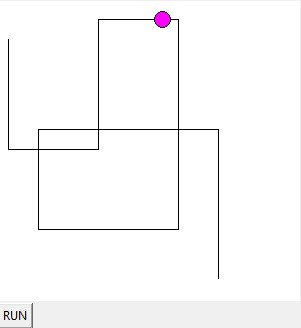
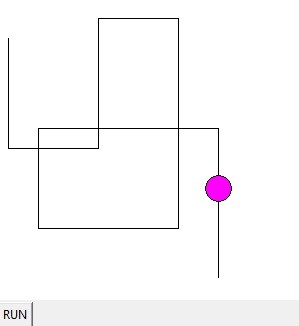

 
# 4. Více přiřazení

Zkusme si v shellu tyto zápisy:

```py
>>> a = 1, 2, 3, 4, 5
>>> a
(1, 2, 3, 4, 5) 
>>> type(a)
<type "tuple">
>>>
```

```py
>>> info = 'Python', 2, True, 0.3, -5
>>> info
('Python', 2, True, 0.3, -5)
>>> type(info)
<class 'tuple'>
>>>
```

V obou ukázkách Python přiřadil do proměnné n-tici. Pro Python jsou čárky důležitější než závorky v notaci pro identifikaci n-tic.

---

❓ Co myslíte, bude fungovat takový zápis cyklu `for`? Svou odpověď zdůvodněte a poté ověřte.

```py
for i in 1, 2, 5, 8, 13:
    print(i)
```

```py
for i in 1, 'Python', False, 0.8, -13:
    print(i)
```

---

# Vícenásobné přiřazení

Zápis n-tic bez závorek se také používá pro více přiřazení. Při jednom přiřazení přiřadíme hodnoty více proměnným najednou. Počet proměnných na levé straně a počet prvků posloupnosti na pravé straně musí být stejný.

```py
>>> r, g, b = 0, 200, 50
>>> r
0
>>> g
200
>>> b
50
>>>
```

```py
>>> jmeno, prijmeni, roknarozeni = 'George', 'Orwell', 1903
>>> jmeno
'George'
>>> prijmeni
'Orwell'
>>> roknarozeni
1903
>>>
```

Tento zápis se také často používá k výměně hodnot proměnných mezi sebou:

```py
>>> a, b = 10, 20
>>> a
10
>>> a, b = b, a
>>> a
20
>>> b
10
>>>
```

---


❓ Jak můžeme prohodit hodnoty dvou proměnných jiným způsobem?

❓ Lze vícenásobná přiřazení použít také k výměně hodnot více proměnných?

❓ Můžeme také použít více přiřazení k výměně hodnot proměnných různých typů mezi sebou?

❓ Co bude výsledkem následujících přiřazení?

```py
a = b = c = 0
a, b = c, d = 10, 20
```

---