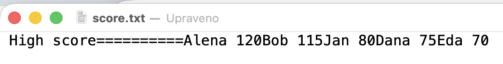
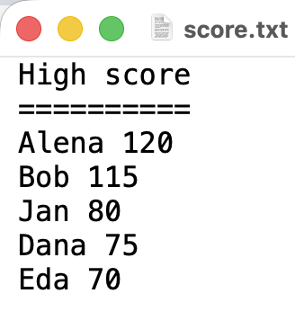
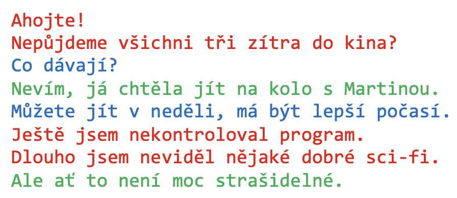
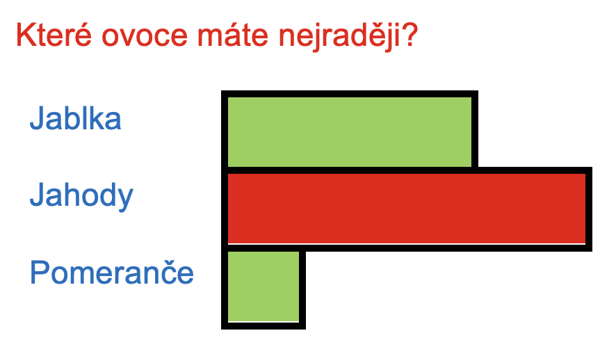
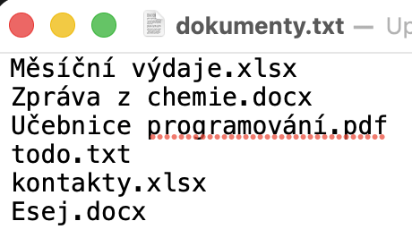
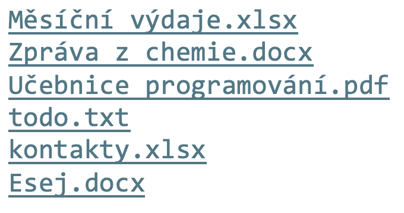

# Lekce 23: Textové soubory <!-- omit in toc -->


---

- [1. Zápis do textového souboru](#1-zápis-do-textového-souboru)
  - [1.1. 💾 Cvičení](#11--cvičení)
- [2. Přidání řádků do textového souboru](#2-přidání-řádků-do-textového-souboru)
  - [2.1. 💾 Cvičení](#21--cvičení)
- [3. Čtení z textového souboru](#3-čtení-z-textového-souboru)
  - [3.1. 💾 Cvičení](#31--cvičení)
- [4. Cyklus `while`](#4-cyklus-while)
  - [4.1. 💾 Cvičení](#41--cvičení)
- [5. Konstrukce `with`](#5-konstrukce-with)
  - [5.1. 💾 Cvičení ](#51--cvičení)
- [6. Práce s více textovými soubory](#6-práce-s-více-textovými-soubory)
  - [6.1. 💾 Cvičení](#61--cvičení)
  - [6.2. 💾 Cvičení](#62--cvičení)


---


# 1. Zápis do textového souboru


Pomocí proměnných si můžeme zapamatovat informace v běžícím programu. Pokud informace uložíme do souboru, můžeme s nimi pracovat i později po restartu programu. Ukážeme si nejjednodušší a nejčastěji používané soubory - textové soubory.

```py
soubor = open('score.txt', 'w')
soubor.write('High score')
soubor.write('='*10)
soubor.write('Alena 120')
soubor.write('Bob 115')
soubor.write('Jan 80')
soubor.write('Dana 75')
soubor.write('Eda 70')
soubor.close()
```


Zápisem `soubor = open('score.txt', 'w')` otevřeme  soubor `score.txt` pro zápis (`w`) a proměnná souboru  `soubor`  (můžeme ji pojmenovat jinak) přiřadí k souboru připojení. Příkaz `soubor.write(string)`  zapíše zadaný řetězec do souboru. Abychom soubor správně ukončili, musíme  zavřít `soubor.close()` na konci souboru. Zavření souboru přeruší spojení mezi proměnnou `soubor` a souborem `score.txt`. Pokud soubor na konci práce nezavřeme, Python nemusí fyzicky zapsat všechna data na disk. Při otevírání souboru pro zápis nemusí soubor s tímto názvem existovat. V tomto příkladu Python vytvoří nový soubor. Pokud soubor se stejným názvem již existuje, Python jeho původní obsah smaže. A kde tento soubor najdeme? Pokud neuvedeme úplnou cestu k souboru, najdeme jej ve stejné složce, kde se nachází program.

Podívejme se na vytvořený soubor pomocí jednoduchého editoru textových souborů - například pomocí poznámkového bloku:




Vidíme, že jsme příkaz `write` použili vícekrát, všechny napsané řetězce byly uloženy v těsném sledu na jednom řádku. Konec řádku lze zapsat pomocí znaků `'\n'`. I jedním příkazem pro zápis  můžeme napsat více řádků. Náš program může také vypadat takto:

```py
soubor = open('score.txt', 'w')
soubor.write('High score\n')
soubor.write('='*10)
soubor.write('\nAlena 120\nBob 115\nJan 80\n')
soubor.write('Dana 75\n')
soubor.write('Eda 70\n')
soubor.close()
```

Opět se podívejme na výsledný soubor pomocí editoru souborů:


 
Vidíme, že soubor obsahuje více řádků, konce jsme definovali znaky `'\n'`.

---

❓ Co bude obsaženo v textovém souboru vytvořeném tímto programem?

```py
f = open('pokus.txt', 'w') 
f.write('\n'*10)
f.write('=')
f.close()
```

❓ Chceme vytvořit textový soubor, který obsahuje číslované řádky postupně podle čísel 1, 2 až 9. Který z programů je tím správným řešením? Najděte chyby v ostatních programech.

```py
# 1
soubor = open('pokus1.txt', 'w')
for i in range(1, 10):
    soubor.write(i)
    soubor.close()

# 2
soubor = open('pokus2.txt', 'w')
for i in range(1, 10):
    soubor.write(i+'\n')
    soubor.close()

# 3
soubor = open('pokus3.txt', 'w')
for i in range(1, 10):
    soubor.write(str(i)+'\n')
    soubor.close()

# 4
soubor = open('pokus4.txt', 'w')
for i in range(1, 10):
    soubor.write(str(i))
    soubor.write('\n')
    soubor.close()

# 5
for i in range(1, 10):
    soubor = open('pokus5.txt', 'w')
    soubor.write(str(i)+'\n')
    soubor.close()
```

---

Pomocí příkazu `print` můžeme také zapisovat do textového souboru (otevřeného pro zápis). Příkaz `print` má standardní výstup do shellu, ale pomocí parametru `soubor` a proměnné `file` jej můžeme změnit na zadaný soubor.

```py
soubor = open('pokus.txt', 'w')
for i in range(1, 10):
    print(i, file = soubor)

soubor.close()
```

---

## 1.1. 💾 Cvičení

**[1]** Vytvořte program, který zapíše tabulku kódování znaků malých písmen do textového souboru. Na samostatném řádku bude kód písmene, mezera a znak.

**[2]** Vytvořte program, který vygeneruje zadaný počet náhodných hesel do textového souboru. Heslo má 8 znaků a skládá se pouze z písmen malé abecedy.

---

# 2. Přidání řádků do textového souboru

Můžeme také otevřít textový soubor s parametrem `'a'`. Například: `soubor = open('jmena.txt', 'a')`. Tím se otevře a přidá řádky (append). To znamená, že nesmaže původní obsah souboru. Při přidávání zapisujeme informace stejným způsobem jako u standardního zápisu. Také není nutné, aby soubor již existoval při otevření pro přidání nebo zápis. Následující ukázka zjistí naše jméno a věk a přidá tuto informaci na konec souboru (obojí na stejném řádku). Pokaždé, když spustíme program, prodloužíme soubor o jeden řádek.

```py
jmeno = input('Jak se jmenuješ?')
print('Ahoj ',jmeno,', rád tě vidím.')
vek = input('Kolik je ti let?')
soubor = open('mena.txt', 'a')
soubor.write(jmeno+' ')
soubor.write(vek+'\n')
print('Děkuji ', jmeno, '. Uložil jsem si tyto informace do souboru :)')
soubor.close()
```

---

❓  V předchozím ukázkovém programu je proměnná `vek`. Proč jej nemusíme převést na řetězec pomocí funkce `str()`?

❓ Odhadněte a otestujte, jak se bude předchozí program chovat, pokud při následných spuštěních vynecháme zavření souboru.

❓ Můžeme nějak zachovat stejnou funkčnost programu a nepoužívat příkaz `write`? Které řešení je podle vás v této situaci vhodnější?

---

```py
veta = input('Napiš nějaké poslelství pro budoucnost :')
if veta == 'delete':
    soubor = open('odkazy.txt', 'w')
    soubor.close()
else:
    soubor = open('odkazy.txt', 'a')
    soubor.write(veta+'\n')
    soubor.close()
```

Tento program nám slouží k psaní zpráv pro budoucnost. Zadáme-li jako text odkazu slovo `delete`, program smaže dříve zadané odkazy. Již víme, že otevřením souboru pro zápis vymažete jeho předchozí obsah. Vzhledem k tomu, že soubor okamžitě zavřeme, soubor zůstane prázdný.

---

## 2.1. 💾 Cvičení

**[3]** Upravte program pro psaní budoucích vzkazů tak, aby do souboru nezapisoval prázdné řádky, pokud uživatel nic nenapíše, ale pouze stiskne klávesu "Enter". 

**[4]** U východu z obchodu je dotyková obrazovka, na které můžeme vyjádřit svou spokojenost s poskytovanými službami. Vytvořte program, který se zeptá na to zeptá a volbu přidá do textového souboru `hlas.txt`. Realizace: v grafické ploše bude větším písmem text "Byli jste spokojeni s našimi službami?" Pod ním dvě tlačítka "Ano" a "Ne".


**[5]** Vytvořte program, ve kterém levým tlačítkem myši kreslíme na plátno malé kroužky. Souřadnice `x` a `y` středu každé kružnice se při kreslení přidají do textového souboru `kresleni.txt`. Souřadnice `x` bude na samostatném řádku a na dalším řádku bude souřadnice `y`. Stisknutím mezerníku můžeme smazat všechny nakreslené kruhy. Tím se také smažou informace uložené v textovém souboru. Ukázkový soubor pro tři nakreslené kruhy v souřadnicích 100, 200 a 57, 84 a 251, 238:

```
100
200
57
84
251
238
```

---

# 3. Čtení z textového souboru

Stejně jako u zápisu do souboru musíme při čtení soubor nejprve otevřít. S parametrem `'r'`  místo  parametru `'w'`  nebo  `'a'` otevřeme soubor pro čtení `soubor = open('jmeno.txt', 'r')`. Pokud nezadáme žádný parametr, soubor se automaticky otevře pro čtení `soubor = open('jmeno.txt')`. Buďte opatrní, při otevírání souboru ke čtení musí soubor již existovat. V opačném případě nám Python nahlásí chybu. 

Problémy mohou nastat i s různými **kódováním znaků v souboru**. Někdy budeme muset zpřesnit použité kódování. Nastavíme to pomocí `encoding` - `soubor = open('jmeno.txt', 'r', encoding='encoding')`. Kódování může být například:  `'utf-8'`, `'cp1250'`,  `'iso88592'`. 

Python defaultně ukládá pracuje ve znakové sadě `'utf-8'`. Pokud k tomu není speciální důvod, nepoužívejte jinou. 

Pomocí jednoduchého textového editoru (nebo programu) vytvoříme textový soubor s tímto obsahem:

```
první řádek
druhý řádek 
třetí řádek
```

a  uložme ho s názvem `info.txt`.  Jedna  celý  řádek souboru přečteme příkazem `radek = soubor.readline()`. Při čtení řádku je jeho obsah uložen v proměnné `radek`. Nemusíme si vždy pamatovat přečtený řádek v proměnné, můžeme ho použít i v nějaké funkci, která očekává vstup řetězce. Například: `print(soubor.readline())`.

Při prohlížení textového souboru v textovém editoru nevidíme znaky konce  řádku `'\n'`, ale po načtení celého řádku do proměnné jsou na konci textu také znaky `'\n'`. Pomocí tohoto programu můžeme přečíst první řádek souboru:

```py
soubor = open('info.txt', 'r')
radek = soubor.readline() 
print(radek) 
soubor.close()
```

I při čtení souboru je vhodné soubor po dokončení čtení zavřít. Po spuštění programu nám Python zapíše text "první řádek" a jeden prázdný řádek do shellu. To způsobil neviditelný návratový znak (Enter '\n'). Abychom viděli, co  je řádek v proměnné, zapsali jsme ho přímo do shellu a vidíme, že je tam `'první řádek\n'`.

```py
====== RESTART: cteni.py ======
první řádek
>>> radek
'první řádek\n'
>>> 
```

Když chceme vidět skutečný obsah řetězce - přesnou reprodukci řetězce se speciálními znaky (např. mezery na konci a také na konci řádku) tak, jak je zapsán po zadání názvu proměnné přímo v shellu, použijeme funkci `repr(string)`.

```py
soubor = open('info.txt', 'r')
radek = soubor.readline()
print(repr(radek)) 
radek = soubor.readline() 
print(repr(radek)) 
radek = soubor.readline() 
print(repr(radek)) 
soubor.close()
```

Nyní vidíme celý soubor se všemi znaky jako řetězci (v apostrofech):

```py
====== RESTART: cteni2.py ======
'první řádek\n'
'druhý řádek\n'
"Třetí řádek" 
>>>
```

Upravme náš textový soubor. Druhý řádek necháme zcela prázdný a podíváme se na výpis souboru programem.

```
první řádek

třetí řádek
```

Program vypíše pouze znak konce řádku na druhém řádku:

```py
====== RESTART: cteni2.py ======
'první řádek\n'
'\n'
"Třetí řádek"
>>>
```

---

❓ **Otázky**

1. Zjistěte, co by se stalo, kdybychom ze souboru přečetli čtvrtý neexistující řádek. Oznámí Python při tomto pokusu chybu, nebo něco vypíše?
2. Mohli bychom náš třířádkový čtecí program napsat efektivněji?

---

Známe-li přesný počet řádků souboru, můžeme použít i `for` cyklus. Tento program můžeme také použít ke čtení našeho třířádkového souboru:

```py
soubor = open('info.txt', 'r')
for i in range(3):
    radek = soubor.readline() 
    print(repr(radek)) 
soubor.close()
```

Často budeme pracovat se soubory s neznámým počtem řádků. Proto nebudeme moci použít smyčku `for` s konkrétním rozsahem (počtem opakování). Smyčku `for` můžeme také napsat ve formě, kdy řídicí proměnná bude postupně obsahovat jednotlivé řádky a my je nemusíme číst pomocí funkce `soubor.readline()`. Napíšeme ji následovně:

```py
soubor = open('info.txt', 'r')
for radek in soubor:
    print(repr(radek))
soubor.close()
```

Při čtení řádku na konci souboru Python nehlásí chybu, ale uloží do proměnné prázdný řetězec. Všimněte si, že po přečtení jakéhokoli existujícího řádku nebude v proměnné prázdný řetězec, protože řetězec bude obsahovat alespoň `'\n'` – konec řádku. Mohli bychom tedy číst řádky souboru pomocí nějaké jiné smyčky, dokud nenačteme prázdný řetězec (konec souboru). Dosud jsme používali pouze časovač (timer). Podívejme se, jak bychom četli textový soubor s neznámým počtem řádků pomocí časovače:

```py
import tkinter
canvas = tkinter.Canvas()
canvas.pack()

def cti():
    radek = soubor.readline()
    if radek == '':
        soubor.close()
    else:
        print(repr(radek))
        canvas.after(10, cti)

soubor = open('info.txt', 'r')
cti()
```

---

❓ **Otázky**

1. Kolikrát se funkce `read()` provede v předchozím programu, pokud je soubor `info.txt` prázdný?
2. Co se změní v činnosti předchozího programu, pokud vložíme otevření souboru přímo do funkce `read()`?
3.  Co se stane, když spustím předchozí program, pokud  soubor `info.txt`  obsahuje také prázdné řádky?

---

Při čtení souboru nemůžeme přečíst pouze jeden zadaný řádek (například nemůžeme přečíst pouze pátý řádek souboru), ale musíme postupně přečíst všechny řádky souboru. Takovému čtení také říkáme **sekvenční přístup** - k potřebným informacím nepřistupujeme přímo, ale postupně. Následující program přečtením celého souboru nejprve zjistí počet řádků v souboru a zapamatuje si ho v proměnné `pocet_radku`. Poté se nás zeptá, který řádek chceme zobrazit (`k`-tý řádek). Pak znovu otevře čtený soubor, přečte `k` řádků a k-tý řádek vypíše.

```py
soubor = open('score.txt', 'r')
pocet_radku = 0

for radek in soubor:
    pocet_radku += 1
soubor.close()

print('Počet řádků souboru:'+str(pocet_radku))
k = int(input('Který řádek mám vypsat:'))

soubor = open('score.txt', 'r')
for i in range(k):
    radek = soubor.readline()
print(repr(radek))

soubor.close()
```

Pokud soubor uložíme celý do proměnné, nemusíme jej číst vícekrát. Ne vždy však víme, jak velký bude soubor, se kterým budeme pracovat. Uložení celého souboru do proměnné (nebo nějaké struktury) znamená, že jeho obsah je uložen v operační paměti. Velikost operační paměti je obvykle omezená a často výrazně menší než velikost disku, na kterém je soubor uložen. Nevýhodou ukládání do operační paměti je tedy její omezená velikost, ale na druhou stranu výhodou je rychlost přístupu k ní. Pokud několikrát čteme velký textový soubor od začátku, náš program může být pomalý, protože čtení z disku je výrazně pomalejší než přístup k operační paměti. Jedno řešení může být náročné na paměť – říkáme, že má prostorové požadavky – má **větší prostorovou složitost**. Druhé řešení může být méně časově efektivní, tj. může mít větší časovou složitost. Naštěstí současné SSD disky zpomalovaní trochu smazávají. Ale i tak jsou výrazně pomalejší než operační paměť.  

Následující program ukládá všechny řádky do n-tice nazvané `radky(tuple)`. Po zadání čísla řádku se vypíše pouze tento řádek přímo z n-tice, tj. z operační paměti, a nemusíme textový soubor znovu číst.

```py
soubor = open('score.txt', 'r')
pocet_radku = 0
radky = ()

for radek in soubor:
    pocet_radku += 1
    radky = radky + (radek,)
soubor.close()

print('Počet řádků souboru:'+str(pocet_radku))
k = int(input('Který řádek mám vypsat:'))
radek = radky[k-1]
print(repr(radek))
```

---


❓  Proč je v programu `radky[k-1]`, když chceme vypsat řádek `k`?

❓ Jak můžeme tento program změnit, pokud nechceme používat proměnnou pro počítání řádků, ale chceme vypsat jen informaci o počtu řádků?

---

Všimněte si, že všechny řádky souboru jsou zapsány v proměnné `radek`.

```py
>>> radek
('High score\n', '==========\n', 'Alena 120\n', 'Bob 115\n', 'Jan 80\n', 'Dana 75\n', 'Eda 70\n') 
>>>
```

Z výpisu vidíme, že každý řádek má také ukončovací znak  `'\n'`. Někdy se potřebujeme těchto znaků zbavit. K tomu slouží metoda `strip`. Kromě `'\n'` odstraní i mezery na začátku a na konci řetězce.

```py
>>> s = ' textový řetězec\n'
>>> s.strip()
'textový řetězec'
>>>
```
Podívejme se na upravený program:

```py
soubor = open('score.txt', 'r')
riadky = ()

for radek in soubor:
    riadky = riadky + (radek.strip(),)
soubor.close()

print('Počet řádků souboru:'+str(len(riadky)))
k = int(input('Který řádek mám vypsat:'))
print(repr(riadky[k-1]))
```

Řádky řazené kolekce  členů nyní neobsahují  '\n':

```py
>>> radek
('High score', '==========', 'Alena 120', 'Bob 115', 'Jan 80', 'Dana 75', 'Eda 70') 
>>>
```

---

## 3.1. 💾 Cvičení

**[6]** Textový soubor `vylet.txt` obsahuje seznam lidí, kteří se přihlásili na výlet. Informace o každé osobě jsou uloženy ve dvou řádcích. První řádek obsahuje jméno osoby a druhý řádek obsahuje její věk. Ukázkový soubor:

```
Martina
16
Roman
14
Adam
15
...
```

Napište program, který:
1. zobrazí počet registrovaných osob,
2. vypíše počet osob mladších 15 let,
3. po zadání ceny (pomocí `input`) vypíše celkovou cenu jízdného pro všechny osoby (osoby mladší 15&nbsp;let mají slevu 50&nbsp;%),
4. vypíše průměrný věk osob.


**[7]** U východu z nákupního centra je dotyková obrazovka, na které můžeme vyjádřit svou spokojenost/nespokojenost s poskytovanými službami. Textový soubor `hlasovani.txt` obsahuje hlasy zákazníků ohledně jejich spokojenosti s poskytovanými službami. Každý řádek obsahuje hlas jednoho zákazníka. Je to buď "ano", nebo "ne". Ukázkový soubor:

```
ano
ano
ne
ano
...
```

Napište program, který:
1. spočítá a vypíše celkový počet hlasujících,
2. graficky zobrazí výsledky hlasování pomocí sloupců pro hodnoty ano a ne,
3. vypočítá a zobrazí procentuální podíl spokojených a nespokojených zákazníků.


**[8]** Textový soubor `kresleni.txt` obsahuje souřadnice kliknutých kruhů v grafické ploše (souřadnice jejich středů). Souřadnice `x` je na jednom řádku, souřadnice `y` je na následujícím řádku. Ukázkový soubor:

```
100
200
57
84
251
238
...
```

Napište program, který postupně v pravidelných časových intervalech nakreslí v grafické ploše kruhy podle souřadnic v souboru.


**[9]** Vytvořte program, který čte a postupně pod sebou zobrazuje v grafické ploše jednotlivé řádky textu z textového souboru `text.txt`. Po zobrazení každého řádku následuje sekundová pauza.


**[10]** Upravte program z predchádzející úlohy tak, aby zvládal i výpis delších textů. Pokud se textem zaplní grafická plocha (maximální počet řádků si nastavte sami), po sekunde sa všechen text smaže a výpis bude pokračovat plynule dál.


**[11]** Textový soubor `citaty.txt `obsahuje citáty slavných osobností na lichých řádcích a jejich autory na sudých řádcích. Vytvořte program, který zobrazí citát na obrazovce a pod ním jméno autora citátu v jiné barvě. Když uživatel stiskne jednu z kláves <kbd>Enter</kbd> / <kbd>Space</kbd> / <kbd>PageDown</kbd>, zobrazí se další citát ze souboru.

---

# 4. Cyklus `while`

> Další způsoby čtení textového souboru

V předchozí kapitole jsme četli textový soubor pomocí časovače. Když jsme došli na konec souboru, dostali jsme  po přečtení řádku prázdný řetězec v proměnné `radek`. A tak jsme vytvořili podmínku pro naplánování dalšího volání časovače pouze v případě, že přečtený řetězec není prázdný.

```py
import tkinter
canvas = tkinter.Canvas()
canvas.pack()

def cti():
    radek = soubor.readline()
    if radek == '':
        soubor.close()
    else:
        print(repr(radek))
        canvas.after(10, cti)

soubor = open('info.txt', 'r')
cti()
```

Někdy pro nás může být užitečný cyklus `while`. Tento cyklus se používá, když předem neznáme počet opakování, ale můžeme definovat podmínku pro pokračování cyklu (pokud je podmínka pravdivá, cyklus se provede znovu). Je to podobné jako s časovačem, zásadní rozdíl je v tom, že nečekáme mezi každým opakováním cyklu. Cyklus `while` se  také označuje jako `cyklus s podmínkou na začátku`. Takto cyklus `while` píšeme:

```
while podminka:
    príkaz1
    príkaz2
    ...
```

V této situaci neznáme počet opakování, ale můžeme definovat podmínku pro pokračování cyklu. Zde je ukázka programu, který jsme původně vyřešili pomocí časovače, přepsaného do  cyklu `while`.

```py
soubor = open('info.txt', 'r')
radek = soubor.readline()
while radek != '':
    print(repr(radek))
    radek = soubor.readline()
soubor.close()
```

---

❓   Co bude dělat tento program? Kolikrát se  cyklus while opakuje? Může se stát, že se neprovede ani jednou?

```py
from random import *
soucet = 0
print('Součet je: ', soucet)
while soucet < 30:
    cislo = randrange(10)
    print('Přičetl jsem čislo: ', cislo)
    soucet += cislo
    print('Součet je: ', soucet)
```

❓  Co udělá následující program? Kolikrát se provede cyklus `while`? Za jakých okolností dojde k pádu programu a hlášení chyby? 

```py
soucet = 0
pocet = 0
znamka = int(input('Zadej známku:'))
while 0 < znamka < 6:
    pocet += 1
    soucet += znamka
    znamka = int(input('Zadej známku:'))
print('Počet zadaných známek: ', pocet)
print('Průměr známek:', soucet/pocet)
```


❓  Co bude dělat další program? Kolikrát se cyklus `while` provede?
   
```py
from random import *
znamka = randrange(1, 6)
pocet = 0
soucet = 0
while znamka < 6:
    pocet += 1
    soucet += znamka
    print('Přičetl jsem známku:', znamka)
    print('Aktuální počet známek:', pocet)
    znamka = randrange(1, 6)
print('Počet zadaných známek:', pocet)
print('Průměr známek:', soucet/pocet)
```

❓  Za jakých okolností se cyklus `while`:
1. neprovede ani jednou,
2. opakování nikdy neskončí?

---

Cyklus, ve kterém používáme `range`, můžeme velmi snadno přepsat na  cyklus `while`. Například:

```py
for i in range(1, 11):
    print('*'*i)
```

```py
i = 1
while i < 11:
    print('*'*i)
    i += 1
```

---

## 4.1. 💾 Cvičení

**[12]** Upravte řešení jednoho z úkolů pomocí smyčky `for` a nahraďte smyčku `for` smyčkou `while`.

---

# 5. Konstrukce `with`

Při práci se soubory se můžeme setkat také s konstrukcí `with`. Při tomto typu operace se souborem není nutné soubor zavírat. Python jej zavře automaticky. Všechny příkazy v konstrukci `with` jsou odsazeny podobně jako `for`, `def`, `if`... Konstrukci `with` píšeme následovně:

```py
with open(...) as proměnná:
    příkaz1
    příkaz2
    ...
```

Následující program přečte a vypíše celý obsah souboru `score.txt`:

```py
with open('score.txt', 'r') as soubor:
    print(soubor.read())
```

Následující program přidá texty zadané v příkazu `entry` na konec souboru. Protože používá konstrukci `with`, není nutné soubor zavírat.

```py
import tkinter

def save():
    with open('text.txt', 'a') as soubor:
        soubor.write(entry1.get()+'\n')

entry1 = tkinter.Entry()
entry1.pack()
button1 = tkinter.Button(text='Zapiš', command=save)
button1.pack()
```

---

## 5.1. 💾 Cvičení 


**[13]** Textový soubor `dialog.txt` obsahuje dialog mezi maximálně pěti postavami v divadelní hře. Liché řádky obsahují číslo postavy, která právě mluví, sudé řádky (následující) obsahují větu, kterou tato postava říká. Napište program, který přiřadí postavám barvy podle vašeho zadání a vytiskne obsah souboru na grafické plátno pomocí barev jednotlivých postav. 




**[14]**  V připraveném textovém souboru `stickman.txt` je na každém řádku jedno číslo. Čtyři řádky tedy popisují jednotlivé části postavičky – Stickmana. První čtyři čísla popisují hlavu (metoda `create_oval`), a každá další čtyři čísla představují jednu čáru Stickmana (souřadnice počátečního a koncového bodu čáry). Napište program, který nakreslí Stickmana.


**[15]**  Vytvořte program, který zobrazí výsledky ankety. V textovém souboru `anketa.txt` je na prvním řádku anketní otázka a další tři řádky obsahují čísla představující počet hlasů pro „Ano“, „Ne“ a „Nevím“.



1.  Program zobrazí otázku a sloupcový graf představující počet odpovědí.
2.  Program bude mít tři tlačítka, která uživatelům umožní hlasovat pro jednu z možností, aby se graf aktualizoval.
3.  Nová čísla hlasů se také uloží, aby se mohla zobrazit při příštím spuštění programu.
4.  Možnost s nejvyšším počtem hlasů bude v grafu zvýrazněna jinou barvou.
5.  Graf bude zobrazovat procento respondentů, kteří hlasovali pro danou možnost.
6.  Tři možné odpovědi nebudou pouze Ano / Ne / Nevím. Názvy tří možností budou uvedeny v souboru přímo pod otázkou průzkumu.
7.  Hlasování bude možné nejen kliknutím na tlačítka, ale také přímým kliknutím na možnost.

---

# 6. Práce s více textovými soubory


Není možné přepsat (změnit) řádek v textovém souboru. Nelze v něm současně číst a zapisovat. Můžeme však otevřít jeden soubor pro čtení, postupně číst jeho obsah a zapisovat jej do nového souboru.

```py
soubor1 = open('score.txt', 'r')
soubor2 = open('score2.txt', 'w')

for radek in soubor1:
    soubor2.write(radek)

soubor1.close()
soubor2.close()
```

---

❓ Dosud jsme při zápisu řádků do souboru přidávali na konec `'\n'`. Proč jsme tak neučinili v tomto případě?

---

Pravděpodobně není nutné vytvářet identickou kopii souboru. Můžeme také měnit jednotlivé řádky. Tento program vytvoří kopii souboru tak, že řádky souboru budou očíslovány.

```py
soubor1 = open('score.txt', 'r')
soubor2 = open('score2.txt', 'w')
pocet = 0

for radek in soubor1:
    pocet += 1
    soubor2.write(str(pocet)+'. '+radek)

soubor1.close()
soubor2.close()
```

Ukázka souboru `score2.txt`:

```
1. Hight score
2. ==========
3. Alena 120
4. Jan 115
5. Karel 80
6. Dana 75
7. Eda 70
```

---

## 6.1. 💾 Cvičení

**[16]** Textový soubor `spinavy.txt` obsahuje kromě textu také prázdné řádky. Pomocí programu vytvořte kopii tohoto souboru, která neobsahuje prázdné řádky ani mezery na začátku a na konci neprázdných řádků. 


**[17]** Textový soubor `vylet.txt` obsahuje seznam osob, které se přihlásily na výlet na konci roku. Informace o každé osobě jsou uloženy na dvou řádcích. První řádek obsahuje jméno osoby a druhý řádek obsahuje její věk. Ukázka souboru:

```
Martina
16
Roman
14
...
```

Vytvořte program, který vytvoří textový soubor obsahující pouze jména těch, kteří se přihlásili.


**[18]**  Textový soubor `kresleni.txt` obsahuje souřadnice naklikaných kruhů v grafické ploše (souřadnice jejich středů). Souřadnice `x` je na samostatném řádku souboru a souřadnice `y` je na následujícím řádku Ukázka souboru:

```
100
200
57
84
...
```

Pomocí programu vytvořte kopii souboru, ve které budou souřadnice `x` a `y` každého kruhu na jednom řádku souboru a budou odděleny jednou mezerou.

---

I při práci s více soubory můžeme použít konstrukci `with`.

```py
with open('score.txt', 'r') as vstup: 
    with open('score3.txt', 'w') as vystup:
    pocet = 0 
    for radek in vstup:
        cislo += 1 
        output.write(str(cislo)+'. '+radek)
```

---

V další ukázce z jednoho textového souboru `kytice.txt` vytvoříme dva nové tak, že na střídačku zapíšeme jeden řádek do souboru `radky1.txt` a druhý řádek uložíme do souboru `radky2.txt`.

Ukázka `kytice.txt`:

```
Polednice (Kytice)
U lavice dítě stálo,
z plna hrdla křičelo.
"Bodejž jsi jen trochu málo,
ty cikáně, mlčelo!
Poledne v tom okamžení,
...
```

Program:

```py
vstup = open('kytice.txt', 'r')
vystup1 = open('radky1.txt', 'w')
vystup2 = open('radky2.txt', 'w')
kam = 0
radek = vstup.readline()
while radek != '':
    if kam == 0:
        vystup1.write(radek)
    else:
        vystup2.write(radek)
    kam = (kam + 1) % 2   # % 2 vypočítá zbytek po dělení dvěmi
    radek = vstup.readline()

vstup.close()
vystup1.close()
vystup2.close()
```

Ukázka `radky1.txt`:

```
Polednice (Kytice)
z plna hrdla křičelo.
ty cikáně, mlčelo!
...
```

Ukázka `radky2.txt`:

```
U lavice dítě stálo,
"Bodejž jsi jen trochu málo,
Poledne v tom okamžení,
...
```

Všimněte si, že název souboru je textový řetězec. Při otevírání souboru můžeme použít i proměnnou. Například
uživatel nám zadá jméno souboru a program otevře zadaný soubor. Program pro rozdělování zprávy může
začínat i takto:

```py
nazev_souboru = input('Zadej celý název vstupného souboru:')
vstup = open(nazev_souboru, 'r')
```

---

❓ Jak jinak můžeme v programu zapsat řádek  `kam = (kam + 1) % 2`?

❓ Porovnáme-li počet řádků v  souboru `radky1.txt` a `radky2.txt` při libovolné délce souboru `kytice.txt`, co bude vždy platit?

❓ Co program udělá, když nebude soubor `kytice.txt` existovat?

❓ Co program udělá, pokud bude soubor `kytice.txt` prázdný?

---

## 6.2. 💾 Cvičení

**[19]**  Vytvořte program, který zkombinuje soubory `radky1.txt` a `radky2.txt` v původním tvaru do souboru `kytice_obnovena.txt`.


**[20]**  Alena si řekla, že rozdělením řádků zprávy do dvou souborů se její obsah moc neutají a lepší bude, pokud ji rozdělí po znacích. Vytvořte program, který:
1. ze souboru `kytice.txt` vytvoří soubory `znaky1.txt` a `znaky2.txt` tak, že jednotlivé znaky v řádku bude střídavě ukládat do těchto souborů.
2. ze souborů `znaky1.txt` a `znaky2.txt` vytvoří původní zprávu.
 


**[21]**  Vytvořte program, který zašifruje textový soubor Césarovou šifrou do nového textového souboru. Stačí, když bude šifrovat jen znaky bez diakritiky z malé abecedy [a-z].


**[22]**  V textovém souboru `dlouhyradek.txt` je zapsán pouze jeden velmi dlouhý řádek. Napište program, který od uživatele načte jedno kladné celé číslo – délku řádku a vytvoří nový soubor, ve kterém bude původní dlouhý řádek zalamovaný na danou délku. Výstupní soubor tedy bude obsahovat více řádků, přičemž každý (kromě posledního) bude mít délku, kterou zadal uživatel. Výsledné řádky mohou být zalomené i ve středu slov.


**[23]**  V textovém souboru `dokumenty.txt` je uveden seznam dokumentů (na každém řádku je jeden název dokumentu i s příponou). Vytvořte program `dokumenty, který vygeneruje HTML soubor s hyperlinky na jednotlivé dokumenty. (_Poznámka: HTML soubor je obyčejný textový soubor, pouze jeho přípona není .txt, ale .html_).





**[24]**  V připraveném textovém souboru `clanek.txt` je článek napsán pouze malými písmeny. napište korektorský program, který vytvoří nový soubor. V něm budou alespoň začáteční písmena vět změněna na velká písmena. Věty v článku jsou zakončeny tečkou, vykřičníkem nebo otazníkem (a za nimi následuje jedna mezera). V jednom řádku může být i více vět a nemusí končit přesně na konci řádku, ale mohou přesahovat i další řádek. Podařilo se vám to? Super! Gratulujeme!

