# Lekce 25: Práce s více daty (seznam) <!-- omit in toc -->


---

- [1. 📝 Výukový příklad: Házení kostkou](#1--výukový-příklad-házení-kostkou)
  - [1.1. 💾 Cvičení](#11--cvičení)
  - [1.2. 💾 Cvičení](#12--cvičení)
  - [1.3. 💾 Cvičení](#13--cvičení)
- [2. Společné vlastnosti textových řetězců, n-tic a seznamu](#2-společné-vlastnosti-textových-řetězců-n-tic-a-seznamu)
- [3. Funkce a metody pro práci se seznamem](#3-funkce-a-metody-pro-práci-se-seznamem)
- [4. Vizualizace dat programu](#4-vizualizace-dat-programu)
- [5. 📝 Výukový příklad: Hledání měst](#5--výukový-příklad-hledání-měst)
  - [5.1. 💾 Cvičení](#51--cvičení)
- [6. 📝 Výukový příklad: Hra Need for Speed](#6--výukový-příklad-hra-need-for-speed)
  - [6.1. 💾 Cvičení](#61--cvičení)
- [7. 📝 Výukový příklad: Cyklotrasa](#7--výukový-příklad-cyklotrasa)
  - [7.1. 💾 Cvičení](#71--cvičení)
- [8. 📝 Výukový příklad: SMS hlasování](#8--výukový-příklad-sms-hlasování)
  - [8.1. 💾 Cvičení](#81--cvičení)
  - [8.2. 💾 Cvičení](#82--cvičení)


---


# 1. 📝 Výukový příklad: Házení kostkou

Studenti dostali v matematice za úkol zjistit, jak často padají jednotlivá čísla na hrací kostce. Kostkou mají hodit alespoň 1000&times; a výsledky vynést do grafu. 

Soňa je chytrá programátorka, tak se rozhodla, že vytvoří program, který to bude simulovat. Nejprve měla takový nápad - v cyklu 1000&times; vylosuje náhodné číslo z rozsahu 1 - 6 a pak si v proměnných `pocet1`, `pocet2`, `pocet3`, `pocet4`, `pocet5` a `pocet6` bude pamatovat počet padnutí jednotlivých čísel. Toto řešení hned zavrhla, neboť se jí vůbec nelíbilo. Řekla si, že to musí vyřešit lépe.


❓ Proč její první nápad není dobrým řešením?

❓ Jak bychom tento problém vyřešili lépe jen s použitím poznatků, které jsme již získali?


Potom dostala další nápad. Hodnoty proměnných pro jednotlivá čísla na kostce spojí do n-tice a nemusí použít komplikovaný `if`, kterým zjišťovala, kterou proměnnou je třeba zvýšit.

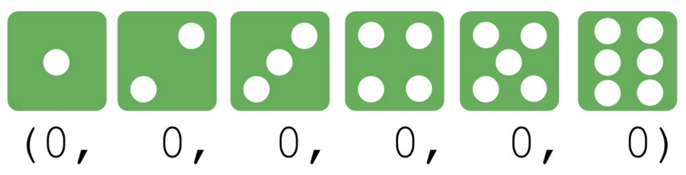

Když počítač hodí **trojku**, na příslušném místě v n-tici zvýší číslo o jednu. Musí s použitím řezů vystřihnout první dvě čísla. Třetí číslo vystřihne a zvýší ho. Vystřihne zbytek - od čtvrtého čísla po konec. Z těchto tří částí vytvoří novou n-tici.

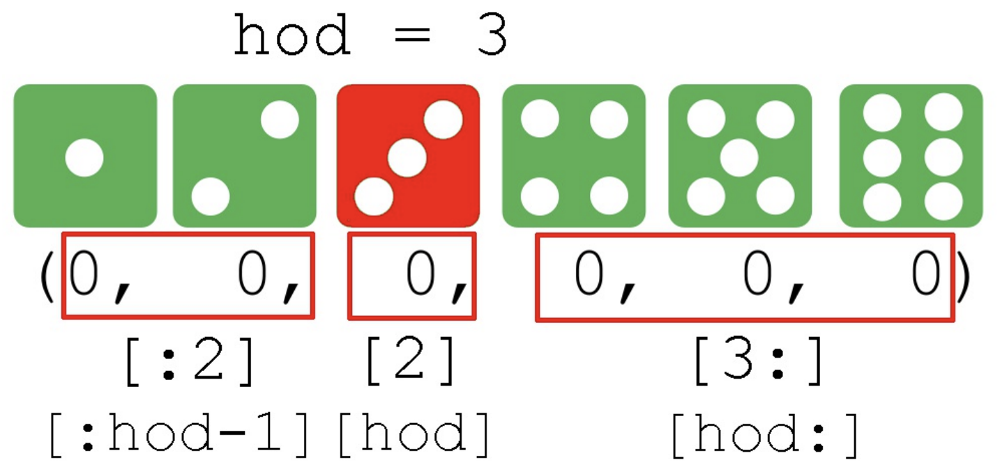


Nakonec vytvořila tento program:

```py
# 25_kostky.py

pocty = (0,)*6
for i in range(10):
    hod = randint(1, 6)
    pocet = pocty[hod-1]+1
    print('Už {}-krát padlo číslo {}.'.format(pocet, hod))
    pocty = pocty[:hod-1]+(pocet,)+pocty[hod:]
for i in range(6):
    print('Číslo {} padlo {}-krát.'.format(i+1, pocty[i]))
```

Nejprve testovala program s menším počtem opakování a teprve poté je nastavila na 1000 pokusů. Při 10 pokusech viděla takový výpis:

```
Už 1-krát padlo číslo 4.
Už 1-krát padlo číslo 6.
Už 2-krát padlo číslo 4.
Už 1-krát padlo číslo 2.
Už 2-krát padlo číslo 6.
Už 3-krát padlo číslo 4.
Už 2-krát padlo číslo 2.
Už 1-krát padlo číslo 5.
Už 2-krát padlo číslo 5.
Už 1-krát padlo číslo 3.
Číslo 1 padlo 0-krát.
Číslo 2 padlo 2-krát.
Číslo 3 padlo 1-krát.
Číslo 4 padlo 3-krát.
Číslo 5 padlo 2-krát.
Číslo 6 padlo 2-krát.
```

Soňa je s programem spokojena, až na jednu drobnost. Vytváření nové n-tice pomocí řezů se jí zdálo komplikované. Chtěla by jednoduše změnit hodnotu konkrétního prvku. Zjistila, že takovou vlastnost má datový typ **list**, někde se můžeme setkat také s označením **seznam** nebo **pole**.

Datový typ **seznam** je také posloupnost dat různého typu (podobně jako **n-tice**). Velkým rozdílem je, že **seznam je měnitelný typ** na rozdíl od n-tice a textového řetězce. To znamená, že v něm můžeme změnit hodnotu konkrétního prvku jen pomocí indexu a nemusíme vytvářet nový seznam pomocí řezů. Seznam (list, pole) vytváříme pomocí hranatých závorek.

```py
>>> pocty = [1, 2, 3, 0, 2, 4]
>>> pocty
    [1, 2, 3, 0, 2, 4]
>>> type(pocty)
    <class 'list'>
>>> len(pocty)
    6
>>> a = []
>>> type(a)
    <class 'list'>
>>> len(a)
    0
>>>
```

K jednotlivým prvkům seznamu (listu) lze přistupovat přímým přístupem pomocí indexu a můžeme jím reprezentovat lineární datovou strukturu. To znamená, že má i vlastnosti, které mívají v jiných programovacích jazycích datové struktury označované jako pole (array). Z tohoto důvodu budeme seznam (list) někdy označovat také názvem **pole**. Je však třeba upozornit, že Python má i datovou strukturu **array**, která je jakýmsi speciálním seznamem, ve kterém prvky mohou být jen reálná čísla.

---

❓ Které z funkcí a operací používaných pro práci s řetězci nebo n-ticemi můžeme použít pro práci se seznamem (listem)?

❓ Vyzkoušejte indexování prvků. Můžeme jej použít i na seznam, je v něčem rozdíl?

❓ Jak to bude s používáním řezů (slice)?

❓ For cyklem jsme mohli procházet prvky řetězce. Funguje to i pro seznam?

❓ Co se stane, pokud budeme indexovat mimo seznam (na neexistující prvek)?

---

Takto můžeme upravit program s kostkami z n-tic na seznam:


```py
pocty = [0]*6

for i in range(10):
    hod = randint(1, 6)
    pocet = pocty[hod-1]+1
    print('Už {}-krát padlo číslo {}.'.format(pocet, hod))
    pocty[hod-1] += 1

for i in range(6):
    print('Číslo {} padlo {}-krát.'.format(i+1, pocty[i]))
```

Výpis bude stejný (pouze s jinými náhodnými čísly). Nakonec jsme ještě vypsali celý seznam `pocty`:

```
Už 1-krát padlo číslo 4.
Už 1-krát padlo číslo 3.
Už 1-krát padlo číslo 1.
Už 2-krát padlo číslo 1.
Už 2-krát padlo číslo 4.
Už 2-krát padlo číslo 3.
Už 1-krát padlo číslo 5.
Už 2-krát padlo číslo 5.
Už 1-krát padlo číslo 2.
Už 3-krát padlo číslo 4.
Číslo 1 padlo 2-krát.
Číslo 2 padlo 1-krát.
Číslo 3 padlo 2-krát.
Číslo 4 padlo 3-krát.
Číslo 5 padlo 2-krát.
Číslo 6 padlo 0-krát.
>>> pocty
[2, 1, 2, 3, 2, 0]
>>>
```

---

## 1.1. 💾 Cvičení


**[1]** Upravte program tak, abychom po spuštění zadali počet simulovaných hodů a poté program nasimuluje takový počet hodů.

**[2]** Upravte program tak, aby nám při výpisu hodu napsal i pořadové číslo hodu.

**[3]** Upravte program tak, aby posloupnost losovaných hodů uložil do souboru.

---

Vytvořme program `25_tri_kostky.py`, ve kterém budeme házet najednou **třemi** hracími kostkami. Spočítáme součet jednoho hodu na všech třech kostkách a zjistíme, jak často padají jednotlivé součty.

---

❓ Jaké součty při hodu třemi kostkami můžeme získat?

❓ Co si myslíte, jaká bude frekvence jednotlivých součtů při hodu třemi kostkami ve srovnání s frekvencí výskytu hodnot při házení jen jednou kostkou? Svou odpověď zdůvodněte.

❓ Jak si můžeme pamatovat frekvenci jednotlivých součtů?

---

Programu na vstupu zadáme počet simulovaných hodů a odstartujeme simulaci. Program postupně simuluje hody a po každém hodu vypíše histogram frekvence výskytu jednotlivých součtů.

```py
# 25_tri_kostky.py

import tkinter
from random import *

canvas = tkinter.Canvas(width=600, height=500, bg='white')
canvas.pack()

pocty = [0]*16

def kresli():
    canvas.delete('sloupce')
    for i in range(16):
        canvas.create_rectangle(50+i*30, 450, 50+i*30+20, 450-pocty[i], fill='#4cb050')

def simulace():
    global pocet_hodu, pocty
    pocet_hodu -= 1
    soucet = 0
    for i in range(3):
        hod = randint(1, 6)
        soucet += hod
    pocty[soucet-3] += 1
    kresli()
    if pocet_hodu > 0:
        canvas.after(10, simulace)

def start():
    global pocet_hodu
    pocet_hodu = int(entry1.get())
    simulace()

label1 = tkinter.Label(text='Počet hodů:')
label1.pack()
entry1 = tkinter.Entry()
entry1.pack()
button1 = tkinter.Button(text='start', command=start)
button1.pack()
pocet_hodu = 0
```

Takové může být rozložení frekvence součtů hodnot při házení třemi kostkami po 400 hodech:

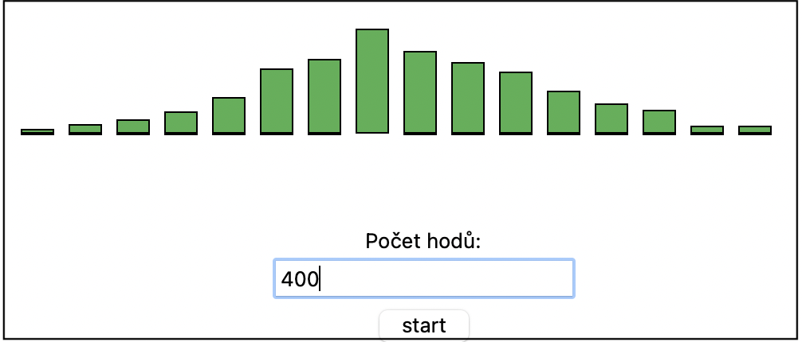


## 1.2. 💾 Cvičení

**[4]** Doplňte do histogramu popis x-ové osy - označení součtů:

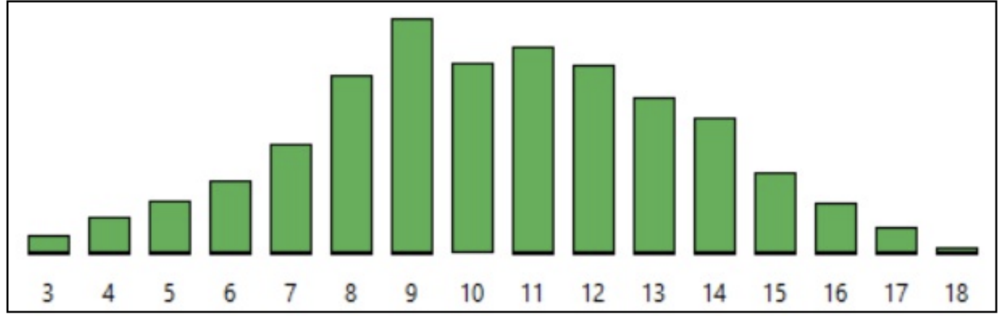

**[5]** Doplňte do histogramu popis jednotlivých sloupců - nad sloupcem zobrazte počet takových součtů:

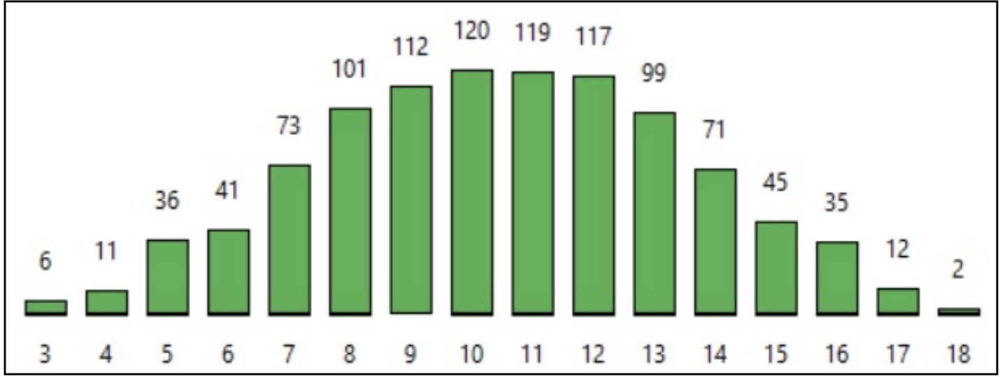

**[6]** Průběh simulace uložte do textového souboru tak, že v jednom řádku budou mezerou odděleny hodnoty, které padly při jednom hodu více kostkami:

```
5 4 3
2 4 2
1 2 6
4 2 2
```

---

Zatím máme velikost canvasu předem přesně nastavenou. Program vylepšíme tak, že po zadání počtu hodů se zároveň **přizpůsobí výška canvasu**. Předpokládáme (odhadujeme), že na nejvyšší sloupec budeme potřebovat přibližně jednu pětinu z počtu hodů a také rezervu 50 pixelů pro výpis označení osy `x` a popis hodnot sloupců. Vytvoříme globální proměnnou `maxy` a do funkce `start()` doplníme výpočet maximální `y`-ové souřadnice `maxy = pocet_hodu//5+50` a změníme výšku okna `canvas['height'] = maxy`. Ihned po přiřazení se velikost canvasu upraví.

**Poznámka:** Podobně umíme změnit i šířku canvasu (`canvas['width'] = 400`), nebo barvu pozadí canvasu (`canvas['bg'] = 'red'`). Pokud bychom naopak chtěli zjistit aktuální velikost canvasu, vypíšeme ji například přes `print(canvas['height'])`, nebo ji přiřadíme do proměnné `vyska = canvas['height']`. Všimněme si, že výsledkem není číslo, ale textový řetězec, čili budeme ho muset funkcí `int()` přetypovat na číslo.


Takto bude vypdat upravená funkce `start()`:

```py
maxy = 500
def start():
    global pocet_hodu, maxy
    pocet_hodu = int(entry1.get())
    maxy = pocet_hodu//5+50
    canvas['height'] = maxy
    simulace()
```

Nestačí upravit pouze tuto funkci, ale všude při vykreslování sloupců a jiných hodnot musíme upravit původní fixně zadanou `y`-ovou souřadnici tak, aby se vypočítala podle `maxy`:

```py
canvas.create_rectangle(50+i*30, maxy-50, 50+i*30+20, maxy-50-pocty[i], fill='#4cb050')
```

Popis jednotlivých sloupců může obsahovat jejich přesnou hodnotu, ale můžeme jej vyjádřit také v procentech (ze všech hodů). K aktuálnímu procentuálnímu zastoupení jednotlivých součtů potřebujeme znát aktuální (již provedený) počet hodů. Zdá se, že ten máme v proměnné `pocet_hodu`, ale není tomu tak. V proměnné `pocet_hodu` si pamatujeme počet hodů, které máme ještě provést, a ne již provedený počet hodů. Buď si vytvoříme novou proměnnou, ve které si budeme počítat počet již zrealizovaných hodů, nebo můžeme sčítat součet všech prvků seznamu pomocí vestavěné funkce `sum()`:

```py
>>> pocty
    [2, 7, 9, 26, 31, 40, 56, 72, 70, 49, 62, 36, 22, 11, 6, 1]
>>> sum(pocty)
    500
>>>
```

Pro každý sloupec vypočteme jeho poměr k celku a vynásobíme 100:

```py
>>> pocty
    [2, 7, 9, 26, 31, 40, 56, 72, 70, 49, 62, 36, 22, 11, 6, 1]
>>> procenta = [0]*16
>>> pocet_hodu_zrealizovany = sum(pocty)
>>> i = 0
>>> for hodnota in pocty:
        procenta[i] = hodnota / pocet_hodu_zrealizovany * 100
        i += 1
>>> procenta
    [0.4, 1.4000000000000001, 1.7999999999999998, 5.2, 6.2, 8.0, 11.200000000000001, 14.399999999999999, 14.000000000000002, 9.8, 12.4, 7.199999999999999, 4.3999999999999995, 2.1999999999999997, 1.2, 0.2]
>>>
```

Pomocí formátování řetězců umíme desetinné číslo zobrazit například na jedno desetinné místo: `'{:.1f}'.format(cislo)`.

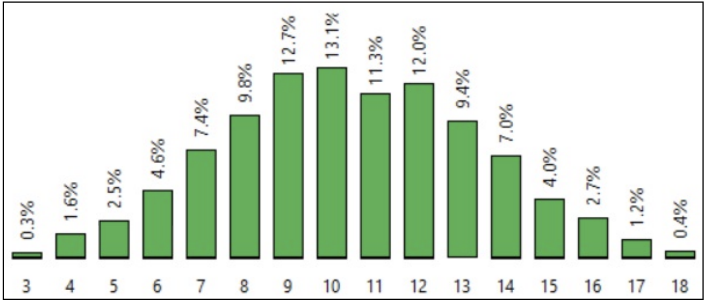

Výsledný program po úpravách:

```py
import tkinter
from random import *
canvas = tkinter.Canvas(width=600, height=500, bg='white')
canvas.pack()

pocty = [0]*16
maxy = 500

def kresli():
    canvas.delete('sloupce')
    canvas.delete('popis')
    procenta = [0]*16
    pocet_hodu_zrealizovany = sum(pocty)
    i = 0
    for hodnota in pocty:
        procenta[i] = hodnota / pocet_hodu_zrealizovany * 100
        i += 1
    for i in range(16):
        canvas.create_rectangle(50+i*30, maxy-50, 50+i*30+20, maxy-50-pocty[i], fill='#4cb050')
        procento = '{:.1f}%'.format(procenta[i])
        canvas.create_text(50+i*30+10, maxy-50-pocty[i]-20, text=procento, tags='popis', angle=90)

def simulace():
    global pocet_hodu, pocty
    pocet_hodu -= 1
    soucet = 0
    for i in range(3):
        hod = randint(1, 6)
        soucet += hod
    pocty[soucet-3] += 1
    kresli()
    if pocet_hodu > 0:
        canvas.after(10, simulace)

def start():
    global pocet_hodu, maxy
    pocet_hodu = int(entry1.get())
    maxy = pocet_hodu//5+50
    canvas['height'] = maxy
    for i in range(16):
        canvas.create_text(50+i*30+10, maxy-30, text=str(i+3))
    simulace()

label1 = tkinter.Label(text='Počet hodů:')
label1.pack()
entry1 = tkinter.Entry()
entry1.pack()
button1 = tkinter.Button(text='start', command=start)
button1.pack()
pocet_hodu = 0
```
---


❓  Je tento program efektivní? Můžeme v něm něco vylepšit (jiným způsobem řešení se dopracovat ke stejnému efektu)?

❓  Proč je lepší umístit vypisování popisu osy `x` ve funkci `start`, a ne `kresli`?

❓  Proč bude program hlásit chybu, pokud bychom do funkce `start` hned před volání simulace umístili volání funkce `kresli`? Jakým způsobem bychom mohli předejít této chybě?

---

## 1.3. 💾 Cvičení

**[7]** Doplňte do programu tlačítko, které bude přepínat, zda nad sloupcem bude zobrazen počet součtů nebo vyjádření v procentech (ze všech padlých součtů).

**[8]** Upravte program tak, že mu zadáme počet kostek, kterými najednou házíme, a také počet simulovaných hodů. Program i podle tohoto vstupu upraví (přizpůsobí) průběžné zobrazení histogramu. Šířku sloupce přizpůsobí velikosti canvasu a počtu sloupců (v závislosti na počtu použitých hracích kostek).

**[9]** Vytvořte program, který vykreslí vedle sebe 20 čtverečků náhodně vybraných barev. Při přechodu myši přes ně se budou čtverečky zvětšovat podle ukázky.

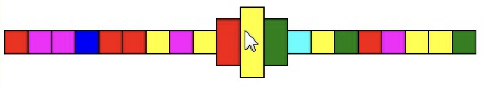

**[10]** Vytvořte program, který bude představovat animovaný "reklamní nápis". Uživatel zadá slovo, které se následně vypíše do grafické plochy, přičemž každý znak zadaného slova bude vypsán náhodně
vybranou barvou.
1. Barvy písmen se budou každou sekundu náhodně měnit.
2. Barvy písmen se budou každou sekundu cyklicky posouvat doleva (viz ukázka):

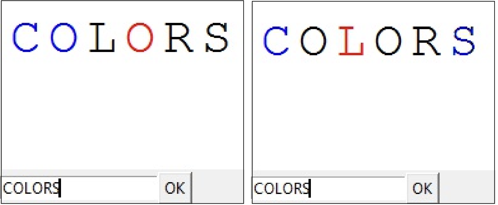

---

# 2. Společné vlastnosti textových řetězců, n-tic a seznamu

- **Indexování** - pro přístup k danému prvku textových řetězců, n-tic i seznamu používáme stejný způsob `proměnná[index]`.
- **Řezy** (slice) - pro výběr více prvků (řez) textových řetězců, n-tic i seznamu používáme stejný způsob `proměnná[odkud:kam:krok]`.
- **Operátor `in`** - funguje v textových řetězcích, n-ticích i v seznamu `prvek in proměnná`.
- **Funkce `len()`** - funguje v textových řetězcích, n-ticích i v seznamu `len(proměnná)`.
- **Operace `+`** - funguje v textových řetězcích, n-ticích i v seznamu - spojí obsah dvou typově stejných proměnných do jedné stejné struktury `a + b`.
- **Operace `*`** - funguje v textových řetězcích, n-ticích i v seznamu - vícenásobně zopakuje obsah proměnné do nové struktury `a * 3` nebo `3 * a`.
- **Procházení `for` cyklem** - funguje v textových řetězcích, n-ticích i v seznamu - pomocí for cyklu můžeme procházet po jednotlivých prvcích struktury – `for i in proměnná`.

# 3. Funkce a metody pro práci se seznamem


Stejně jako textový řetězec a n-tice i seznam (list, pole) má v Pythonu definovány své **metody**, tedy funkce ve speciálním zápisu ve tvaru 

```
jmeno_seznamu.funkce(parametry)
```

Seznam je na rozdíl od textového řetězce a n-tice měnitelný typ, to znamená, že některé z těchto metod nevrátí výsledek, ale budou mít nějaký účinek na seznam (něco v něm změní). Nejčastěji budeme používat tyto metody:

| Metoda | Co dělá|
| --- | --- |
| `n.append(hodnota)` | přidá na konec seznamu prvek se zadanou hodnotou |
| `n.insert(index, hodnota)` | přidá nový prvek se zadanou hodnotou před zadaný index seznamu |
| `n.pop()` | odstraní poslední prvek seznamu a vrátí jeho hodnotu |
| `n.pop(0)` | odstraní první prvek seznamu a vrátí jeho hodnotu |
| `n.index(hodnota)` | vyhledá hodnotu a vrátí index prvního výskytu hodnoty v seznamu |
| `n.count(hodnota)` | vrátí počet výskytů hodnoty v seznamu |
| `n.sort()` | seřadí prvky seznamu vzestupně (přímo v paměti) |

V následujících dvou ukázkách (v shellu) uvidíme vytvoření seznamu z pěti náhodných čísel. Nejprve využijeme metodu `append()`:

```py
>>> from random import *
>>> cisla = []
>>> type(cisla)
    <class 'list'>
>>> for i in range(5):
        cisla.append(randrange(10))
>>> cisla
    [4, 8, 5, 1, 6]
>>>
```

Ve druhé ukázce nepoužíváme metodu `append()`, ale vytvoříme nový seznam spojením existujícího seznamu a seznamu s jedním prvkem (náhodné číslo, které chceme do seznamu přidat):

```py
>>> from random import *
>>> cisla = []
>>> type(cisla)
    <class 'list'>
>>> for i in range(5):
        cisla = cisla + [randrange(10)]
>>> cisla
    [6, 7, 3, 9, 7]
>>>
```

Stejný efekt bude mít i vytvoření 5-prvkového seznamu s hodnotami 0, které následně změníme na náhodné číslo:


```py
>>> from random import *
>>> cisla = [0] * 5
>>> type(cisla)
    <class 'list'>
>>> for i in range(5):
        cisla[i] = randrange(10)
>>> cisla
    [9, 5, 5, 5, 3]
>>>
```

Někdy nechceme vytvořit seznam s konkrétními hodnotami. Tehdy můžeme použít i speciální, ještě nedefinovanou hodnotu `None`. Později ji změníme podle potřeby.

```py
>>> cisla = [None] * 5
>>> cisla
    [None, None, None, None, None]
>>>
```

---

Seznam můžeme vytvořit i transformací z jiné struktury (například z textového řetězce, n-tice) pomocí funkce `list()`:

```py
>>> s = 'Python'
>>> l = list(s)
>>> l
    ['P', 'y', 't', 'h', 'o', 'n']
>>>
```

```py
>>> n = (1, 2, 3, 4, 5)
>>> l = list(n)
>>> l
    [1, 2, 3, 4, 5]
>>>
```

Podobně ze seznamu nebo z textového řetězce můžeme funkcí `tuple()` vytvořit n-tici:


```py
>>> l = [1, 2, 3, 4, 5]
>>> n = tuple(l)
>>> n
    (1, 2, 3, 4, 5)
>>>
```

Ve funkci `list()` můžeme použít i generátor `range()`, který známe z `for` cyklu:


```py
>>> l = list(range(5))
>>> l
    [0, 1, 2, 3, 4]
>>>
```

```py
>>> l = list(range(5,-5,-1))
>>> l
    [5, 4, 3, 2, 1, 0, -1, -2, -3, -4]
>>>
```
---

❓ Zjistěte, co vypíše tento program. Který ze seznamů bude mít více prvků?

```py
adam_navstivil = ['Brno', 'Praha', 'Ostrava']
boris_navstivil = adam_navstivil
boris_navstivil.append('Plzeň')
print(adam_navstivil)
print(boris_navstivil)
```

❓ Zjistěte, co vypíše tento program. Která z n-tic bude mít více prvků?

```py
adam_navstivil = ('Brno', 'Praha', 'Ostrava')
boris_navstivil = adam_navstivil
boris_navstivil = boris_navstivil + ('Plzeň',)
print(boris_navstivil)
```

❓ Zjistěte, co vypíše tento program. Která z n-tic bude mít více prvků?

```py
adam_navstivil = ('Brno', 'Praha', 'Ostrava')
boris_navstivil = adam_navstivil
boris_navstivil = boris_navstivil + ('Plzeň',)
print(boris_navstivil)
```

❓ Zjistěte, co vypíše tento program. Který ze seznamů bude mít více prvků?

```py
adam_navstivil = ['Brno', 'Praha', 'Ostrava']
boris_navstivil = adam_navstivil[:]
boris_navstivil.append('Plzeň')
print(adam_navstivil)
print(boris_navstivil)
```

---

Když vytvoříme seznam `adam_navstivil`, v proměnné `adam_navstivil` je pouze reference na seznam (pole) s prvky `'Brno'`, `'Praha'`, `'Ostrava'`. Seznam je uložen v paměti a reference je jen jakýmsi odkazem na toto paměťové místo. Po přiřazení `boris_navstivil = adam_navstivil` se nevytvoří kopie celého seznamu, ale i proměnná `boris_navstivil` obsahuje referenci (má odkaz) na stejný seznam, tedy hodnoty uložené v paměti. Takže je jedno, jestli nějak změníme seznam `adam_navstivil` nebo `boris_navstivil`, vždy uděláme změnu na stejném paměťovém místě, na které referují (odkazují) obě proměnné.


# 4. Vizualizace dat programu

Pro vizualizaci programu můžeme použít web [www.pythontutor.com](https://www.pythontutor.com):


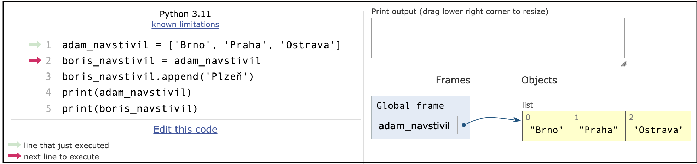


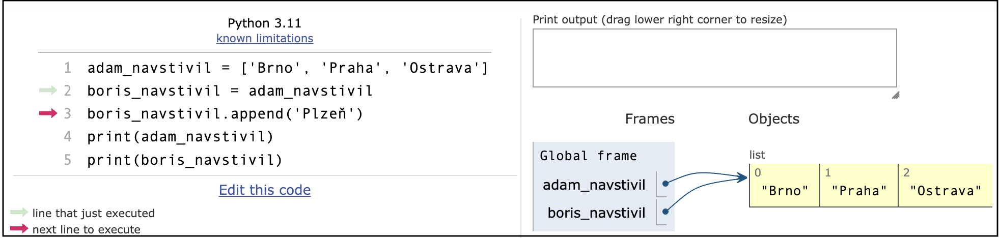


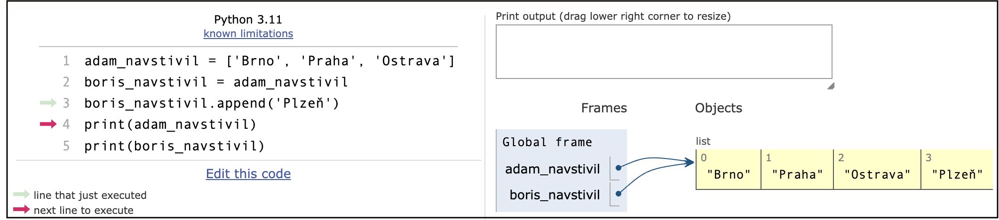


**Pokud potřebujeme vytvořit kopii seznamu (listu), využijeme řez (slice]**. Použitím řezu vždy vytvoříme kopii prvků (daného řezu). My jsme použili řez na celý seznam - viz řádek 2 `boris_navstivil = adam_navstivil[:]`


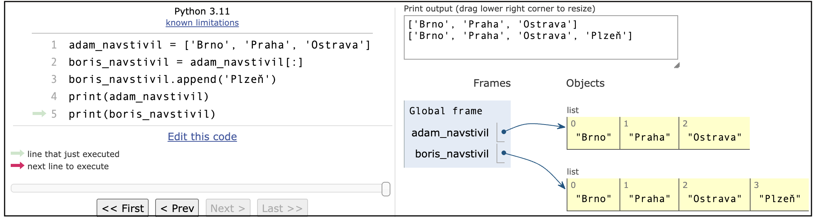

Doposud jsme se s takovou situací nesetkali, protože řetězec (**string**) ani n-tice (**tuple**) jsou neměnitelné typy.

---

**Cvičení:** Vytvořte 10-prvkové pole, naplněné hodnotami 0, 1 až 9 - `p = list(range(10))`. Pomocí shellu nebo vizualizací na stránce [https://pythontutor.com](https://pythontutor.com) zjistěte, co bude výsledkem takových úprav původního seznamu:

1. `p[3:4] = [0]`
2. `p[3:4] = [0, 0]`
3. `p[3:4] = []`
4. `p[3:7] = []`
5. `p[2:5] = p[4:1:-1]`

---

# 5. 📝 Výukový příklad: Hledání měst 

> Rozdělení textového řetězce do seznamu

Vytvořme program, který se nás zeptá na navštívená města (zadáme je oddělená mezerou) a vypíše nám počet navštívených měst a seřadí je podle abecedy.

```py
odpoved = input('Napiš města, které jsi navštívil(a) (odděl je mezerou): ')

odpoved = odpoved.strip()
seznam = []
mesto = ''

for i in range(len(odpoved)):
    if odpoved[i] == ' ':
        seznam.append(mesto)
        mesto = ''
    else:
        mesto = mesto + odpoved[i]

seznam.append(mesto) # (1)*
seznam.sort()
print('Počet navštívených měst:', len(seznam))
print('Abecedně seřazená města:')
for mesto in seznam:
    print(mesto, end=' ')
```

V programu jsme použili metodu `sort()`, která seřadí prvky seznamu.

```
Napiš města, které jsi navštívil(a) (odděl je mezerou): Ostrava Praha Brno Plzeň 
Počet navštívených měst: 4
Abecedně seřazená města:
Brno Ostrava Plzeň Praha 
>>>
```

---


❓  Zdůvodněte, proč je potřebný v programu řádek označený komentářem `# (1)*`.

❓  Zjistěte a popište situace (různé vstupy), pro které program nebude fungovat zcela správně.

❓  Co bychom měli změnit v programu, aby korektně fungoval i v případě, že na konci řádku bude mezera? Nebo funguje korektně i v takovém případě? Svou odpověď zdůvodněte.

❓  Jak bychom měli program upravit, aby fungoval správně i v případě, že jednotlivá města oddělíme více než jednou mezerou?

---

Namísto cyklu, který po nalezení mezery přidá do seznamu město, můžeme využít metodu textových řetězců `řetězec.split()`. Tato metoda rozdělí vstupní řetězec na jednotlivé prvky a vytvoří z nich seznam jednotlivých znaků. Standardně řetězec rozdělí podle mezer. Parametrem můžeme určit znak, podle kterého se má řetězec rozdělovat `řetězec.split(oddělovač)`.


```py
>>> odpoved = 'Bratislava Praha Budapešť'
>>> seznam = odpoved.split()
>>> seznam
['Bratislava', 'Praha', 'Budapešť']
>>>
```

```py
>>> odpoved = 'Bratislava;Praha;Budapešť'
>>> seznam = odpoved.split(';')
>>> seznam
['Bratislava', 'Praha', 'Budapešť']
>>>
```

Výsledný program s funkcí `split()` je nyní kratší:

```py
odpoved = input('Napiš města, které jsi navštívil(a) (odděl je mezerou): ')
odpoved = odpoved.strip()
seznam = odpoved.split()
seznam.sort()
print('Počet navštívených měst:', len(seznam))
print('Abecedně seřazená města:')

for mesto in seznam:
    print(mesto, end=' ')
```


---

## 5.1. 💾 Cvičení


**[11]** V textovém souboru `mesta.txt` jsou hlavní města Evropy. Na každém řádku je název města, středník a název země. Vytvořte program, který vyzve uživatele, aby zadal hlavní města Evropy, která navštívil. Program porovná seznam navštívených míst s městy, která jsou v souboru, a uživateli napíše, která města ještě nenavštívil. Textový soubor můžeme v programu **přečíst jen jednou**. Ukázka souboru:

```
Amsterdam;Nizozemsko
Andorra;Andorra
Atény;Řecko
Bělehrad;Srbsko
Berlín;Německo
...
```


**[12]** V textovém souboru `mesta.txt` jsou hlavní města Evropy. Na každém řádku je název města, středník a název země. Vytvořte program, který vytvoří textový soubor `zeme.txt`. V tomto souboru budou pouze názvy zemí (každá země bude na samostatném řádku). Názvy zemí v souboru budou abecedně seřazeny.

**[13]** Vytvořte program, který vyzve uživatele, aby zadal hlavní města Evropy, která navštívil on a která jeho kamarád. Program porovná tyto seznamy a vypíše města, která již navštívili oba.


**[14]**  Vytvořte program, ve kterém uživatel zadá slovo. Toto slovo se vypisuje postupně po jednotlivých znacích tak, že po každé vteřině se objeví další písmeno. V programu využijte seznam identifikátorů nakreslených útvarů.
1. Když už bude vypsáno celé slovo,začnou písmena postupně od prvního po poslední mizet.
2. Když už bude vypsáno celé slovo,začnou písmena postupně od posledního mizet.
3. Upravte program tak, aby písmena „přilétala“ zprava a po vypsání celého slova „odlétala“ doleva.
4 Upravte jednotlivé verze programů z úloh 1., 2., 3., aby se tato animace opakovala neustále dokola.


**[15]** Vytvořte program, který bude umět vykreslit obrázek zakódovaný v textovém souboru `obrazek.txt`. Každý řádek souboru popisuje jeden objekt – obdélník, ovál nebo čáru. Program vykreslí obrázek, který je složen z těchto objektů. Ukázka vstupních řádků souboru `obrazek.txt`:

```
r 10 20 150 200    # Obdélník s danými souřadnicemi
o 30 50 210 305    # Ovál s danými souřadnicemi
l 20 100 170 180   # Čára s danými souřadnicemi
```

Přidejte na konec řádků v textovém souboru informaci o barvě jednotlivých objektů a upravte program, aby obrázek vykreslil v příslušných barvách.


---

#  6. 📝 Výukový příklad: Hra Need for Speed 

> Využíváme seznam v programech

Naprogramujeme si zjednodušenou hru **Need for Speed**. Ve hře bude cesta a auto. Velikost grafického plátna bude 640&times;480 pixelů. Na začátku je cesta rovná a je umístěna přesně ve středu grafického plátna. Šířka cesty je 100 pixelů. V dolní části je auto umístěno na silnici. Šipkami vlevo a vpravo hýbeme autem. Cílem hráče je udržet auto na silnici. Cesta se skládá ze 48 řádků, každý řádek má výšku 10 pixelů. Ve svislé poloze je auto stále na stejném místě. Ve hře se posouvá cesta, ne auto. Cesta se hýbe (roluje) směrem dolů. Vrch cesty (první řádek) se náhodně generuje, ale tak, aby byl o plus minus 10 pixelů posunut vůči druhému řádku. Čili na vrchu se generují nové řádky a ty se postupně rolují dolů po obrazovce až z ní odejdou. V programu je zajištěno, aby cesta neodešla mimo levý nebo pravý okraj obrazovky (abychom ji mohli hrát).


---

❓ Které údaje si budeme muset pamatovat v programu?

❓ V jakých strukturách bude vhodnější si je pamatovat?

❓ Jak je vhodné provést posun cesty o jeden řádek a generovat nový řádek?

❓ Budeme využívat canvas.move, nebo budeme cestu vymazávat a znovu kreslit?

❓ Co všechno je třeba udělat v časovači?

❓ Ve které části programu budeme hýbat autem, kde ho musíme překreslovat?

❓ Ve které části programu je dobré testovat, zda je auto na silnici?

❓ Jak zajistíme, aby cesta neodešla z boků plátna?

---

Nejprve vytvoříme `canvas`, v proměnné `radku` si budeme pamatovat počet řádků cesty, abychom případně mohli náš program později snadno upravit. Canvas bude zelený a my budeme kreslit na zelené pozadí jen bílou cestu. Je to jednodušší než na bílé pozadí kreslit zvláště levou a pravou část plochy vedle cesty. Tak nám namísto dvou obdélníků stačí nakreslit jen jeden obdélník ve středu.

Každý řádek cesty si budeme pamatovat v seznamu `cesta`, označme si jejich nultý až 47. řádek. Například v prvku s indexem 0 si pamatujeme souřadnici nultého řádku, v prvku s indexem 1 souřadnici prvního řádku atd., teprve v prvku s indexem 47 si pamatujeme souřadnici posledního řádku (zcela spodního). Souřadnice řádku je v našem případě x-ová souřadnice levého okraje cesty. Na začátku je cesta rovná úplně uprostřed (střed má hodnotu 320, šířka cesty je 100), takže levý okraj má souřadnici 320 - 50 = 270.

```py
import tkinter
from random import *
canvas = tkinter.Canvas(width=640, height=480, bg='green')
canvas.pack()
```

Dalším krokem bude kreslení cesty. Vytvoříme funkci `kresli_cestu()`. Funkce nejprve smaže nakreslenou cestu (podle tagu pro cestu). Následně for cyklem projedeme všechny řádky cesty a podle x-ové souřadnici v seznamu `cesta` pro příslušný řádek nakreslíme bílý obdélník (cestu). Y-ovou souřadnici si nikde nemusíme pamatovat, protože každý řádek má podle zadání výšku 10 pixelů, a tudíž si umíme y-ovou souřadnici vypočítat podle `i` (indexu prvku seznamu, pro který cestu kreslíme).

```py
def kresli_cestu():
    canvas.delete('cesta')
    for i in range(radku):
        canvas.create_rectangle(cesta[i], i*10, cesta[i]+100, i*10+10, fill='white', outline='', tags='cesta')
```

V časovači zavoláme funkci `posun_cestu()`, která posune cestu o jeden řádek dolů a vygeneruje nový řádek. Následně cestu vykreslíme a budeme plánovat další spuštění animace. Zřejmě tam později doplníme další věci.

```py
def animace():
    posun_cestu()
    kresli_cestu()
    canvas.after(100, animace)
```

Nyní musíme vytvořit funkci `posun_cestu()`. V ní nejprve vypočítáme souřadnici nového řádku, který vložíme na horní okraj plátna. Vypočítáme ji ze souřadnice aktuálního nulového řádku a k ní náhodně přičteme +10, 0 nebo -10 (je třeba si uvědomit, že k tomu nepotřebujeme `if`). Pomocí podmínky `if` zajistíme, aby nová souřadnice nebyla menší než 0 a větší než 540 (640 – 100), aby cesta zůstala v zobrazené části plátna. Tuto novou souřadnici `x` nulového řádku vložíme na začátek seznamu (před aktuální nulový prvek) metodou `insert`. Zároveň musíme z konce seznamu odstranit poslední řádek metodou `pop()`, aby cesta měla stále pouze 48 řádků.

```py
def posun_cestu():
    novy = cesta[0] + randint(-1, 1)*10
    if novy < 0:
        novy = 0
    if novy > 540:
        novy = 540
    cesta.insert(0, novy)
    cesta.pop()
```

Ještě musíme spustit funkci `animace()`. Program nyní již funguje – tedy posouvání cesty. Ještě musíme vyřešit samotné auto. O autě si musíme zapamatovat souřadnice `x` a `y`. Na globální úrovni definujeme proměnné `autox` a `autoy` a přiřadíme jim hodnoty tak, aby se auto nacházelo uprostřed cesty na předposledním řádku. Zároveň přiřadíme událost stisknutí šipky vlevo a vpravo k funkci, která bude řídit posun auta doleva a vpravo.


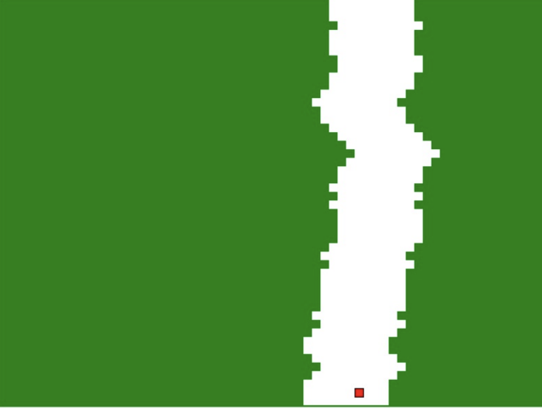

Auto bychom měli nakreslit po prvním spuštění animace, ale to nebude stačit. Jelikož v animaci pokaždé smažeme a znovu nakreslíme dráhu, dráha nám zakryje obrázek auta. V našem řešení tedy musíme pokaždé nakreslit auto i v animaci (časovači). A takto (prozatím) zapíšeme celý náš program:

```py
# 25_nfs.py

import tkinter
from random import *
canvas = tkinter.Canvas(width=640, height=480, bg='green')
canvas.pack()

radku = 48
cesta = [270]*radku

def kresli_cestu():
    canvas.delete('cesta')
    for i in range(radku):
        canvas.create_rectangle(cesta[i], i*10, cesta[i]+100, i*10+10, fill='white', outline='', tags='cesta')

def posun_cestu():
    novy = cesta[0] + randint(-1, 1)*10
    if novy < 0:
        novy = 0
    if novy > 540:
        novy = 540
    cesta.insert(0, novy)
    cesta.pop()

def animace():
    posun_cestu()
    kresli_cestu()
    kresli_auto()
    canvas.after(100, animace)

def kresli_auto():
    canvas.delete('auto')
    canvas.create_rectangle(autox, autoy, autox+10, autoy+10, fill='red', tags='auto')

def vlevo(event):
    global autox
    autox -= 10

def vpravo(event):
    global autox
    autox += 10

autox = 320
autoy = 460
canvas.bind_all('<Left>', vlevo)
canvas.bind_all('<Right>', vpravo)
animace()
kresli_auto()
```

---

## 6.1. 💾 Cvičení

**[16]**  Doplňte do programu test, který zjistí, zda je auto mimo silnici, či nikoli. Otestujte také správnost umístění tohoto testu v programu.

**[17]**  Upravte program tak, aby hráči povolil maximálně tři nehody (vyjetí ze silnice), a po překročení tohoto limitu se hra zastaví a zobrazí informaci, kolik řádků silnice (jak dlouhý úsek) jsme urazili.

**[18]** Upravte program tak, aby se postupně zvyšovala náročnost hry pro hráče. Například zúžením silnice, změnou rychlosti nebo jejich kombinací.

**[19]**  Vylepšete způsob generování trasy tak, aby v delších úsecích vedla vlevo nebo vpravo.

**[20]**  Upravte program tak, aby zaznamenával průběh celé hry (jak pohyb trasy, tak i auta) do textového souboru. Takto uložený záznam si můžeme přehrát (buď stejným, nebo jiným programem). Prodiskutujte a zvažte, jaké informace je vhodné do souboru zapsat, abychom zaznamenali vše potřebné, ale zároveň zapsali co nejméně dat (velikost souboru).

**[21]**  Doplňte do programu tlačítko, kterým zapneme režim autopilota (počítač bude hrát hru sám).

**[22]**  Vylepšete grafiku hry, například silnice bude vykreslena jemněji a jeden řádek nebude mít 10 pixelů.

---


# 7. 📝 Výukový příklad: Cyklotrasa

> Vyhledávání prvku s požadovanými vlastnostmi 

V textovém souboru `cyklotrasa.txt` jsou uloženy údaje o cyklotrase z Prahy do Křivoklátu. V každém řádku jsou tři údaje o jednom místě na trase. Prvním údajem je název místa na trase. Druhý údaj představuje nárůst nadmořské výšky daného místa oproti předchozímu místu. Konkrétně v prvním řádku je uvedena nadmořská výška místa startu. Třetím údajem je vzdálenost daného místa od předchozího místa. Údaje v řádku jsou odděleny středníkem. Ukázka souboru:

```
Praha;235;0
Zbraslav;-5;8
Černošice;5;7
Dobřichovice;10;8
Řevnice;8;4
Karlštejn;35;10
Srbsko;-18;7
Beroun;-10;9
Nižbor;25;13
Roztoky;20;8
Křivoklát;-5;8.5
```

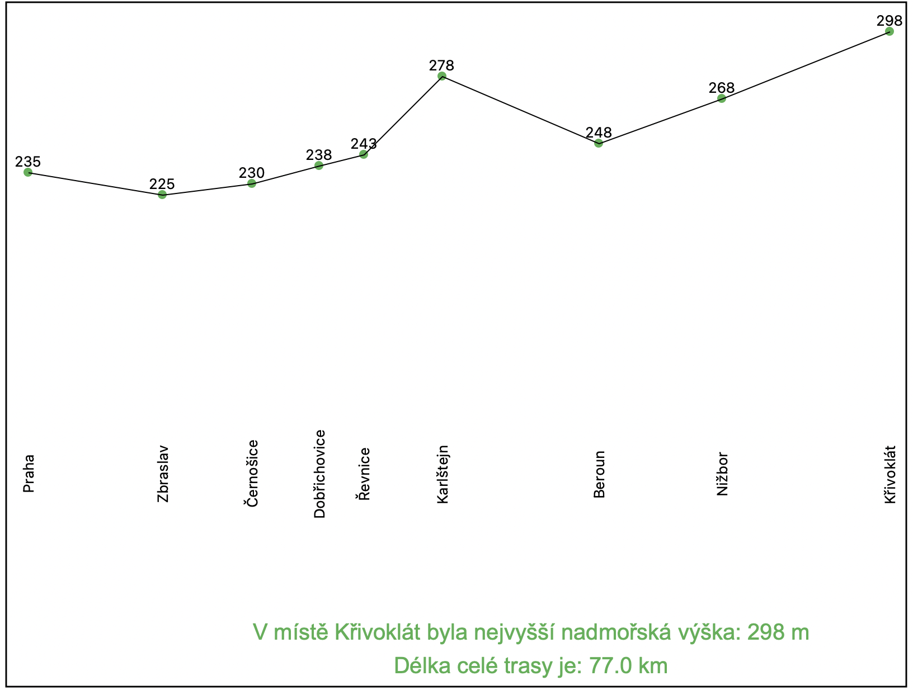


Vytvoříme program, který načte textový soubor, vypočítá nadmořské výšky jednotlivých míst, vypočítá délku trasy a vykreslí výškový profil trasy. Program určí nejvyšší bod trasy, vypíše jeho geografický název a nadmořskou výšku.

```py
# 25_cyklotrasa.py

import tkinter
from random import *
canvas = tkinter.Canvas(width=1000, height=700, bg='white')
canvas.pack()

mista = []
vysky = []
vzdalenosti = []
f = open('cyklotrasa.txt', 'r')
radek = f.readline().strip()
info = radek.split(';')
mista.append(info[0])
vysky.append(int(info[1]))
vzdalenosti.append(float(info[2]))
for radek in f:
    radek = radek.strip()
    info = radek.split(';')
    mista.append(info[0])
    vyska = vysky[-1] + int(info[1])
    vysky.append(vyska)
    vzdalenosti.append(float(info[2]))
f.close()

x = 50
maxy = 700
trasa = ()
for i in range(len(mista)):
    x += vzdalenosti[i] * 10
    y = maxy - vysky[i]*2
    trasa = trasa + (x, y)
    canvas.create_oval(x-4, y-4, x+4, y+4, fill='#4cb050', outline='')
    canvas.create_text(x, y-10, text=vysky[i])
    canvas.create_text(x, maxy-200, text=mista[i], angle=90)
canvas.create_line(trasa)
delka_trasy = sum(vzdalenosti)
nejvyssi_vyska = max(vysky)
index_nejvyssi_vysky = vysky.index(nejvyssi_vyska)
misto_nejvyssi_vysky = mista[index_nejvyssi_vysky]
canvas.create_text(500, 640, text='V místě '+misto_nejvyssi_vysky+' byla nejvyšší nadmořská výška: '+str(nejvyssi_vyska)+' m',
font='Arial 20', fill='#4cb050')
canvas.create_text(500, 670, text='Délka celé trasy je: '+str(delka_trasy)+' km', font='Arial 20', fill='#4cb050')
```

V programu jsme využili funkce `sum()` a `max()`. Funkce `sum()` vypočítá součet všech prvků posloupnosti (n-tice, seznamu, ...). Funkce `max()` vrátí hodnotu největšího prvku z posloupnosti (n-tice, seznamu, ...). K určení nejmenšího prvku můžeme použít funkci `min()`.

---

## 7.1. 💾 Cvičení

**[23]** Upravte program tak, aby nám vypsal i nejníže položené místo na trase.

**[24]**  Upravte program tak, aby jsme pohybem myši po názvech geografických míst mohli určit úsek od začátku trasy po dané místo a program nám na daném úseku vypočítal a vypsal největší převýšení a délku trasy od startu. Převýšení je rozdíl dvou nadmořských výšek mezi dvěma body trasy (může být kladné i záporné). Fungoval by váš program i na klesající trase?

**[25]**  Upravte program tak, aby vytvořil nový textový soubor `cyklotrasa2.txt`, ve kterém budou uvedeny názvy míst, jejich absolutní nadmořská výška a celková vzdálenost od startu.

**[26]**  Naprogramujte si vlastní funkci `soucet()`, která spočítá součet prvků seznamu (nepoužívejte funkci `sum`).

**[27]**  Naprogramujte si vlastní funkci `prumer()`, která vypočítá průměr prvků seznamu.

**[28]**  Vezměte si list papíru formátu A4, přeložte jej napůl a rozdělte ho. Získané poloviny znovu přeložte napůl a rozdělte je. Nyní každou část ještě jednou přeložte napůl a rozdělte ji. Získáte 8 kartiček. Na kartičky napište náhodná čtyřmístná čísla tak, aby nebyla vidět z druhé strany.

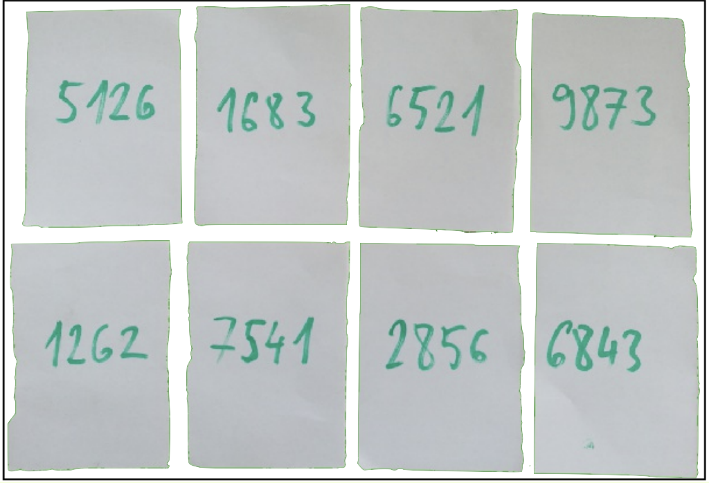


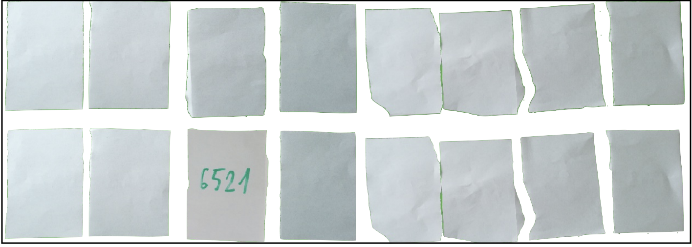


Všechny kartičky otočte tak, abyste neviděli napsaná čísla. Nyní máte před sebou seznam osmi prvků a můžete s ním dělat pouze to, co umí počítač (nemůžete se podívat na všechna čísla najednou). To znamená podívat se na jedno číslo, případně si jedno číslo zapamatovat. Odkryté můžete mít maximálně dvě kartičky, ale můžete stále odkrývat další dvě kartičky, můžete je navzájem porovnávat a zapamatovat si maximálně jedno číslo. Vymyslete algoritmus, pomocí kterého ze seznamu (z karet) zjistíte největší číslo. Zkuste tento algoritmus zapsat do programu a ověřit jeho funkčnost a správnost. (V programu nesmíme použít metodu sort(), ani funkce min() a max(), naprogramujeme si ji sami).

**[29]**  Použijte kartičky z předchozího úkolu a vymyslete nyní algoritmus, pomocí kterého na kartičkách najdeme nejmenší číslo. Zkuste tento algoritmus zapsat do programu a ověřte jeho funkčnost a správnost. V programu nesmíme použít metodu `sort()`, ani funkce `max()` nebo `min()`, naprogramujeme si je sami.
Až bude váš program fungovat, změňte některá čísla v seznamu na záporná a zjistěte, zda bude fungovat i pro takový vstup. Upravte svůj program tak, aby nebylo nutné jej upravovat podle rozsahu čísel zadaných na vstupu.

---


# 8. 📝 Výukový příklad: SMS hlasování

> Metoda `sort`

Soutěžní televizní reality show umožňuje divákům hlasovat zasláním SMS. V soutěži je deset účastníků. Každému soutěžícímu je přiděleno SMS číslo (6930, 6931, 6932 až 6939), na které mohou diváci zaslat hlasovací SMS. Všechny příchozí SMS se zaznamenávají do jednoho textového souboru `sms.txt`. Každý řádek souboru obsahuje číslo, na které divák poslal svůj hlas. Vytvoříme program, který sečte hlasy odeslané jednotlivým soutěžícím a vykreslí graf. V grafu budou znázorněny sečtené hlasy soutěžících, seřazené od nejvyššího počtu hlasů po nejnižší. Uvidíme jak počet hlasů, tak procentuální podíl ze všech hlasů a číslo SMS. Soutěžící s nejnižším počtem hlasů vypadává a v grafu bude přeškrtnut.


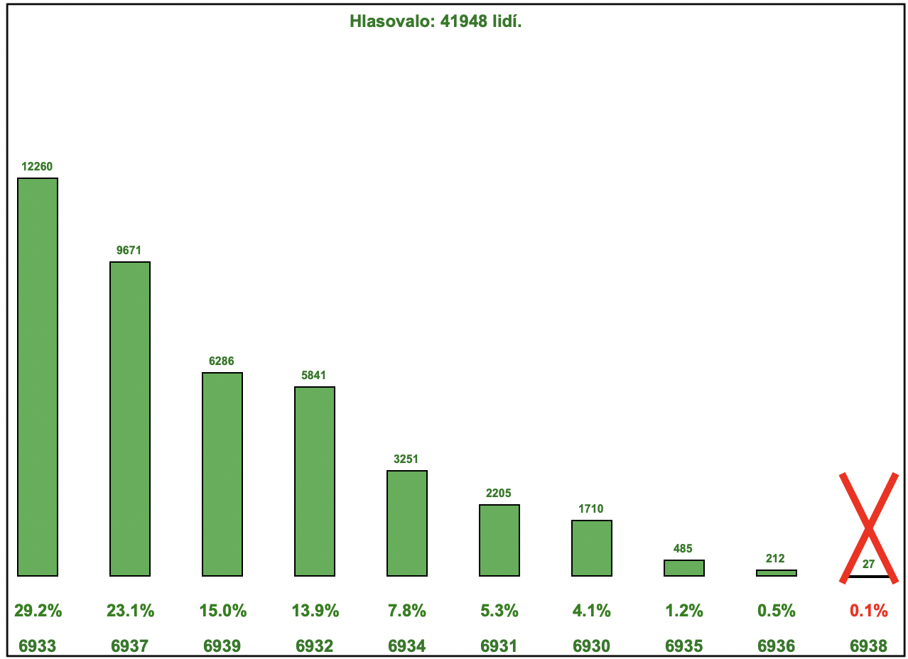

---

❓ Jaké údaje budeme muset v programu uložit?

❓ V jakých strukturách bude vhodnější je uložit?

❓ Potřebujeme spočítat celkový počet hlasů?

❓ Jak můžeme seřadit počty získaných hlasů?

❓ Co udělají následující kódy?

```py
# A
cisla = [20, 4, 10, 5]
cisla.sort()
```

```py
# B
cisla = [(0,20), (1,4), (2,10), (3,5)]
cisla.sort()
```

```py
# C
cisla = [(20,0), (4,1), (10,2), (5,3)]
cisla.sort()
```

---

Ukázka souboru `sms.txt`:

```
6930
6935
6935
6937
6930
6937
6932
6937
6930
...
```

V programu máme spočítat počet hlasů pro jednotlivá čísla. Soutěžících je deset, takže počet jejich hlasů budeme uchovávat v seznamu o deseti prvcích. Seznam bude mít indexy 0 až 9, my však máme čísla SMS 6930 až 6939. Odečtením čísla 6930 od čísla SMS získáme index 0 až 9 a k tomuto prvku přičteme hlas (když je takové číslo načteno z řádku textového souboru).

```py
# 25_sms_anketa.py

import tkinter
WIDTH, HEIGHT = 720, 480
canvas = tkinter.Canvas(width=WIDTH, height=HEIGHT, bg='white')

canvas.pack()
soubor = 'sms.txt'
hlasy = [0] * 10

def cti_soubor(soubor):
    f = open(soubor, 'r')
    for cislo in f:
        cislo = int(cislo.strip())-6930
        hlasy[cislo] += 1
    f.close()

cti_soubor(soubor)
pocet_hlasujicich = sum(hlasy)
```

V shellu vypíšeme obsah seznamu `hlasy`:

```
>>> hlasy
[1710, 2205, 5841, 12260, 3251, 485, 212, 9671, 27, 6286]
```

Vidíme, že soutěžící s číslem SMS 6930 získal 1710 hlasů, soutěžící s číslem SMS 6931 získal 2205 hlasů. Nyní potřebujeme seřadit přidělené hlasy. Musíme si uvědomit, že nestačí pouze seřadit pole hlasy pomocí funkce `hlasy.sort()`, protože při seřazení bychom ztratili informaci o tom, kterému soutěžícímu daný počet hlasů náleží. Tento problém můžeme řešit různými způsoby. Vytvoříme kopii seznamu s názvem `hlasy2`, kde prvky budou dvojice. Každou dvojici bude tvořit počet hlasů a SMS číslo soutěžícího. Teprve tento seznam `hlasy2` seřadíme.

```py
hlasy2 = []
for i in range(len(hlasy)):
    hlasy2.append((hlasy[i], i+6930))
    hlasy2.sort()
```

Pro kontrolu si v shellu vypíšeme obsah seznamu `hlasy2`:

```
>>> hlasy2
[(27, 6938), (212, 6936), (485, 6935), (1710, 6930), (2205, 6931),
(3251, 6934), (5841, 6932), (6286, 6939), (9671, 6937), (12260, 6933)]
```

Nyní již můžeme na základě seznamu `hlasy2` vykreslit graf.

```py
maxH = HEIGHT*2
def graf():
    x1 = WIDTH // (len(hlasy2)+1)
    y1 = HEIGHT-75
    canvas.create_text(WIDTH/2, 15, text='Hlasovalo: ' + str(pocet_hlasujicich) + \
        ' lidí.', font='Arial 12 bold', fill='#15791c')

    index = 10
    for info in hlasy2[::-1]:
        index -= 1
        sms = info[1]
        pocet = info[0]
        procento = (pocet/pocet_hlasujicich)*100
        procento = '{:.1f}%'.format(procento)
        y2 = int((pocet/pocet_hlasujicich)*maxH)
        canvas.create_rectangle(x1, y1, x1+28, y1-y2, fill='#4cb050')
        canvas.create_text(x1+14, y1+50, text=sms, font='Arial 12 bold', fill='#15791c')
        canvas.create_text(x1+14, y1-y2-8, text=pocet, font='Arial 8 bold',  fill='#15791c')
        if index == 0:
            canvas.create_line(x1-5, y1-y2-72, x1+33, y1+5, width=5, fill='red')
            canvas.create_line(x1-5, y1+5, x1+33, y1-y2-72, width=5, fill='red')
            canvas.create_text(x1+15, y1+25, text=procento, font='Arial 12 bold', fill='red')
        else:
            canvas.create_text(x1+15, y1+25, text=procento, font='Arial 12 bold', fill='green')
        x1 += WIDTH // (len(hlasy2)+1)
graf()
```

---

❓ Proč cyklus `for` prochází pole `hlasy2[::-1]` tímto způsobem a nestačí tam napsat `for info in hlasy2`?

❓ Co bychom museli v programu změnit (a jak), kdyby byl cyklus `for` zapsán takto: `for i in hlasy2`?

---

## 8.1. 💾 Cvičení 

**[30]** Textový soubor `sms.txt` je při počtu hlasujících 41 948 lidí poměrně velký. Vymyslete jiný způsob jeho zápisu tak, aby soubor zabíral méně místa, ale aby nedošlo ke ztrátě informací o pořadí hlasování. Tento způsob realizujte a převedete soubor `sms.txt` na soubor `sms2.txt`. Porovnejte velikost obou souborů a diskutujte o svých nápadech ve třídě.

---


# 📝 Výukový příklad: Hra Žáby

> Výměna prvků v seznamu


Vytvoříme hru "Skákání žab". Na začátku hry se vedle sebe vykreslí 10 leknínů. Na devíti leknínech jsou náhodně rozmístěny žáby s čísly 1–9. Jeden z leknínů je volný. Kliknutím na žábu ji můžeme přesunout na volný leknín, ale pouze v případě, že žába sousedí s volným leknínem, nebo pokud při přesunu přeskočí maximálně 1 žábu. Hráč vyhrává, když jsou žáby seřazeny od 1 do 9 a poslední leknín je volný.

Náhodné rozmístění na začátku hry:

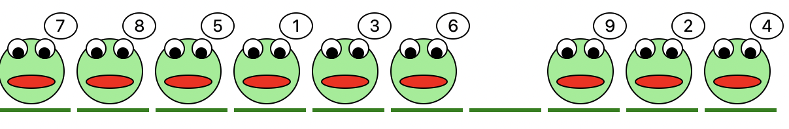


Výherní pozice:

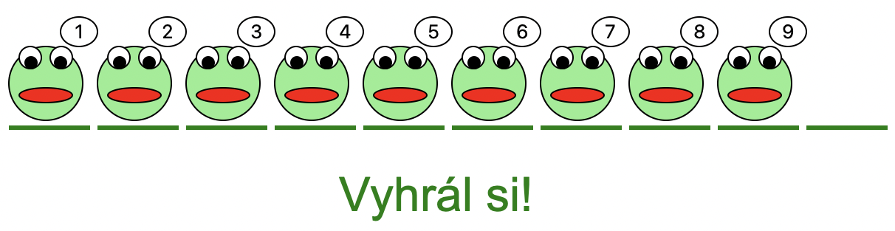

---


❓ Jaké údaje si budeme muset v programu zapamatovat?

❓ V jakých strukturách bude vhodnější je ukládat?

❓ Potřebujeme u každé žáby zapamatovat i číslo lekna, na kterém sedí?

❓ Jak vytvoříme náhodné pořadí žab na leknech?

❓ Jak zjistíme, na kterou žábu jsme klikli myší (tedy číslo lekna)?

❓ Jak zjistíme, zda žába splňuje kritéria pro skok?

❓ Jak zjistíme, zda jsou žáby uspořádány ve výherní pozici?

---

Pořadí žab si můžeme zapamatovat v seznamu o deseti prvcích. Index prvku seznamu bude ve skutečnosti číslem lekínu a hodnota prvku bude číslem žáby, která na leknníu sedí. Je-li leknín prázdný, můžeme si tam zapamatovat například hodnotu 0. Vhodnější než náhodné losování pořadí žab bude, když je nejprve vygenerujeme v uspořádaném pořadí a poté je náhodně prohodíme. Tím se vyhneme opakovanému vylosování stejného čísla. Vyměnit více hodnot můžeme v Pythonu také takto: `a, b = b, a` (ve skutečnosti jsme pracovali s dvojprvkovými n-ticemi).

```py
import tkinter
from random import *
canvas = tkinter.Canvas(width=610, height=270, bg='white')
canvas.pack()

sirka_zaby = 60
zaby = list(range(10))
print(zaby)

for i in range(len(zaby)):
    ktery = randrange(10)
    zaby[i], zaby[ktery] = zaby[ktery], zaby[i]
print(zaby)
```

Nyní můžeme nakreslit žáby i s lekníny. Pokud je u leknínu hodnota 0, žábu nekreslíme.


```py
# 25_zaby.py

def kresli_zabu(x, y, cislo):
    canvas.create_line(x, y+55, x+55, y+55, width=3, fill='green')
    if cislo != 0:
        canvas.create_oval(x, y, x+50, y+50, fill='lightgreen')
        canvas.create_oval(x+7, y+28, x+43, y+38, fill='red')
        canvas.create_oval(x+7, y, x+22, y+15, fill='white')
        canvas.create_oval(x+28, y, x+43, y+15, fill='white')
        canvas.create_oval(x+11, y+7, x+19, y+15, fill='black')
        canvas.create_oval(x+31, y+7, x+39, y+15, fill='black')
        canvas.create_oval(x+35, y-20, x+60, y, fill='white')
        canvas.create_text(x+48, y-10, text=cislo)
    
def kresli():
    canvas.delete('all')
    for i in range(len(zaby)):
        kresli_zabu(i*sirka_zaby+10, 100, zaby[i])

kresli()
```

Ještě budeme reagovat na levé kliknutí myší. Ze souřadnice `x` vypočítáme index žáby celočíselným dělením velikostí jednoho políčka: `index = (x-10) // sirka_zaby`. Nejprve odečteme hodnotu 10, protože vykreslování žab je posunuto o 10 px doprava. Například pokud jsme na souřadnici `x = 68`, klikli jsme na nulový leknín: `index = 68 - 10 // 60`, `index = 58 // 60`, `index = 0`. Kdybychom hodnotu 10 neodčetli, vyšel by nám index leknínu `1`, a to je již druhý leknín, nikoli první (nulový). 

Pomocí metody `zaby.index(0)` zjistíme, který leknín je volný. Odečtením indexu leknínu, na které jsme klikli, od indexu volného leknínu získáme jejich vzdálenost (v počtu leknínů). Pouze pokud je tato vzdálenost menší než tři, může dojít k výměně prvků. Zkontrolujeme, zda nehodláme zaměnit neexistující prvky (s indexem mimo rozsah seznamu). Při výpočtu vzdálenosti použijeme absolutní hodnotu `abs()`, protože odečtením těchto dvou indexů můžeme získat i záporné číslo.

```py
def klik(mys):
    index = (mys.x - 10) // sirka_zaby
    prazdne = zaby.index(0)
    vzdalenost = abs(index - prazdne)
    if vzdalenost < 3 and 0 <= index <= 9:
        zaby[index], zaby[prazdne] = zaby[prazdne], zaby[index]
        kresli()
    if vyherni_pozice():
        gratulace()

canvas.bind('<Button-1>', klik)
```

Ještě musíme vytvořit funkci `vyherni_pozice()`, která vrátí hodnotu `True` v případě, že jsou žáby správně seřazeny. Funkce gratulace nám pouze vypíše, že jsme vyhráli.

```py
def vyherni_pozice():
    for i in range(len(zaby)-1):
        if i != zaby[i]-1:
            return False
    return True

def gratulace():
    canvas.create_text(300, 200, text='Vyhrál si!', font='Arial 32', fill='green')
```

---

❓ Kdybychom neznali funkci `abs()`, jak jinak bychom mohli program upravit?

❓ Co a v jakých situacích by program dělal jinak, kdybychom vynechali tuto podmínku: `0 <= index <= 9`?

❓ Kolikrát se zopakuje tělo cyklu `for` ve funkci `vyherni_pozice()`?

❓ Co se stane, pokud po výhře klikneme na nějakou žábu, která splňuje kritérium pro přesun?

❓ Následující řešení funkce `vyherni_pozice()` je chybné. Výherní pozici vyhodnotí správně pouze v některých situacích. Zjistěte, pro které vstupy bude funkce fungovat správně a pro které nesprávně. Jak bychom měli funkci upravit, aby fungovala správně (za předpokladu, že nezměníme podmínku v if-u)?

```py
def vyherni_pozice():
    ok = False
    for i in range(len(zaby)-1):
        if i == zaby[i]-1:
            ok = True
    return ok
```

---

## 8.2. 💾 Cvičení

**[41]** Upravte program tak, aby počítal počet tahů.


**[42]** Upravte program tak, aby bylo možné zadat výchozí pozici a na ní si vyzkoušet minimální počet pokusů o uspořádání.


**[43]** Upravte program tak, aby počítač sám hrál hru s žábami (náhodnými tahy).


**[44]** Upravte program tak, aby byl tah animován – žába pomalu přeskočí na nový leknín. Pokud nemůže skákat, pouze poskočí na místě.


**[45]** Upravte program tak, aby do textového souboru zapsal počáteční pozici žab a během hry do souboru zaznamenal historii tahů hráče. Z takto vytvořeného souboru bude program schopen znovu přehrát zaznamenanou hru.


**[46]** **Výzva:** Upravte program tak, aby se počítač sám naučil hru hrát optimálně.


**[47]** Vytvořte simulátor trávníku. Program vykreslí ve spodní části grafické plochy 100 zelených čar – stébel trávy – o rozumné náhodné délce.

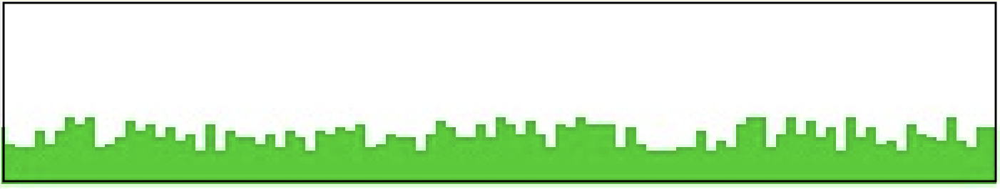

1. Po kliknutí na tlačítko "Zalít trávník" tráva trochu vyroste (o rozumné  náhodné hodnoty).
2. Po kliknutí na tlačítko "Posekat" se čáry zkrátí přibližně na stejnou délku.
3. Upravte program tak, aby tráva postupně rostla.


**[48]** Každý zahradník zná trápení s plevelem. Ten samozřejmě roste nejrychleji. Upravte program z předchozího úkolu (simulátor trávníku). Do programu přidejte možnost zadat číslo – kolik procent trávníku je zarostlé plevelem. Plevel vykreslete jiným odstínem zelené.

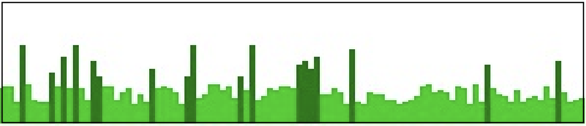


1. Po kliknutí na tlačítko "Zalít trávník" porostou stébla plevele mnohem výrazněji než zbytek trávníku a zároveň místo jednoho náhodného stébla trávy začne růst nový plevel.
2. Přidejte tlačítko "Vytrhat", které vytrhne 90 % plevele (tak, aby vždy alespoň jeden zůstal).
3. Přidejte tlačítko "Herbicid", které simuluje postupné vysychání plevele po postřiku herbicidy (plevel bude postupně měnit barvu až na šedou – vyschne).


**[49]** Naprogramujte hru "Klikačka".

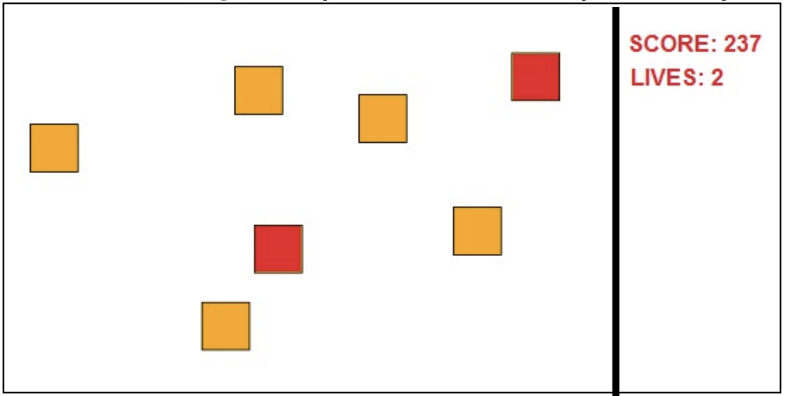

1. Na herní ploše se postupně objevují čtverečky a hráč je odstraňuje klikáním na ně, čímž získává body. Hráč se tak snaží zabránit tomu, aby se plocha zaplnila nad úroveň kritického počtu čtverečků.
2. Čtverečky po určité době zmizí, za což se odečtou body. Hráč musí stihnout čtvereček odstranit.
3. Pokud hráč klikne, ale netrefí žádný čtvereček, odečtou se mu body.
4. Vylepšete tuto hru podle vlastních představ – pojmenujte ji, vymyslete, kdy má hra skončit, přidejte čtverečky jiné barvy, na které je třeba kliknout vícekrát, nebo "dobré" čtverečky, na které se nemá klikat. Přidejte zrychlení hry a body na konci uložte do textového souboru – do tabulky High score.

---