# Lekce 26: Obrázky <!-- omit in toc -->


---

- [1. Čtení a zobrazování obrázků](#1-čtení-a-zobrazování-obrázků)
  - [1.1. 💾 Cvičení](#11--cvičení)
  - [1.2. 💾 Cvičení](#12--cvičení)
- [2. Vizualizace předpovědi počasí](#2-vizualizace-předpovědi-počasí)
  - [2.1. 💾 Cvičení](#21--cvičení)
- [3. Lambda funkce](#3-lambda-funkce)


---

# 1. Čtení a zobrazování obrázků

Dosud jsme v programech kreslili obrázky sami pomocí obdélníků, čar, elips a podobně. Pomocí knihovny `tkinter` můžeme v programu využít i obrázky ze souborů `gif` nebo `png`.

Nejprve si vytvoříme speciální proměnnou pro obrázek, do které načteme obrázek ze souboru:

```py
premenna = tkinter.PhotoImage(file='nazev_souboru')
```

Obrázek se zatím nikde nezobrazí, pouze se vytvoří proměnná, ve které si Python obrázek zapamatuje. Pokud uvedeme pouze název souboru s příponou, bude Python tento soubor hledat ve stejném adresáři, kde máme uložený program. Pokud ho tam nenajde, oznámí nám chybu. 

V názvu souboru můžeme uvést i celou cestu k souboru nebo relativní cestu. Vhodnější je používat relativní cestu, protože i po přesunutí našeho programu na jiný počítač se stejnou strukturou složek s obrázky bude naše relativní cesta správná a nebudeme ji muset opravovat. Například pokud máme svůj program umístěný na disku `C:\Users\<jmeno>\python` a v této složce je složka `obrazky`, kde se nachází soubor s názvem `zaba1.gif`, napíšeme:

```py
obrazek1 = tkinter.PhotoImage(file='obrazky/zaba1.png')
```

Obrázek z proměnné můžeme nyní umístit na plátno pomocí příkazu:

```py
canvas.create_image(50, 50, image=obrazek1)
```

Tento program nakreslí obrázek z proměnné `obrazek1` v místě kliknutí myší:


```py
import tkinter
canvas = tkinter.Canvas(width=600, height=400)
canvas.pack()

obrazek1 = tkinter.PhotoImage(file='obrazky/zaba1.png')

def klik(mys):
    canvas.create_image(mys.x, mys.y, image=obrazek1)

canvas.bind('<Button-1>', klik)
```

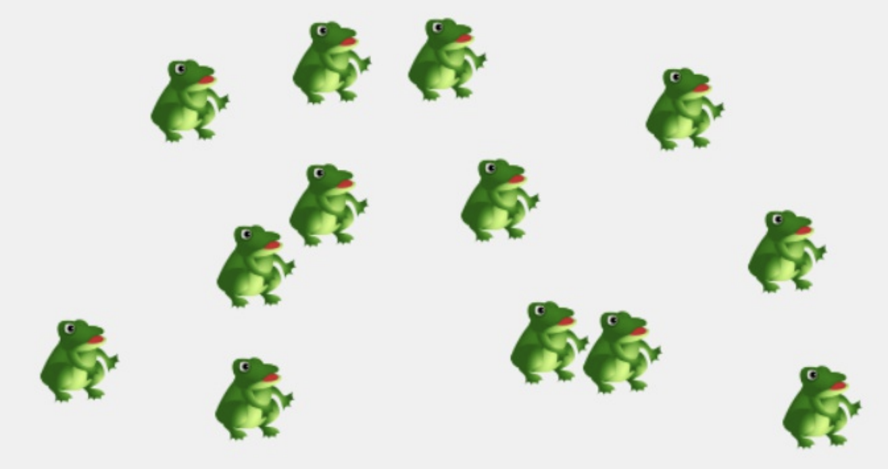

Pozor, mějme na paměti, že při použití příkazu `canvas.create_image` se obrázek do plátna **nevytiskne**. Obrázek se pouze zobrazí na základě odkazu na načtený obrázek (tj. zobrazuje to, co je jednou načteno někde v paměti). Kdybychom změnili proměnnou `obrazek1` na jinou hodnotu (nebo i na jiný obrázek), zobrazený obrázek zmizí. Python neví, že v příkazu `canvas.create_image` používáme původní odkaz, a proto načtený obrázek z paměti odstraní, protože proměnnou `obrazek1` nyní odkazujeme na něco nového.

```py
import tkinter
canvas = tkinter.Canvas(width=600, height=400)
canvas.pack()

obrazek1 = tkinter.PhotoImage(file='obrazky/zaba1.png')

canvas.create_image(50, 50, image=obrazek1)
obrazek1 = 'nová informace'
```

Z podobného důvodu nebude fungovat ani tento program:

```py
import tkinter
canvas = tkinter.Canvas(width=600, height=400)
canvas.pack()

def klik(mys):
    obrazek1 = tkinter.PhotoImage(file='obrazky/zaba1.png')
    canvas.create_image(mys.x, mys.y, image=obrazek1)

canvas.bind('<Button-1>', klik)
```

Pokaždé po kliknutí levým tlačítkem myši se zavolá funkce `klik`. Tam se vytvoří **lokální** proměnná `obrazek1`, do které se načte obrázek žáby. Příkazem `canvas.create_image` se obrázek zobrazí a hned poté se ukončí provádění funkce `klik`, a tím se ztratí lokální proměnné, tedy i proměnná `obrazek1`. Python tedy načtený obrázek odstraní z paměti a my nic neuvidíme, protože pro funkci `canvas.create_image`, která si pamatuje odkaz na obrázek, zmizela z paměti data samotného obrázku. Proto jsme hned na začátku použili proměnnou `obrázek1` jako globální proměnnou.


Upravíme program tak, aby se levým tlačítkem myši vykreslil obrázek `zaba1.png` a pravým tlačítkem myši obrázek `zaba2.gif`.

```py
import tkinter
canvas = tkinter.Canvas(width=600, height=400)
canvas.pack()

obrazek1 = tkinter.PhotoImage(file='obrazky/zaba1.png')
obrazek2 = tkinter.PhotoImage(file='obrazky/zaba2.gif')

def klik(mys):
    canvas.create_image(mys.x, mys.y, image=obrazek1)

def klik2(mys):
    canvas.create_image(mys.x, mys.y, image=obrazek2)

canvas.bind('<Button-1>', klik)
canvas.bind('<Button-3>', klik2)
```

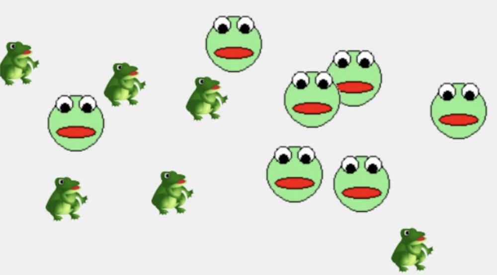

Nyní vyzkoušíme nakreslit jednu žábu s obrázkem v globální proměnné a druhou s obrázkem v lokální proměnné a do funkce `klik2` přidáme také zdržovací cyklus `while` s průběžnou aktualizací plátna. Uvidíme, že druhá žába se po kliknutí alespoň na chvíli objeví (po dobu trvání lokální proměnné).


```py
import tkinter
canvas = tkinter.Canvas(width=600, height=400)
canvas.pack()

obrazek1 = tkinter.PhotoImage(file='obrazky/zaba1.png')

def klik(mys):
    canvas.create_image(mys.x, mys.y, image=obrazek1)

def klik2(mys):
    obrazek2 = tkinter.PhotoImage(file='obrazky/zaba2.gif')
    canvas.create_image(mys.x, mys.y, image=obrazek2)
    a = 50000
    while a>0:
        a -= 1
        canvas.update()

canvas.bind('<Button-1>', klik)
canvas.bind('<Button-3>', klik2)
```

Vidíme, že v místě kliknutí se umístí střed obrázku. Někdy potřebujeme, aby se v místě kliknutí vykreslil levý horní bod obrázku. V takovém případě stačí v příkazu zadat parametr `anchor` s hodnotou `'nw'` (northwest – severozápad) a podobně i ostatní body v obrázku:

```py
canvas.create_image(x, y, image=obrazek2, anchor='nw')
```

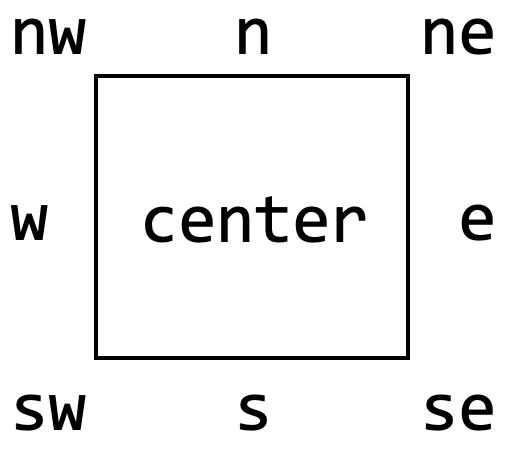

💡 **TIP:** Parametr `anchor` můžeme použít k určení základního bodu i v příkazu `canvas.create_text()`.

---

❓ Můžeme v našich programech používat jakékoli obrázky stažené z internetu? Jak je to s jejich licencí?

❓ Co znamená licence "Creative Commons" s označením "CC0"? Jak můžeme na internetu najít obrázky, které mají takovou licenci? Můžeme je používat ve svých programech? Můžeme je upravovat? Můžeme je dále šířit i komerčně?

❓ Jak zajistíme, aby obrázek načtený ze souboru měl průhlednou barvu (byl průhledný)?

---

## 1.1. 💾 Cvičení

**[1]** Upravte program (hru) s žábami z předchozí kapitoly tak, aby se žáby nekreslily pomocí grafických tvarů, ale aby se načetly ze souboru ve formátu `gif` nebo `png`. Obrázek si můžete nakreslit sami v grafickém editoru nebo ho najít na internetu.

**[2]** Upravte program (hru) Need for Speed z předchozí kapitoly a vložte do něj obrázek auta (ve formátu `gif` nebo `png`).

---

# Seznam obrázků

Soubory `k_1.png`, `k_2.png`, `k_3.png`, `k_4.png`, `k_5.png` a `k_6.png` obsahují obrázky hracích kostek s hodnotami od 1 do 6.


❓ Jak můžeme při načítání těchto obrázků do paměti využít cyklus for?


```py
import tkinter
canvas = tkinter.Canvas(width=610, height=150)
canvas.pack()

obrazky = []

def nacti(nazev, typ, pocet, obrazky):
    for i in range(1, pocet+1):
        obrazek = tkinter.PhotoImage(file=nazev + str(i) + '.'+typ)
        obrazky.append(obrazek)

def nakresli(x,y,obrazky):
    for obrazek in obrazky:
        canvas.create_image(x, y, image=obrazek, anchor='nw')
        x += 100

nacti('obrazky/k_', 'png', 6, obrazky)
nakresli(10, 30, obrazky)
```

Program načte do seznamu všechny obrázky od `k_1.png` až po `k_6.png`. Jednotlivé obrázky načítá v cyklu do lokální proměnné `obrazek` a následně přidá odkaz na načtený obrázek do seznamu. Ve skutečnosti jsou tedy obrázky uloženy jako odkaz v globální proměnné (seznamu) `obrazky`, a proto nevadí, že jsme je původně načítali do lokální proměnné. Název souboru vytváříme z názvu složky a první části názvu souboru, následně čísla (z hodnoty proměnné `i`) a typu souboru. Při vykreslování pomocí cyklu `for` projdeme všechny prvky seznamu a obrázky zobrazíme.

❓ Zamyslete se a zjistěte, co bude dělat následující program.

```py
import tkinter
from random import *
canvas = tkinter.Canvas(width=310, height=150)
canvas.pack()

def nacti(nazev, typ, pocet, obrazky):
    for i in range(1, pocet+1):
    obrazek = tkinter.PhotoImage(file=nazev + str(i) + '.'+typ)
    obrazky.append(obrazek)

def kresli_jednu(x, y, hodnota, obrazky):
    canvas.create_image(x, y, image=obrazky[hodnota-1], anchor='nw',
    tags='kostka')

def animace():
    global hodnoty
    canvas.delete('kostka')
    for i in range(3):
        hodnoty[i] = randint(1, 6)
        kresli_jednu(i*100+10, 20, hodnoty[i], obrazky)
        canvas.after(400, animace)

def klavesa(event):
    global body
    canvas.delete('body')
    if hodnoty.count(hodnoty[0]) == 3:
        body += 2
    elif hodnoty.count(hodnoty[0]) == 2:
        body += 1
    elif hodnoty.count(hodnoty[1]) == 2:
        body += 1
    else:
        body -= 1
    canvas.create_text(150, 10, text=body, tags='body')

obrazky = []
nacti('obrazky/k_', 'png', 6, obrazky)
hodnoty = [0]*3
body = 0
animace()
canvas.bind_all('<space>', klavesa)
```

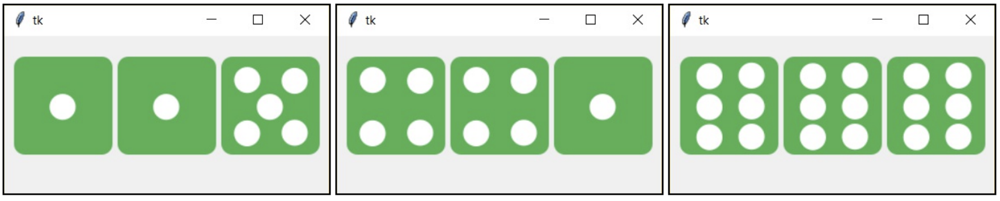

❓ Jakým jiným způsobem můžeme vyřešit test ve funkci `klavesa`? Prodiskutujte různé způsoby řešení.

## 1.2. 💾 Cvičení

**[3]** Upravte předchozí program tak, abychom před spuštěním animace mohli zadat počet hracích kostek. Program také vyhodnotí počet stejných hodnot na více kostkách a podle toho nám zvýší počet bodů.

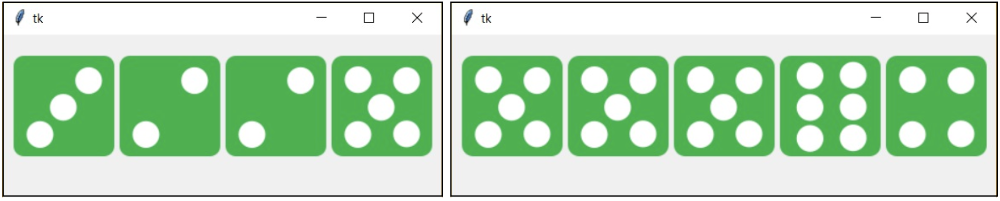

**[4]** Upravte program tak, aby bylo možné pomocí tlačítka (nebo některé klávesy) přepínat mezi původními obrázky kostek a obrázky kostek se symboly počasí, které se nacházejí v souborech `k_7.png`, `k_8.png`, `k_9.png`, `k_10.png`, `k_11.png`, `k_12.png`. Případně si vytvořte hrací kostky s vlastními obrázky.

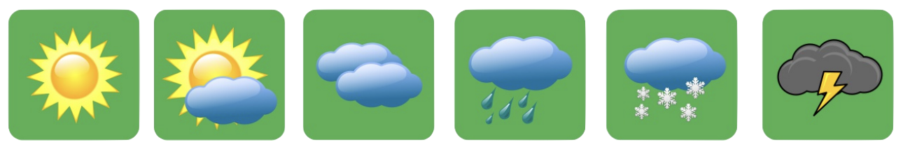

**[5]** Soubory `oz_1.png`, `oz_2.png` až `oz_8.png` obsahují obrázky ovoce a soubory `oz_9.png`, `oz_10.png` až `oz_16.png` obsahují obrázky zeleniny:

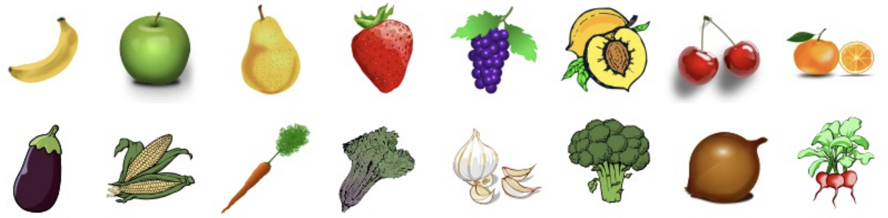


Vytvořte program, který vedle sebe zobrazí náhodnou posloupnost 9 obrázků ovoce a zeleniny (obrázky jsou navzájem náhodně promíchány). Posloupnost se vykreslí na plátno. Pod každým obrázkem a také vedle posledního obrázku je nakreslena vodorovná čára – police, na které je umístěno ovoce nebo zelenina. Kliknutím na obrázek přesuneme vybraný obrázek na prázdnou polici, ale pouze v případě, že mezi obrázkem a prázdnou polici je maximálně jedna obsazená police. Cílem hráče je uspořádat obrázky tak, aby na prvních policích bylo ovoce a až za ním byla umístěna zelenina. 

Náhodná posloupnost na začátku:

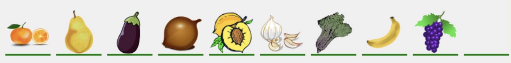

Jedna z výherních pozic:

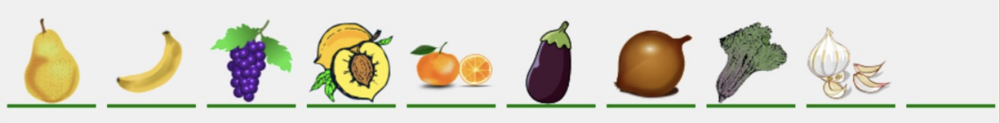


# 2. Vizualizace předpovědi počasí

Ve společnosti zabývající se předpovědí počasí chtějí vytvořit program, který jim umožní na základě aktuální předpovědi počasí vytvořit vizuální předpověď.

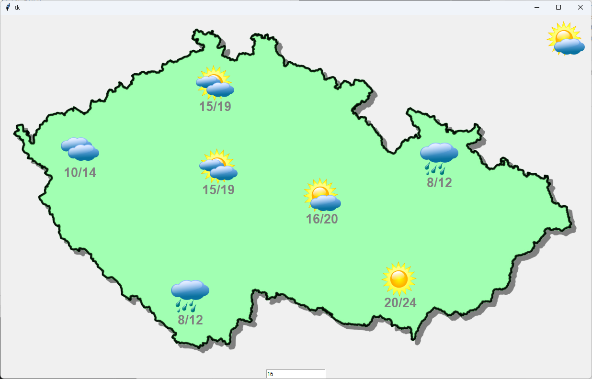


Soubor `cesko.png` obsahuje obrázek slepé mapy České republiky:

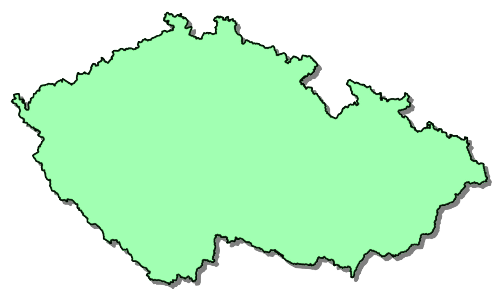

V souborech s názvy `jasno.png`, `polojasno.png`, `castecne_zatazeno.png`, `oblacno.png`, `dest.png`, `snezeni.png`, `bourka.png` se nacházejí obrázky počasí:

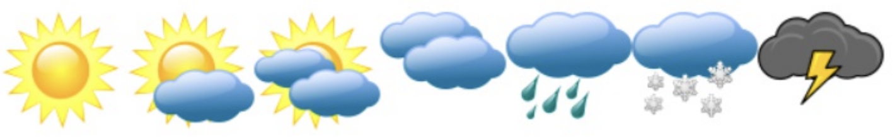


V programu se nejprve zobrazí prázdná mapa země. V pravém horním rohu bude umístěn obrázek počasí, který budeme vkládat (aktuálně vkládané počasí). Kliknutím myší na plátno umístíme aktuální obrázek počasí a pod obrázek zapíšeme předpovězenou teplotu. Dolní hranici teploty zadáme pomocí vstupního pole, horní hranici program vypočítá (teplota je uváděna v rozsahu čtyř stupňů, jak je zvykem).

Program uloží zadané informace do textového souboru. Tento textový soubor předpovědní společnost zašle svým odběratelům (televizním stanicím), které pak předpověď vizualizují na základě informací v souboru. Pokud se při úpravách předpovědi počasí spleteme, stisknutím mezerníku můžeme začít úplně od začátku (dosud zadané informace se vymažou).


❓ Jaké údaje budeme muset v programu ukládat?

❓ V jakých strukturách bude vhodnější je ukládat? Jak budeme vykreslovat aktuální počasí? Je vhodnější použít jedno plátno, nebo přidat další?

❓ Které údaje a v jakém formátu bychom měli zapisovat do textového souboru? Který formát bude vhodnější pro opětovné čtení souboru? Co do souboru nemusíme zapisovat (abychom ušetřili místo)?

❓ Jak zajistíme, aby se kliknutím na aktuálně zobrazené počasí cyklicky měnilo na další počasí (stále dokola)?

❓ V které části programu, jak často a jakým způsobem je vhodné soubor otevírat a zavírat?


Vytvoříme dvě plátna. Na jednom bude mapa České republiky a zobrazené počasí. Druhé plátno bude umístěno vpravo nahoře, bude mít menší rozměry a v něm budeme zobrazovat aktuální počasí. K zobrazení tohoto plátna nepoužijeme metodu `pack()`, ale metodu `place()`, ve které také určíme souřadnice `x` a `y` umístění tohoto plátna v rámci celého okna aplikace. Například `canvas2.place(x=300, y=0)`. Po vytvoření prvního plátna načteme do proměnné mapa mapu České republiky a následně ji umístíme do plátna. Pomocí metod `width()` a `height()` zjistíme velikost mapy a následně upravíme velikost plátna na stejnou velikost (např. `canvas['width'] = 600`, `canvas['height'] = 400`).

```py
# 26_pocasi.py

import tkinter
canvas = tkinter.Canvas()
canvas.pack()

canvas2 = tkinter.Canvas(width=100, height=100)
mapa = tkinter.PhotoImage(file='img/cesko.png')
canvas.create_image(0, 0, image=mapa, anchor='nw')
sirka = mapa.width()
vyska = mapa.height()
canvas['width'] = sirka
canvas['height'] = vyska
canvas2.place(x=sirka-100, y=0)
```

V proměnné `sirka` ukládáme šířku mapy. Druhý canvas umístíme na souřadnici `x`, která je o 100 px vlevo od šířky mapy. Pozor, nemůžeme použít současně metody `pack()` i `place()`, ale pouze jednu z nich.


Obrázky si uložíme do proměnné typu seznam `obrazky`. Potřebujeme si také zapamatovat názvy počasí, například v proměnné `pocasi`. Může se jednat o n-tici nebo seznam. Tím si zajistíme, že budeme moci obrázky načítat v cyklu. Pro načtení obrázků do pole si vytvoříme funkci `nacti()`. Index počasí, které je připraveno k umístění, si uložíme do globální proměnné `aktuelni`. Jako první aktuální stav nastavíme počasí s indexem `0` (tedy jasno) a rovnou ho vykreslíme do `canvas2`.


```py
def nacti(cesta, typ, nazvy, obrazky):
    for nazev in nazvy:
        obrazek = tkinter.PhotoImage(file=cesta+nazev+'.'+typ)
        obrazky.append(obrazek)

pocasi = ('jasno', 'polojasno', 'castecne_zatazeno', 'oblacno', 'dest', 'snezeni', 'bourka')
aktualni = 0
obrazky = []
nacti('img/', 'png', pocasi, obrazky)

canvas2.create_image(50, 50, image=obrazky[aktualni])
```

Po spuštění program vykreslí mapu a v pravém horním rohu uvidíme obrázek jasného počasí. Nyní budeme reagovat na událost levého kliknutí myší v prvním a druhém plátně a na stisk mezerníku, který vytvořené objekty smaže. Také vytvoříme `entry`, do které na začátek vložíme číslo `0` (`entry1.insert(0,'0')`).

Po kliknutí na první plátno se v místě kliknutí nakreslí aktuálně vybrané počasí (ze seznamu `obrázky` vybereme obrázek s indexem `aktualni`). Z `entry` zjistíme hodnotu, převedeme ji na číslo a vypočítáme také horní hranici teplotního intervalu. Rozsah teplot nakreslíme pod obrázek počasí. Současně po kliknutí otevřeme soubor pro přidání řádku a do řádku zapíšeme souřadnice, název počasí a dolní hranici teplotního intervalu. Následně soubor zavřeme.

Kliknutím na `canvas2` zvýšíme hodnotu proměnné `aktualni` a pokud je vyšší než počet obrázků počasí, nastavíme ji opět na 0. Následně vymažeme `canvas2` a nakreslíme tam aktuální obrázek počasí `obrazky[aktualni]`. Stisknutím mezerníku otevřeme soubor pro zápis a ihned jej zavřeme – tím vymažeme jeho obsah. Také vymažeme nakreslené počasí pomocí tagu `'predpovedi'`, abychom nevymazali mapu.

```py
def klik(souradnice):
    x, y = souradnice.x, souradnice.y
    canvas.create_image(x, y, image=obrazky[aktualni], tags='predpovedi')
    teplota1 = int(entry1.get())
    teplota2 = teplota1+4
    teploty = str(teplota1)+'/'+str(teplota2)
    canvas.create_text(x, y+50, text=teploty, font='Arial 20 bold', fill='gray', tags='predpovedi')
    f = open('predpoved.txt', 'a')
    f.write(str(x)+' '+str(y)+' '+pocasi[aktualni]+' '+str(teplota1)+'\n')
    f.close()

def dalsi_pocasi(event):
    global aktualni
    aktualni += 1
    if aktualni == len(pocasi):
        aktualni = 0
    canvas2.delete('all')
    canvas2.create_image(50, 50, image=obrazky[aktualni])

def vymaz(event):
    f = open('predpoved.txt', 'w')
    f.close()
    canvas.delete('predpovedi')

canvas.bind('<Button-1>', klik)
canvas2.bind('<Button-1>', dalsi_pocasi)
entry1 = tkinter.Entry()
entry1.pack()
entry1.insert(0, '0')
canvas.bind_all('<space>', vymaz)
```


Nyní už můžeme kliknout na předpověď a podívat se na textový soubor `predpoved.txt`:

```
455 316 castecne_zatazeno 15
448 142 castecne_zatazeno 15
166 280 oblacno 10
396 588 dest 8
916 301 dest 8
835 552 jasno 20
671 377 polojasno 16
```

---

Vytvořili jsme editor počasí, který bude společnost používat k předpovídání počasí. Vytvořený textový soubor se odešle televizní stanici, která k jeho zpracování potřebuje program (Viewer). Program načte textový soubor a vytvoří animaci "příchodu" předpovědi (posunem) z pravého okraje na obrazovku a animaci "odchodu" předpovědi k levému okraji obrazovky. Program tedy ovládáme levým a pravým tlačítkem myši. Levé tlačítko posune předpověď z aktuálního místa o celou šířku obrazovky doleva a pravé tlačítko naopak – doprava.


❓ Co budou mít oba programy společného a v čem se budou lišit?

❓ Jak budeme číst soubor?

❓ Co a v jaké struktuře si musíme zapamatovat?

❓ Jakým způsobem je nejvhodnější vytvořit animaci příchodu a odchodu předpovědi?

---

První část programu bude téměř stejná jako v editoru. V programu pouze vynecháme vytvoření druhého plátna. Obrázky si budeme pamatovat stejně – v seznamu `obrazky`, názvy počasí v n-tici `pocasi`. Proměnnou `obrazky[aktualni]` nepotřebujeme.

```py
# 26_pocasi2.py

import tkinter
canvas=tkinter.Canvas()
canvas.pack()
mapa = tkinter.PhotoImage(file='img/cesko.png')
canvas.create_image(0, 0, image=mapa, anchor='nw')
sirka = mapa.width()
vyska = mapa.height()
canvas['width'] = sirka
canvas['height'] = vyska

def nacti(cesta, typ, nazvy, obrazky):
    for nazev in nazvy:
        obrazok = tkinter.PhotoImage(file=cesta+nazev + '.'+typ)
        obrazky.append(obrazok)

pocasi = ('jasno', 'polojasno', 'castecne_zatazeno', 'oblacno', 'dest', 'snezeni', 'bourka')
obrazky = []
nacti('img/', 'png', pocasi, obrazky)
```

Nyní můžeme načíst soubor, pomocí metody `split()` rozdělit jednotlivé údaje z řádku do seznamu, ze seznamu vytáhnout souřadnice a převést je na čísla. Na číslo převedeme také dolní hranici teplotního intervalu a z ní vypočítáme horní hranici. Následně zobrazíme obrázky a všechny je posuneme doprava o šířku obrazovky (aby byly připraveny na zobrazení na obrazovce). Nejprve můžeme program vyzkoušet bez posunutí obrázků, abychom se ujistili, že jsme soubor správně načtli a vše se zobrazilo.

```py
f = open('predpoved.txt', 'r')
for radek in f:
    predpoved1 = radek.split()
    typ_pocasi = predpoved1[2]
    index_obrazku = pocasi.index(typ_pocasi)
    x = int(predpoved1[0])
    y = int(predpoved1[1])
    canvas.create_image(x, y, image=obrazky[index_obrazku], tags='predpovedi')
    teplota1 = int(predpoved1[3])
    teplota2 = teplota1+4
    teploty = str(teplota1)+'/'+str(teplota2)
    canvas.create_text(x ,y+50, text=teploty, font='Arial 20 bold', fill='gray', tags='predpovedi')
    
f.close()
canvas.move('predpovedi', sirka, 0)
```

Teď už jen naprogramujeme animaci. Budeme reagovat na levé a pravé tlačítko myši. Rozdíl bude pouze ve směru posunu, který uložíme do proměnné `smer` (`-1` nebo `+1`). V proměnné `pocet_kroku` nastavíme, na kolik kroků chceme animaci provést. V proměnné `posun` vypočítáme velikost posunu jednoho kroku (šířka obrazovky // počet kroků posunu). Následně spustíme animaci pomocí časovače a v ní počítáme počet provedených kroků (proměnná `i`). Až provedeme všechny kroky animace, nebudeme plánovat další spuštění časovače.

```py
def animace():
    global pocet_kroku, i
    canvas.move('predpovedi', posun, 0)
    i -= 1
    if i > 0:
        canvas.after(10, animace)

smer = 0
pocet_kroku = 20
i = pocet_kroku
posun = 0

def posun_vlevo(event):
    global smer, pocet_kroku, i, posun
    smer = -1
    i = pocet_kroku
    posun = smer * sirka // pocet_kroku
    animace()

def posun_vpravo(event):
    global smer, pocet_kroku, i, posun
    smer = 1
    i = pocet_kroku
    posun = smer * sirka // pocet_kroku
    animace()

canvas.bind('<Button-1>', posun_vlevo)
canvas.bind('<Button-3>', posun_vpravo)
```

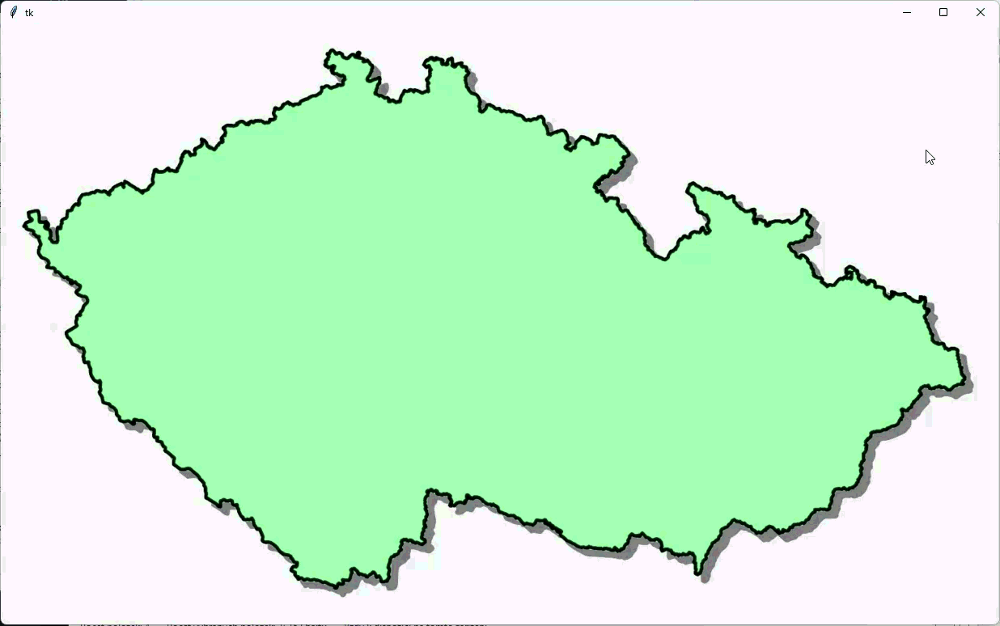

---

## 2.1. 💾 Cvičení

**[6]** Vytvořte tři různé předpovědi počasí a uložte je do souborů `predpoved1.txt`, `predpoved2.txt` a `predpoved3.txt`. Upravte program pro zobrazení počasí v televizi tak, aby je postupně animoval. 

**[7]** Upravte oba programy "Předpověď počasí" tak, aby bylo možné k předpovědi zadat také datum předpovědi; toto datum se rovněž uloží do souboru, v televizi se z něj načte a stane se součástí animace. Následně bude možné ze tří souborů postupně vizualizovat předpovědi počasí na nejbližší tři dny.

---

# 3. Lambda funkce

Jistě jste si všimli, že funkce `posun_vlevo()` a `posun_vpravo()` jsou téměř stejné, liší se pouze nastavením proměnné `smer`. Můžeme program zobecnit a vytvořit pouze jednu funkci, ke které ještě přidáme parametr pro nastavení směru. Problém však spočívá v tom, že `bind` neumožňuje napsat volání funkce s vlastními parametry a `bind` vždy předává právě jeden svůj parametr. Pro tyto a jiné účely se často používá speciální zápis, tzv. `lambda` funkce. Jedná se o tzv. anonymní funkci (není nutné ji deklarovat pomocí `def`). Taková funkce má v těle pouze jeden řádek a neobsahuje `return`. Například takováto jednořádková funkce `xnay`:

```py
def xnay(x, y):
    return x**y

print(xnay(2, 3))
```

Pomocí lambda funkce to zapíšeme takto (funkci si uložíme do proměnné `xnay`):


```py
>>> xnay = lambda x, y: x**y
>>> xnay(2, 3)
8
>>>
```

Lambda funkce se tedy zapisuje ve tvaru `lambda parametry: výraz`.

Vytvoříme pouze jednu funkci s názvem `posun_start` (pozor, nelze ji pojmenovat pouze `posun`, protože v programu již máme proměnnou s tímto názvem).


```py
def posun_start(novy_smer):
    global smer, pocet_kroku, i, posun
    smer = novy_smer
    i = pocet_kroku
    posun = smer * sirka // pocet_kroku
    animace()
```

A teď upravíme příkazy `bind`.

```py
canvas.bind('<Button-1>', lambda event: posun_start(-1))
canvas.bind('<Button-3>', lambda event: posun_start(1))
```

Do bloku jsme přidali `lambda` funkci, která přijímá parametr `event` (musí jej přijmout) a volá funkci `posun_start(-1)` resp. `posun_start(1)`. Jak je vidět, parametr `event` se nemusí dále předávat do funkce `posun_start`, protože jej v ní nepotřebujeme.

Kdybychom potřebovali zpracovat i parametr `event`, řešení bychom zapsali takto:

```py
def posun_start2(event, nsmer):
    global smer, pocet_kroku, i, posun
    smer = nsmer
    i = pocet_kroku
    posun = smer * sirka // pocet_kroku
    animace()

canvas.bind('<Button-1>', lambda event: posun_start2(event, -1))
canvas.bind('<Button-3>', lambda event: posun_start2(event, 1))
```

❓ Jak byste využili funkci `lambda` v případě, že bychom chtěli kliknutím myši spustit časovač (v naprosto jednoduchém programu, kde pouze spouštíme časovač)?

V následujících dvou programech uvidíte ukázku využití `lambda` funkce. V programu jsou dvě tlačítka, jedno posouvá nakreslené tvary nahoru a druhé dolů. Oba programy dělají totéž, jen jsou řešeny různými způsoby.

```py
import tkinter
canvas=tkinter.Canvas()
canvas.pack()

def posun(dy):
    canvas.move('all', 0, dy)

canvas.create_line(10, 100, 210, 100, width=5)
button1 = tkinter.Button(text='-', command=lambda:posun(-5))
button1.pack()
button2 = tkinter.Button(text='+', command=lambda:posun(5))
button2.pack()
```

```py
import tkinter
canvas=tkinter.Canvas()
canvas.pack()

canvas.create_line(10, 100, 210, 100, width=5)
button1 = tkinter.Button(text='-', command=lambda:canvas.move('all', 0, -5))
button1.pack()
button2 = tkinter.Button(text='+', command=lambda:canvas.move('all', 0, 5))
button2.pack()
```


