# Lekce 27: Matematické výpočty a geometrie

---

V programování je za řešením mnoha úloh spousta matematických výpočtů. Některé operace a funkce jazyka Python již známe. Nyní si ukážeme další. Některé z nich jsou součástí modulu `math`, jiné jsou standardní součástí jazyka Python.


❓ Jak byste vypočítali vzdálenost dvou bodů, pokud známe souřadnice těchto bodů?

❓ Jakou operaci či funkci je třeba použít při výpočtu vzdálenosti dvou bodů?

---

Funkce `abs(číslo)` vrátí absolutní hodnotu čísla. V kapitole 24 jsme si naprogramovali vlastní řešení.

```py
>>> abs(-3,58)
3,58
```

Funkce `round(číslo, počet míst)` zaokrouhlí zadané číslo na zadaný počet míst. Pokud zadáme pouze první parametr, zaokrouhlí vstupní číslo na celé číslo.

```py
>>> round(2.58)
3
>>> round(2.48)
2
>>> round(2.58, 1)
2.6
>>> round(2.48, 1)
2.5
>>> round(2.48, -1)
0.0
>>> round(1253.48, -1)
1250.0
>>> round(1253.48, -2)
1300.0
```

Funkce `sqrt(číslo)` z modulu `math` vrátí druhou odmocninu zadaného čísla.


```py
>>> import math
>>> math.sqrt(4)
2.0
>>> math.sqrt(9)
3.0
>>> math.sqrt(8)
2.8284271247461903
```

Vzdálenost dvou bodů vypočítáme pomocí Pythagorovy věty.


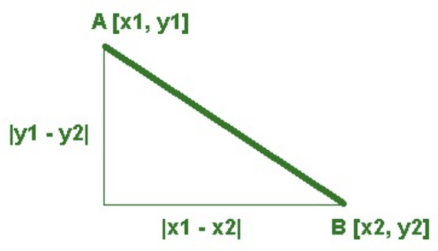

Délku přepon můžeme vypočítat jako rozdíl souřadnic na ose `x` a souřadnic na ose `y` (tedy jejich absolutní hodnotu). Pokud známe v pravoúhlém trojúhelníku dvě přepony, vypočítáme pomocí Pythagorovy věty délku protilehlé strany.


```py
import math

def vzdalenost(a, b):
    return math.sqrt((a[0]-b[0])**2 + (a[1]-b[1])**2)

vzd = vzdalenost((50, 100), (150, 200))
print(round(vzd))
```

---

## 💾 Cvičení

**[1]** Vytvořte program, ve kterém uživatel zadá poloměr kruhu. Program vypočítá a vypíše jeho obvod a obsah.


**[2]** Vytvořte program, který od uživatele načte tři reálná čísla – délky stran trojúhelníku. Program vypočítá obsah trojúhelníku pomocí [Herónova vzorce](https://cs.wikipedia.org/wiki/Heron%C5%AFv_vzorec).


**[3]** Vytvořte program, ve kterém může uživatel kliknutím určit počáteční a koncový bod přímky. Bod se v grafickém okně zobrazí jako malý křížek.

1. Následně (po druhém kliknutí nebo po kliknutí na tlačítko) program vypočítá délku přímky.

    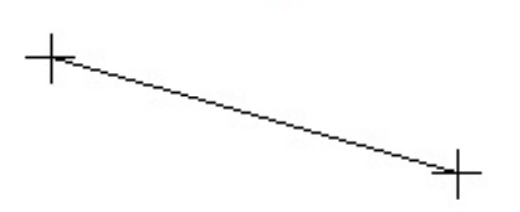


2. Upravte program tak, aby se po třetím kliknutí křížky zmizely a vykreslil se trojúhelník.
3. Vypočítejte obvod a obsah tohoto trojúhelníku.
4. Vykreslete v vzniklém trojúhelníku jinou barvou středovou čáru.

    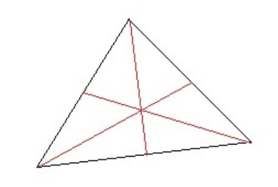

5. Po čtvrtém kliknutí se trojúhelník smaže a body lze začít klikat znovu.


**[4]** Vytvořte program, který vykreslí jeden dostatečně velký, náhodně vygenerovaný barevný kruh. Program pak při každém kliknutí otestuje a vypíše, zda uživatel klikl do tohoto kruhu, nebo mimo něj. (Příprava na sestřelování nepřátelských kruhů ve hře.)

**[5]** Vytvořte program, který vygeneruje 1000 stejně velkých kruhů na náhodných pozicích. Kruhy budou červené nebo bílé.

1. Kruh bude červený, pokud souřadnice jeho středu „spadnou“ do velkého pomyslného kruhu uprostřed grafické plochy, jinak bude kruh bílý.

    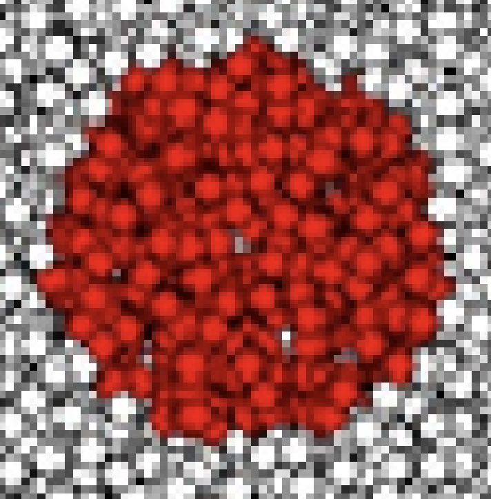

2. Červené kruhy se nakreslí pouze tehdy, pokud spadají do kruhu (mezikruží).

    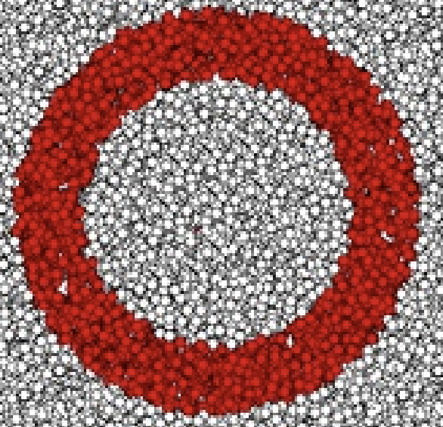


3. Červené a bílé kruhy budou tvořit takový terč.

    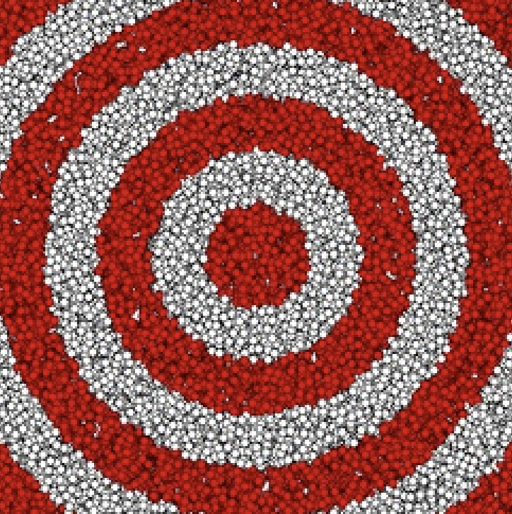


**[6]** Vytvořte program, ve kterém uživatel zadá dvě hodnoty – délky přepon `a`, `b` (v pixelech) pravoúhlého trojúhelníku. Program zobrazí trojúhelník tak, že strana `a` bude vodorovná a strana `b` svislá. U všech stran bude zobrazena jejich délka.

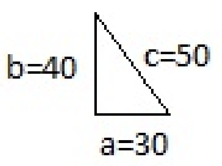


**[7]** Vytvořte program, který zobrazí odměrný válec se stupnicí v centilitrech (viz obrázek).

1. Uživatel může kliknutím na tlačítka nalít nebo vylít zadané množství vody (reálné číslo) v centilitrech. Program také umí zobrazit hlášku "Válec je plný" nebo "Válec je prázdný".

    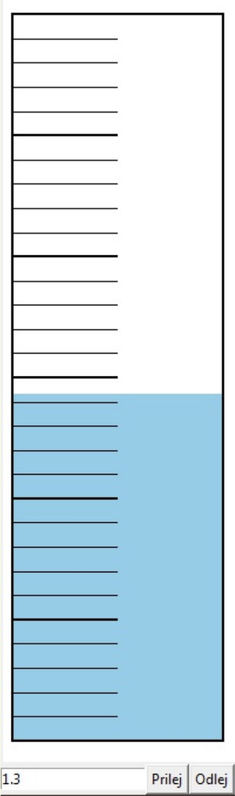

2. Program k dílům vykresluje také hodnoty a uživatel může určit celkový objem měřicího válce a počet dílů. Na obrázku bude odměrný válec vždy stejně velký. Program vypočítá velikost jednoho dílku a podle toho upraví výpis hodnot k dílkům. Pokud se nalitá voda nevejde do odměrného válce, program vedle něj nakreslí další válec a tam nalije přebytečnou vodu.

---

❓ Jak bychom nakreslili rotující sekundovou ručičku? Jaké výpočty potřebujeme k otáčení čáry?

Než nakreslíme rotující sekundovou ručičku, vyznačme si všechny polohy sekundové ručičky (v celých sekundách) na ručičkových hodinách. Těchto poloh je `60`, a tedy jedné sekundě odpovídá úhel `360 / 60 = 6` stupňů. Známe střed, kolem kterého se ručička otáčí (bod `S` se souřadnicemi `sx`, `sy`), a také délku ručičky – tedy poloměr kružnice (`r`) a úhel otočení ručičky. Pomocí trigonometrických funkcí `sinus` a `kosinus` vypočítáme délku obou přepon pravoúhlého trojúhelníku. Jelikož naše kružnice není jednotková, musíme délku přepon vynásobit poloměrem `r` (je `r`-krát větší než jednotková kružnice). Z délky přepon a ze souřadnic bodu `S` vypočítáme koncový bod sekundové ručičky.

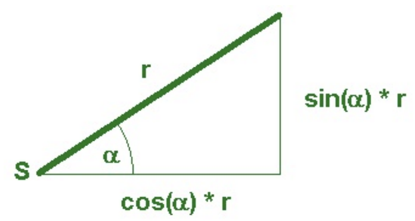

```py
import tkinter, math

canvas = tkinter.Canvas(height=500, width=500, bg='white')
canvas.pack()

sx = 300
sy = 300
r = 100

for uhel in range(0, 360, 6):
    uhel_rad = math.radians(uhel)
    x = sx + math.cos(uhel_rad) * r
    y = sy - math.sin(uhel_rad) * r
    canvas.create_line(sx, sy, x, y)
```

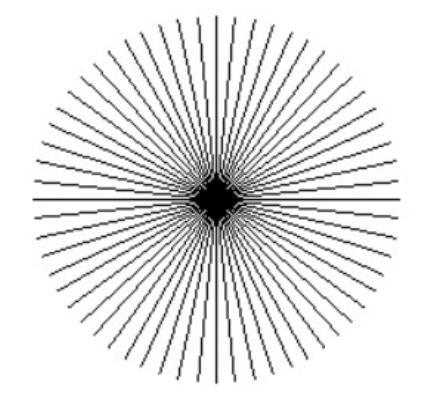

V programu jsme využili funkci `math.sin(úhel)`, která vypočítá sinus pro úhel zadaný v **radiánech**, a funkci `math.cos(úhel)`, která vypočítá kosinus rovněž pro úhel zadaný v radiánech. Jelikož jsme pomocí cyklu `for` generovali velikost úhlu ve stupních, převedli jsme ji pomocí funkce `math.radians()` na radiány. K převodu z radiánů na stupně slouží funkce `math.degrees()`. Převod si však můžete naprogramovat i sami, k tomu můžete využít konstantu `math.pi`.

Program můžeme upravit. Přidáme časovač a pohyblivou ručičku. Abychom nemuseli dlouho čekat, nastavíme čas na méně než jednu sekundu.


```py
# 27_hodiny.py

import tkinter, math
canvas = tkinter.Canvas(height=500, width=500, bg='white')
canvas.pack()

uhel = 90
sx = 200
sy = 200
r = 100

def rucicka():
    global uhel
    uhel -= 6
    uhel_rad = math.radians(uhel)
    x = sx + math.cos(uhel_rad) * r
    y = sy - math.sin(uhel_rad) * r
    canvas.delete('all')
    canvas.create_line(sx, sy, x, y)
    canvas.after(100, rucicka)

rucicka()
```


Do programu přidáme vykreslení ciferníku:

```py
import tkinter, math
canvas = tkinter.Canvas(height=500, width=500, bg='blue')
canvas.pack()

uhel = 90
sx = 200
sy = 200
r = 100

def rucicka():
    global uhel
    uhel -= 6
    uhel_rad = math.radians(uhel)
    x = sx + math.cos(uhel_rad) * r
    y = sy - math.sin(uhel_rad) * r
    canvas.delete('rucicka')
    canvas.create_line(sx, sy, x, y, tags='rucicka')
    canvas.after(100, rucicka) 

def cifernik(sx, sy, r):
    for i in range(1,13):
        alfa = 90 - (i * 360/12)
        alfa_rad = math.radians(alfa)
        x = sx + math.cos(alfa_rad) * (r + 20)
        y = sy - math.sin(alfa_rad) * (r + 20)
        canvas.create_text(x, y, text=i)

cifernik(sx, sy, r)
rucicka()
```

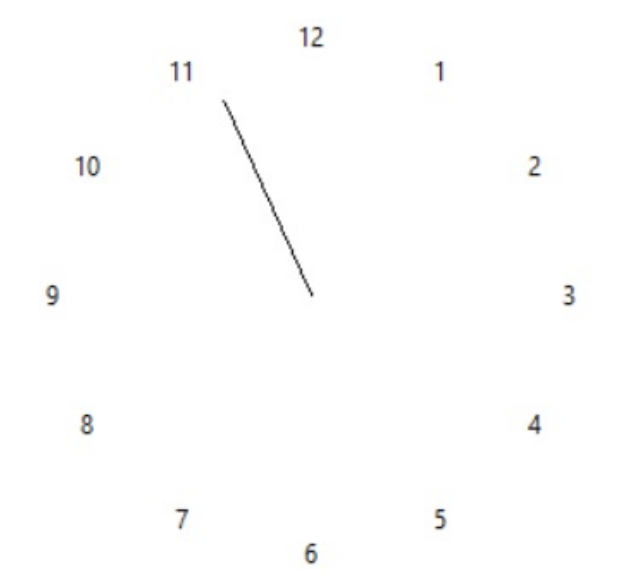


❓ Co se stane, když při vykreslování textu přidáme `angle=alfa` nebo `angle=alfa - 90`?


## 💾 Cvičení

**[8]** Upravte program s vteřinovou ručičkou a ciferníkem tak, aby se hodiny po kliknutí myší přesunuly na místo kliknutí (střed hodin).


**[9]** Upravte program s vteřinovou ručičkou a ciferníkem tak, aby byl ciferník označen římskými číslicemi.

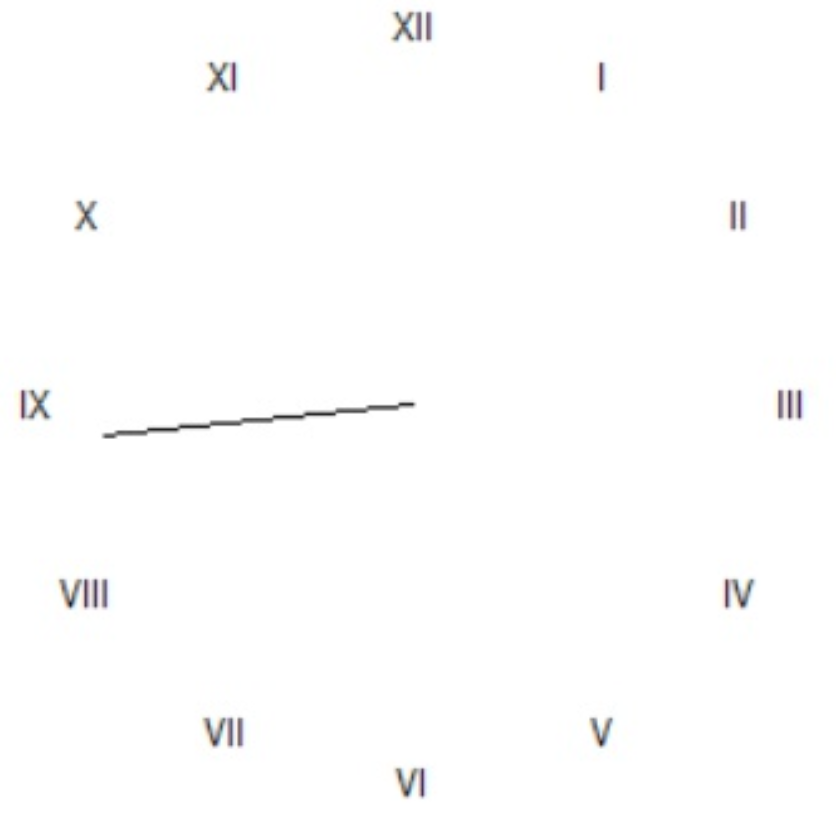


**[10]** Vytvořte funkci `text_v_kruhu`, do které zadáme souřadnice středu, poloměr a text, a funkce vykreslí text rovnoměrně rozmístěný po obvodu kruhu, přičemž spodní části jednotlivých znaků budou otočeny směrem ke středu kruhu. Ukázka volání funkce `text_v_kruhu(200, 200, 80, ‚Programujeme v Pythonu ‘)`:

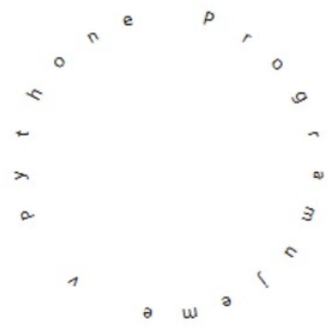


**[11]** Pomocí funkce `text_v_kruhu` z předchozího úkolu vytvořte funkci, která tento text nakreslí vícekrát pro různé poloměry:

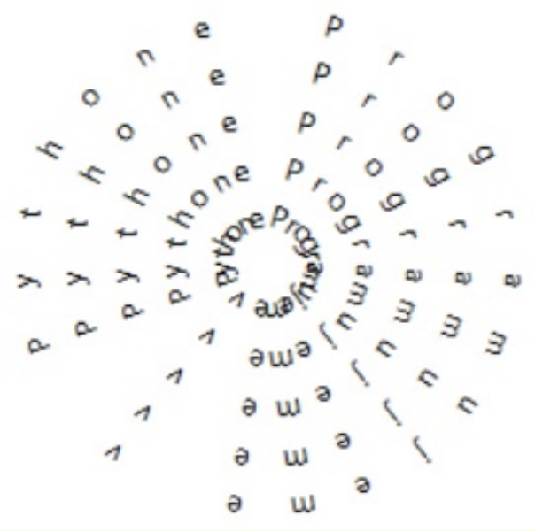


**[12]** Soubor `hvezda.png` obsahuje obrázek žluté pěticípé hvězdy. Vytvořte program, který nakreslí vlajku EU.


---

Vytvořme program, který bude animovat pohyb bodu po kružnici a jeho souřadnice `x` a `y` (vzhledem ke středu kružnice, tedy vzdálenost `x` a `y` od středu kružnice) bude zaznamenávat do grafu.


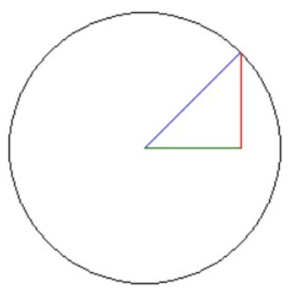


```py
# 27_body_na_kruznici.py

import tkinter, math
canvas = tkinter.Canvas(height=500, width=1000, bg='white')
canvas.pack()

uhel = 0
sx = 120
sy = 120
r = 100
px = 0

def animace():
    global uhel, px
    canvas.delete('k')
    uhel_rad = math.radians(uhel)
    x1 = math.cos(uhel_rad) * r
    y1 = math.sin(uhel_rad) * r
    canvas.create_line(sx, sy, sx+x1, sy-y1, fill='green', tag='k')
    canvas.create_line(sx+x1, sy, sx+x1, sy-y1, fill='blue', tag='k')
    canvas.create_line(sx, sy, sx+x1, sy, fill='red', tag='k')
    canvas.create_line(sx+r+20+px, sy, sx+r+20+px, sy-y1, fill='blue')
    canvas.create_line(sx+r+20+px, sy+200, sx+r+20+px, sy+200-x1, fill='red')
    uhel += 1
    px += 1
    canvas.after(10, animace)

canvas.create_oval(sx-r, sy-r, sx+r, sy+r)
animace()
```

Program postupně nakreslí následující graf:

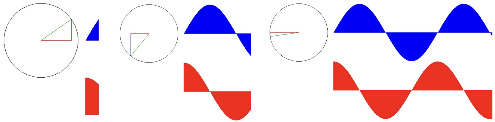

---

## 💾 Cvičení

**[13]** Upravte program pro vykreslování grafu z předchozího příkladu tak, aby se oba grafy vykreslily ihned po spuštění programu pro jedni periodu 2π. Následně se pohybem myši v grafu nakreslí příslušná úsečka (výšky v obou grafech) a současně se na kružnici nakreslí odpovídající úhel i s trojúhelníkem.

**[14]** Vytvořte program – kreslič trigonometrických funkcí. Program zobrazí část osy X v rozmezí od 0 do 2π a pomocí malých čárek vykreslí křivku zvolené trigonometrické funkce. Souřadnici Y pro danou hodnotu X vypočítejte pomocí funkcí z modulu `math`.

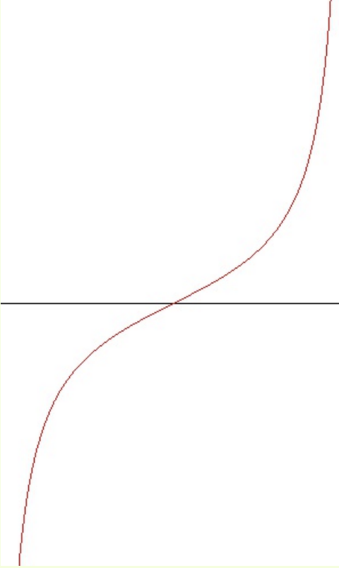

---

Upravme ještě náš program `27_body_na_kruznici.py`, ve kterém se bod pohybuje po kružnici. V proměnných si kromě souřadnic středu, poloměru a počátečního úhlu zapamatujeme také hodnotu, o kterou budeme úhel měnit (delta úhel – `du`). A do programu přidáme další pohyb bodu po jiné kružnici s nějakými jinými nastaveními. Abychom proměnné pro obě kružnice odlišili, přidáme k nim čísla `1` a `2` (tedy proměnné první kružnice a druhé kružnice).

```py
import tkinter, math
canvas = tkinter.Canvas(height=500, width=1000, bg='white')
canvas.pack()

u1 = 0
du1 = 1
sx1 = 250
sy1 = 250
r1 = 100

u2 = 0
du2 = 4
sx2 = 300
sy2 = 200
r2 = 30

def animace():
    global u1, u2
    canvas.delete('k')

    u1_rad = math.radians(u1)
    x1 = math.cos(u1_rad) * r1
    y1 = math.sin(u1_rad) * r1
    canvas.create_line(sx1, sy1, sx1+x1, sy1-y1, fill='green', tags='k')

    u2_rad = math.radians(u2)
    x2 = math.cos(u2_rad) * r2
    y2 = math.sin(u2_rad) * r2

    canvas.create_line(sx2, sy2, sx2+x2, sy2-y2, fill='orange', tags='k')
    u1 += du1
    u2 += du2
    canvas.after(10, animace)

animace()
```

Program zatím nedělá nic zajímavého. Ještě ho trochu upravíme. Střed druhé kružnice nebude stále na stejném místě, ale bude se nacházet v pohyblivém bodě na první kružnici. Následně vykreslíme místa, kde se nacházel bod pohybující se po druhé kružnici. A jak si myslíte, že bude vypadat výsledný obrázek tohoto programu?

```py
import tkinter, math
canvas = tkinter.Canvas(height=500, width=1000, bg='white')
canvas.pack()

u1 = 0
du1 = 1
sx1 = 250
sy1 = 250
r1 = 100

u2 = 0
du2 = 4
sx2 = 300
sy2 = 200
r2 = 30

def animace():
global u1, u2, sx2, sy2
    canvas.delete('k')
    u1_rad = math.radians(u1)
    x1 = math.cos(u1_rad) * r1
    y1 = math.sin(u1_rad) * r1
    canvas.create_line(sx1, sy1, sx1+x1, sy1-y1, fill='green', tags='k')

    sx2 = sx1+x1
    sy2 = sy1-y1

    u2_rad = math.radians(u2)
    x2 = math.cos(u2_rad) * r2
    y2 = math.sin(u2_rad) * r2
    canvas.create_line(sx2, sy2, sx2+x2, sy2-y2, fill='orange', tags='k')
    canvas.create_line(sx2+x2, sy2-y2, sx2+x2+1, sy2-y2+1, width=2 )

    u1 += du1
    u2 += du2
    canvas.after(10, animace)

animace()
```

Program bude postupně vykreslovat tento obrázek:

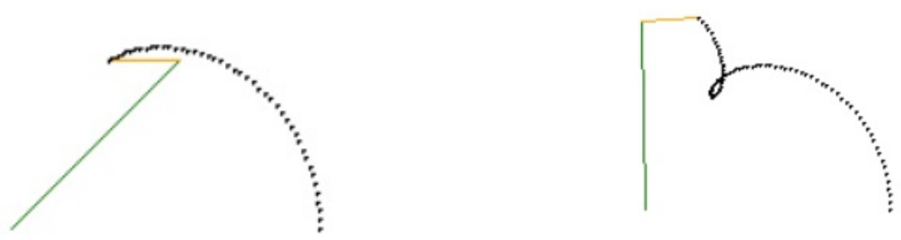


## 💾 Cvičení

**[15]** Experimentujte s nastavením v předchozím programu a zjistěte, jaké obrázky dokáže program nakreslit. Pro pohodlnější nastavení vymyslete vhodný způsob zadávání vstupních údajů. Dokážete vytvořit takové obrázky?

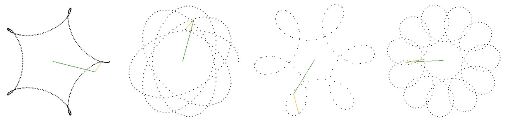


**[16]** Upravte předchozí program tak, aby příslušné body trajektorie uložil do seznamu a následně nakreslil souvislou čáru procházející všemi body, které program vypočítal.


**[17]** (*) Upravte program s pohyblivými body na kružnici tak, aby se i první bod, který je původně statický, pohyboval (buď po kružnici, nebo po přímce, ve čtverci atp.). Program můžete vylepšit tím, že údaje nebudete ukládat do jednotlivých proměnných, ale do nějaké struktury.


**[18]** Vytvořte program, ve kterém se bod `A` nezávisle pohybuje po kružnici `k1` a bod `B` po kružnici `k2`. Každá z kružnic má určený střed a poloměr a každý z bodů se pohybuje danou rychlostí (například zadanou v počtu stupňů otočení v jednom kroku). Program vykresluje trajektorii bodu `C`, který je středem úsečky `AB`. Experimentujte s různými nastaveními a vylepšete program tak, aby uživatel mohl snadno měnit vstupní hodnoty.


**[19]** Vytvořte funkci, která převede zadané číslo v desítkové soustavě do dvojkové soustavy (bez použití formátování a vestavěné funkce `bin()`).

**[20]** Vytvořte funkci, která převede zadané číslo ve dvojkové soustavě do desítkové soustavy (bez použití formátování).


