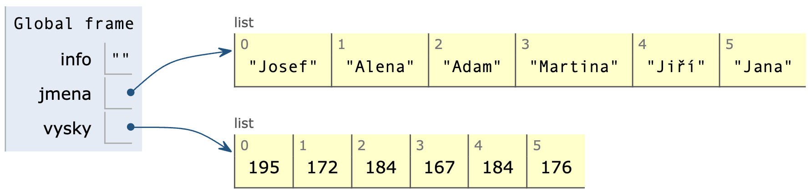
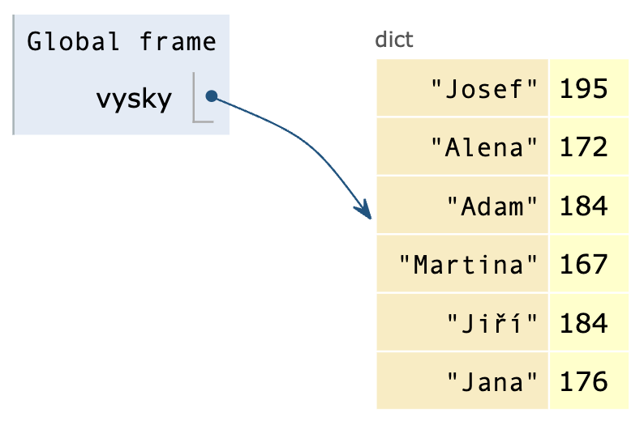
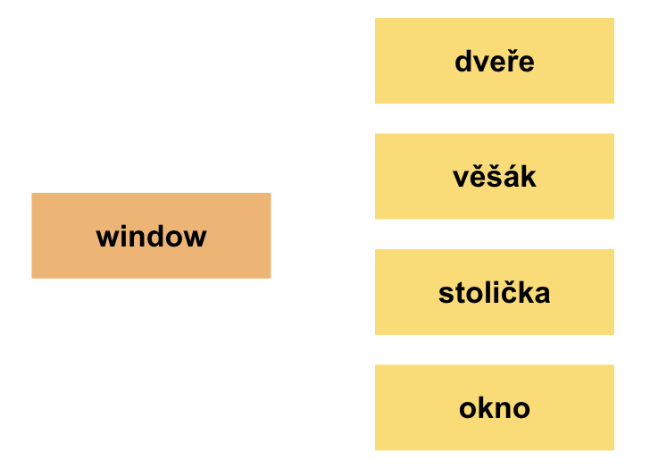
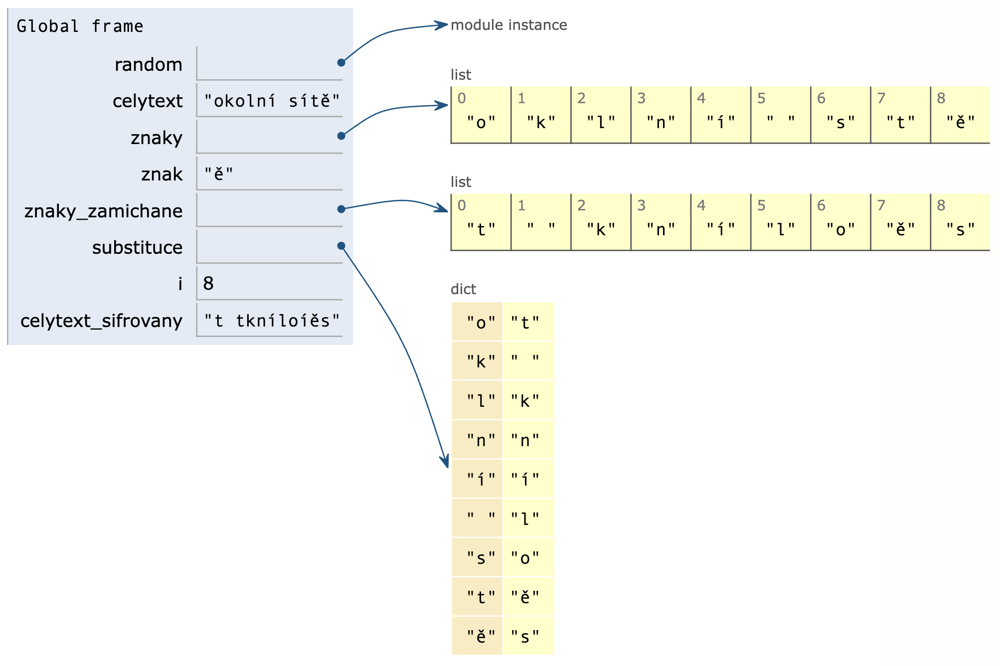
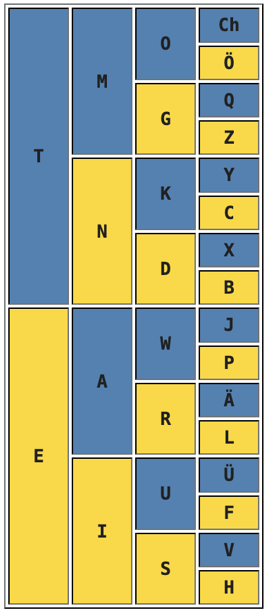
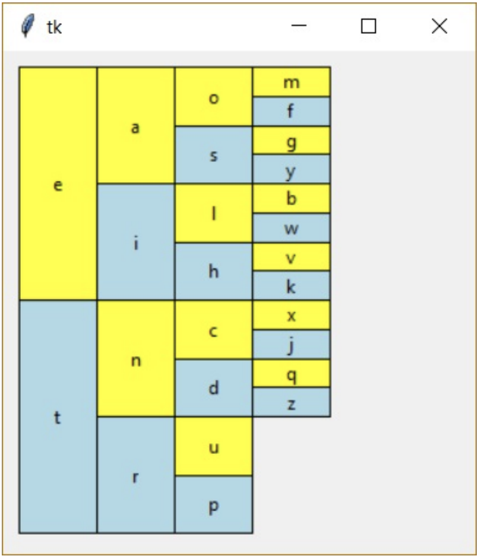
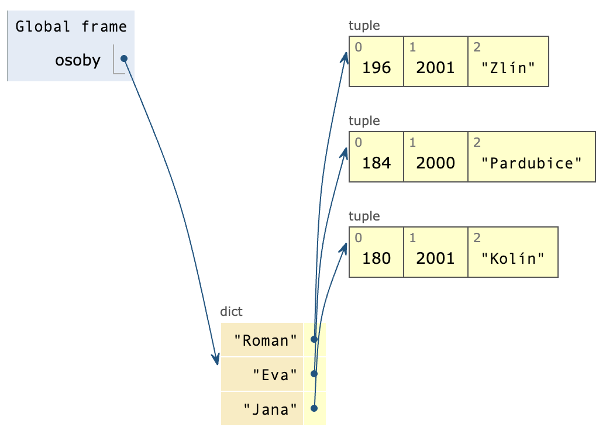
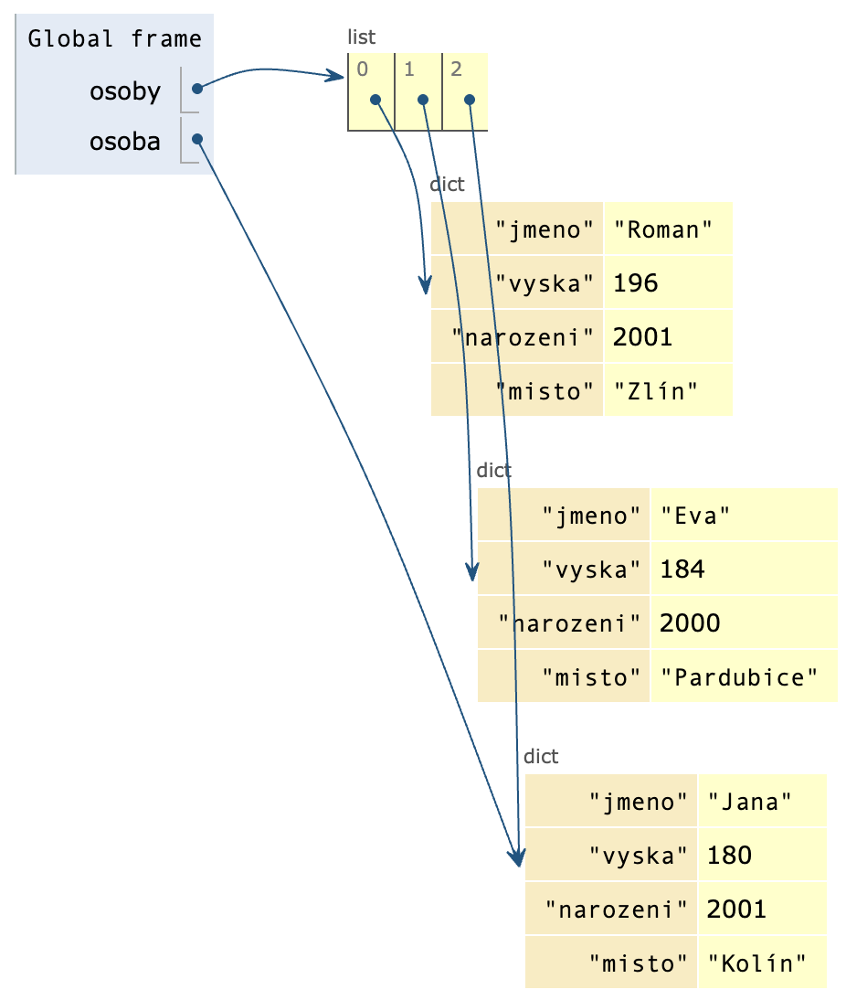
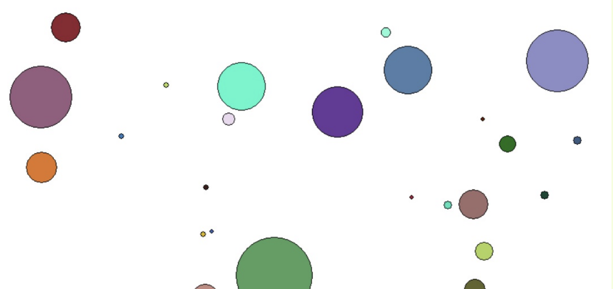

# Lekce 28: Asociativní pole <!-- omit in toc -->

---

- [1. Vytvoření slovníku a metody práce](#1-vytvoření-slovníku-a-metody-práce)
  - [1.1. 💾 Cvičení](#11--cvičení)
- [2. Šifrování náhodnou substitucí](#2-šifrování-náhodnou-substitucí)
- [3. Frekvence výskytů znaků](#3-frekvence-výskytů-znaků)
  - [3.1. 💾 Cvičení](#31--cvičení)
- [4. Seznam asociativních polí](#4-seznam-asociativních-polí)
  - [4.1. 💾 Cvičení](#41--cvičení)
- [5. Hledání pokladu - textová dobrodružná hra](#5-hledání-pokladu---textová-dobrodružná-hra)
  - [5.1. 💾 Cvičení - vlastní textová hra](#51--cvičení---vlastní-textová-hra)


---

# 1. Vytvoření slovníku a metody práce

`Seznam` (list) a `n-tici` (tuple) jsme používali k uchování nějaké struktury informací. K přístupu k jednotlivým prvkům struktury jsme používali číselný index. Existují situace, kdy potřebujeme, aby indexy nebyly pouze čísla od 0 do *n*. 

Například vytvoříme program, do kterého uživatel zadá jména a výšku osob, načež nám program vypočítá a vypíše jejich průměrnou výšku. Na požádání nám k zadanému jménu vypíše výšku dané osoby. S tím, co zatím víme, můžeme vytvořit takovýto program:

```py
# 28_1.py

print('Zjistím ti výšku zadaných osob (Enter = konec).')
info = input('Zadej jméno a výšku osoby: ')
jmena = []
vysky = []
while info != '':
    info = info.split()
    jmena.append(info[0])
    vysky.append(int(info[1]))
    info = input('Zadej jméno a výšku osoby: ')

prumer = 0
soucet = sum(vysky)
pocet = len(vysky)
if pocet > 0:
    prumer = soucet / pocet
print('='*30)
print('Průměrná výška je: '+'{:.2f} cm'.format(prumer))
print('='*30)
print('Zjistím ti výšku zadaných osob (Enter = konec).')
hledat = input('Zadej jméno: ')
while hledat != '':
    if hledat in jmena:
        index = jmena.index(hledat)
        print(hledat+' má výšku: '+str(vysky[index]))
    else:
        print(hledat+' není v seznamu!')
        hledat = input('Zadej jméno: ')
```


```
Zjistím ti výšku zadaných osob (Enter = konec).
Zadej jméno a výšku osoby: Josef 195
Zadej jméno a výšku osoby: Alena 172
Zadej jméno a výšku osoby: Adam 184
Zadej jméno a výšku osoby: Martina 167
Zadej jméno a výšku osoby: Jiří 184
Zadej jméno a výšku osoby: Jana 176
Zadej jméno a výšku osoby:
==============================
Průměrná výška je: 179.67 cm
==============================
Zjistím ti výšku zadaných osob (Enter = konec).
Zadej jméno: Adam
Adam má výšku: 184
Zadej jméno: Monika
Monika není v seznamu!
Zadej jméno: Jana
Jana má výšku: 176
Zadej jméno:
>>>
```

Zadané výšky a jména ukládáme do dvou různých seznamů. Podívejte se na vizualizaci (s využitím [www.pythontutor.com](https://www.pythontutor.com)):




Hledání výšky pro zadané jméno je poněkud složitější. Nejprve pomocí metody `index` v seznamu `jmena` najdeme index hledaného jména a následně ze seznamu `vysky` zjistíme hodnotu prvku na zjištěném indexu (stejném jako v seznamu `jmena`).

---

V takových případech je vhodnější použít **asociativní pole**. V něm k prvkům nepřistupujeme pomocí číselného indexu, ale pomocí **klíče**. Ke klíči je přiřazena (je s ním asociována) hodnota. Prvky asociativního pole tvoří **klíč** a jeho **hodnota** oddělené dvojtečkou. Takto zapíšeme jména s výškami:


```py
>>> vysky = {'Josef':195, 'Alena':172, 'Adam':184, 'Martina':167, 'Jiří':184, 'Jana':176}
>>> type(vysky)
<class 'dict'>
>>> vysky
{'Josef': 195, 'Alena': 172, 'Adam': 184, 'Martina': 167, 'Jiří': 184, 'Jana': 176}
>>>
>>> 
```


Tento datový typ nazýváme **slovník** (**dictionary**). Vidíme, že na rozdíl od seznamu zapisujeme prvky do složených závorek. Ve složených závorkách jsou dvojice `klíč:hodnota` (nebo jen prázdné složené závorky – tím vytvoříme prázdné asociativní pole).




```py
>>> vysky['Adam']
184
>>> vysky['Jana']
176
>>> tridy = {}
>>> tridy
{}
>>>
```

Použití klasického číselného indexu skončí chybou (číselné indexy nebudou chybou v případě, že klíči jsou právě taková čísla). Chybu vykazuje také použití neexistujícího klíče:

```py
>>> vysky[0]
Traceback (most recent call last):
File "<pyshell#8>", line 1, in <module>
    vysky[0]
KeyError: 0
>>> vysky['Tomáš']
Traceback (most recent call last):
File "<pyshell#9>", line 1, in <module>
    vysky['Tomáš']
KeyError: 'Tomáš'
>>>
```

Aby program nevykazoval chybu v případě neexistujícího klíče, můžeme existenci klíče ověřit pomocí operátoru `in`. Operátor `in` prohledává **pouze klíče**, nikoli hodnoty:

```py
>>> 'Adam' in vysky
True
>>> 'Roman' in vysky
False
>>> 176 in vysky
False
>>>
```

Nebo použijeme metodu `get(klíč, náhradní_hodnota)`, která v případě, že klíč neexistuje, vrátí náhradní hodnotu, a pokud není zadána, vrátí hodnotu `None`:

```py
>>> vysky.get('Roman',0)
0
>>> vysky.get('Roman')
>>> vysky.get('Adam',0)
184
>>>
```

Tímto způsobem vytvoříme prázdné asociativní pole `vysky = {}`. Zápisem `vysky['Katka‘] = 174` vytvoříme asociaci klíče `'Katka'` s hodnotou `174`. Pokud v asociativním poli klíč `'Katka'` již existuje, změníme jeho hodnotu na `174`.

```py
>>> vysky = {}
>>> vysky['Katka'] = 174
>>> vysky
{'Katka': 174}
>>> vysky['Alena'] = 174
>>> vysky
{'Alena': 174, 'Katka': 174}
>>> vysky['Katka'] = 169
>>> vysky
{'Alena': 174, 'Katka': 169}
>>>
```
---

❓ Mohou být v jednom asociativním poli dva klíče s různými hodnotami (například: `'Katka':174` a `'Katka':169`)?

❓ Které datové typy mohou být klíči asociovaného pole (zjistěte experimentálně)?

❓ Které z těchto typů: `integer`, `float`, `string`, `boolean`, `tuple` mohou být hodnotami v asociovaném poli?

❓ Můžeme na asociovaná pole použít řezy (slice)?

❓ Co vypíše funkce `len()` pro asociované pole?

---

Upravme náš program z úvodu této kapitoly. Místo dvou seznamů `jmena` a `vysky` vytvoříme jedno asociativní pole `vyska`. Zpočátku bude prázdné. Po načtení vstupu vytvoříme asociaci mezi klíčem (jméno osoby) a hodnotou (výška osoby). Ukázka první části programu (načtení):


```py
print('Zjistím ti výšku zadaných osob (Enter = konec).')
info = input('Zadej jméno a výšku osoby:')
vysky = {}
while info != '':
    info = info.split()
    vysky[info[0]] = info[1]
    info = input('Zadej jméno a výšku osoby:')
```

Funkce `sum()` se slovníkem nefunguje. Potřebujeme získat pouze hodnoty slovníku. Metoda `values()` vrátí hodnoty asociovaného pole a z nich můžeme vypočítat součet: `sum(vysky.values())`. Zbývající část programu (s použitím slovníku):

```py
prumer = 0
soucet = sum(vysky.values())
pocet = len(vysky)
if pocet > 0:
    prumer = soucet / pocet
print('='*30)
print('Průměrná výška je: '+'{:.2f} cm'.format(prumer))
print('='*30)
print('Zjistím ti výšku zadaných osob (Enter = konec).')
hledat = input('Zadej jméno: ')
while hledat != '':
    hodnota = vysky.get(hledat, None)
    print(hledat+' má výšku: '+str(hodnota))
    hledat = input('Zadej jméno: ')
```

V případě neexistujícího klíče program přímo vypíše hodnotu `None`:


```
==============================
Průměrná výška je: 179.67 cm
==============================
Zjistím ti výšku zadaných osob (Enter = konec).
Zadej jméno: Adam
Adam má výšku: 184
Zadej jméno: Tomáš
Tomáš má výšku: None
Zadej jméno: Josef
Josef má výšku: 195
Zadej jméno:
>>>
```

Pomocí funkce `list()` můžeme vytvořit `seznam` pouze z hodnot slovníku (nebo pomocí funkce `tuple()` z nich vytvoříme `n-tici`):

```py
>>> list(vysky.values())
[184, 195, 184, 167, 172, 176]
>>> tuple(vysky.values())
(184, 195, 184, 167, 172, 176)
>>>
```

Metoda `keys()` nám vrátí pouze klíče z asociativního pole a z nich můžeme pomocí funkce `list()` vytvořit `seznam` a pomocí funkce `tuple()` naopak `n-tici`:

```py
>>> vysky.keys()
dict_keys(['Adam', 'Josef', 'Jiří', 'Martina', 'Alena', 'Jana'])
>>> list(vysky.keys())
['Adam', 'Josef', 'Jiří', 'Martina', 'Alena', 'Jana']
>>> tuple(vysky.keys())
('Adam', 'Josef', 'Jiří', 'Martina', 'Alena', 'Jana')
>>>
```

Pomocí metody `items()` získáme všechny dvojice klíčů a hodnot ze slovníku a můžeme z nich také vytvořit `seznam` nebo `n-tici`. V tomto případě bude jedním prvkem dvojice `(klíč, hodnota)`, tedy `n-tice`:


```py
>>> vysky.items()
dict_items([('Adam', 184), ('Josef', 195), ('Jiří', 184), ('Martina', 167),
('Alena', 172), ('Jana', 176)])
>>> list(vysky.items())
[('Adam', 184), ('Josef', 195), ('Jiří', 184), ('Martina', 167),
('Alena', 172), ('Jana', 176)]
>>> tuple(vysky.items())
(('Adam', 184), ('Josef', 195), ('Jiří', 184), ('Martina', 167),
('Alena', 172), ('Jana', 176))
>>>
```

Cyklem `for` můžeme procházet také posloupnost klíčů, hodnot nebo dvojic `klíč:hodnota` z asociativního pole:

```py
>>> for klic in vysky.keys():
    print(klic)

Adam
Josef
Jiří
Martina
Alena
Jana
>>>
```

```py
>>> for hodnota in vysky.values():
    print(hodnota)

184
195
184
167
172
176
>>>
```

```py
>>> for dvojice in vysky.items():
    print(dvojice)

('Adam', 184)
('Josef', 195)
('Jiří', 184)
('Martina', 167)
('Alena', 172)
('Jana', 176)
>>>
```

Nebo to můžeme udělat i takto:

```py
>>> for klic, hodnota in vysky.items():
    print(klic, hodnota)

Alena 172
Adam 184
Josef 195
Martina 167
Jiří 184
Jana 176
>>>
```
---

## 💾 Cvičení

**[1]** Upravte program pro výpočty výšky osob tak, aby údaje zadané na vstupu ukládal do textového souboru.

**[2]** Upravte program s výškami osob tak, aby údaje o výšce osob načítal do slovníku ze souboru.

---

V textovém souboru `slovicka.txt` je na každém řádku anglický výraz (slovo) a český výraz (slovo). Jednotlivé výrazy jsou odděleny středníkem. Ukázka souboru `slovicka.txt`:

```
table;stůl
chair;stolička
lamp;lampa
window;okno
air condition;klimatizace
...
```

Vytvoříme program, který načte slovíčka do asociativního pole a následně nás z nich bude zkoušet. Nejprve vytvoříme slovník `en_cz`, ve kterém bude klíčem anglické slovíčko a hodnotou české slovíčko:

```py
# 28_2.py

soubor = open('slovicka.txt', 'r')
en_cz = {}
for radek in soubor:
    radek = radek.strip()
    r = radek.split(';')
    en_cz[r[0]] = r[1]
print(en_cz)
```

Na závěr vypisujeme celé asociativní pole (slovník):

```py
{'wardrobe': 'šatník', 'picture': 'obraz', 'desk': 'lavice', 'door': 'dveře',
'chair': 'stolička', 'ceiling': 'strop', 'armchair': 'křeslo', 'table': 'stůl',
... }
>>>
```

Nyní můžeme přímo z příkazového řádku zadávat anglická slovíčka jako klíče slovníku a program nám vypíše český překlad. Pokud omylem zadáme české slovíčko, program nahlásí chybu, protože česká slovíčka nejsou klíče, ale hodnoty:

```py
>>> en_cz['carpet']
'koberec'
>>> en_cz['chair']
'stolička'
>>> en_cz['pohovka']
Traceback (most recent call last):
File "<pyshell#72>", line 1, in <module>
en_cz['pohovka']
KeyError: 'pohovka'
>>> en_cz['desk']
'lavice'
>>>
```

Pro překlad z češtiny do angličtiny si vytvoříme obrácený slovník – klíči budou hodnoty původního slovníku a hodnotami budou klíče původního slovníku:

```py
cz_en = {}
for dvojice in en_cz.items():
    cz_en[dvojice[1]] = dvojice[0]
print(cz_en)
```

nebo to můžeme zapsat i takto:

```py
cz_en = {}
for en, cz in en_cz.items():
    cz_en[cz] = en
print(cz_en)
```

Vytvořili jsme následující asociativní pole:

```py
{'věšák': 'hanger', 'šatník': 'wardrobe', 'lavice': 'desk', 'lampa': 'lamp',
'hodiny': 'clock', 'obraz': 'picture', 'strop': 'ceiling', 'koberec': 'carpet',
... }
>>>
```

---

## 1.1. 💾 Cvičení

**[3]** Máme program se dvěma asociativními poli. Jedno se jmenuje `en_cz` (anglicko-český slovník) a druhé se jmenuje `en_es` (anglicko-španělský slovník). Slovníky buď přímo zkopírujte do programu, nebo je načtěte ze souboru. V souboru `slovicka_en_es.txt` najdete slova pro slovník `en_es`. Z těchto dvou slovníků vytvořte **španělsko-český** a **česko-španělský** slovník.

**[4]** V textovém souboru máme na samostatném řádku slovo ve češtině a na řádku pod ním jeho překlad do cizího jazyka. Takových dvouřádkových záznamů je v souboru libovolné množství. Vytvořte program, který nás náhodně zkouší ze slovíček cizího jazyka (v grafickém okně) a vždy nám dá na výběr čtyři libovolná slova ve češtině, přičemž jedno z nich je správná odpověď. Pokud slovo uhodneme, přidá nám bod; pokud ho neuhodneme, bude nám ho častěji zařazovat do seznamu slov, ze kterých nás má ještě vyzkoušet.




---

# 2. Šifrování náhodnou substitucí

V textovém souboru `clanek.txt` je článek z internetu, který chceme zašifrovat náhodnou substitucí. To znamená, že každému znaku v textu přiřadíme nějaký náhodný znak, který se v původním textu vyskytuje. Platí však, že jeden znak je v celém textu nahrazen stejným náhodným znakem. Zašifrovaný text uložíme do souboru `clanek_zasifrovany.txt`. Substituční tabulku (původní znak a nový znak – převodní tabulka) uložíme do souboru `clanek_klic.txt`.

---

❓ Zamyslete se, jaké kroky je třeba v programu provést.

❓ Jaké znaky musí obsahovat převodní tabulka? Jakým způsobem můžeme minimalizovat počet znaků použitých v převodní tabulce?

❓ Jak zajistíme, aby každý znak ze vstupního textu byl v převodní tabulce zaznamenán přesně jednou?

---

Podívejme se na program:

```py
# 28_sifrovani.py

import random
soubor = open('clanek.txt', 'r')
celytext = soubor.read()
soubor.close()

znaky = []
for znak in celytext:
    if not znak in znaky:
        znaky.append(znak)
znaky_zamichane = znaky[:]
random.shuffle(znaky_zamichane)

substituce = {}
for i in range(len(znaky)):
    substituce[znaky[i]] = znaky_zamichane[i]

celytext_sifrovany = ''
for znak in celytext:
    celytext_sifrovany = celytext_sifrovany + substituce[znak]

soubor_sifrovany = open('clanek_sifrovany.txt', 'w')
soubor_sifrovany.write(celytext_sifrovany)
soubor_sifrovany.close()

soubor_tabulka = open('clanek_klic.txt', 'w')
for klic, hodnota in substituce.items():
    soubor_tabulka.write(klic+';'+hodnota+';')
soubor_tabulka.close()
```

Celý soubor načteme do jedné proměnné `celytext`. Následně procházíme jednotlivé znaky této proměnné a v seznamu `znaky` vytváříme vstupní abecedu (tj. seznam všech znaků použitých ve vstupním souboru – každý znak do něj přidáme pouze jednou). Nejprve zjistíme, zda jsme daný znak již do seznamu `znaky` přidali, a pokud ne, přidáme ho tam. Následně vytvoříme kopii seznamu (`znaky_zamichane = znaky[:]`), ve které znaky náhodně zamícháme pomocí funkce `random.shuffle(znaky_zamichane)`. K zamíchání použijeme funkci `shuffle()` z modulu `random`.

---

❓ Které datové typy dokáže funkce `random.shuffle()` zamíchat? (zjistěte to experimentováním v příkazovém řádku)

❓ Jak bychom náhodně zamíchali prvky seznamu bez funkce `random.shuffle()`?

❓ Proč jsme vytvořili kopii seznamu a nestačí zapsat přiřazení `znaky_zamichane = znaky`?

❓ Jak program zpracuje znak konce řádku v souboru `'\n'`?

---

Kdybychom v textovém souboru měli pouze tento text: `okolní sítě`, nebo kdybychom tuto větu přiřadili proměnné `celytext`, mohla by být převodní tabulka ve slovníku uspořádána například takto:




Nyní stačí procházet znaky proměnné `celytext`, přičemž daný znak slouží jako klíč ve slovníku `substituce` k nové hodnotě (kterou jsme získali zamícháním a která je uložena v tomto slovníku).

```py
celytext_sifrovany = ''
for znak in celytext:
    celytext_sifrovany = celytext_sifrovany + substituce[znak]
```

Zašifrovaný text už jen uložíme do souboru. Následně uložíme do souboru celý slovník, tedy převodní tabulku.

```py
soubor_tabulka = open('clanek_klic.txt', 'w')
for klic, hodnota in substituce.items():
    soubor_tabulka.write(klic+';'+hodnota+';')
soubor_tabulka.close()
```

---

❓ Jak byste udělali program na opačný proces - rozšifrování?

❓ Za jakých okolností nebudou programy pro šifrování a rozšifrování fungovat správně? Které znaky mohou / nemohou být použity v textovém souboru pro toto šifrování?

❓ Pokud bychom ze zašifrovaného souboru vytvořili seznam znaků v programu pro šifrování, v čem by se lišil seznam znaků zašifrovaného a nezašifrovaného souboru? Nebo by byly seznamy stejné?

❓ Je takové šifrování symetrické? Můžeme program pro šifrování použít i pro rozšifrování?

❓ Pokud bychom vícekrát šifrovali vstupní soubor, budou výstupy stejné? Proč?

---

Výsledný program pro rozšifrování:

```py
# 28_desifrovani.py

import random
soubor = open('clanek_sifrovany.txt', 'r')
celytext_sifrovany = soubor.read()
soubor.close()

soubor = open('clanek_klic.txt', 'r')
tabulka = soubor.read()
tabulka = tabulka[:-1]
soubor.close()
pole = tabulka.split(';')
pole1 = pole[::2]
pole2 = pole[1::2]

substituce = {}
for i in range(len(pole1)):
    substituce[pole2[i]] = pole1[i]

rozsifrovani = ''
for znak in celytext_sifrovany:
    rozsifrovani = rozsifrovani + substituce[znak]
print(rozsifrovani)
```

---

❓ Proč je v programu tento řádek `tabulka = tabulka[:-1]`? Co by se stalo, kdybychom ho vynechali?

❓ Co udělají tato dvě přiřazení `pole1 = pole[::2]` a `pole2 = pole[1::2]`? Jakým způsobem je můžeme nahradit, pokud je nechceme použít?

❓ Kdybychom četli soubor `for` cyklem po řádcích, jak by se změnila funkčnost a efektivnost programu? Diskutujte o tom ve skupině.

---

#  3. Frekvence výskytů znaků


Pomocí slovníku můžeme vytvořit frekvenční tabulku znaků, slov a jiných údajů. Frekvenční tabulka je seznamem sledovaných hodnot (čísel, řetězců, aj., například znaků nebo slov) a informací o počtu výskytů (neboli frevenci) těchto hodnot ve sledovaném souboru těchto hodnot. Například můžeme vytvořit frekvenční tabulku o počtu výskytů jednotlivých písmen v textu nebo větším rozsahu textů.

---

❓ Co si myslíte? Analyzujeme-li větší množství textu (v jednom jazyce), jaká bude frekvence jednotlivých znaků abecedy v těchto textech? Budou se vyskytovat jednotlivé znaky v textu přibližně ve stejném počtu, nebo jejich počty budou mít jiné rozdělení?

❓ Pokud uděláme frekvenční tabulku znaků ve větším textu ve dvou různých jazycích a porovnáme tyto tabulky, budou se v něčem lišit nebo budou podobné?

❓ *Samuel Morse* vymyslel kódování anglické abecedy (Morseova abeceda, nebo morseovka) do posloupnosti krátkého a dlouhého signálu (tečka a čárka) a od roku 1844 se používalo toto kódování v telegrafii. Znaky byly kódovány různým počtem teček a čárek. Co si myslíte, které znaky měly kratší zápis v kódování a které delší? Svou odpověď zdůvodněte.

---

V textovém souboru `anglicke_texty.txt` máme připraveny tři anglické články ze stránky `bbc.com`. Ze souboru vytvoříme frekvenční tabulku znaků písmen anglické abecedy, zbylé znaky budeme ignorovat. Abychom nemuseli zvlášť sčítat velká a malá písmena, změníme si všechna písmena na malá. Frekvenční tabulku vypíšeme pouze jednoduše příkazem `print`.

```py
# 28_5.py

soubor = open('anglicke_texty.txt', 'r')
frekvence = {}
for radek in soubor:
    radek = radek.lower()
    for znak in radek:
        if 'a' <= znak <= 'z':
            frekvence[znak] = frekvence.get(znak, 0) + 1
soubor.close()
print(frekvence)
```

❓ Budou nebo musí být ve slovníku po zpracování souboru zastoupena všechna písmena malé abecedy? Čím je to ovlivněno?

Ukázka výstupu programu na příkazovém řádku a také zjištění počtu klíčů ve slovníku:

```py
{'d': 463, 'f': 243, 'o': 870, 'x': 28, 'v': 149, 'g': 242, 'h': 525, 'z': 2,
'i': 896, 'b': 213, 'n': 882, 'w': 204, 'c': 505, 'p': 279, 'u': 309, 's': 862,
'm': 264, 'e': 1446, 'j': 16, 'q': 6, 'a': 1069, 'k': 88, 'y': 239, 'r': 871,
'l': 526, 't': 1119}
>>> len(frekvence)
26
>>>
```

```py
>>> frekvence.sort()
Traceback (most recent call last):
File "<pyshell#13>", line 1, in <module>
frekvence.sort()
AttributeError: 'dict' object has no attribute 'sort'
>>>
```

Můžeme to vyřešit dvěma způsoby. Například si ze slovníku vyrobíme seznam n-tic, kde jedna n-tice bude v pořadí hodnota a klíč. Tento seznam seřadíme metodou `sort`, čili se seřadí podle nultého prvku n-tic (tam máme hodnotu neboli frekvenci výskytu znaku). Nebo použijeme standardní funkci `sorted()`, která z prvků libovolné posloupnosti (řetězce, seznamu, n-tice...) vytvoří nový seznam těchto hodnot, standardně seřazený vzestupně (od nejmenšího prvku po největší). Když seřadíme slovník funkcí `sorted()`, vytvoří z něj jen seřazený seznam klíčů, a my potřebujeme seřazení podle hodnot slovníku:

```py
>>> sorted(frekvence)
['a', 'b', 'c', 'd', 'e', 'f', 'g', 'h', 'i', 'j', 'k', 'l', 'm', 'n', 'o', 'p',
'q', 'r', 's', 't', 'u', 'v', 'w', 'x', 'y', 'z']
>>>
```

Pro funkci `sorted()` použijeme další dva parametry 

```py
sorted(frekvence, key=frekvence.get, reverse=True)
```

Parametrem `key` určujeme, která funkce se použije při řazení. Čili funkce `sorted` bude procházet klíči slovníku frekvence a při zařazování daného klíče pro určení pořadovací hodnoty použije funkci `get`, která pro daný klíč zjistí hodnotu ve slovníku. Čili řazení bude podle hodnot slovníku, ale v seřazené posloupnosti budou pouze klíče. To nám až tak nevadí, neboť pro tyto klíče si snadno zjistíme hodnotu ze slovníku. Parametrem `reverse` určujeme, zda chceme posloupnost seřadit vzestupně nebo sestupně.

```py
>>> sorted(frekvence, key=frekvence.get, reverse=True)
['e', 't', 'a', 'i', 'n', 'r', 'o', 's', 'l', 'h', 'c', 'd', 'u', 'p', 'm', 'f',
'g', 'y', 'b', 'w', 'v', 'k', 'x', 'j', 'q', 'z']
```

Výsledný program:

```py
# 28_6.py

soubor = open('anglicke_texty.txt', 'r')
frekvence = {}
for radek in soubor:
    radek = radek.lower()
    for znak in radek:
    if 'a' <= znak <= 'z':
        frekvence[znak] = frekvence.get(znak, 0) + 1
soubor.close()
serazeni = sorted(frekvence, key=frekvence.get, reverse=True)
for klic in serazeni:
    print(klic, frekvence.get(klic))
```

Výstup z programu:

```
e 1446
t 1119
a 1069
i 896
n 882
r 871
o 870
s 862
l 526
h 525
c 505
d 463
u 309
p 279
m 264
f 243
g 242
y 239
b 213
w 204
v 149
k 88
x 28
j 16
q 6
z 2
```

Na stránce je pěkná [tabulka](https://cs.wikipedia.org/wiki/Morseova_abeceda#Pom%C5%AFcka_pro_%C4%8Dten%C3%AD_Morseovy_abecedy), která nám pomůže dekódovat Morseovu abecedu.

Při čtení postupujeme zleva doprava. Každé políčko představuje část jednoho vyslaného znaku a to podle barvy (tečka nebo čárka) a sloupce (pořadí tečky či čárky ve vysílaném znaku). V následující tabulce představují modrá pole čárku a žlutá tečku.



Vytvořme program, který vygeneruje takovou tabulku na základě četnosti znaků zjištěné předchozím programem. K původnímu programu přidáme část k vykreslení tabulky. Pokuste se programu porozumět a v duchu si simulovat jeho činnost ještě předtím, než jej spustíte na počítači.

```py
# 28_7.py

import tkinter
canvas = tkinter.Canvas(width=300, height=320)
canvas.pack()

def kresli_sloupec(x, y, dx, dy, znaky):
    fa, fb = 'yellow', 'lightblue'
    for znak in znaky:
        canvas.create_rectangle(x, y, x+dx, y+dy, fill=fa)
        canvas.create_text(x+dx/2, y+dy/2, text=znak)
        y += dy
        fb, fa = fa, fb

velkost = 300
pocet_casti = 2
x = 10
y = 10
dx = 50
zpracovat = serazeni[:]

while len(zpracovat) > 0:
    kresli_sloupec(x, y, dx, velkost/pocet_casti, zpracovat[:pocet_casti])
    zpracovat = zpracovat[pocet_casti:]
    x += dx
    pocet_casti *= 2
```



---

❓ Kolikrát se zavolá funkce `kresli_sloupec`?

❓ Co bude v seznamu `zpracovat` po skončení programu?

❓ Jak se změní nakreslená tabulka, pokud přiřazení `pocet_casti = 2` nahradíme přiřazením `pocet_casti = 3` nebo přiřazením `pocet_casti = 1`?

❓ Jak se změní tabulka, pokud do funkce `kresli_sloupec` vložíme na začátek přiřazení `znaky = znaky[::-1]`?

❓ Porovnejte původní tabulku z wikipedie s naší tabulkou. V čem se liší? Jsou zásadně odlišné, nebo mají něco společného? Diskutujte ve skupině.

---

## 3.1. 💾 Cvičení

**[5]** Na internetu najděte několik článků v českém jazyce, uložte je do jednoho textového souboru a vytvořte z něj frekvenční tabulku znaků. Následně vedle sebe vykreslete dvě tabulky, jak by mohlo vypadat kódování Morseovy abecedy z anglických a českých textů.

**[6]** Na [http://sas.ujc.cas.cz/archiv.php?art=2913](http://sas.ujc.cas.cz/archiv.php?art=2913) jsou tabulky procentuálního výskytu grafém v českém jazyce pro různé styly. Z vašeho textového souboru v českém jazyce vytvořte frekvenční tabulku znaků a přepočtěte ji na procenta. Obě tabulky navzájem porovnejte. 
 
**[7]** Pomocí programu vytvořte histogram ze sestupně seřazené frekvenční tabulky podle frekvence výskytů znaků jak v českém, tak v anglickém jazyce.

---

# 4. Seznam asociativních polí

V úvodu kapitoly jsme pomocí slovníku vytvořili seznam osob se jménem a výškou. Pokud bychom k seznamu osob chtěli doplnit další údaje, k jednomu klíči (ke jménu osoby) by mohla být hodnotou například n-tice nebo seznam. Ale museli bychom neustále při práci s touto strukturou myslet na to, co který prvek této n-tice nebo seznamu vyjadřuje. Například ke jménu bychom si pamatovali kromě výšky i rok narození a místo narození. Takový slovník by mohl vypadat například takto:

```py
>>> osoby = {'Roman':(196, 2001, 'Zlín'),'Eva':(184, 2000, 'Pardubice'), 'Jana':(180, 2001,'Kolín')}
>>> osoby['Roman']
(196, 2001, 'Zlín')
>>> osoby['Roman'][0]
196
>>> osoby['Roman'][1]
2001
>>> osoby['Roman'][2]
'Zlín'
>>>
```



Pokud bychom do struktury doplnili další informace, například adresu bydliště apod., už nebude jasné, co který údaj vyjadřuje. Vhodnější bude, když pro každou osobu vytvoříme asociativní pole (slovník, dictionary) s klíči `vyska`, `narození`, `misto` a z těchto asociativních polí (slovníků) vytvoříme `seznam`. Čili budeme mít seznam s posloupností prvků o osobách a všechny informace o jedné osobě budou v jednom slovníku, kde klíč popisuje danou informaci. Takto má každá osoba v seznamu jakousi "kartu" se svými údaji:




Seznam osob můžeme naplňovat i postupně:

```py
osoby = []
osoba = {'jmeno':'Roman', 'vyska':196, 'narozeni':2001, 'misto':'Zlín'}
osoby.append(osoba)
osoba = {'jmeno':'Eva', 'vyska':184, 'narozeni':2000, 'misto':'Pardubice'}
osoby.append(osoba)
osoba = {'jmeno':'Jana', 'vyska':180, 'narozeni':2001, 'misto':'Kolín'}
osoby.append(osoba)
print(osoby)
```

Vytvoříme textový soubor, kde bude seznam osob s těmito údaji. Jednotlivé údaje jsou odděleny středníkem a načteme je do seznamu asociativních polí. Ukázka textového souboru `osoby.txt`:

```py
Roman;196;2001;Zlín
Eva;184;2000;Pardubice
Jana;180;2001;Kolín
Adam;187;2002;Brno
...
```

Program, který přečte soubor:

```py
soubor = open('osoby.txt', 'r')
osoby = []
for radek in soubor:
    info = radek.split(';')
    osoba = {}
    osoba['jmeno'] = info[0]
    osoba['vyska'] = int(info[1])
    osoba['narozeni'] = int(info[2])
    osoba['misto'] = info[3].strip()
    osoby.append(osoba)

soubor.close()
print(osoby)
```

Z textového souboru jsme přečetli strukturované informace (databázi nebo databázovou tabulku). Jeden záznam databáze (informace o jedné osobě) jsme vložili jako jeden prvek seznamu. S takovými jednoduchými databázemi jsme zvyklí pracovat i v tabulkovém kalkulátoru (např. Excel, Calc, ...). Přímo v tabulkovém kalkulátoru můžeme databázovou tabulku uložit jako `CSV` soubor, což je běžný textový soubor, ve kterém jsou sloupce tabulky odděleny středníkem (popř. čárkami). Soubor `CSV` můžeme číst i přímo v Pythonu jako běžný textový soubor, proto nemusíme měnit ani jeho příponu z `.csv` na `.txt` (`soubor = open('osoby.csv', 'r')`).

Pokud bude po načtení text poškozený (chybná diakritika), je pravděpodobně potřeba zadat správné **kódování znaků**. To můžeme určit například podle programu, ve kterém byl soubor vytvořen nebo uložen. Kódování pak uvedeme při otevírání souboru pomocí parametru `encoding`:

```py
soubor = open('osoby.csv', 'r', encoding='utf-8')
```

Pokud `utf-8` nefunguje, může být soubor uložen například v kódování `cp1250` (Windows-1250):

```py
soubor = open('osoby.csv', 'r', encoding='cp1250')
```

**Postup:** Pokud se po načtení zobrazují chybné znaky, zkusíme jiné kódování. Pro české texty jsou nejčastější `utf-8` a `cp1250`.

---

## 4.1. 💾 Cvičení

**[8]** Z načteného seznamu osob zjistěte a vypište jména osob a počet osob, které se narodili v:

1. zadaném roce,
2. zadaném městě.


**[9]** Z načteného seznamu osob zjistěte a vypište nejvyšší a nejmladší osobu.


**[10]** Najděte si na internetu nějakou tabulku (například seznam studentů), zkopírujte jej do tabulkového kalkulátoru, uložte jako `.csv` soubor (kódování UTF-8) a tento soubor načtěte vytvořeným programem v Pythonu do seznamu asociativních polí. Následně v tomto seznamu najděte nebo vypočítejte a následně vypište např. průměr, maximum, počet nějakých údajů.


**[11]** V textových souborech `eu_cz.csv`, `eu_sk.csv` a `eu_en.csv` se nacházejí tabulky o zemích (členech EU), které jsou vytvořeny ze stránek:

- [https://cs.wikipedia.org/wiki/%C4%8Clensk%C3%BD_st%C3%A1t_Evropsk%C3%A9_unie](https://cs.wikipedia.org/wiki/%C4%8Clensk%C3%BD_st%C3%A1t_Evropsk%C3%A9_unie)
- [https://sk.wikipedia.org/wiki/%C4%8Clenovia_Eur%C3%B3pskej_%C3%BAnie](https://sk.wikipedia.org/wiki/%C4%8Clenovia_Eur%C3%B3pskej_%C3%BAnie)
- [https://en.wikipedia.org/wiki/Member_state_of_the_European_Union](https://en.wikipedia.org/wiki/Member_state_of_the_European_Union)

Všechny tři stránky jsou pod stejným heslem wikipedie, ale v různých jazycích (CZ, SK, EN). Tabulky uložené v souborech mají některé údaje společné, ale mnohé se mohou lišit. V prvním řádku souborů jsou popsány také informace v jednotlivých sloupcích (csv tabulky). Ukázky některých řádků jednotlivých souborů (bez prvních řádků):

```
eu_cz.csv:
Francie;1958;65 327 724;643 801;111;106;74;29
Itálie;1958;59 394 207;301 340;97;98;73;29
Německo;1958;81 843 743;357 022;124;125;96;29

eu_sk.csv:
Francúzsko;1958;60,65;547 030;29 203;114;74
Nemecko;1958;82,46;357 021;30 150;117;96
Taliansko;1958;58,1;301 230;29 414;114;73

eu_en.csv:
France ;Paris ;1958;66352469;632833;2,833,687 ;74
Germany ;Berlin ;1958;81089331;357021;3,874,437 ;96
Italy ;Rome ;1958;61438480;301338;2,147,744 ;73
```

Vytvořte program, který přečte tyto soubory do paměti a:

1. porovná správnost údajů v jednotlivých tabulkách, které by měly být stejné (například rozlohu, počet obyvatel - pokud je údaj ze stejného roku, počet měst v Evropském parlamentu). Nesprávné (odlišující se údaje) program vypíše a upozorní na ně,

2. vytvoří textový soubor slovnik_krajin.csv, kde bude seznam všech zemí (jejich názvy). V jednom řádku budou názvy zemí ve všech třech jazycích odděleny středníkem. Například: `Francie;Francúzsko;France`,

3. vypočítá a vypíše celkovou rozlohu EU, celkový počet obyvatel, celkový počet měst v Evropském parlamentu pro všechny jazykové verze a výsledky vzájemně porovná,

4. vypočítá celkovou průměrnou hustotu obyvatelstva v EU a také hustotu obyvatelstva v jednotlivých zemích,

5. po zadání roku na vstupu od uživatele vypíše seznam zemí, které v tom roce byly členy EU, přičemž země budou seřazeny podle roku vstupu do EU,

6. vypočítá a zobrazí nějaké informace, které si vyberete.


**[12]** Vytvořte program simulace života speciálních bakterií. V programu se na náhodných místech vygenerují speciální bakterie (kruhy). Každá bakterie má při vzniku vygenerovanou náhodnou velikost (z malého intervalu) a náhodnou barvu. Program simuluje náhodný pohyb bakterií po ploše. Když se střetnou dvě bakterie (dotknou se), větší pohltí menší a svou velikost zvětší o velikost pohlcené bakterie:




S programem experimentujte, zkoušejte mu měnit a doplňovat různé parametry a pozorujte simulaci.


**[13]** Upravte program z předchozí úlohy (simulace života speciálních bakterií) tak, že na začátku se vygenerují bakterie jen dvou barev `barva1` a `barva2`. Setkají-li se dvě bakterie stejné barvy, větší pohltí menší. V případě, že se setkají dvě bakterie různé barvy, vytvoří se nová bakterie (na náhodném místě), jejíž velikost bude průměrem původních bakterií a její barva bude náhodná. Program bude průběžně vypisovat i stav o počtu bakterií jednotlivých barev.

S programem experimentujte a doplňte do něj parametr, kterým můžeme nastavit poměr počtu bakterií jedné a druhé barvy a následně můžeme pozorovat simulaci, co se bude dít s populací.


**[14]** V připraveném textovém souboru `airlines.txt` je seznam leteckých linek společnosti EuroJet Airlines ve tvaru start;cíl na každém řádku. Ukázka části souboru:

```
Prague;Brussels
London Stansted;Berlin
Zurich;Prague
Vienna;London Heathrow
Budapest;Berlin
Vienna;Paris Orly
...
```

Vytvořte program, který načte ze souboru seznam leteckých linek společnosti EuroJet Airlines.

1. Vypište, kolik linek z jednotlivých letišť společnost provozuje.

2. Vypište, ze kterého letiště je provozováno nejvíce linek. Pokud je takových více, vypište všechny.

3. Vypište tabulku, z kolika letišť létá jedna linka, z kolika dvě atp. až po maximální počet linek z jednoho letiště.


**[15]** Vyhledejte si na internetu mezinárodní telefonní předvolby pro země Evropské unie. (Např. Česko má `+420`). V připraveném textovém souboru `predvolby.txt` jsou uložena pouze telefonní čísla (jedno telefonní číslo na jednom řádku) na pobočky vaší firmy v rámci EU v mezinárodním tvaru (kromě poboček v ČR).

1. Vytvořte program, který vypíše seznam zemí, ve kterých má vaše firma pobočky.
2. Počítejte s tím, že telefonní čísla mohou být ve tvaru `+420...`, ale také `00420...`.
3. Počítejte i s čísly, která nemají mezinárodní předvolbu – to jsou pobočky v ČR.
4. Vypište seznam, kolik poboček se nachází v jednotlivých zemích.

---


# 5. Hledání pokladu - textová dobrodružná hra

```py
# 28_poklad.py

print("Vítej v dobrodružné hře HLEDÁNÍ POKLADU!")
print("Úkolem je najít jeskyni s pokladem a ten pak")
print("uložit do chrámu.")
print("Pohybuj se pomocí příkazů: sever, jih, vychod, zapad")
print("Napiš 'konec' pro ukončení hry.\n")

# Popis herního světa
mapa = {
    "plaz": {
        "popis": "Stojíš na opuštěné pláži. Před tebou je džungle.",
        "sever": "dzungle"
    },
    "dzungle": {
        "popis": "Jsi v husté džungli. Všude kolem slyšíš zvuky zvířat.",
        "jih": "plaz",
        "vychod": "jeskyne",
        "zapad": "chram"
    },
    "jeskyne": {
        "popis": "Vcházíš do temné jeskyně. Na zemi se něco leskne.",
        "zapad": "dzungle"
    },
    "chram": {
        "popis": "Stojíš před starým chrámem.",
        "vychod": "dzungle"
    }
}

# Počáteční stav hry
misto = "plaz"
poklad_nalezen = False
hra_bezi = True

while hra_bezi:
    print("\n" + mapa[misto]["popis"])

    # Speciální události
    if misto == "jeskyne" and not poklad_nalezen:
        print("Našel jsi poklad!")
        poklad_nalezen = True

    if misto == "chram" and poklad_nalezen:
        print("V chrámu poklad bezpečně uložíš.")
        print("Vyhrál jsi hru!")
        break

    prikaz = input("Kam chceš jít? ").lower()

    if prikaz == "konec":
        print("Hra ukončena.")
        hra_bezi = False

    elif prikaz in mapa[misto]:
        misto = mapa[misto][prikaz]

    else:
        print("TUDY TO NEJDE!")
```

Začneme úplně jednoduše:

```py
mistnost = {
    "nazev": "Džungle",
    "popis": "Hustá džungle plná zvuků."
}
```

* `"nazev"` je **klíč**
* `"Džungle"` je **hodnota**
* hodnoty mohou být **text, číslo, seznam i další slovník**

Přístup k hodnotě:

```py
print(mistnost["popis"])
```

Ve hře má každé místo:

* textový popis
* možné směry, kam se dá jít

Jedno místo tedy může vypadat takto:

```py
plaz = {
    "popis": "Stojíš na opuštěné pláži.",
    "sever": "dzungle"
}
```

klíč `"sever"` říká, **když hráč půjde na sever, dostane se do džungle**


Celá mapa hry je **slovník, který obsahuje další slovníky**:

```py
mapa = {
    "plaz": {
        "popis": "Stojíš na opuštěné pláži.",
        "sever": "dzungle"
    },
    "dzungle": {
        "popis": "Jsi v husté džungli.",
        "jih": "plaz"
    }
}
```

Struktura:

```
mapa
 ├─ "plaz"
 │   ├─ "popis"
 │   └─ "sever"
 └─ "dzungle"
     ├─ "popis"
     └─ "jih"
```


**Jak hra slovník používá:**

Ve hře máme proměnnou:

```py
misto = "plaz"
```

**Výpis popisu místa**

```py
print(mapa[misto]["popis"])
```

Čteme to takto: „V mapě najdi místo, kde jsem, a z něj vypiš popis.“


Hráč zadá směr:

```py
prikaz = input("Kam chceš jít? ").lower()
```

Ověření:

```py
if prikaz in mapa[misto]:
    misto = mapa[misto][prikaz]
```

Význam:

- `prikaz in mapa[misto]` → existuje takový směr?
- `mapa[misto][prikaz]` → vrátí **název další místnosti**

**Žádné složité podmínky – mapa rozhoduje za nás.**

💾 **Úkoly:** 

1. Nakresli na papír mapu míst.
2. Přidej do mapy nové místo.
3. Přidej nový směr z existujícího místa.
4. Změň popis místa.

---

## 5.1. 💾 Cvičení - vlastní textová hra

**Nakresli mapu:**

Mapa by měla být jednoduchá (4–6 míst),  přehledná, čtvercová nebo křížová, například:

```
         [ Hrad ]
            |
[ Les ]—[ Náměstí ]—[ Jeskyně ]
            |
        [ Přístav ]
```

Každý čtverec = **jedno místo**


Každé místo musí mít:

* **krátký název** (bez mezer, ideálně malými písmeny)
* **popis pro hráče**

Tabulka návrhu:

| Na mapě | Název v kódu | Popis                     |
| ------- | ------------ | ------------------------- |
| Náměstí | `namesti`    | Stojíš na rušném náměstí. |
| Les     | `les`        | Jsi v temném lese.        |
| Jeskyně | `jeskyne`    | Temná a vlhká jeskyně.    |

Důležitá vazba: **grafika → text → kód**


**Směry = šipky na mapě:**

Teď stačí ke každému místu doplnit kam se dá jít a kam se jít **nedá**. Např.:

* z `namesti` jdeš `sever → hrad`
* z `namesti` jdeš `vychod → jeskyne`

Na papíře:

```
Náměstí:
- sever → Hrad
- východ → Jeskyně
- jih → Přístav
```


**Teprve teď přijde Python:**

Základní struktura:

```py
mapa = {
    "namesti": {
        "popis": "Stojíš na rušném náměstí.",
        "sever": "hrad",
        "vychod": "jeskyne",
        "jih": "pristav"
    }
}
```

* klíče = **směry**
* hodnoty = **názvy míst**


U každého místa se ptej:

- Má toto místo **popis**?
- Jsou **všechny směry oboustranné**?
- Existuje cíl, kam se **nedá dojít**? (chyba)
- Typická chyba: z lesa se jde na východ, ale zpět už ne.

**Kostra hry (stejná pro všechny)**. V ní neměníš logiku hry, jen **data**.

```py
misto = "namesti"

while True:
    print(mapa[misto]["popis"])
    prikaz = input("Kam chceš jít? ").lower()

    if prikaz == "konec":
        break
    elif prikaz in mapa[misto]:
        misto = mapa[misto][prikaz]
    else:
        print("Tímto směrem jít nemůžeš.")
```

Je krásně vidět, že **hra se mění změnou mapy**, ne kódu.

**Příklady témat:**

* hrad (věž, nádvoří, sklepení)
* škola (třída, kabinet, chodba)
* vesmírná loď (most, strojovna, hangár)
* nemocnice
* strašidelný dům

Slovník funguje vždy **stejně**.


**Pokročilé rozšíření (pro zdatnější):**

* přidej `"predmet": True/False`
* přidej `"zamceno": True`
* přidej seznam inventáře
* přidej podmíněné vstupy


**Shrnutí:**

1. Nakresli mapu
2. Pojmenuj místa
3. Urči směry
4. Přepiš do slovníku
5. Použij stejnou herní smyčku

„Neprogramuješ hru, ale **svět**, ve kterém hra běží.“