 
# Lekce 29: Vlastnosti objektů na plátně <!-- omit in toc -->


---


- [1. Zjišťování stavu objektů a jejich změna](#1-zjišťování-stavu-objektů-a-jejich-změna)
  - [1.1. 💾 Cvičení](#11--cvičení)
  - [1.2. 💾 Cvičení](#12--cvičení)
- [2. Značky objektů a jejich využití k pamatování si informace](#2-značky-objektů-a-jejich-využití-k-pamatování-si-informace)
  - [2.1. 💾 Cvičení](#21--cvičení)


---

# 1. Zjišťování stavu objektů a jejich změna

Z předchozí výuky víme, že objekty nakreslené v canvasu (`rectangle`, `line`, `oval`, `text`) nejsou otisknuty v ploše, ale jaksi "žijí" na ploše. Kromě samotného vytváření je zatím umíme posouvat příkazem `canvas.move()` a vymazávat příkazem `canvas.delete()`. Nyní se naučíme zjišťovat a měnit jejich vlastnosti. Nakreslíme si pár objektů, abychom si na ně v příkazovém řádku vyzkoušeli nové příkazy.

```py
import tkinter
canvas = tkinter.Canvas(width=400, height=400)
canvas.pack()

canvas.create_rectangle(100, 100, 200, 190, fill='blue')
canvas.create_rectangle(250, 200, 350, 290, fill='red')
canvas.create_oval(120, 220, 190, 290, fill='yellow')
canvas.create_oval(270, 120, 340, 190, fill='green')
canvas.create_line(100, 350, 150, 300, 200, 350, 100, 350, width=3)
canvas.create_polygon(250, 350, 300, 300, 350, 350, fill='orange')
canvas.create_text(200, 50, text='Vlastnosti objektů', font='Arial 20')
```

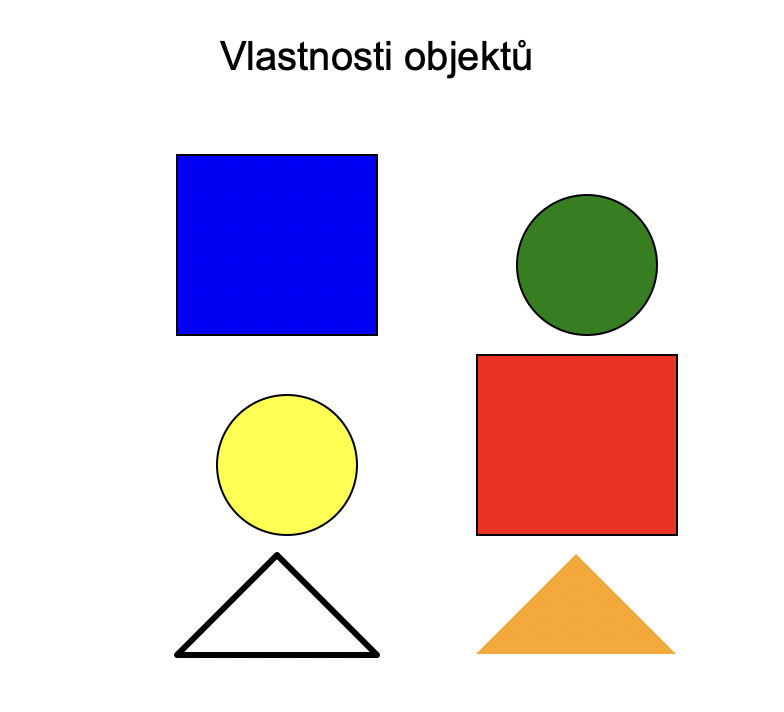

Příkazem `canvas.itemcget(id_objektu, 'vlastnost')` zjistíme hodnotu dané vlastnosti objektu se zadaným identifikátorem. V našem programu má modrý obdélník identifikátor `1`, čili zápisem `canvas.itemcget(1, 'fill')` zjistíme barvu jeho výplně. Zápisem `canvas.itemcget(1, 'outline')` zjistíme barvu okraje. Pro text můžeme zjišťovat i aktuální text například `canvas.itemcget(7, 'text')` (identifikátor `7` v našem programu má nadpis).


```py
>>> canvas.itemcget(1, 'fill')
'blue'
>>> canvas.itemcget(1, 'outline')
'black'
>>> canvas.itemcget(7, 'text')
'Vlastnosti objektů'
>>> canvas.itemcget(7, 'font')
'Arial 20'
>>>
```

Vlastnosti vykreslených objektů můžeme také měnit. Ke změně vlastnosti nám slouží příkaz `canvas.itemconfig(id_objektu, vlastnost=hodnota)`. Například modrý obdélník změníme na červený, změníme mu tloušťku okraje na 10 pixelů a barvu okraje na modrou. Následně změníme text, barvu a font napsaného textu.

```py
>>> canvas.itemconfig(1, fill='red')
>>> canvas.itemconfig(1, width=10)
>>> canvas.itemconfig(1, outline='blue')
>>> canvas.itemconfig(7, text='Měníme objekty')
>>> canvas.itemconfig(7, fill='blue')
>>> canvas.itemconfig(7, font='Calibri 40')
>>>
```

Ukázka canvasu po úpravě:

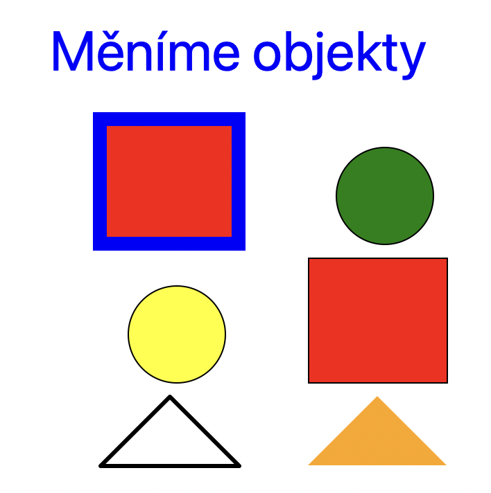

---


❓ Co se stane, budeme-li chtít zjistit nebo nastavit objektu vlastnost, kterou nemá? Například pro obdélník bychom zjišťovali a nastavovali `font` a pro text bychom zjišťovali a nastavovali `outline`.

❓ Pro identifikaci objektů jsme v příkazu `move` a `delete` používali kromě standardně vytvořených číselných identifikátorů také značky (`tags`). Budou i v těchto příkazech fungovat vytvořené značky? Co se stane, když dva objekty s různou vlastností mají stejnou značku a my budeme zjišťovat tuto vlastnost nebo ji nastavovat?

---

Příkazem `canvas.coords(id_objektu)` zjistíme souřadnice objektu. Výsledkem je seznam, jeho prvky jsou všechny souřadnice. Čili pro obdélník i ovál jsou to čtyři čísla, pro text dvě čísla a pro čáru a polygon je to tolik čísel, kolik souřadnic jsme zadali při vytváření nebo změně objektu.

```py
>>> canvas.coords(1)
[100.0, 100.0, 200.0, 190.0]
>>> canvas.coords(7)
[200.0, 50.0]
>>> canvas.coords(6)
[250.0, 350.0, 300.0, 300.0, 350.0, 350.0]
>>> canvas.coords(5)
[100.0, 350.0, 150.0, 300.0, 200.0, 350.0, 100.0, 350.0]
>>>
```

Po posunutí objektu a zjištění jeho souřadnic vidíme, že se změnily.

```py
>>> canvas.coords(1)
[100.0, 100.0, 200.0, 190.0]
>>> canvas.move(1, 50, 0)
>>> canvas.coords(1)
[150.0, 100.0, 250.0, 190.0]
>>>
```

Příkaz `coords` můžeme použít i pro změnu souřadnic objektu, nové souřadnice zadáme jako druhý parametr. Mohou být zapsány jako `n-tice` nebo `seznam`.

```py
>>> canvas.coords(1, [50, 50, 100, 100])
[]
```

Typ objektu zjistíme příkazem canvas.type(id_objektu).

```py
>>> canvas.type(1)
'rectangle'
>>> canvas.type(3)
'oval'
>>> canvas.type(6)
'polygon'
>>>
```

Smažme některý z objektů, například `canvas.delete(2)`. Příkaz `canvas.find_all()` vrátí n-tici všech identifikátorů stávajících objektů v pořadí, jak jsou na sobě poskládané ("na fiktivních vrstvách").


```py
>>> canvas.find_all()
(1, 3, 4, 5, 6, 7)
>>>
```


Znovu spusťme původní program a vraťme se k původním objektům. Posuňme modrý čtverec do středu, aby se překrýval jak s červněným čtvercem, tak se žlutým kruhem - `canvas.move(1, 70, 70)`. Vidíme, že se nachází pod oběma objekty.

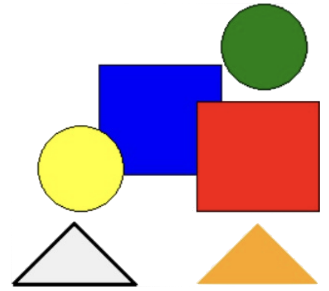

Příkazem `canvas.lift(1)` jej přesuneme v pořadí objektů na vrch. Jako parametr použijeme identifikátor objektu nebo značku (pomocí značky můžeme přesunout i více objektů najednou). Výsledek vidíme i na obrázku a také v pořadí `n-tice` objektů:

```py
>>> canvas.lift(1)
>>> canvas.find_all()
(2, 3, 4, 5, 6, 7, 8, 1)
```

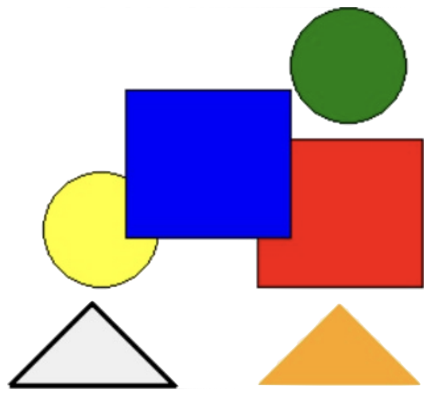


Nyní přesuneme nahoru objekt s identifikátorem `2` – červený obdélník.

```py
>>> canvas.lift(2)
>>> canvas.find_all()
(3, 4, 5, 6, 7, 8, 1, 2)
```

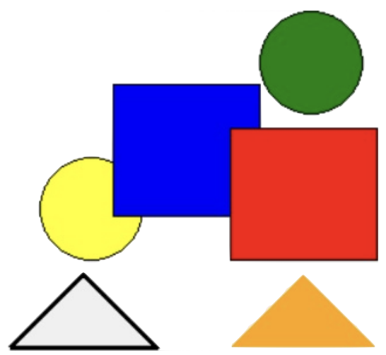

Příkazem `canvas.lower(2)` přesuneme objekt s identifikátorem 2 na spodek. I zde je parametrem identifikátor objektu nebo značka (pomocí značky můžeme přesunout i více objektů najednou).

```py
>>> canvas.lower(2)
>>> canvas.find_all()
(2, 3, 4, 5, 6, 7, 8, 1)
```

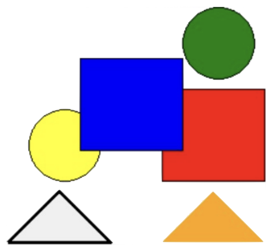

---

Vytvoříme program, který po stisku tlačítka projde cyklem přes všechny objekty. Ovály nebo obdélníky zmenší na polovinu.

```py
# 29_vlastnosti_objektu.py

import tkinter
canvas = tkinter.Canvas(width=400, height=400)
canvas.pack()

canvas.create_rectangle(100, 100, 200, 190, fill='blue', tags='obd')
canvas.create_rectangle(250, 200, 350, 290, fill='red', tags='obd')
canvas.create_oval(120, 220, 190, 290, fill='yellow')
canvas.create_oval(270, 120, 340, 190, fill='green')
canvas.create_line(100, 350, 150, 300, 200, 350, 100, 350, width=3)
canvas.create_polygon(250, 350, 300, 300, 350, 350, fill='orange')
canvas.create_text(200, 50, text='Vlastnosti objektů', font='Arial 20')

def zmensi():
    objekty = canvas.find_all()
    for objekt in objekty:
        if canvas.type(objekt) == 'rectangle' or canvas.type(objekt) == 'oval':
            obdelniky = canvas.coords(objekt)
            x1, y1, x2, y2 = obdelniky
            stred_x = (x2 + x1)/2
            nsirka = (x2 - x1)/4
            stred_y = (y2 + y1)/2
            nvyska = (y2 - y1)/4
            nove_obdelniky = [stred_x - nsirka, stred_y - nvyska, stred_x + nsirka, stred_y + nvyska]
            canvas.coords(objekt, nove_obdelniky)

button1 = tkinter.Button(text='Zmenši obdélníky a čtverce', command=zmensi)
button1.pack()
```


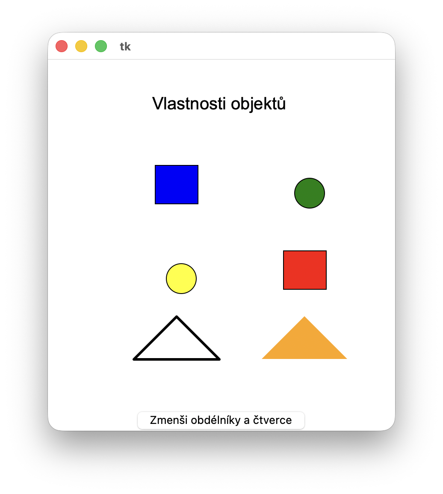


**[1]** Přidejte do předchozího programu další tlačítko, kterým se budou objekty naopak zvětšovat.

---

Abychom v programu mohli pracovat s objekty pomocí myši, budeme používat funkci `canvas.find_overlapping(x1, y1, x2, y2)`. Tato funkce vrátí n-tici všech identifikátorů objektů, které se nacházejí v zadaném obdélníku (stačí jejich část). Kolem souřadnic myši můžeme nakreslit malý obdélník a pomocí této funkce zjistíme, které objekty do něj zasahují. Do programu doplníme reakci na událost `'<Motion>'`. Výsledek budeme vypisovat textem, jehož obsah budeme měnit příkazem `itemconfig`.


```py
def mys(event):
    x1, y1, x2, y2 = event.x-5, event.y-5, event.x+5, event.y+5
    pod_mysi = canvas.find_overlapping(x1, y1, x2, y2)
    info = 'Jsi nad objektem číslo: ' + str(pod_mysi)
    canvas.itemconfig('vypis', text = info)

canvas.create_text(100, 10, text='', tags='vypis')
canvas.bind('<Motion>', mys)
```

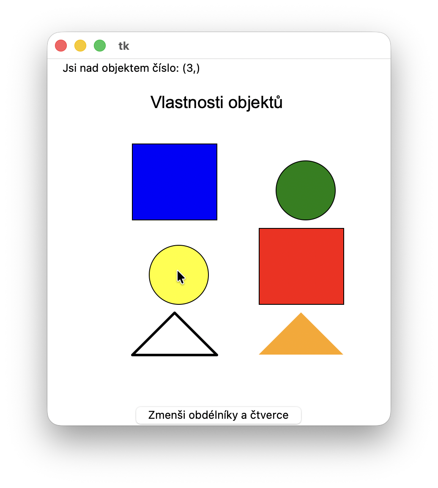

---

Vytvoříme program, kterým budeme kreslit čáry. Prvním klepnutím nakreslíme začátek čáry, dalším klepnutím přidáme k čáře další bod. Kreslení čáry ukončíme dvojklikem. Program nám umožní kreslit více čar.


```py
import tkinter
canvas = tkinter.Canvas(width=400, height=400)
canvas.pack()

zacatek = True
pocet = 0
cara = []

def bod(event):
    global cara, pocet, zacatek
    if zacatek:
        cara = [event.x, event.y, event.x, event.y]
        pocet +=1
        canvas.create_line(cara, tags='cara'+str(pocet))
        zacatek = False
    else:
        cara.append(event.x)
        cara.append(event.y)
        canvas.coords('cara'+str(pocet), cara)

def konec(event):
    global cara, zacatek
    if not zacatek:
        cara.append(event.x)
        cara.append(event.y)
        canvas.coords('cara'+str(pocet), cara)
    zacatek = True

canvas.bind('<Button-1>', bod)
canvas.bind('<Double-Button-1>', konec)
```

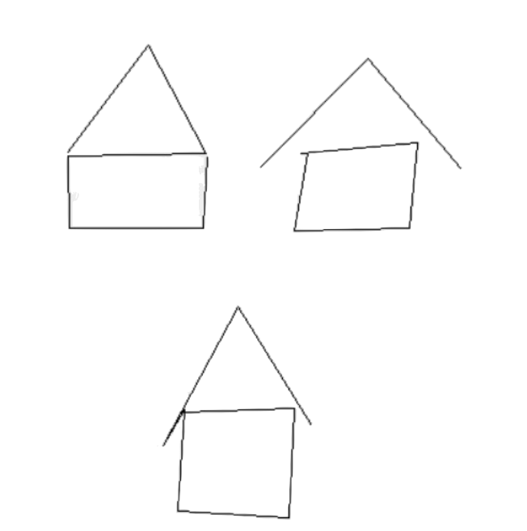


---


❓ K čemu nám slouží v programu proměnná `zacatek` a proč ji potřebujeme?

❓ Proč je v programu první bod v čáře zadán dvakrát? Jak bychom mohli program upravit, aby první bod čáry nebyl v seznamu (listu) dvakrát a aby fungoval korektně?

❓ Proč je v programu použito značkování objektů (`tags`)? Je to nutné? Lze program vytvořit i bez `tags`? Pokud ano, jaké by bylo jiné řešení?

---

Ještě můžeme program vylepšit. Při pohybu myši budeme stále překreslovat (natahovat) čáru do místa, kde se chystáme klepnout (kde je právě myš). Tento bod si však nesmíme zapamatovat do seznamu `cara`, neboť při dalším potáhnutí myši jej už nepotřebujeme. Doplníme do programu reakci na událost `'<Motion>'`. Na tuto událost budeme reagovat funkcí `natahovani`.

```py
def natahovanie(event):
    if not zaciatok:
        docasna_cara = cara[:]
        docasna_cara.append(event.x)
        docasna_cara.append(event.y)
        canvas.coords('cara'+str(pocet), docasna_cara)

canvas.bind('<Motion>', natahovani)
```

## 1.1. 💾 Cvičení

**[2]** Doplňte do programu tlačítko <kbd>Save</kbd>. Po jeho stisknutí se do textového souboru uloží souřadnice všech nakreslených čar. Na každém řádku souboru budou souřadnice právě jedné čáry.

**[3]** Vytvořte program, který přečte textový soubor z předchozí úlohy a vykreslí všechny čáry zapsané v souboru.

---

Vytvořme pro mladšího sourozence interaktivní aktivitu k pohádce *O Popelce*. V programu se na začátku vygeneruje a nakreslí několik zrnek kukuřice a hrachu (žluté a zelené kroužky). Zrnka budou náhodně rozházená po ploše. Úkolem uživatele bude rozdělit od sebe zrnka kukuřice a hrachu. Uživatel přenáší zrnka pomocí myši. Aby to nebylo úplně jednoduché, myš (hrubý prst) vezme najednou všechna zrnka, která jsou ve čtverci 20&times;20 pixelů. Velikost jednoho zrnka je 10&times;10 pixelů.

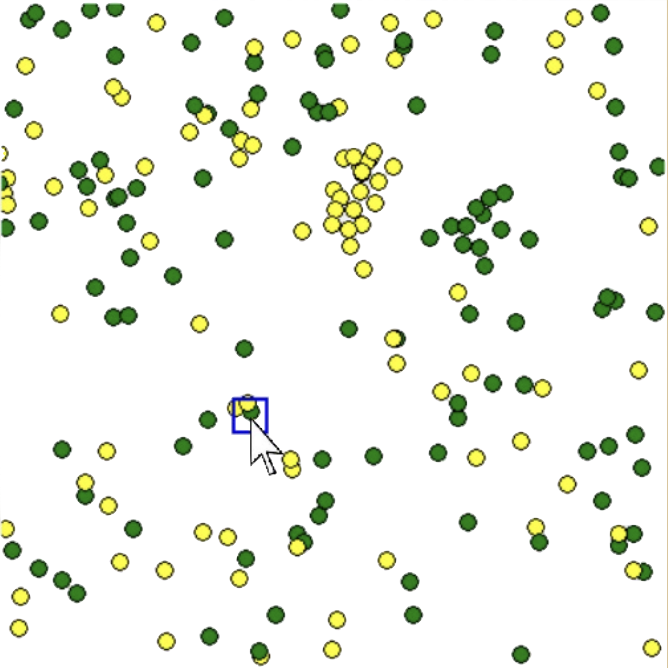

---

❓ Jak byste řešili tento program?

❓ Na které události bychom měli v programu reagovat? Jak zrealizujeme dragování (tahání) myší?

❓ Co si potřebujeme v programu pamatovat? Jelikož využijeme příkazy ke zjišťování nakreslených objektů z této kapitoly, které informace si nemusíme pamatovat a zjistíme je z vlastností objektů? Pokud bychom neznali příkazy z této kapitoly, jak jinak bychom mohli úkol řešit s tím, co víme dosud?

---

Nejprve si vykreslíme zrnka na náhodném místě, buď žlutá nebo zelená.

```py
# 29_popelka.py

import tkinter, math, random
canvas = tkinter.Canvas(width=400, height=400)
canvas.pack()

def zrnka():
    for i in range(200):
        sx, sy = random.randrange(400), random.randrange(400)
        f = random.choice(('green', 'yellow'))
        canvas.create_oval(sx-5, sy-5, sx+5, sy+5, fill=f)

zrnka()
```

Při pohybu myši budeme přemísťovat čtvercový kurzor o velikosti 20&times;20 pixelů, který nám označuje, která zrnka bychom vzali, když je začneme myší přetahovat. Obdélník si nakreslíme na začátku v bodě [0, 0] a bude mít nulovou velikost. Při pohybu myši mu už jen změníme vlastnosti a nemusíme jej pokaždé mazat a vytvářet.

```py
def mys(event):
    x1, y1, x2, y2 = event.x-10, event.y-10, event.x+10, event.y+10
    obdelnik = [x1, y1, x2, y2]
    prekryva = canvas.find_overlapping(x1, y1, x2, y2)
    canvas.coords('obdelnik', obdelnik)

canvas.create_rectangle(0,0,0,0, width=2, outline='blue',tags='obdelnik')
canvas.bind('<Motion>', mys)
```

Tahání bude mít **tři fáze**. První fáze je začátek (při kliknutí). Tehdy si zapamatujeme do globální proměnné `stara_pozice` nynější pozici myši, abychom při dalším pohnutí myší zjistili, o kolik jsme se posunuli, a tedy o kolik potřebujeme posunout tažené objekty. A ještě na začátku tahání zjistíme, které objekty jsou v okolí 20&times;20 px pod kurzorem myši. Tyto objekty si zapamatujeme do globálního seznamu `taham`, abychom při tahání posouvali už jen tyto objekty.

Čili po kliknutí levého tlačítka myši jsme si zapamatovali, kde se nachází myš, která objekty překrývá, a tedy je jdeme táhnout. Abychom vizuálně viděli, že jsme ve stavu tahání, obdélník (kurzor) přebarvíme na jinou barvu.

Druhou fází je tahání (událost `'<B1-Motion>'`). Tam zjišťujeme, o kolik se myš posunula vůči staré pozici. O tolik posuneme všechny tažené objekty a následně si zapamatujeme do staré pozice myši nynější pozici (abychom věděli v následujícím kroku, o kolik jsme se posunuli v tomto jednom kroku).

Poslední fází je ukončení tahání, čili reakce na puštění levého tlačítka `'<ButtonRelease-1>'`. Tady jen vyprázdníme seznam `taham`, protože už nic netaháme. A změníme barvu kurzoru (obdélníku) na původní.

Celý výsledný program (bez testu oddělení kukuřice od hrachu):

```py
import tkinter, math, random
canvas = tkinter.Canvas(width=400, height=400)
canvas.pack()

taham = []
stara_pozice = []

def zrnka():
    for i in range(200):
        sx, sy = random.randrange(400), random.randrange(400)
        f = random.choice(('green','yellow'))
        canvas.create_oval(sx-5, sy-5, sx+5, sy+5, fill=f)

def mys(event):
    x1, y1, x2, y2 = event.x-10, event.y-10, event.x+10, event.y+10
    obdelnik = [x1, y1, x2, y2]
    prekryva = canvas.find_overlapping(x1, y1, x2, y2)
    canvas.coords('obdelnik', obdelnik)

def oznaceni(event):
    global taham, stara_pozice
    x1, y1, x2, y2 = event.x-10, event.y-10, event.x+10, event.y+10
    stara_pozice = [event.x, event.y]
    obdelnik = [x1, y1, x2, y2]
    taham = canvas.find_overlapping(x1, y1, x2, y2)
    canvas.coords('obdelnik', obdelnik)
    canvas.itemconfig('obdelnik', outline='red')

def tahani(event):
    global stara_pozice
    posunx = event.x - stara_pozice[0]
    posuny = event.y - stara_pozice[1]
    stara_pozice = [event.x, event.y]
    for utvar in taham:
        canvas.move(utvar, posunx, posuny)

def ukonceni(event):
    global taham
    taham = []
    canvas.itemconfig('obdelnik', outline='blue')

zrnka()
canvas.create_rectangle(0,0,0,0, width=2, outline='blue', tags='obdelnik')
canvas.bind('<Motion>', mys)
canvas.bind('<Button-1>', oznaceni)
canvas.bind('<B1-Motion>', tahani)
canvas.bind('<ButtonRelease-1>', ukonceni)
```


## 1.2. 💾 Cvičení

**[4]** Doplňte do programu test, který zjistí, zda jsou oddělena zrnka kukuřice od zrnek hrachu. Nemusí to být rozděleno na dvou hromádkách, ale důležité je, že v blízkém okolí žádného zrnka hrachu se nenachází kukuřice. Dejme tomu, že v okolí 50 px zrnka hrachu není kukuřice.

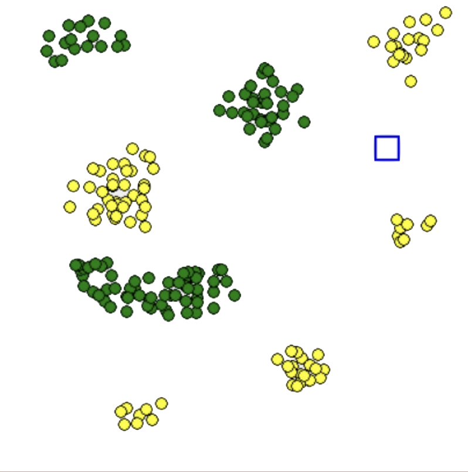

**[5]** Doplňte do programu pomůcku pro uživatele, která mu pomůže přesouvat jen zrnka kukuřice nebo hrachu. Po stisku klávesy **k** (kukuřice) se budou po kliknutí táhnout jen zrnka kukuřice, po stisku klávesy **h** (hrách) se budou po kliknutí táhnout jen zrnka hrachu. Stisknutím mezerníku se vrátí program do běžného režimu, ve kterém táhneme jak zrnka hrachu, tak kukuřice.

**[6]** Upravte program tak, aby se po stisku klávesy **Enter** zrnka sama oddělila. Animací se budou postupně pohybovat. Do horní poloviny obrazovky přejde hrách a do dolní poloviny přejdou zrnka kukuřice.

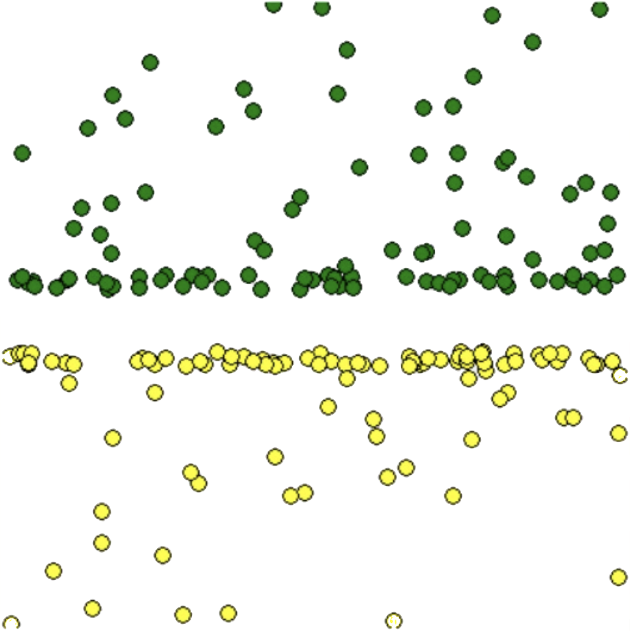

**[7]** Vytvořte program, který vykreslí vedle sebe 20 čtverečků náhodně vybraných barev. Při přechodu myši přes ně se budou čtverečky zvětšovat podle ukázky. Tento úkol je i v 25. kapitole, ale nyní jej řešte tak, abyste čtverečky nepromazávali, ale aby program měnil pouze vlastnosti nakreslených objektů.

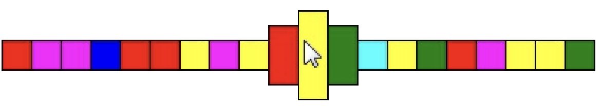

**[8]** Vytvořte program, který vykreslí vedle sebe 20 čtverečků stejné barvy. Při přechodu myši přes ně se bude barva čtverečků měnit podle ukázky – barva čtverečku, nad kterým je myš, ztmavne a barva nejbližších čtverečků vlevo a vpravo ztmavne také, ale trochu méně (čtverečky nevymazávejte).

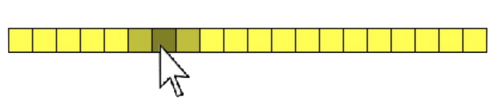


**[9]** Upravte program z předchozí úlohy tak, že bude univerzálnější. V programu bude moci uživatel nastavit konstantu – kolik sousedních čtverečků se má postupně ztmavovat.

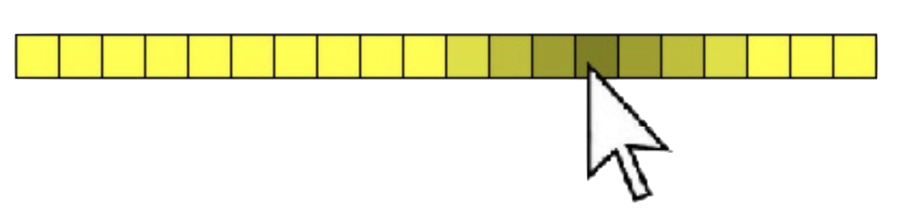

**[10]** Vytvořte animaci – nejjasnější čtvereček se bude pohybovat ("rozsvěcovat") z jedné strany na druhou, přičemž od krajů se vždy odrazí na opačný směr a za sebou bude zanechávat "ocas" z posloupnosti stále tmavších čtverečků.

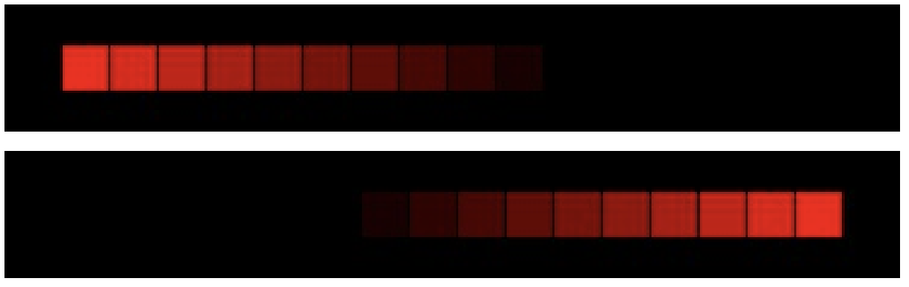

---

# 2. Značky objektů a jejich využití k pamatování si informace

Z nakreslených objektů si umíme zjistit různé informace. No do objektu si můžeme i zapamatovat nějakou informaci pomocí `tags`, například si informaci vhodně zakódujeme do značky, kterou objekt pojmenujeme. Jeden objekt může mít i několik značek, tehdy je zapíšeme jako `n-tici`, například:

```py
import tkinter
canvas = tkinter.Canvas(width=400, height=400)
canvas.pack()

canvas.create_rectangle(100, 100, 180, 180, fill='blue', tags=('obdlznik', 'farba1'))
canvas.create_rectangle(200, 100, 280, 180, fill='red', tags=('obdlznik', 'farba2'))
canvas.create_oval(100, 200, 180, 280, fill='blue', tags=('kruh', 'farba1'))
canvas.create_oval(200, 200, 280, 280, fill='red', tags=('kruh', 'farba2'))
```

Příkazem `canvas.itemconfig('barva1', fill='green')` změníme všechny objekty, které mají značku `barva1` na zelené. A například příkazem `canvas.move('obdlznik', -50, 0)` posuneme všechny objekty, které mají značku `'obdlznik'`.

Značky objektu můžeme zjistit pomocí příkazu `canvas.itemcget(ID_objektu, 'tags')` nebo příkazem `canvas.gettags(ID_objektu)`. Vhodnější je používat příkaz `gettags()`, protože pokud má objekt více značek, vrátí nám je jako n-tici, kdežto příkaz `itemcget()` jako textový řetězec.

```py
>>> canvas.gettags(1)
('obdlznik', 'farba1')
>>> canvas.itemcget(1, 'tags')
'obdlznik farba1'
>>>
```

Pokud se nad objektem nachází kurzor myši, bude mít také značku `'current'`. To můžeme využít k hledání objektů, nad kterými je myš, nebo na které jsme klikli. Dosud jsme to zjišťovali přes `find_overlapping()`, ale můžeme využít funkci `canvas.find_withtag('current')`. Nejprve kurzor myši není nad žádným objektem, následně jej přesuneme nad objekt s identifikátorem `2` a znovu zavoláme funkci:

```py
>>> canvas.find_withtag('current')
()
>>> canvas.find_withtag('current')
(2,)
```

Značky lze měnit také příkazem `canvas.itemconfig()`, ale aby nám správně fungovala značka `'current'` - při klikání myší a pohybu myši, doporučuje se pro přidání značky používat příkaz `canvas.addtag('nová_značka', 'withtag', ID_objektu)` a pro odebrání značky příkaz `canvas.dtag(ID_objektu, 'značka')`.

```py
>>> canvas.gettags(1)
('obdlznik', 'farba1', 'current')
>>> canvas.addtag('utvar1', 'withtag', 1)
>>> canvas.gettags(1)
('obdlznik', 'farba1', 'current', 'utvar1')
>>> canvas.dtag(1, 'farba1')
>>> canvas.gettags(1)
('obdlznik', 'utvar1', 'current')
>>>
```

Shrňme si nové příkazy:

- `canvas.gettags(ID_objektu)` - vrátí n-tici značek zadaného objektu,
- `canvas.find_withtag('hledaná značka')` - vrátí n-ticu ID objektů se zadanou značkou,
- `canvas.addtag('nová značka', 'withtag', ID_objektu)` - k zadanému objektu přidá novou značku,
- `canvas.dtag(ID_objektu, 'stará značka')` - ze zadaného objektu odstraní zadanou značku.


Pomocí značek objektů a pamatování si informací v nich si naprogramujeme pexeso s obrázky ovoce a zeleniny. V souborech `oz_1.png`, `oz_2.png` až `oz_16.png` jsou obrázky ovoce a zeleniny:

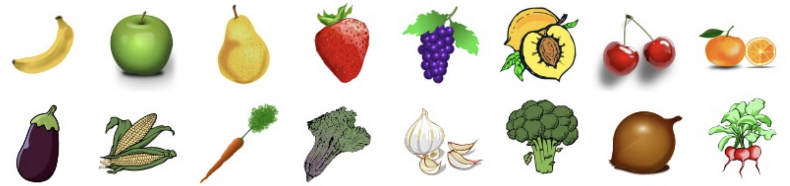

V souboru `pexeso.png` je zadní strana kartičky pexesa.

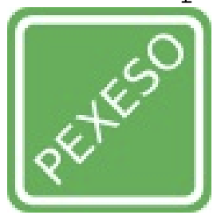

Náš program nakreslí 32 kartiček (každý obrázek dvakrát) v obdélníku 8&times;4 kartiček. Na začátku budou všechny kartičky otočeny rubem. Nejprve zajistíme jen otáčení kartiček, na které klikneme, až později budeme řešit dodržení hracích pravidel pexesa.

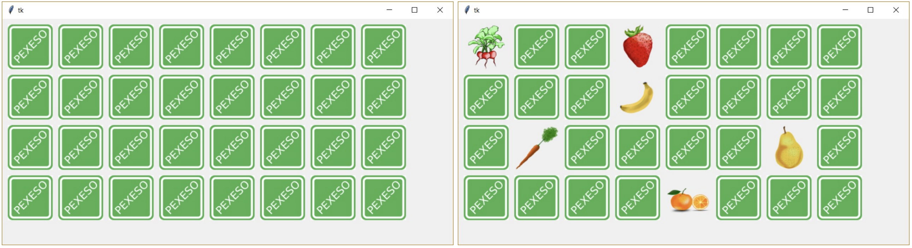

---

❓ **Otázky**

1. Co všechno musíme v programu řešit?

2. Které údaje si budeme muset v programu pamatovat? A které z nich si stačí pamatovat pomocí vlastností a značek přímo v objektech?

3. V jakých strukturách bude nejvhodnější si pamatovat potřebné údaje?

4. Jak vytvoříme dvojici kartiček a zamícháme jejich pořadí na začátku?

5. Jakým způsobem zajistíme, abychom klepnutím myši kartičku otočili?

---

Obrázky ovoce a zeleniny si zapamatujeme v seznamu `obrazky`. Seznam bude mít prvky s indexem `0` až `15`. Obrázek rubu si zapamatujeme v proměnné `pexeso`. Pomocí vnořených `for` cyklů nakreslíme všech 32 kartiček, nejprve s obrázkem rubu. Ale už při prvním vykreslování kartičky si do značky (tagu) zapamatujeme číslo obrázku (odpovídající index v seznamu `obrazky`), který tam bude umístěn. Jelikož značka nemůže mít v názvu pouze číslo, na její začátek přidáme text. V něm si budeme pamatovat, jak je kartička právě otočená. Čili značka bude ve tvaru `'rub_'` a číslo obrázku nebo `'lic_'` a číslo obrázku. Například obě kartičky s obrázkem číslo `1` budou mít nejprve tag `'rub_1'` a po otočení kartičky změníme jen té jedné kartičce značku na `'lic_1'`. 

Ještě před vykreslením musíme kartičky zamíchat, jelikož čísla umístěných obrázků na kartičkách si pamatujeme hned při vytvoření. Zamícháme je tak, že si vytvoříme seznam `oznaceni` se všemi možnými značkami (pro čísla 0 až 15), ten zduplikujeme (aby tam byla značka i pro druhou kartičku) a funkcí `random.shuffle()` jej zamícháme. Nyní při vytváření kartiček budeme jen vybírat značky v pořadí (již zamíchaném) ze seznamu `oznaceni`.


```py
# 29_pexeso.py

import tkinter, random
canvas = tkinter.Canvas(width=800, height=400)
canvas.pack()

def nacti(nazev, typ, pocet, obrazky):
    for i in range(1, pocet+1):
        obrazek = tkinter.PhotoImage(file=nazev + str(i) + '.'+typ)
        obrazky.append(obrazek)

def kresli_rub(x, y, oznaceni):
    poradi = 0
    for j in range (4):
        for i in range(8):
            canvas.create_image(x + i*90, y + j*90, image=pexeso, tags=oznaceni[poradi])
            poradi += 1

obrazky = []
nacti('obrazky/oz_', 'png', 16, obrazky)

pexeso = tkinter.PhotoImage(file='obrazky/29/pexeso.png')
oznaceni = []

for i in range(16):
    oznaceni.append('rub_'+str(i))
oznaceni = oznaceni + oznaceni
random.shuffle(oznaceni)

kresli_rub(50, 50, oznaceni)
```

Kartičky jsou vykreslené, můžeme doplnit reakci na proklik. Zde zjistíme, na kterou kartičku jsme klikli `zakliknute = canvas.find_withtag('current')`. Jelikož se kartičky nepřekrývají, v proměnné `zakliknute` bude buď prázdná nebo jednoprvková n-tice. Pokračovat dále budeme pouze v případě, že tam je prvek. Ten vybereme do proměnné `zakliknuty`. V ní je nyní `ID` zakliknutého objektu a my potřebujeme zjistit tagy tohoto objektu `tagy = canvas.gettags(zakliknuty)`. Kromě námi přiděleného tagu bude mít objekt i tag `current`, protože jsme na něj právě klikli. A nevíme, v jakém pořadí je námi přidělen tag a tag `current`, proto se na to if-em zeptáme a do proměnné `stara_znacka` si vytáhneme námi přidělený tag. Z něj umíme zjistit, jak je kartička právě otočená a který obrázek (číslo) má být na ní umístěn. Takže například v proměnné `stara_znacka` pro kartičku s obrázkem `1` může být tag `'rub_1'` nebo `'lic_1'`. Metodou `split` si z názvu oddělíme číslo a text `info = stara_znacka.split('_')`. Pokud je textem `rub`, nová značka bude mít text `lic` a naopak, je-li textem `lic`, nová značka bude mít text `rub` (neboť kartičku právě otáčíme). Takže si vytvoříme novou značku, přidáme ji zakliknutému objektu a vymažeme mu starou značku. Následně kartičce změníme obrázek přes příkaz `itemconfig`, přičemž nový obrázek bude z proměnné `pexeso` nebo ze seznamu `obrazky` s indexem čísla kartičky (podle toho, jak má být kartička otočena).

```py
def klik(event):
    zakliknute = canvas.find_withtag('current')
    if len(zakliknute) > 0:
        zakliknuty = zakliknute[0]
        tagy = canvas.gettags(zakliknuty)
        
        if tagy[0] != 'current':
            stara_znacka = tagy[0]
        else:
            stara_znacka = tagy[1]
        
        info = stara_znacka.split('_')

        if info[0] == 'rub':
            nova_znacka = 'lic_'+info[1]
            cislo_obrazku = int(info[1])
            canvas.addtag(nova_znacka, 'withtag', zakliknuty)
            canvas.dtag(zakliknuty, stara_znacka)
            canvas.itemconfig(zakliknuty, image=obrazky[cislo_obrazku])
        
        if info[0] == 'lic':
            nova_znacka = 'rub_'+info[1]
            canvas.addtag(nova_znacka, 'withtag', zakliknuty)
            canvas.dtag(zakliknuty, stara_znacka)
            canvas.itemconfig(zakliknuty, image=pexeso)

canvas.bind('<Button-1>', klik)
```

❓ Jak byste upravili program, aby fungoval podle pravidel hry pexeso?


Program upravíme, aby se více podobal hře pexeso. To znamená, že hráč může lícem otočit dvě kartičky. Pokud jsou kartičky stejné, vyřadí se ze hry a hráč získává bod a má další tah. Pokud jsou kartičky různé, otočí se na rub a ve hře pokračuje druhý hráč. Do programu doplníme globální proměnnou `pocet_otocenych`, ve které si budeme pamatovat počet kartiček otočených lícem (na začátku jich bude 0). V seznamu otocene si budeme pamatovat jejich značky (na začátku bude prázdný).

Při kliknutí zrušíme možnost klikání na kartičky otočené lícem (dáme pryč celý `if info[0] == 'lic'`). V kliknutí na rub doplníme podmínku, že počet otočených kartiček je menší než 2 `if info[0] == 'rub' and pocet_otocenych < 2:`. Následně po kliknutí na rub zvýšíme počet otočených kartiček `pocet_otocenych += 1`. A do seznamu otočených kartiček přidáme novou značku otočené kartičky `otocene.append(nova_znacka)`.


Na konci tohoto `if`-u zjistíme, ať už jsou otočeny dvě kartičky. Pokud ano, zjistíme, zda jsou stejné, jsou-li, vyřadíme je ze hry a vynulujeme počet otočených kartiček a vyprázdníme seznam `otocene`. Pokud jsou kartičky různé, otočíme je zpět a také vynulujeme počet otočených kartiček a vyprázdníme seznam `otocene`. Aby si toho hráči stihli i všimnout, hned za podmínkou, zda jsou otočeny dvě kartičky, program na půl vteřiny pozdržíme `canvas.update()` a `canvas.after(500)`.

Nezapomeňme ještě doplnit `global pocet_otocenych, otocene` do funkce `klik()`. Zatím program nestřídá hráče a nepočítá body. A takto vypadá celý program i s doplněnými funkcemi `stejne()`, `vyrad_ze_hry()`, a `otoc()`.


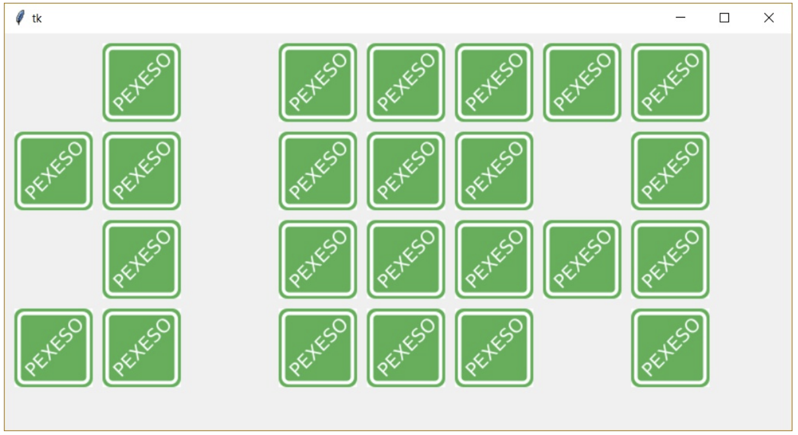


```py
#29_pexeso.py

import tkinter, random
canvas = tkinter.Canvas(width=800, height=400)
canvas.pack()

def nacti(nazev, typ, pocet, obrazky):
    for i in range(1, pocet+1):
        obrazek = tkinter.PhotoImage(file=nazev + str(i) + '.'+typ)
        obrazky.append(obrazek)

def kresli_rub(x, y, oznaceni):
    poradi = 0
    for j in range (4):
        for i in range (8):
            canvas.create_image(x + i*90, y + j*90, image=pexeso, tags=oznaceni[poradi])
            poradi += 1

obrazky = []
nacti('obrazky/oz_', 'png', 16, obrazky)

pexeso = tkinter.PhotoImage(file='obrazky/29/pexeso.png')
oznaceni = []

for i in range(16):
    oznaceni.append('rub_'+str(i))
oznaceni = oznaceni + oznaceni
random.shuffle(oznaceni)

kresli_rub(50, 50, oznaceni)
pocet_otocenych = 0
otocene = []

def stejne(karticky):
    if karticky[0] == karticky[1]:
        return True
    return False

def vyrad_ze_hry(karticky):
    canvas.delete(karticky[0])

def otoc(karticky):
    for karticka in karticky:
        info = karticka.split('_')
        nova_znacka = 'rub_'+info[1]
        ID = canvas.find_withtag(karticka)
        canvas.addtag(nova_znacka, 'withtag', ID)
        canvas.dtag(ID, karticka)
        canvas.itemconfig(ID, image=pexeso)

def klik(event):
    global pocet_otocenych, otocene
    zakliknute = canvas.find_withtag('current')
    if len(zakliknute) > 0:
        zakliknuty = zakliknute[0]
        tagy = canvas.gettags(zakliknuty)
        if tagy[0] != 'current':
            stara_znacka = tagy[0]
        else:
            stara_znacka = tagy[1]
        info = stara_znacka.split('_')
        if info[0] == 'rub' and pocet_otocenych < 2:
            pocet_otocenych += 1
            nova_znacka = 'lic_'+info[1]
            otocene.append(nova_znacka)
            cislo_obrazku = int(info[1])
            canvas.addtag(nova_znacka, 'withtag', zakliknuty)
            canvas.dtag(zakliknuty, stara_znacka)
            canvas.itemconfig(zakliknuty, image=obrazky[cislo_obrazku])
            if pocet_otocenych == 2:
                canvas.update()
                canvas.after(500)
                if stejne(otocene):
                    vyrad_ze_hry(otocene)
                else:
                    otoc(otocene)
                otocene = []
                pocet_otocenych = 0

canvas.bind('<Button-1>', klik)
```

## 2.1. 💾 Cvičení

**[11]** Vylepšete hru pexeso. Doplňte do ní počítání a výpis počtu bodů, střídání hráčů a závěrečné vyhodnocení.


**[12]** Upravte hru pexeso tak, že si můžeme vybrat, s jakým počtem dvojic obrázků hrajeme, například od 8 do 16 dvojic.


**[13]** Upravte program pexeso tak, že pravým tlačítkem můžeme kartičky uchopit a přesouvat na jiné místo.


**[14]** Upravte program pexeso tak, že počáteční stav hry a její průběh se uloží do textového souboru. Jiným programem můžeme takto uložený průběh hry přehrát. Také jej vytvořte.


