# Lekce 30: Upravujeme vzhled aplikací <!-- omit in toc -->


---

- [1. Metody zobrazení widgetů a jejich umístění](#1-metody-zobrazení-widgetů-a-jejich-umístění)
- [2. Rozbalovací nabídka](#2-rozbalovací-nabídka)
- [3. Posuvník](#3-posuvník)
- [4. Textová plocha](#4-textová-plocha)
- [5. Přepínač](#5-přepínač)
- [6. Zaškrtávací pole](#6-zaškrtávací-pole)
- [7. Menu](#7-menu)
- [8. Dialogová okna](#8-dialogová-okna)


---

*Tato kapitola neobsahuje úkoly ani otázky, protože je spíše doplňující kapitolou. Informace v ní obsažené vám pomohou upravit vzhled aplikací, které jste dosud vytvářeli.*

*Naučíte se vytvářet ovládací prvky, které použijeme při tvorbě větších komplexnějších programů, například pro absolventský projekt.* 

---

V našich aplikacích jsme doposud běžně používali `canvas`, `button`, `entry`. Nazývali jsme je *grafickými součástkami*. Jsou součástí grafické knihovny `tkinter` a v Pythonu se nazývají **widgety** (ovládací prvky). Představíme si některé další ovládací prvky, abychom mohli vytvářet komplexnější programy, které jsou dobře ovladatelné uživatelem.


# 1. Metody zobrazení widgetů a jejich umístění

Když jsme vytvářeli nějaký widget, zobrazovali jsme jej metodou `pack()`. Ještě si pro porozumění zobrazování prvků ukážeme na příkladu, co se stane, když pro různé prvky zavoláme metodu `pack()` v jiném pořadí. A také uvidíme, že aplikace může mít několik grafických pláten.

První program pokládá do okna aplikace v pořadí `canvas1`, `canvas2`, `label1`, `entry1` a `button1`. Pokud pořadí volání metod `pack()` zaměníme, jak vidíme v ukázce druhého programu, v horní části okna budou nejprve `label1`, `entry1` a `button1` a teprve potom bude `canvas2` a `canvas1`.


```py
# 30_1.py

import tkinter, random

def nakresli():
    x = random.randrange(400)
    y = random.randrange(200)
    canvas1.create_text(x, y, text=entry1.get())
    canvas2.create_text(x, y, text=entry1.get()[::-1])

canvas1 = tkinter.Canvas(width=400, height=200, bg='yellow')
canvas2 = tkinter.Canvas(width=400, height=200, bg='green')
label1 = tkinter.Label(text='Napiš jméno:')
entry1 = tkinter.Entry()
button1 = tkinter.Button(text='nakresli', command=nakresli)

canvas1.pack()
canvas2.pack()
label1.pack()
entry1.pack()
button1.pack()
```

```py
# 30_2.py

import tkinter, random

def nakresli():
    x = random.randrange(400)
    y = random.randrange(200)
    canvas1.create_text(x, y, text=entry1.get())
    canvas2.create_text(x, y, text=entry1.get()[::-1])

canvas1 = tkinter.Canvas(width=400, height=200, bg='yellow')
canvas2 = tkinter.Canvas(width=400, height=200, bg='green')
label1 = tkinter.Label(text='Napiš jméno:')
entry1 = tkinter.Entry()
button1 = tkinter.Button(text='nakresli', command=nakresli)

label1.pack()
entry1.pack()
button1.pack()
canvas2.pack()
canvas1.pack()
```

V programu jsme použili widget `label`, který slouží k vypsání nějakého textu, například k entry.

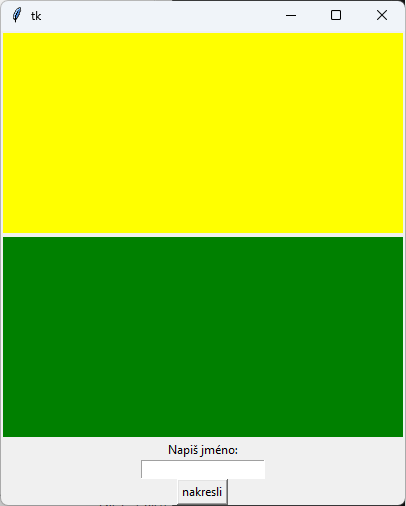
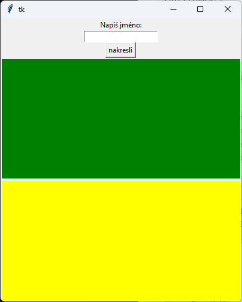


V metodě `pack()` můžeme použít také parametr `side` s hodnotou `'left'`, `'right'`.


```py
canvas1.pack()
canvas2.pack()
label1.pack(side='left')
entry1.pack(side='left')
button1.pack(side='left')
```

Takové nastavení pokládá canvasy pod sebe a pak dá vedle sebe vlevo ostatní prvky.

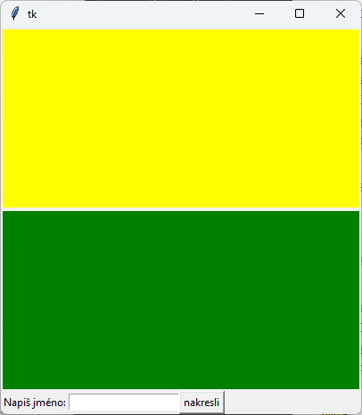


Nebo si můžeme vytvořit i takové uspořádání:

```py
canvas1.pack(side='right')
label1.pack(side='left')
entry1.pack(side='left')
button1.pack(side='left')
```

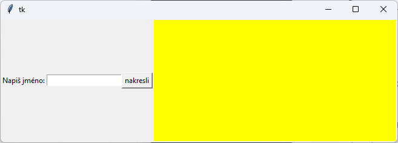


Více widgetů můžeme seskupit do jednoho (myšleného) rámečku - `frame`. A samozřejmě widgetem můžeme nastavovat i další vlastnosti (`width`, `bg`, `fg`,...).

```py
# 30_3.py

import tkinter
canvas = tkinter.Canvas(width=400, height=200, bg='white')
canvas.pack()

frame1 = tkinter.Frame()
frame1.pack(side='left')

button1 = tkinter.Button(frame1, text='tlačítko 1', width=20)
button1.pack()
button2 = tkinter.Button(frame1, text='tlačítko 2', width=20)

button2.pack()
frame2 = tkinter.Frame()
frame2.pack(side='left')
button3 = tkinter.Button(frame2, text='3', width=10, bg='green')

button3.pack()
button4 = tkinter.Button(frame2, text='4', width=10, fg='red')
button4.pack()
```

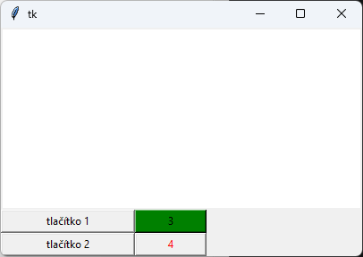

K zobrazení widgetu se používají také metody `grid()` a `place()`. U každého prvku můžeme k jeho zobrazení použít **jen jednu** z metod. V metodě `place()` nastavujeme souřadnice umístění widgetu v rámci okna aplikace. V metodě `grid()` se widgety umisťují do fiktivní tabulky pomocí nastavení sloupce a řádku (více naleznete v dokumentaci na internetu).

```py
# 30_4.py

import tkinter
canvas = tkinter.Canvas(width=400, height=200, bg='white')
canvas.pack()

frame1 = tkinter.Frame()
frame1.pack(side='left')

button1 = tkinter.Button(frame1, text='tlačítko 1', width=20)
button1.pack()

button2 = tkinter.Button(frame1, text='tlačítko 2', width=20)
button2.pack()

frame2 = tkinter.Frame()
frame2.place(x=300, y=10)

button3 = tkinter.Button(frame2, text='3', width=10, bg='green')
button3.pack()

button4 = tkinter.Button(frame2, text='4', width=10, fg='red')
button4.pack()
```

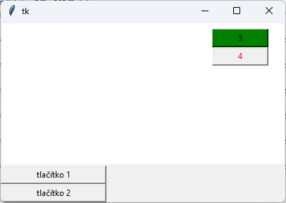


# 2. Rozbalovací nabídka

Listbox je widget, který ukáže v nabídce více možností a my můžeme (standardně) z nich jednu označit (v jiném nastaveném režimu lze vybírat i více položek).

Následující program vytvoří naplněný `listbox` seznamem barev. Po dvojkliku na barvu se canvas přebarví vybranou barvou. V programu je také `entry` a dvě tlačítka. Do `entry` zadáváme barvu a přidáváme ji do listboxu tlačítkem. Jiným tlačítkem z listboxu vymažeme označenou položku (barvu).


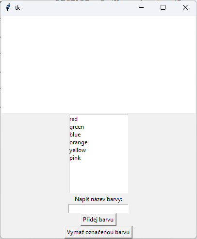


```py
# 30_5.py

import tkinter
canvas = tkinter.Canvas(width=400, height=200, bg='white')
canvas.pack()

def prebarvi(event):
    oznacene = listbox1.curselection()
    canvas['bg'] = listbox1.get(oznacene)

def pridej():
    listbox1.insert('end', entry1.get())

def vymaz():
    oznacene = listbox1.curselection()
    if len(oznacene) == 1:
        listbox1.delete(oznacene)

listbox1 = tkinter.Listbox()
listbox1.pack()

barvy = ['red', 'green', 'blue', 'orange', 'yellow', 'pink']
for prvek in barvy:
    listbox1.insert('end', prvek)

listbox1.bind('<Double-Button-1>', prebarvi)

label1 = tkinter.Label(text='Napíš název barvy:')
label1.pack()

entry1 = tkinter.Entry()
entry1.pack()

button1 = tkinter.Button(text='Přidej barvu', command=pridej)
button1.pack()

button2 = tkinter.Button(text='Vymaž označenou barvu', command=vymaz)
button2.pack()
```


**Vytvoření listboxu a některé jeho metody:**

- Listbox má řádky indexovány od čísla `0`,

- `listbox1 = tkinter.Listbox()` - vytvoření listboxu. Můžeme nastavit například height – počet řádků listboxu.
- `listbox1.insert('end', 'hodnota')` - vloží na konec listboxu zadanou hodnotu,
- `listbox1.insert(index, 'hodnota')` - vloží před zadaný index listboxu zadanou hodnotu,
- `listbox1.delete(index)` - vymaže hodnotu na zadaném indexu,
- `listbox1.delete(index1, index2)` - vymaže hodnoty mezi zadanými indexy, včetně indexů,
- `listbox1.curselection()` - vrátí n-tici označených řádků (jejich indexy),
- `listbox1.get(index)` - vrátí hodnotu se zadaným indexem,
- `listbox1.bind('<Double-Button-1>', funkce)` - sváže událost dvojkliku na řádku listboxu se zadanou funkcí,
- `listbox1.size()` - vrátí počet prvků listboxu (poslední prvek má index o jedno menší),
- `listbox1.config(vlastnost=hodnota)` - nastaví dodatečně některou z vlastností, pokud jsme ji nenastavili při vytváření. Například: `listbox1.config(height=5)`, `listbox1.config(bg='red')`.

# 3. Posuvník

Ke změně číselných hodnot můžeme použít widget `scale` (posuvník). Vytvoříme program, který nakreslí `oval` a dvěma posuvníky budeme interaktivně měnit jeho poloměr na ose `x` a poloměr na ose `y`.


```py
# 30_6.py

import tkinter
canvas = tkinter.Canvas(width=440, height=200, bg='white')
canvas.pack()

rx, ry = 100, 50
x, y = 200, 100
canvas.create_oval(x-rx, y-ry, x+rx, y+ry, width=5, outline='green', tags='oval')

def zmena1(event):
    global rx
    rx = scale1.get()
    prekresli()

def zmena2(event):
    global ry
    ry = scale2.get()
    prekresli()

def prekresli():
    canvas.coords('oval',[x-rx, y-ry, x+rx, y+ry])

scale1 = tkinter.Scale(from_=10, to=200, orient='horizontal', length=400, command=zmena1)

scale1.pack()
scale1.set(rx)

scale2 = tkinter.Scale(from_=10, to=100, orient='vertical', length=200, command=zmena2)

scale2.place(x=400, y=0)
scale2.set(ry)
```


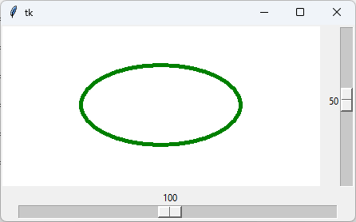
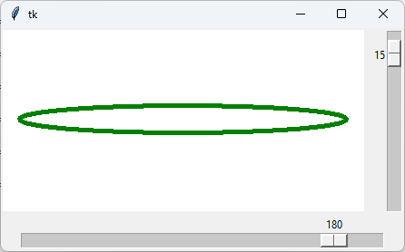


**Vytvoření `scale` a některé jeho metody:**

- `scale1 = tkinter.Scale(from_=10, to=200)` - vytvoření widgetu `scale`. Může obsahovat další nastavení, například: `orient='horizontal'` nebo `orient='vertical'`, `length=400` (délku widgetu), `command=funkce` (při změně zavolá danou funkci) - `scale1 = tkinter.Scale(from_=10, to=200, orient='horizontal', command=zmena)`
- `scale1.get()` - zjistí aktuální hodnotu,
- `scale1.set(hodnota)` - nastaví aktuální hodnotu,
- `scale1.config(from_=0)` - změní zadanou vlastnost na zadanou hodnotu,
- `scale1.config(showvalue=0)` - vypne zobrazování hodnoty (`showvalue=1` - zapne zobrazování hodnoty
hodnoty),
- `scale1.config(label='poloměr v ose x')` - nastaví popis posuvníku.


# 4. Textová plocha

Doposud jsme delší text vypisovali do shellu, ale můžeme vytvořit i widget `text` přímo v okně aplikace. Widget text nám může připomínat víceřádkové `entry`. Do tohoto widgetu píšeme text příkazy programu, nebo jej může editovat přímo i uživatel. Následující program vytvoří canvas a pod ním widget `text`. Samozřejmě, pokud nepoužíváme canvas, není třeba jej vytvářet. Do widgetu text přidáme metodou `insert` několik řádků. Podobně jako při zápisu textového souboru, konec řádku zapíšeme pomocí `'\n'`.

```py
# 30_7.py

import tkinter
canvas = tkinter.Canvas(width=200, height=200, bg='white')
canvas.pack()

text1 = tkinter.Text(height=5, width=30)
text1.pack()

text1.insert('end', 'první\n')
text1.insert('end', 'druhý\n')
text1.insert('end', 'třetí\n')
```

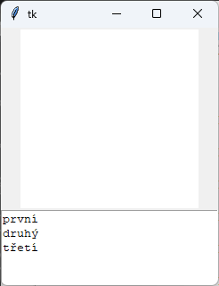

Metoda `get(od, do)` nám vrátí obsah widgetu `text` podle zadaného rozsahu. Rozsah (`od` a `do`) zadáváme ve tvaru `číslo_řádku.číslo_sloupce` nebo v `do` použijeme `'end'`, pokud chceme rozsah do konce widgetu. Pozor, první řádek má číslo `1`, ale první sloupec má číslo `0`.


```py
>>> text1.get(1.0, 1.2)
'pr'
>>> text1.get(1.1, 1.2)
'r'
>>> text1.get(1.0, 2.0)
'první\n'
>>> text1.get(1.0, 3.0)
'první\ndruhý\n'
>>> text1.get(1.0, 'end')
'prvý\ndruhý\ntřetí\n\n'
>>> text1.insert(1.0, 'nadpis\n')
>>>
```

Vkládat metodou `insert` nemusíme jen na konec, ale také na konkrétní pozici, například `text1.insert(1.0, 'nadpis\n')`.

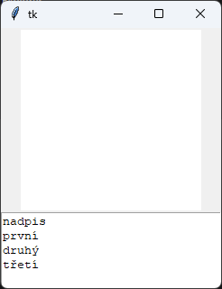

**Některé metody widgetu `text`:**

- `text1.get(od, do)` - vrátí text v rozsahu od, do,
- `text1.get('current')` - vrátí znak pod kurzorem myši,
- `text1.insert(pozice, 'řetezec')` - vloží na zadanou pozici zadaný řetězec. Pozice je ve tvaru `číslo_řádku.číslo_sloupce`, nebo `'end'`,
- `text1.count(1.0, 'end')` - vrátí počet znaků (n-tici) mezi zadanými pozicemi,
- `text1.config(vlastnost=hodnota)` - nastaví novou hodnotu pro zadanou vlastnost, například `width=20`,
- `text1.config(state=hodnota)` - nastaví stav (`'normal'` - standardní stav, `'disabled'` - uživatel
nemůže měnit obsah),
- `text1.selection_get()` - je-li označena část textu (selektována), vrátí tento text, jinak hlásí chybu.

```py
# 30_8.py

import tkinter
text1 = tkinter.Text(height=5, width=30)
text1.pack()

f = open('score.txt', 'r')

for radek in f:
    text1.insert('end', radek)

f.close()
```

Widget `text` můžeme používat například k zobrazování obsahu textových souborů.


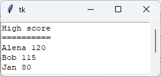

Pro delší texty můžeme vytvořit k widgetu `text` i posuvník s ním provázaný (analogicky to použijeme s `listboxem`).

```py
# 30_9.py

import tkinter
text1 = tkinter.Text(height=5, width=30)
text1.pack(side='left')

scrollbar1 = tkinter.Scrollbar()
scrollbar1.pack(side='right', fill='y') #vyplní s ním celý volný prprostor v rozsahu osy y
scrollbar1.config(command=text1.yview) #po posunutí se posune i obsah text1
text1.config(yscrollcommand=scrollbar1.set) #po posunutí obsahu text1 sa posunie i scrollbar1

f = open('soubory/score.txt', 'r')
for radek in f:
    text1.insert('end', radek)
f.close()
```


# 5. Přepínač

Widget `radiobutton` (přepínač) se nepoužívá samostatně, ale jako skupina možností, ze kterých může být vybrána právě jedna možnost. U radiobuttonů se pro zjišťování hodnoty používá speciální typ proměnné z knihovny tkinter (buď `tkinter.IntVar()` nebo `tkinter.StingVar()`). Nejprve se vytvoří tato proměnná a prováže se se všemi radiobuttony v jedné skupině (nastavením vlastnosti `variable=jméno_proměnné`). Ke zjištění hodnoty použijeme metodu `get()` přímo té proměnné, kterou jsme vytvořili a je s radiobuttony provázána. Hodnotu jednotlivých radiobuttonů určujeme nastavením vlastnosti `value=hodnota`. Podle toho, zda jsou hodnoty čísla nebo textové řetězce, použijeme pro provázání proměnnou typu `IntVar()` nebo `StringVar()`.

V následujícím programu budeme pomocí radiobuttonů vybírat, který objekt chceme nakreslit klepnutím myši do canvasu.

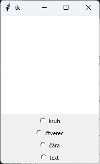


```py
# 30_10.py

import tkinter
canvas = tkinter.Canvas(width=200, height=200, bg='white')
canvas.pack()

v = tkinter.IntVar()
radiobutton1 = tkinter.Radiobutton(text='kruh', variable=v, value=1)
radiobutton1.pack()
radiobutton2 = tkinter.Radiobutton(text='čtverec', variable=v, value=2)
radiobutton2.pack()
radiobutton3 = tkinter.Radiobutton(text='čára', variable=v, value=3)
radiobutton3.pack()
radiobutton4 = tkinter.Radiobutton(text='text', variable=v, value=4)
radiobutton4.pack()

def klik(mys):
    typ = v.get()
    if typ == 1:
        canvas.create_oval(mys.x-10, mys.y-10, mys.x+10, mys.y+10)
    if typ == 2:
        canvas.create_rectangle(mys.x-10, mys.y-10, mys.x+10, mys.y+10)
    if typ == 3:
        canvas.create_line(mys.x-10, mys.y, mys.x+10, mys.y)
    if typ == 4:
        canvas.create_text(mys.x, mys.y, text='['+str(mys.x)+','+str(mys.y)+']')

canvas.bind('<Button-1>', klik)
```

Pokud bychom v programu nepoužívali canvas, program nám po spuštění hlásí chybu: 

```py
AttributeError: 'NoneType' object has no attribute '_root'
```

Při vytváření canvasu se automaticky použité widgety převáží s oknem aplikace. Radiobuttonem se nepodaří z nějakého důvodu zjistit, ve kterém prvku (místě) jsou umístěny, chybí jim atribut `'_root'`.

```py
# 30_11.py

import tkinter

v = tkinter.IntVar()
radiobutton1 = tkinter.Radiobutton(text='kruh', variable=v, value=1)
radiobutton1.pack()
radiobutton2 = tkinter.Radiobutton(text='čtverec', variable=v, value=2)
radiobutton2.pack()
radiobutton3 = tkinter.Radiobutton(text='čára', variable=v, value=3)
radiobutton3.pack()
radiobutton4 = tkinter.Radiobutton(text='text', variable=v, value=4)
radiobutton4.pack()
```

Řešení je takové, že příkazem `okno = tkinter.Tk()` vytvoříme okno hlavní aplikace a referenci na něj si zapamatujeme do proměnné `okno`. Následně při vytváření radiobuttonu jako první parametr uvedeme proměnnou `okno`, čili referenci na nadřazené místo, ve kterém budou radiobuttony existovat. Všechny widgety mohou mít první parametr referenci na hlavní okno, ve kterém jsou umístěny. My jsme to v našich programech zatím nepoužívali, neboť to nebylo nutné. Pokud jste na internetu hledali další materiály, tam jste se s tím určitě setkali. Jiné materiály nejprve vytvářejí okno, například takto: `root = tkinter.Tk()` nebo `master = tkinter.Tk()` apod.

A takto zapíšeme program, který i vybranou hodnotu vypíše:

```py
# 30_12.py

import tkinter
okno = tkinter.Tk()

v = tkinter.IntVar()

def vypis():
    print(v.get())
    radiobutton1 = tkinter.Radiobutton(okno, text='kruh', variable=v, value=1, command=vypis)
    radiobutton1.pack()
    radiobutton2 = tkinter.Radiobutton(okno, text='čtverec', variable=v, value=2, command=vypis)
    radiobutton2.pack()
    radiobutton3 = tkinter.Radiobutton(okno, text='čára', variable=v, value=3, command=vypis)
    radiobutton3.pack()
    radiobutton4 = tkinter.Radiobutton(okno, text='text', variable=v, value=4, command=vypis)
    radiobutton4.pack()

vypis()
```

Pro přednastavení radiobuttonu na zapnutý použijeme metodu `select()` - `radiobutton1.select()` a pro odznačení všech radiobuttonů ve skupině použijeme metodu `deselect()` - `radiobutton1.deselect()`.

Jelikož radiobuttony jsou provázány proměnnou, nemusíme si při jejich vytváření zapamatovat referenci na ně, a tedy můžeme je vytvořit i v cyklu ze seznamu položek a hodnot. Aby byly všechny radiobuttony zarovnány podle levého okraje (a ne středu), nastavíme jim v metodě `pack()` `anchor='w'` (`anchor` jsme již používali při vykreslování textu a obrázků).

```py
# 30_13.py

import tkinter
okno = tkinter.Tk()

v = tkinter.StringVar()

mesta = [
    ('Kolín','KO'), 
    ('Příbram','PB'), 
    ('Karviná','KA'), 
    ('Brno','BN'), 
    ('Pardubice','PA'), 
    ('Plzeň','PZ'), 
    ('Česká Třebová','CT'), 
    ('Liberec','LB')
    ]

def vypis():
    print(v.get())

for mesto, zkratka in mesta:
    rb = tkinter.Radiobutton(okno, text=mesto, value=zkratka, 
        variable=v, command=vypis)
    rb.pack(anchor='w')
```

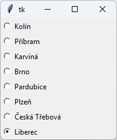


Ke změně hodnoty z programu použijeme metodu `set()` - proměnné, se kterou jsou radiobuttony provázány:

```py
>>> v.set('PB')
>>> v.set('LB')
>>>
```

# 6. Zaškrtávací pole

Pokud potřebujeme z nabídky vybírat více možností, namísto radiobuttonů je vhodnější použít checkboxy (zaškrtávací pole). V ukázce si může uživatel vybrat maturitní předměty.

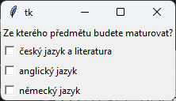

```py
# 30_14.py

import tkinter

def vypis():
    predmety = predmet1.get() + ' ' + predmet2.get() + ' ' + predmet3.get()
    predmety = predmety.strip()
    print('Právě máte vybrané předměty:', predmety)

label1 = tkinter.Label(text='Ze kterého předmětu budete maturovat?')
label1.pack()
predmet1 = tkinter.StringVar()
checkbutton1 = tkinter.Checkbutton(text='český jazyk a literatura',
            onvalue='SJL', offvalue='', variable=predmet1,
            command=vypis)

checkbutton1.pack(anchor='w')

predmet2 = tkinter.StringVar()
checkbutton2 = tkinter.Checkbutton(text='anglický jazyk', onvalue='AJ',
            offvalue='', variable=predmet2, command=vypis)
checkbutton2.pack(anchor='w')

predmet3 = tkinter.StringVar()
checkbutton3 = tkinter.Checkbutton(text='německý jazyk', onvalue='NJ',
            offvalue='', variable=predmet3, command=vypis)
checkbutton3.pack(anchor='w')
```

Každý z checkboxů je samostatně provázán s proměnnou typu `StingVar()` nebo `IntVar()` (dle typu použitých hodnot). K hodnotě se dostaneme pomocí provázané proměnné a její metody `get()`. Pro checkbox definujeme hodnotu, pro zakliknutý stav `onvalue` a hodnotu pro neoznačený stav `offvalue`. V naší ukázce bylo vhodné nastavit `offvalue` na prázdný textový řetězec. Metodou `set()` nastavíme proměnné aktuální hodnotu, která se zároveň zobrazí ve stavu checkboxu.

```py
>>> predmet1.set('SJL')
>>> predmet1.set('')
>>> predmet2.set('AJ')
>>> predmet2.set('')
>>>
```

Pozor, pokud v programu používáme pouze chceckboxy, také potřebujeme vytvořit referenci na hlavní okno a použít ji při vytváření checkbuttonů (podobně jako v adiobuttonech). My jsme to nepotřebovali udělat, neboť jsme vytvořili i widget `label`.

Následující program nám vytvoří nabídku checkboxů - předmětů ze souboru `predmety.txt`. Na každém řádku je právě jeden maturitní předmět ve tvaru `celý_název;zkratka`. Jelikož ke každému checkboxu potřebujeme proměnnou pro čtení a nastavování hodnot a provázání s checkboxem, vytvoříme si z nich seznam. Při výpisu procházíme seznam proměnných jednotlivých checkboxů a vytváříme výslednou informaci pro výpis. Jelikož widgety jsou provázány s proměnnými (v seznamu), nepotřebujeme na každý z nich samostatnou referenci. Pokud bychom ji přece jen potřebovali, i reference na vytvořené widgety si můžeme uložit do seznamu (můžeme mít seznam canvasů, buttonů apod.). V programu jsme vytvořili také tlačítko `reset`, které projde celý seznam proměnných svázaných s checkboxy a nastaví metodou `set()` jejich hodnotu na hodnotu nastavenou pro `offvalue`.


```py
# 30_15.py

import tkinter

def vypis():
    predmety = ''
    for prvek in informace:
        predmety = predmety + ' ' + prvek.get()
        predmety = predmety.strip()
    print('Právě máte vybrané předměty:', predmety)

def reset():
    for pole in informace:
        pole.set('')
    vypis()

soubor = open('predmety.txt', 'r')
informace = []
label1 = tkinter.Label(text='Ze kterých předmětů budete maturovat?')
label1.pack()

for radek in soubor:
    radek = radek.strip()
    info = radek.split(';')
    informace.append(tkinter.StringVar())
    chb = tkinter.Checkbutton(text=info[0], onvalue=info[1], offvalue='',
                variable=informace[-1], command=vypis)
    chb.pack(anchor='w')

soubor.close()

button1 = tkinter.Button(text='Reset', command=reset)
button1.pack()
```

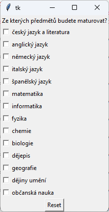


# 7. Menu

Pomocí knihovny `tkinter` vytvoříme také hlavní menu. Opět se nevyhneme vytvoření reference na hlavní okno aplikace, podobně, jak jsme to dělali v radiobuttonech. 

Nejprve si ukážeme jednoduché hlavní menu, které má jen nabídku na hlavní úrovni a prozatím nerozbaluje další podmenu. Menu vytváříme podobně jako ostatní widgety `menu1 = tkinter.Menu(okno)`. V parametru uvedeme referenci na prvek (něco), ve kterém bude menu umístěno. Úplně hlavní liště menu nastavíme referenci na samotné okno aplikace. Aby se `menu1` v okně aplikace zobrazilo, musíme mu jej nastavit `okno.config(menu=menu1)`. Potom do `menu1` přidáváme metodou `add_command()` položky tohoto menu. Při přidávání nastavujeme jejich popis (`label`) a jméno funkce, která má být provedena po výběru této položky:

```py
menu1.add_command(label='kresli kruh', command=kruh).
```

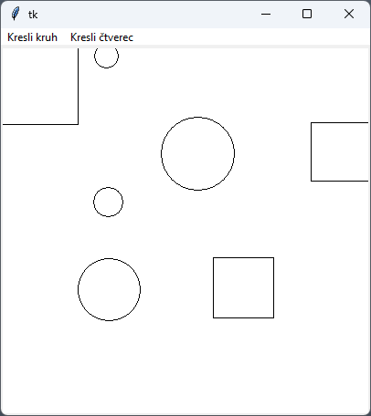

```py
# 30_16.py

import tkinter, random
okno = tkinter.Tk()
canvas = tkinter.Canvas(width=400, height=400, bg='white')
canvas.pack()

def kruh():
    x, y = random.randrange(400), random.randrange(400)
    r = random.randint(10,50)
    canvas.create_oval(x-r, y-r, x+r, y+r)

def ctverec():
    x, y = random.randrange(400), random.randrange(400)
    r = random.randint(10, 50)
    canvas.create_rectangle(x-r, y-r, x+r, y+r)

menu1 = tkinter.Menu(okno)
okno.config(menu=menu1)
menu1.add_command(label='Kresli kruh', command=kruh)
menu1.add_command(label='Kresli čtverec', command=ctverec)
```

Menu další úrovně vytvoříme zvlášť. Při vytváření mu nastavíme umístění nikoli v hlavním okně, ale v menu v nadřazené úrovni. Následně jej pak přidáme v nadřazeném menu metodou `add_cascade()`. 

V následujícím programu je vytvořeno `menu1` - hlavní lišta se dvěmi možnostmi, přičemž každá z nich obsahuje další menu (`menu2` a `menu3`). Některé funkce jsou zatím prázdné, aby zde Python nehlásil chybu, máme tam příkaz `pass` (příkaz se používá i v `if`-u, pokud potřebujeme mít větev prázdnou). V `menu3` je položka, která ukáže text s popisem programu a tlačítko pro zavření popisu a tlačítka. Zde používáme metodu `place_forget()` nebo `pack_forget()`, která zruší zobrazení widgetu (podle toho, kterou metodou byl widget zobrazen). V programu vidíme také nastavení nadpisu hlavního okna `okno.title('Používání menu')` a jeho rozměrů `okno.geometry('500x400')`.

```py
# 30_17.py

import tkinter, random

okno = tkinter.Tk()
okno.geometry('500x400')
okno.title('Používání menu')
canvas = tkinter.Canvas(width=400, height=400, bg='white')
canvas.pack()

def otevri():
    pass

def uloz():
    pass

def about():
    text1.place(x=100, y=100)
    button1.place(x=300, y=200)

def about_zavrit():
    text1.place_forget()
    button1.place_forget()

menu1 = tkinter.Menu(okno)
okno.config(menu=menu1)

menu2 = tkinter.Menu(menu1)
menu2.add_command(label='Otevřít', command=otevri)
menu2.add_command(label='Uložit', command=uloz)
menu2.add_separator()
menu2.add_command(label='Konec', command=okno.destroy) # nebo quit

menu1.add_cascade(label='Soubor', menu=menu2)

menu3 = tkinter.Menu(menu2)
menu3.add_command(label='O programu', command=about)

menu1.add_cascade(label='Nápověda', menu=menu3)

text1 = tkinter.Text(height=5, width=42)
text1.insert('end', 'O programu\ntoto je program na ukázku používání menu\nverze 1.0')
text1.config(state='disabled')
button1 = tkinter.Button(text='Zavřít', command=about_zavrit)
```

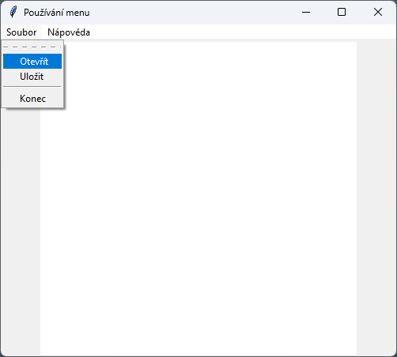
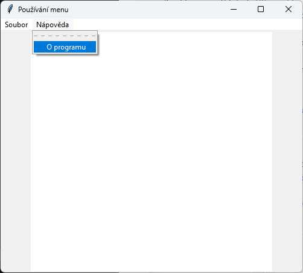
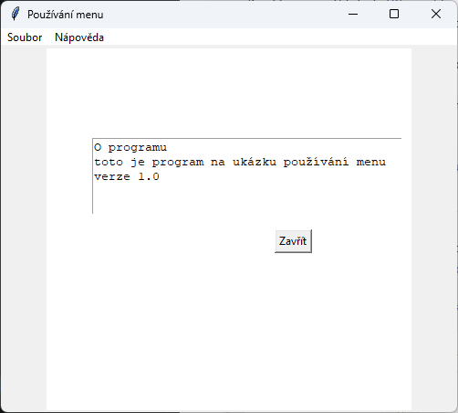


Pro oddělení jednotlivých položek menu zavoláme metodu vložení separátoru `menu2.add_separator()`.


# 8. Dialogová okna

Různá sdělení a otázky řešíme v programech pomocí dialogových oken. Máme-li spuštěno aplikační okno a importovaný modul `tkinter`, můžeme dialogové okno vyvolat i přímo ze shellu

```py
tkinter.messagebox.askyesno('titulek', 'text oznámení')
```

Je to funkce, která vrátí nějakou hodnotu, podle toho, kterou metodu messageboxu jsme zavolali (jsou různé typy: `showerror`, `showinfo`, `askyesno`, `askokcancel`, `askyesnocancel` apod.). nejsou součástí samotního modulu `tkinter`, ale jako jeho podmodul, který se musí zavést příkazem `tkinter.messagebox`.


```py
# 30_18.py

import tkinter
import tkinter.messagebox 

canvas = tkinter.Canvas(width=400, height=100, bg='white')
canvas.pack()

def oznameni():
    vysledek = tkinter.messagebox.showinfo('Oznámení', 'Stiskli jste tlačítko')
    print(vysledek)

def otazka1():
    vysledek = tkinter.messagebox.askyesno('Pokračování', 'Chcete pokračovat?')
    print(vysledek)

def otazka2():
    vysledek = tkinter.messagebox.askyesnocancel('Pokračování', 'Chcete pokračovat?')
    print(vysledek)

button1 = tkinter.Button(text='ukaž oznámeni', command=oznameni)
button1.pack()
button2 = tkinter.Button(text='otázka 1', command=otazka1)
button2.pack()
button3 = tkinter.Button(text='otázka 2', command=otazka2)
button3.pack()
```

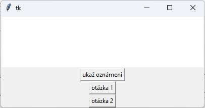

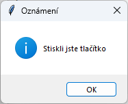
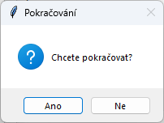
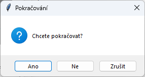

---

Na výběr barvy a názvu souboru lze zavolat i speciální dialogová okna. Jejich použití si ukážeme přímo v programu. Zde jsou potřeba zavést podmoduly `tkinter.filedialog` a `tkinter.colorchooser`. 


```py
# 30_19.py

import tkinter
import tkinter.messagebox
import tkinter.filedialog
import tkinter.colorchooser 

canvas = tkinter.Canvas(width=200, height=200, bg='white')
canvas.pack(side='left')

def nacti():
    info = tkinter.filedialog.askopenfile()
    if info != None:
        print('Název souboru:' + info.name)
        print('Kódování znaků:' + info.encoding)
        soubor = open(info.name, 'r', encoding=info.encoding)
        obsah = soubor.read()
        soubor.close()
        text1.delete(1.0, 'end')
        text1.insert('end', obsah)

def barva():
    barva = tkinter.colorchooser.askcolor()
    print(barva)
    cislo_barvy = barva[1]
    if cislo_barvy != None:
        canvas['bg'] = cislo_barvy
        print('změnil jsem barvu na:', cislo_barvy)
    else:
        print('barva nebyla změněna')

text1 = tkinter.Text(width=60, height=10)
text1.pack()
button1 = tkinter.Button(text='Otevři soubor', command=nacti)
button1.pack()
button2 = tkinter.Button(text='Vyber barvu', command=barva)
button2.pack()
```

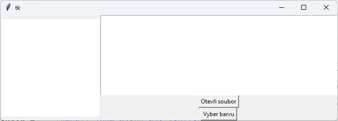

Funkce `tkinter.filedialog.askopenfile()` otevře klasické dialogové okno pro výběr souboru a na výstup vrátí informace o výběru. Pokud okno zrušíme, výstupem je `None`. Jinak jsou výstupem jakési složené údaje. Jméno z nich vytáhneme přes `.name` a informaci o kódování souboru přes `.encoding`. Náš program přečte obsah celého souboru a vloží jej do widgetu `text1`.

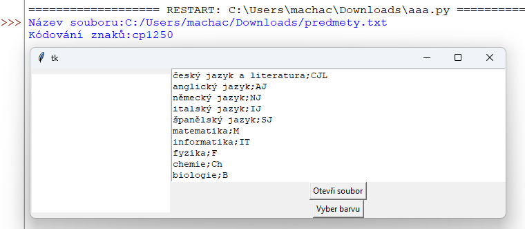


Podobně funguje funkce `tkinter.filedialog.asksaveasfile()`, rozdíl je pouze v popisech dialogového okna.


Funkce `tkinter.colorchooser.askcolor()` otevře dialogové okno pro výběr barvy. Po jeho zrušení je na výstupu funkce `None`. Při výběru barvy je na výstupu n-tice, ze které je pro nás zajímavý prvek s indexem `1` – barva v hexadecimální soustavě.


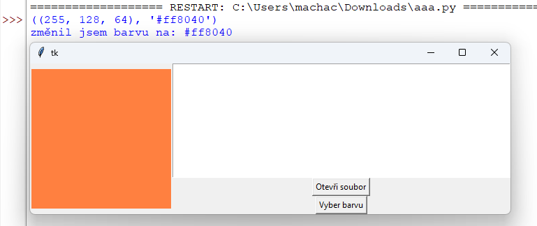


