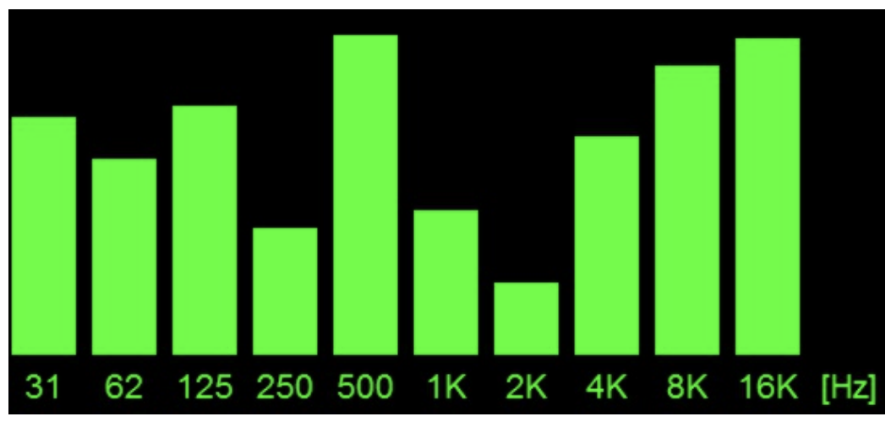
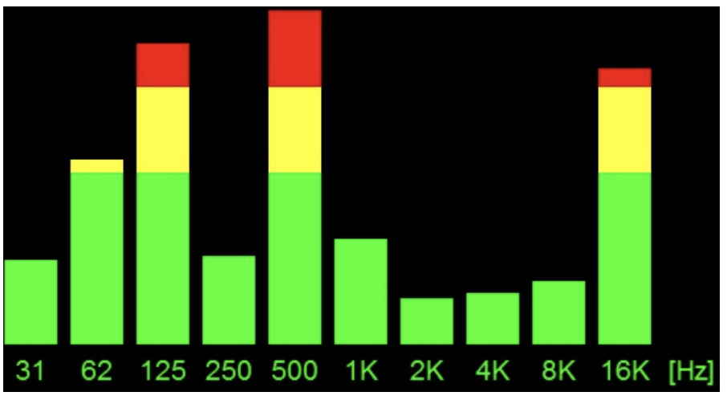
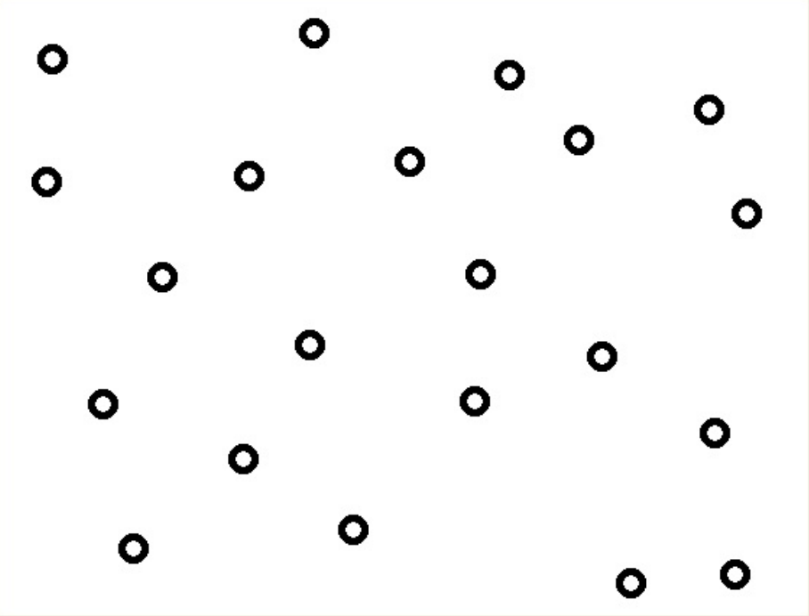
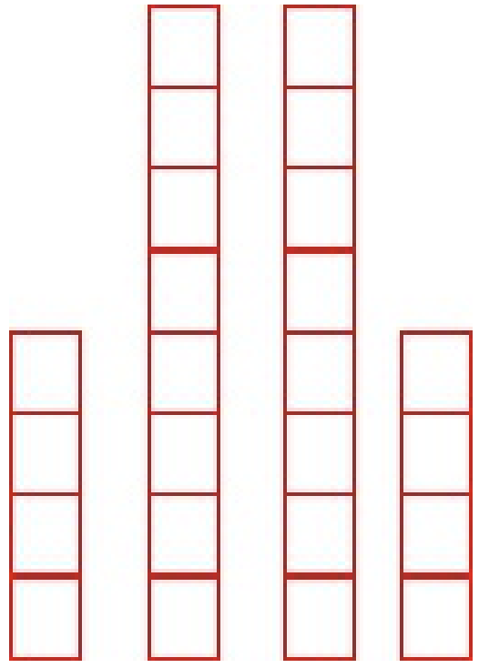
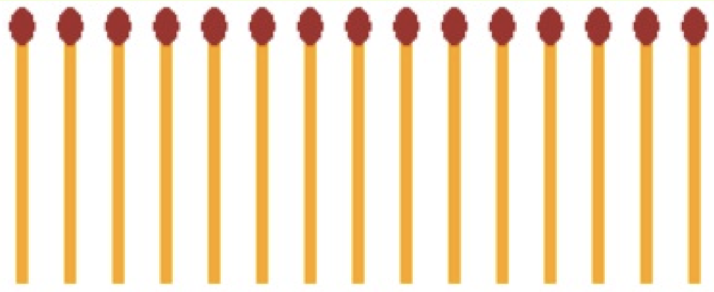
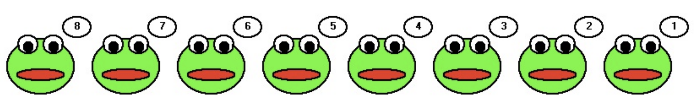
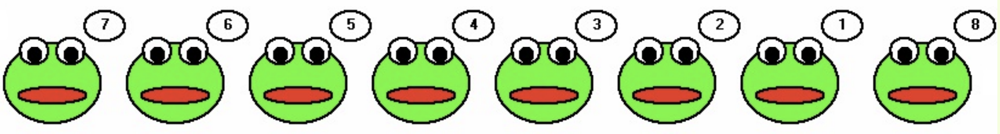
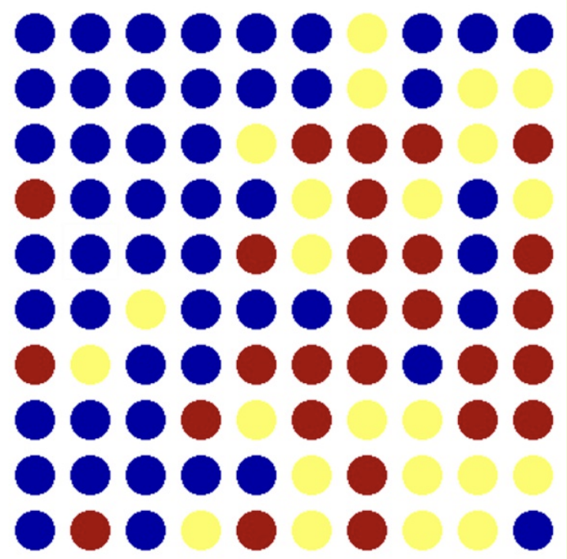

  
# Lekce 31: Kontrolní cvičení <!-- omit in toc -->


---

- [1. Zahrádka](#1-zahrádka)
- [2. Ekvalizér](#2-ekvalizér)
- [3. Losování otázek](#3-losování-otázek)
- [4. Generátor početních příkladů](#4-generátor-početních-příkladů)
- [5. Míčky](#5-míčky)
- [6. Sídliště](#6-sídliště)
- [7. Hra NIM](#7-hra-nim)
- [8. Závody autíček](#8-závody-autíček)
- [9. Tanec žabek](#9-tanec-žabek)
- [10. Hádání čísla](#10-hádání-čísla)
- [11. Hádání čísla 2](#11-hádání-čísla-2)
- [12. Kruhy](#12-kruhy)
- [13. Překvapení](#13-překvapení)
- [14. Generování CSV](#14-generování-csv)
- [15. Robot](#15-robot)


---


# 1. Zahrádka

Vytvořte simulátor zahrádky. Několik náhodně rozmístěných květin (barevných kroužků) postupně vadne – zmenšuje se. Klikáním na ně je polijete, a tedy obnovíte jejich původní velikost. Pokud se ale kvítek zmenší na kritickou velikost, zanikne (uschne).

**Rozšíření 1:** Doplňte a upravte program a vytvořte z něj hru. Přidejte zrychlování vadnutí v závislosti na zvětšujícím se suchu a bodování.

**Rozšíření 2:** Upravte program tak, že květ nebude vykreslen pouze jako jeden kroužek, ale bude mít i listy. Nezapomeňte, že kliknout se bude dát i na listy. Listy můžete vytvořit vlastní funkcí, nebo si připravte `png`, `gif` obrázky a použijte je v programu. Ve hře můžete upravit bodování a náročnost na zalévání podle druhů květin (vzácnost květiny, požadované podmínky apod.). Podmínky rostlin, informace o nich a jméno odpovídajícího obrázku mohou být uloženy v textovém souboru.

# 2. Ekvalizér 

Vytvořte program, který bude simulovat hudební grafický ekvalizér. Hodnoty pro jednotlivé výšky se budou měnit v tomto případě náhodně ve stejných časových intervalech, jelikož se jedná pouze o simulátor. 

Hodnoty jednotlivých výškových pásem, které se vypíší na ose X, si připravte do n-tice.




**Rozšíření 1:** Upravte program s grafickým ekvalizérem tak, aby byly vyšší hlasitosti (nad polovičním rozsahem) vykresleny žlutou barvou a nejvyšší hlasitosti (v nejvyšší čtvrtině rozsahu) červenou barvou.




# 3. Losování otázek

Vytvořte program, který bude sloužit jako pomůcka pro učitele při ústním zkoušení. Předpokládejme, že ve třídě je deset studentů a každý student odpovídá z předem připravených otázek. Pro zjednodušení má každý student přiděleno číslo (dle abecedy, začíná číslem 1 a končí číslem 10). Otázky jsou číslovány čísly 1 až 10. Program má následující vlastnosti:

- vypíše náhodné pořadí, v jakém půjdou studenti odpovědět,
- ke každému studentovi vypíše i náhodné číslo otázky, ze které bude odpovědět,
- otázky, ze kterých studenti odpovídají, se nesmějí opakovat,
- programu můžeme zadat počet studentů ve třídě a také počet otázek. Program zjistí, zda není počet otázek menší než počet studentů, a na takovou chybu nás upozorní.


# 4. Generátor početních příkladů

Vytvořte program, který bude pro žáky prvního stupně vytvářet náhodné příklady na součet nebo součin čísel od 1 do 20. Předpokládejme, že program nám zadá maximálně 20 příkladů. Program kontroluje naši odpověď, počítá nám body a v závěru vypíše naši úspěšnost. Zajistěte, aby se příklady neopakovaly. Program příklady uloží do textového souboru. Výsledné úkoly mohou vypadat například takto:

```
1)   3 + 4 =
2)   7 * 8 =
3)  16 + 8 =
4)  11 * 2 =
5)  2 + 18 =
6)  13 * 3 =
```

# 5. Míčky

Vytvořte program, který bude fungovat následovně:

- kliknutím myší na plátno přidáme na obrazovku míček,
- všechny míčky padají směrem rovnou dolů ke spodnímu okraji obrazovky (všechny mají stejnou rychlost),
- pokud míček dosáhne dolního okraje, padá znovu z horního okraje,
- míčky můžeme neustále přidávat kliknutím myši, program je připraven zvládnout maximálně 100 míčků,
- program "nespadne" při ovládání uživatelem (ani v případě, že chce uživatel přidat více míčků než je program schopen zvládnout).



# 6. Sídliště

Vytvořte program generátor sídliště:

- na začátku hry se na obrazovce zobrazí vedle sebe náhodně vysoké paneláky (jeden panelák má šířku 10 pixelů, výška jednoho patra je 10 pixelů),
- paneláky mohou mít maximálně 30 pater,
- ve hře se mohou vyskytnout i paneláky s nulovou výškou - tedy mezi některými může být i mezera,
- po stisknutí tlačítka se bude na obrazovce simulovat pohyb paneláků od levého okraje k pravému okraji,
- panelák, který opustí obrazovku se znovu ukáže jako první na levé straně,
- paneláky mohou mít další vlastnosti, jako například barvu, tabulku s číslem domu apod.,
- program má omezení, není možné použít příkaz `move`.




# 7. Hra NIM

Vytvořte program, který umožní hráčům hrát hru NIM. Hra NIM bývá v různých variantách. Vy vytvořte hru tak, že program vykreslí zadaný počet zápalek. Zápalky se vykreslí na obrazovku. Hru hrají střídavě dva hráči. Program píše, který hráč je na tahu, a umožní mu vzít 1, 2 nebo 3 zápalky. Přehrává ten hráč, který odebral poslední zápalku. Program nakonec vyhodnotí, kdo vyhrál. Po stisku tlačítka <kbd>Repríza</kbd> program přehraje hru (simuluje ji) a ukáže nám, kdo, kolik a v jakém pořadí odebral zápalky.

Připravený program s kreslením zápalky:

```py
import tkinter, random
canvas = tkinter.Canvas(width=650, height=200)
canvas.pack()

def zapalka(x, y):
    canvas.create_line(x, y, x, y+100, width=5, fill='yellow')
    canvas.create_oval(x-5, y-5, x+5, y+8, fill='brown', outline='brown')
```




# 8. Závody autíček

Vytvořte program, který simuluje závody autíček. Na levém okraji obrazovky vykreslí 15 autíček. Autíčka se nacházejí na svislé úsečce. Každé autíčko má svoji náhodnou barvu a soutěžní číslo. Po stisku nějaké klávesy spustíme animaci závodů autíček. Autíčka se budou najednou pohybovat směrem vpravo, ale pokaždé se každé z nich posune náhodně o 5 až 10 bodů. Program skončí, když všechna autíčka dosáhnou pravého okraje obrazovky. Na obrazovce se vypisují čísla autíček v pořadí, v jakém přišla do cíle.


# 9. Tanec žabek

Vytvořte program tanec žabek. V programu je tlačítko, které zapne / vypne tanec žabek. Choreografie tance je následující:

- první žabka vlevo se posune na konec zcela vpravo,
- všechny ostatní žabky se posunou o jednu pozici vlevo,
- žabky si takto mění své pozice v pravidelných časových intervalech, dokud nevypneme tanec tlačítkem.




# 10. Hádání čísla

Počítač si myslí náhodné číslo. Uživatel zadává své tipy a dostává odezvu, zda číslo uhodl, nebo je to nižší nebo vyšší číslo. Počítač si pamatuje tipy hráče. Pokud hráč zadá stejný tip jako už dříve, počítač jej na to upozorní. Nakonec počítač vyhodnotí, na kolik tipů se hráči podařilo číslo uhodnout a která čísla zadal opakovaně. Průběh hry zapíše do textového souboru.

# 11. Hádání čísla 2

Uživatel si myslí číslo. Počítači zadá dolní a horní hranici intervalu, ve kterém se myšlené číslo nachází. Úkolem počítače je uhodnout číslo nejmenším možným počtem kroků. 

**Dodatek:** Když vytvoříte tento program, porovnejte vaše programy vytvořené ve vaší skupině zadáním stejného vstupu (myslete si stejné číslo) a vyhodnoťte, který z vytvořených programů uhodl myšlené číslo nejmenším počtem pokusů.

# 12. Kruhy

Vytvořte hru kruhy. V hrací ploše se vykreslí 10&times;10 barevných kruhů. Kruhy jsou obarveny náhodně jednou ze tří barev (červená, modrá, žlutá). Úkolem hráče je obarvit všechny kruhy stejnou barvou. Hra se ovládá levým a pravým tlačítkem myši. Klepnutím levého tlačítka myši se změní barva celého sloupce, nad kterým je kurzor myši. Klepnutím pravého tlačítka myši se změní barva celého řádku, nad kterým je kurzor myši. Po stisku klávesy `+` se změní barva jedné diagonály a po stisku klávesy `-` se změní barva druhé diagonály. Při změně barev (sloupce, řádku nebo diagonály) se změní barva každého kruhu (dané oblasti) tak, že vždy se mění cyklicky v pořadí barev červená, modrá, žlutá, červená. Program má dané omezení - je třeba využít si pamatování informací pomocí vlastností útvarů v canvasu.




**Rozšíření:** Upravte program kruhy tak, že průběh hry uloží do textového souboru a pomocí jiného vytvořeného programu umíme průběh hry přehrát. Navrhněte strukturu textového souboru optimálně vzhledem k velikosti zapsaných údajů.


# 13. Překvapení

Máme dva textové soubory `x.txt` a `y.txt`. V každém z nich jsou uloženy informace o naklikaných bodech v canvasu - jejich příslušné složce (`x` nebo `y`). Vytvořte program Překvapení, který bude číst souřadnice `x` a `y` a podle těchto souřadnic postupně (animací) vykreslí na zabarvené pozadí malé bílé kruhy.

**Rozšíření:**  Upravte program Překvapení tak, že posloupnost bodů `x` a `y` ze souborů `x.txt` a `y.txt` si uloží do složeného datového typu. Uživatel pomocí ovládacího prvku nastaví koeficient zmenšení / zvětšení těchto souřadnic a kliknutím myši do canvasu se všechny body nakreslí ve zmenšeném měřítku (dle nastavení) s posunutím vzhledem k místu kliknutí (místo kliknutí je levým horním bodem umístění celé posloupnosti bodů). Vícenásobným kliknutím myši razítkujeme připravenou posloupnost bodů do canvasu v nastaveném měřítku.

# 14. Generování CSV

Vytvořte program, který ze souborů `x.txt` a `y.txt` vytvoří nový textový soubor `souradnice.txt`, kde spojí souřadnici `x` (z příslušného řádku) se souřadnicí `y` (z příslušného řádku) a v souboru je zapíše ve tvaru `x;y` (čili společně na jeden řádek).

# 15. Robot

Vytvořte program, ve kterém bude uživatel ovládat kreslícího robota. Na začátku programu bude robot ve středu grafické plochy a je natočen směrem na sever. Samotného robota nezobrazujte, vidět budou pouze jeho kresby. Robot poslouchá na zadané příkazy a podle nich kreslí obrázky. Příkazy zadáváme do widgetu `entry` a potvrzujeme je tlačítkem **provést**. Robot zná tyto příkazy:

| Příkaz | Čínnost |
| --- | --- |
| `cara <delka>` | nakreslí čáru zadané délky ve směru, ve kterém je natočen (např. `cara 50`) |
| `vlevo` | otočí se o 90 stupňů vlevo (relativně od aktuálního natočení) | 
| `vpravo` | otočí se o 90 stupňů vpravo (relativně od aktuálního natočení) |

1. Program umožňuje opakované zadání (vstupem z entry) jednoho z textových příkazů `cara`, `vpravo`, `vlevo`. Zadaný příkaz robot ihned provede.

2. Uživatel může napsat najednou více příkazů (jakoby program pro robota) a až po stisku spouštěcího tlačítka se příkazy provedou.

3. Sekvenci příkazů pro robota připravte do textového souboru. Program po zadání názvu připraveného souboru bude umět příkazy provést a nakreslit tak výsledný obrazec.

4. Doprogramujte pro robota i příkazy nastavení vzhledu čáry – například. `barva blue`, `sila 5`.

5. Program pro robota v textovém souboru umožňuje zadání příkazu `opakuj`, který zopakuje N-krát zadané příkazy. Syntaxi příkazu opakuj si zvolte sami. Např.

    ```
    opakuj 4
    cara 70
    vlevo
    konecopakuj
    ```

6. Upravte chování příkazů `vlevo` a `vpravo`, aby ještě vyžadovaly vstupní parametr, o kolik stupňů se robot otočí, takže pomocí příkazu `cara` bude schopen kreslit i šikmé čáry.

7. Přidejte do programu tlačítko pro uložení kresby do souboru.

