#  Lekce 32: Seznam seznamů (2D pole) <!-- omit in toc -->

---

- [Piškvorky](#piškvorky)
  - [💾 Úkoly](#-úkoly)
- [diamantué bludiště](#diamantué-bludiště)
  - [💾 Úkoly](#-úkoly-1)
- [💾 Cvičení](#-cvičení)

---


# Piškvorky

Následující program je přípravou na hru Piškvorky. Program vykreslí mřížku. Klepnutím levého tlačítka myši se na místě kliknutí nakreslí kolečko nebo křížek, podle toho, který hráč je na tahu.

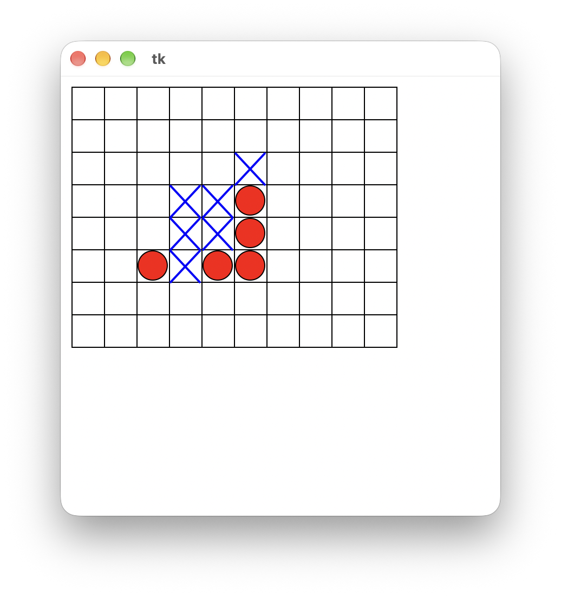

```python
# 32_01.py
import tkinter
canvas = tkinter.Canvas(width=400, height=400)
canvas.pack()
pocet_policek_x, pocet_policek_y = 10, 8
v = 30 #velikost políčka
mrizka_x, mrizka_y = 10, 10      # x a y začátku mřížky
vypln = 1

def kresli_mrizku(px, py, v, mx, my):
    for sloupec in range(px):
        for radek in range(py):
            canvas.create_rectangle(sloupec*v + mx, radek*v + my,
                                    (sloupec+1)*v + mx, (radek+1)*v + my)

def kresli(sloupec, radek, vypln):
    if vypln == 1:
        canvas.create_oval(sloupec*v + mrizka_x +1, radek*v+mrizka_y+1,
                           (sloupec+1)*v+mrizka_x -2, (radek+1)*v+mrizka_y-2,
                           fill = 'red')
    if vypln == 2:
        canvas.create_line(sloupec*v + mrizka_x +1, radek*v+mrizka_y+1,
                           (sloupec+1)*v+mrizka_x -1, (radek+1)*v+mrizka_y+1,
                           fill = 'blue', width = 2)
        canvas.create_line(sloupec*v + mrizka_x +1, (radek+1)*v+mrizka_y+1,
                           (sloupec+1)*v+mrizka_x -1, radek*v + mrizka_y+1,
                           fill = 'blue', width = 2)

def pozice(x, y):
    sloupec = (x - mrizka_x) // v
    radek = (y - mrizka_y) // v
    return sloupec, radek    
    
def oznac(mys):
    global vypln
    vypln = 3 - vypln
    sloupec, radek = pozice(mys.x, mys.y)
    kresli(sloupec, radek, vypln)
    
kresli_mrizku(pocet_policek_x, pocet_policek_y, v, mrizka_x, mrizka_y)

canvas.bind('<Button-1>', oznac)
```

---

❓ Který symbol se nakreslí po prvním kliknutí?

❓ Který příkaz zajistí, že se při dalším klinutí nakreslí jiný symbol?

❓ Jakými jinými způsoby můžeme zajistit výměnu kreslícího se symbolu (`vypln = 3 - vypln`)?

❓ Proč se nám nepodaří kliknutím na hranici políčka nakreslit křížek nebo kolečko přes dvě políčka?

❓ Jaký index má v programu první sloupec (resp. první řádek) hrací plochy?

❓ Co se stane, když na některé políčko klikneme vícekrát?

❓ Co se stane, když klikneme mimo hrací mřížku?

❓ Jakým způsobem zvětšíme počet políček hrací plochy, velikost jednoho políčka nebo posuneme celou hrací plochu? 

❓ Jak zjistíme, kolik symbolů naklikal uživatel během hry? Nechceme upravovat původní (existující) program, ale k vyřešení můžeme použít jen tlačítko a vytvořit funkci, která tuto informaci vypíše.

---

Program si zatím v žádné struktuře nepamatuje naklikané křížky a kolečka. Informace o stávajících symbolech bychom uměli zjistit pomocí vlastností vytvořených grafických symbolů v canvasu (s těmito vlastnostmi jsme pracovali v lekci 29). Bylo by to ale zbytečně komplikované. Pomohlo by nám vhodné vytvoření značek k symbolům (`tags`).

My si ukážeme jiný způsob. Naklikané křížky a kolečka si budeme pamatovat v seznamu. Každému (i prázdnému) políčku mřížky bude v seznamu odpovídat jedno číslo. Například: prázdné políčko bude reprezentováno číslem `0`, křížek číslem `1` a kolečko číslem `2`. Pro mřížku o rozměrech 10 sloupců a 8 řádků by nám postačoval 80-prvkový seznam. Jak zjistíme, co je umístěno ve třetím sloupci a druhém řádku? Pokaždé bychom si museli počítat index prvku v seznamu. Například výpočtem `(radek-1) * pocet_policek_x + sloupec - 1`.

```python
>>> radek = 2
>>> sloupec = 3
>>> (radek-1) * pocet_policek_x + sloupec - 1
12
>>> radek = 1
>>> sloupec = 1
>>> (radek-1) * pocet_policek_x + sloupec - 1
0
>>> radek = 8
>>> sloupec = 10
>>> (radek-1) * pocet_policek_x + sloupec - 1
79
>>> radek = 3
>>> sloupec = 1
>>> (radek-1) * pocet_policek_x + sloupec - 1
20
```

Aby se nám pracovalo s indexy políček jednodušeji, budeme si informace pamatovat jinak. Pro každý řádek mřížky vytvoříme jeden seznam – v našem případě 8 seznamů. Přidáním těchto seznamů do jednoho seznamu získáme seznam seznamů. Jedním prvkem tohoto seznamu bude právě seznam čísel jednoho řádku. Jeden řádek je seznam 10 čísel.

```python
#  32_01a.py
plocha = []
for i in range(8):
    plocha.append([0]*10)
print(plocha)
```

```python
[
[0, 0, 0, 0, 0, 0, 0, 0, 0, 0],
[0, 0, 0, 0, 0, 0, 0, 0, 0, 0],
[0, 0, 0, 0, 0, 0, 0, 0, 0, 0],
[0, 0, 0, 0, 0, 0, 0, 0, 0, 0],
[0, 0, 0, 0, 0, 0, 0, 0, 0, 0],
[0, 0, 0, 0, 0, 0, 0, 0, 0, 0],
[0, 0, 0, 0, 0, 0, 0, 0, 0, 0],
[0, 0, 0, 0, 0, 0, 0, 0, 0, 0]
]
```

Chceme změnit prázdné políčko ve druhém řádku a třetím sloupci v seznamu plocha na křížek. Nejprve uvedeme index pro daný řádek (čili `1`, neboť index `0` má první řádek, index `1` druhý řádek) a v něm uvedeme index pro sloupec (čili `2`, neboť první sloupec má v seznamu index `0`). Změníme tedy hodnotu pro `plocha[1][2]` a přiřadíme tam hodnotu `2`.


```python
>>> plocha[1][2] = 2
>>> plocha
[
[0, 0, 0, 0, 0, 0, 0, 0, 0, 0],
[0, 0, 2, 0, 0, 0, 0, 0, 0, 0], 
[0, 0, 0, 0, 0, 0, 0, 0, 0, 0],
[0, 0, 0, 0, 0, 0, 0, 0, 0, 0],
[0, 0, 0, 0, 0, 0, 0, 0, 0, 0],
[0, 0, 0, 0, 0, 0, 0, 0, 0, 0],
[0, 0, 0, 0, 0, 0, 0, 0, 0, 0],
[0, 0, 0, 0, 0, 0, 0, 0, 0, 0]]
>>> 
```

Ještě to zobecníme podle rozměrů plochy, které máme nastaveny v proměnných, a doplníme to do programu před definici funkce kresli_mrizku:

```python
# 32_01a-2.py
plocha = []
for i in range(pocet_policek_y):
    plocha.append([0]*pocet_policek_x)
print(plocha)
```

Teď už můžeme doplnit funkci `oznac()` o kontrolu, zda je políčko prázdné. Pouze je-li prázdné, změníme políčku hodnotu, vykreslíme obrázek a změníme typ výplně.

```python
def oznac(mys):            # 32_01b.py
    global vypln
    sloupec, radek = pozice(mys.x, mys.y)
    if plocha[radek][sloupec] == 0:
        vypln = 3 - vypln
        plocha[radek][sloupec] = vypln
        kresli(sloupec, radek, vypln)
```

---

❓ Proč program ohlásí chybu, když klikneme mimo mřížku?

❓ Jak zajistíme, abychom této chybě předešli?

---

Když si pamatujeme naklikané symboly, můžeme rozehranou hru uložit do textového souboru. Doplníme do programu tlačítko **Save**, které hru uloží. Do prvního řádku uložíme velikost hrací plochy (v počtu políček).

```python
def save():                # 32_01c.py
    soubor = open('piskvorky.txt', 'w')
    soubor.write(str(pocet_policek_x)+' '+str(pocet_policek_y)+'\n')
    for radek in plocha:
        zapsat = ''
        for prvek in radek:
            zapsat = zapsat + str(prvek) + ' '
        zapsat = zapsat[:-1]+'\n'
        soubor.write(zapsat)
    soubor.close()
button1 = tkinter.Button(text='Save', command=save)
button1.pack()
```

Ukázka uloženého souboru pro takto naklikanou hrací plochu:

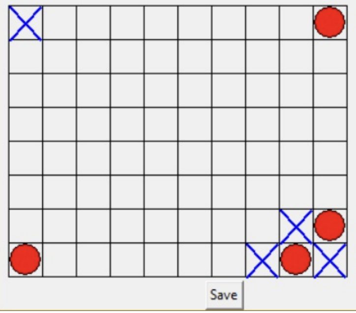

```
10 8
2 0 0 0 0 0 0 0 0 1
0 0 0 0 0 0 0 0 0 0
0 0 0 0 0 0 0 0 0 0
0 0 0 0 0 0 0 0 0 0
0 0 0 0 0 0 0 0 0 0
0 0 0 0 0 0 0 0 0 0
0 0 0 0 0 0 0 0 2 1
1 0 0 0 0 0 0 2 1 2
```

Ještě doplníme do programu tlačítko **Load**, které načte do seznamu textový soubor, vykreslí mřížku a symboly a změní rozměry plochy podle informací v souboru. Jelikož po přečtení řádku a použití metody `split()` dostaneme z čísel v řádku seznam řetězců, a ty potřebujeme po jednotlivých prvcích přetypovat funkcí `int()` na čísla, vytvoříme si funkci `int_seznam()`. Funkce `int_seznam()` nám všechny prvky seznamu změní na čísla a na výstupu vrátí seznam čísel.

```python
def int_seznam(seznam):    # 32_01d.py
    vysledek = []
    for prvek in seznam:
        vysledek.append(int(prvek))
    return vysledek
```

```python
def load():                # 32_01e.py
    global pocet_policek_x, pocet_policek_y, plocha
    soubor = open('piskvorky.txt', 'r')
    info = soubor.readline()
    info = info.strip()
    rozmery = info.split()
    pocet_policek_x, pocet_policek_y = int_seznam(rozmery)
    plocha = []
    for radek in soubor:
        radek = radek.strip()
        radek_seznam = radek.split()
        radek_seznam = int_seznam(radek_seznam)
        plocha.append(radek_seznam)
    canvas.delete('all')
    kresli_mrizku(pocet_policek_x, pocet_policek_y, v, mrizka_x, mrizka_y)
    kresli_plochu()

button2 = tkinter.Button(text='Load', command=load)
button2.pack()
```

Funkce `kresli_plochu()`, kterou voláme po přečtení souboru, projde celým seznamem `plocha` a postupně vykreslí jednotlivé symboly voláním funkce `kresli()`.

```python
def kresli_plochu():       # 32_01f.py
    for r in range(pocet_policek_y):
        for s in range(pocet_policek_x):
            kresli(s, r, plocha[r][s])
```

Zatím máme vytvořený tento program:

```python
#  32_01g.py
import tkinter
canvas = tkinter.Canvas(width=400, height=400)
canvas.pack()
pocet_policek_x, pocet_policek_y = 10, 8
v = 30 #velikost políčka
mrizka_x, mrizka_y = 10, 10      # x a y začátku mřížky
vypln = 1
plocha = []
for i in range(pocet_policek_y):
    plocha.append([0]*pocet_policek_x)

def kresli_mrizku(px, py, v, mx, my):
    for sloupec in range(px):
        for radek in range(py):
            canvas.create_rectangle(sloupec*v + mx, radek*v + my,
                                    (sloupec+1)*v + mx, (radek+1)*v + my)

def kresli(sloupec, radek, vypln):
    if vypln == 1:
        canvas.create_oval(sloupec*v + mrizka_x +1, radek*v+mrizka_y+1,
                           (sloupec+1)*v+mrizka_x -2, (radek+1)*v+mrizka_y-2,
                           fill = 'red')
    if vypln == 2:
        canvas.create_line(sloupec*v + mrizka_x +1, radek*v+mrizka_y+1,
                           (sloupec+1)*v+mrizka_x -1, (radek+1)*v+mrizka_y+1,
                           fill = 'blue', width = 2)
        canvas.create_line(sloupec*v + mrizka_x +1, (radek+1)*v+mrizka_y+1,
                           (sloupec+1)*v+mrizka_x -1, radek*v + mrizka_y+1,
                           fill = 'blue', width = 2)

def pozice(x, y):
    sloupec = (x - mrizka_x) // v
    radek = (y - mrizka_y) // v
    return sloupec, radek    
    
def oznac(mys):
    global vypln
    sloupec, radek = pozice(mys.x, mys.y)
    if plocha[radek][sloupec] == 0:
        vypln = 3 - vypln
        plocha[radek][sloupec] = vypln
        kresli(sloupec, radek, vypln)

def save():
    soubor = open('piskvorky.txt', 'w')
    soubor.write(str(pocet_policek_x)+' '+str(pocet_policek_y)+'\n')
    for radek in plocha:
        zapsat = ''
        for prvek in radek:
            zapsat = zapsat + str(prvek) + ' '
        zapsat = zapsat[:-1]+'\n'
        soubor.write(zapsat)
    soubor.close()

def int_seznam(seznam):
    vysledek = []
    for prvek in seznam:
        vysledek.append(int(prvek))
    return vysledek

def kresli_plochu():
    for r in range(pocet_policek_y):
        for s in range(pocet_policek_x):
            kresli(s, r, plocha[r][s])

def load():
    global pocet_policek_x, pocet_policek_y, plocha
    soubor = open('piskvorky.txt', 'r')
    info = soubor.readline()
    info = info.strip()
    rozmery = info.split()
    pocet_policek_x, pocet_policek_y = int_seznam(rozmery)
    plocha = []
    for radek in soubor:
        radek = radek.strip()
        radek_seznam = radek.split()
        radek_seznam = int_seznam(radek_seznam)
        plocha.append(radek_seznam)
    canvas.delete('all')
    kresli_mrizku(pocet_policek_x, pocet_policek_y, v, mrizka_x, mrizka_y)
    kresli_plochu()

button1 = tkinter.Button(text='Save', command=save)
button1.pack()
button2 = tkinter.Button(text='Load', command=load)
button2.pack()

kresli_mrizku(pocet_policek_x, pocet_policek_y, v, mrizka_x, mrizka_y)

canvas.bind('<Button-1>', oznac)
```

❓ Když načteme jakoukoli uloženou hru (vytvořenou tímto programem), který symbol se nakreslí ve hře při následujícím kliknutí? Jak můžeme zajistit, aby to byl vždy ten správný symbol?

❓ Jak bychom museli upravit náš program, pokud bychom v souboru ve všech řádcích (kromě prvního) vynechali mezery mezi čísly?

❓ Jistý hráč používáním našeho programu (neměnil program ani údaje v textovém souboru) vytvořil takové hrací pole:

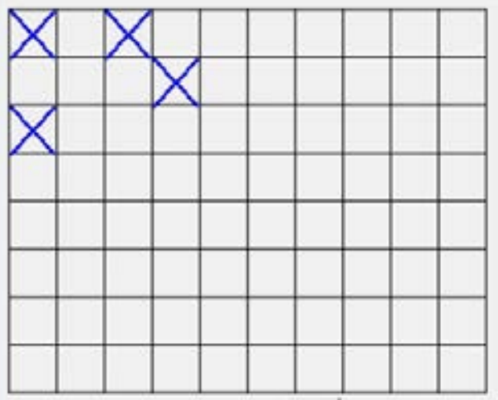

Odhadněte, jakým postupem se mu to mohlo podařit.


## 💾 Úkoly

**[1]** Doplňte do programu tlačítko **Vyměň**, které vymění navzájem křížky a kolečka (nejen na obrazovce, ale také v seznamu `plocha`).


**[2]** Doplňte do programu widget `scale` (posuvník), kterým budeme měnit velikost jednoho políčka. Hned po změně se nám překreslí obsah canvasu.


**[3]** Vytvořte funkci `pocty()`, která spočítá v hrací ploše počet křížků a počet koleček.


**[4]** Doplňte do programu tlačítko **Překlop svisle**, které zrcadlově otočí (překlopí) obsah hrací plochy.

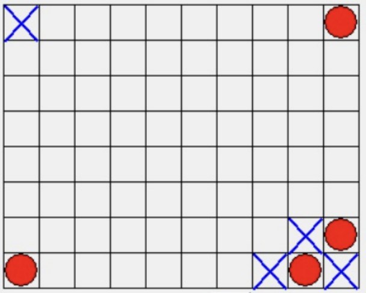
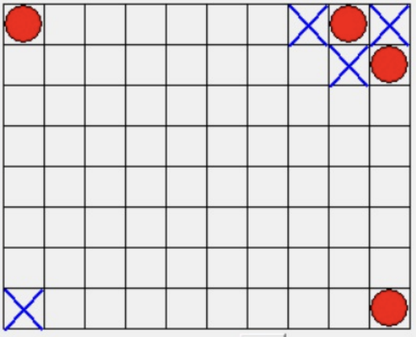


**[5]** Doplňte do programu tlačítko **Překlop vodorovně**, které zrcadlově otočí (překlopí) obsah hrací plochy.

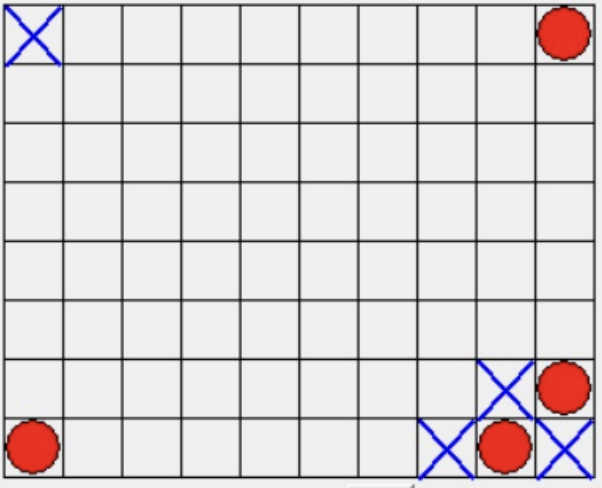
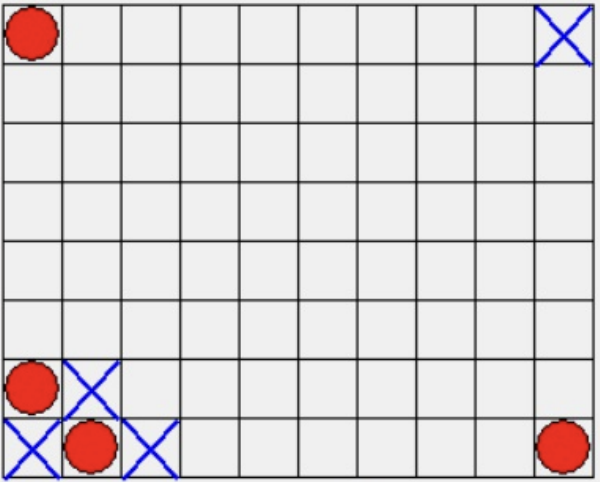


**[6]** Vytvořte program, který ověří, zda v textovém souboru je zapsán plán reálné hry, tedy zda v něm jen někdo nepřepsal v poznámkovém bloku některé hodnoty. Například ověřte, zda rozměry hrací plochy korespondují s údaji v řádcích, zda počet koleček je roven nebo o jedno větší než počet křížků.

---

❓ Jak byste naprogramovali, aby program ve hře Piškvorky zjistil souvislou řadu alespoň pěti symbolů ve stejném směru?

❓ Co dělají následující funkce `A()` a `B()`? Proč ve funkci `A()` je příkaz `global`, a ve funkci `B()` není?

```python
def A():
    global plocha
    plocha = plocha[::-1]

def B():
    for r in range(len(plocha)):
    plocha[r] = plocha[r][::-1]
```

❓ Jak bychom vytvořili funkce `A()` a `B()` (v předchozí otázce), pokud bychom neznali nebo nemohli použít řezy?

---

Vraťme se k vytvoření seznamu seznamů. V programu ` 32_01a.py` jsme jej vytvářeli pomocí `for` cyklu.

```python
# 32_01a-2.py
plocha = []
for i in range(pocet_policek_y):
    plocha.append([0]*pocet_policek_x)
print(plocha)
```

Můžeme seznam seznamů vytvořit i jednodušší? Podívejme se na takové řešení:

```python
>>> plocha = [[0] * 3] * 5
>>> plocha
[[0, 0, 0], [0, 0, 0], [0, 0, 0], [0, 0, 0], [0, 0, 0]]
>>> plocha[0][1] = 2
>>> plocha
[[0, 2, 0], [0, 2, 0], [0, 2, 0], [0, 2, 0], [0, 2, 0]]
>>>
```

Z pokusu v příkazovém řádku vidíme, že seznam seznamů se na první pohled vytvořil i tímto způsobem správně. Když však změníme hodnotu jednoho prvku některého seznamu, tento prvek se najednou změní ve všech seznamech v seznamu. Proč tomu tak je? Zápis `[0] * 3` vytvořil jeden tříprvkový seznam s nulami. Následně zápisem `[[0] * 3] * 5` se vytvořil pětiprvkový seznam. Problémem však je, že ten obsahuje pětkrát referenci (odkaz na místo v paměti), kde se nachází původně vytvořený tříprvkový seznam. Všech pět prvků tedy referuje (odkazuje) na jeden a tentýž seznam tří nul. Když v kterémkoli z pěti seznamů změníme jeden prvek, stále měníme tentýž tříprvkový seznam. Nejlépe to uvidíme ve vizualizaci pomocí `www.pythontutor.com`:

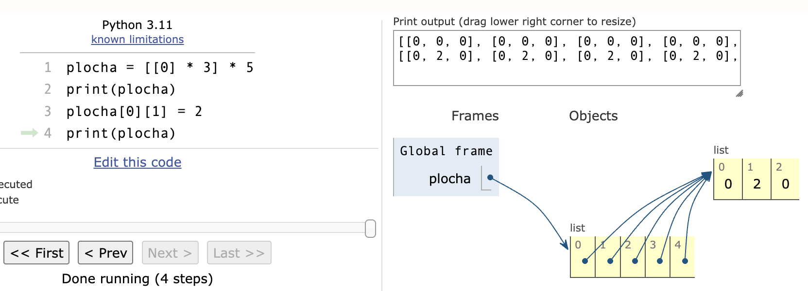

Stejně nevhodné je i toto řešení:

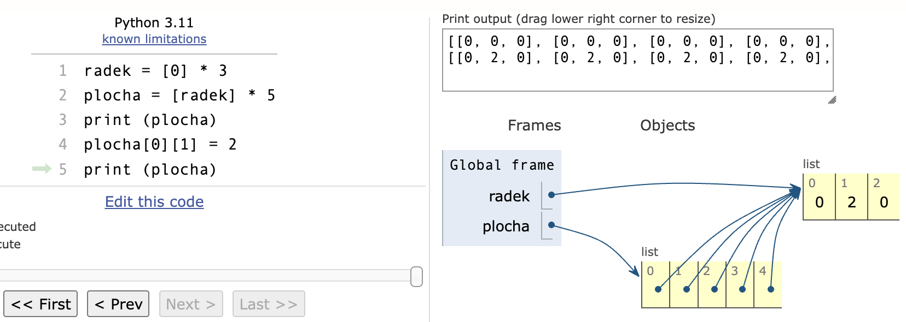


Pro správné naplnění seznamu seznamů potřebujeme pokaždé do seznamu vložit nový seznam (reference na různé seznamy). Budeme používat takové řešení (jeho vizualizace je na dalším obrázku):

```python
plocha = []
for i in range(5):
    plocha.append([0] * 3)
```

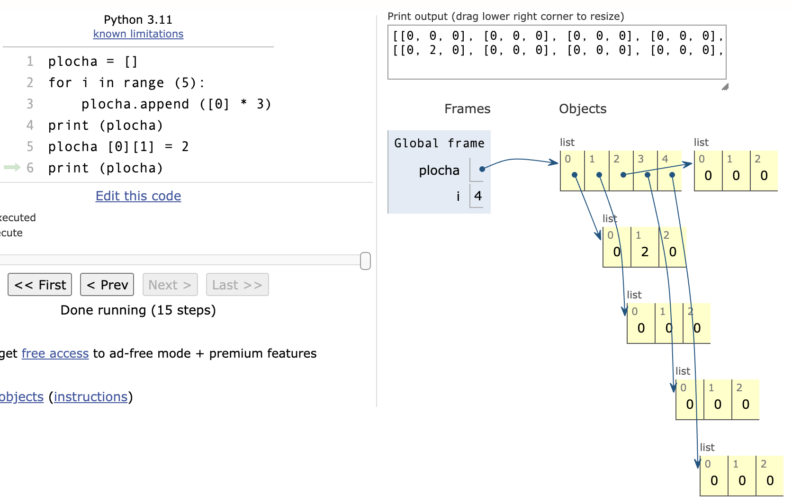


---

❓ Které programy správně vytvoří seznam seznamů (dvojrozměrné pole)? Svou odpověď zdůvodněte.

```python
# A
plocha = []
radek = [0] * 3 
for i in range(5):
    plocha.append(radek)
```

```python
# B
plocha = []
for i in range(5):
    radek = [0] * 3 
    plocha.append(radek)
```

```python
# C
for i in range(5):
    plocha = []
    radek = [0] * 3 
    plocha.append(radek)
```

```python
# D
plocha = []
radek = [0, 0, 0]
for i in range(5):
    plocha.append(radek)
```

```python
# E
plocha = []
radek = [0, 0, 0]
for i in range(5):
    plocha.append(radek[:])
```

---

# diamantué bludiště

Vytvoříme program, který bude základem pro hru diamantué bludiště. Na obrázku je ukázka hrací plochy pro první level hry:

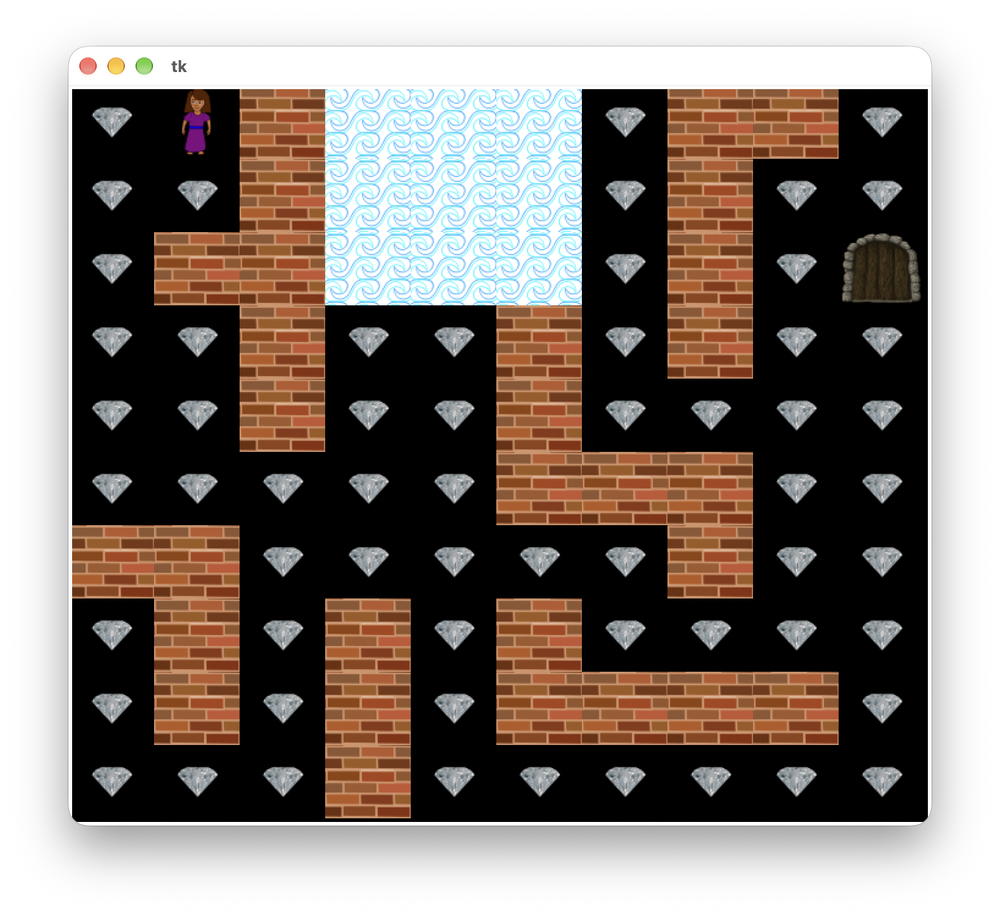


Hrací plocha má 10&times;10 políček. Jedno políčko má rozměry 70&times;60 bodů. Plán všech levelů je uložen v textovém souboru `data.txt` (k dispozici jsou také soubory `data2.txt` a `data3.txt`). Prvních deset řádků popisuje první level. Pokud je ve hře levelů více, další level popisuje dalších 10 řádků souboru. Ukázka textového souboru jen pro první level, který jsme viděli na předchozím obrázku:

```
1 6 3 4 4 4 1 3 3 1
1 1 3 4 4 4 1 3 1 1
1 3 3 4 4 4 1 3 1 5
1 1 3 1 1 3 1 3 1 1
1 1 3 1 1 3 1 1 1 1
1 1 1 1 1 3 3 3 1 1
3 3 1 1 1 1 1 3 1 1
1 3 1 3 1 3 1 1 1 1
1 3 1 3 1 3 3 3 3 1
1 1 1 3 1 1 1 1 1 1
```

Jednotlivá čísla v souboru popisují, co se má zobrazit v políčku hry. K číslům přísluší tyto obrázky (uvádíme u nich i název souboru, ve kterém se nacházejí):

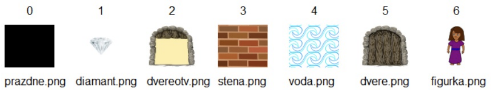

Hráč (figurka) se pohybuje v bludišti pomocí šipek klávesnice - nahoru, vlevo, dole a vpravo. Při stisku šipky se daným směrem posune na další políčko pouze v případě, že je prázdné nebo obsahuje diamant. Hráč nemůže vstoupit na políčko, kde je stěna, voda nebo kde jsou zavřené dveře. Úkolem hráče je vysbírat všechny diamanty. Po odchodu figurky ze startovacího políčka nebo po sebrání diamantu se ve hře zobrazí prázdné políčko. Po vysbírání všech diamantů se otevřou dveře a přes ně může hráč přejít do dalšího levelu (pokud jej hra má). Pokud prošel poslední level, vypíše se mu gratulace. Předpokládejme, že každý plán hry (podle textového souboru) obsahuje právě jednu figurku a právě jedny zavřené dveře a naopak neobsahuje otevřené dveře.

---

❓ Které informace by si měl program v paměti pamatovat? V jaké struktuře?

❓ Kolik řádků může mít správně vytvořený textový soubor pro tuto hru?

❓ Kde vykreslíme figurku na začátku hry?

---

Prohlédněte si naše částečné řešení:

```python
#  32_02.py
import tkinter
canvas = tkinter.Canvas(width=700, height=600, bg='black')
canvas.pack()

obrazky_nazvy = ('prazdne', 'diamant', 'dvereotv', 'stena', 'voda', 'dvere', 'figurka')
obrazky = []
plocha = []

def nacti_obrazky():
    for nazev in obrazky_nazvy:
        obrazek = tkinter.PhotoImage(file='diamanty/'+nazev+'.png')
        obrazky.append(obrazek)

def nacti_plochu():
    soubor = open('bludiste/data.txt')
    for radek in soubor:
        radek = radek[::2]
        radek_cisla = []
        for znak in radek:
            radek_cisla.append(int(znak))
        plocha.append(radek_cisla)
    soubor.close()

def kresli_obrazek(x, y, cislo):
    canvas.create_image(x, y, image=obrazky[cislo], anchor='nw')
    
def vykresli_plochu():
    for r in range(10):
        for s in range(10):
            kresli_obrazek(s*70, r*60, plocha[r][s])
    
nacti_obrazky()
nacti_plochu()
vykresli_plochu()
```

---

❓ Jak si v programu ` 32_02` pamatujeme plán hry?

❓ Jak pracuje program s textovým souborem s více levely?

❓ Co zajistí, že se podle čísel políček v plánu zobrazí příslušející obrázek?

❓ Co by se stalo, kdyby v souboru byla i dvouciferná čísla políček?

❓ Co je třeba v programu ještě vyřešit?

---

Funkce `nacti_plochu()` přečte ze souboru všechny řádky. To znamená, že pokud je v souboru více levelů, jsou všechny načteny do pole `plocha`. Nám to nebude překážet, protože když budeme pracovat s plochou, budeme využívat jen prvních 10 prvků (vidíme to ve funkci `vykresli_plochu()`).

V programu nám ještě chybí mnoho věcí, např. ovládání klávesnicí, posun hráče, přechod do dalšího levelu, výpis gratulace. Nejprve rozhýbeme hráče. Zjistíme si, kde se nachází, a zapamatujeme si jeho pozici do globální proměnné `hrac` – dvouprvkové n-tice. Pro vyhledání hráče vytvoříme funkci `najdi_policko()`, můžeme ji pak využít i pro vyhledání dveří.


```python
def najdi_policko(typ_policka):
    for r in range(10):
        for s in range(10):
            if plocha[r][s] == typ_policka:
                return s, r

hrac = najdi_policko(6)
```

Nyní můžeme spočítat počet diamantů v jednom levelu (aktuálním) a zapamatovat si jej do globální proměnné `pocet_diamantu`. Když hráč vezme diamant, `pocet_diamantu` snížíme o jeden. Pokud je bude nula, můžeme otevřít dveře. Pro zjištění počtu si vytvoříme funkci `spocitej_diamanty()`.

```python
def spocitej_diamanty():
    pocet = 0
    for r in range(10):
        for s in range(10):
            if plocha[r][s] == 1:
                pocet += 1
    return pocet

pocet_diamantu = spocitej_diamanty()
```

Budeme reagovat na stisknuté klávesy. Podle stisknuté šipky nastavíme globální proměnnou `smer` typu n-tice. V ní si pamatujeme, o kolik políček se máme posunout na osách `x` a `y`. Čili `(-1, 0)` znamená, že se posouváme na ose x o `-1` políčko a na ose `y` o `0` políček (posouváme se vlevo).

```python
def klavesa(event):
    global smer
    smer = (0, 0)
    if event.keysym == 'Left':
        smer = (-1, 0)
    if event.keysym == 'Right':
        smer = (1, 0)
    if event.keysym == 'Up':
        smer = (0, -1)
    if event.keysym == 'Down':
        smer = (0, 1)
    if smer != (0, 0):
        zkus_posun()

smer = (0, 0)
canvas.bind_all('<Key>', klavesa)
```

Ve funkci `klavesa()` zavoláme funkci `zkus_posun()` pouze v případě, že se máme pohnout nějakým směrem (`smer != (0, 0)`). Funkce `zkus_posun()` vypočítá nové souřadnice (ne absolutně, ale indexy sloupce a řádku hrací plochy). Ve funkci následně zjistíme, zda se daným směrem může hráč pohnout (zda není políčko mimo plochu a zda se na něj může jít podle pravidel hry). Tím zajistíme, že hráč nepůjde do zdi, vody ani zavřených dveří. Podíváme-li se na číslování políček, zjistíme, že čísla políček, na která se může jít, mají hodnotu menší než `3`.

```python
def zkus_posun():
    nove_x = hrac[0] + smer[0]
    nove_y = hrac[1] + smer[1]
    if 0 <= nove_x <= 9 and 0 <= nove_y <= 9:
        if plocha[nove_y][nove_x] < 3:
            posun_se(nove_x, nove_y, plocha[nove_y][nove_x])
```

Pokud se hráč může posunout, zavoláme funkci `posun_se()`. V parametrech jí předáme informaci o nové pozici hráče a hodnotu nového políčka. Funkce `posun_se()` v poli `plocha` nastaví původní pozici hráče na prázdnou, přemístí hráče, aktualizuje globální proměnnou `hrac`. Pokud se hráč posunul na políčko, kde je diamant, odečte ho z globální proměnné `pocet_diamantu`. Funkce také zjistí, zda hráč již vzal poslední diamant. Pokud ano, zavolá funkci `otevri_dvere()`. Ve funkci následně překreslíme celou plochu voláním `vykresli_plochu()`. Mohli bychom to řešit i tak, že překreslujeme pouze změněná políčka. My si ukážeme takové řešení. Ještě zjistíme, jestli hráč přišel na otevřené dveře. Pokud ano, zavoláme funkci `dalsi_level()`.

```python
def posun_se(nove_x, nove_y, typ_policka):
    global hrac, pocet_diamantu
    plocha[hrac[1]][hrac[0]] = 0
    hrac = (nove_x, nove_y)
    plocha[hrac[1]][hrac[0]] = 6
    if typ_policka == 1:
        pocet_diamantu -= 1
        if pocet_diamantu == 0:
            otevri_dvere()
    vykresli_plochu()
    if typ_policka == 2:
        dalsi_level()
```

Funkce `otevri_dvere()` najde zavřené dveře a změní je ve dvourozměrném poli plocha na otevřené.

```python
def otevri_dvere():
    x, y = najdi_policko(5)
    plocha[y][x] = 2
```

Funkce `dalsi_level()` pomocí řezu změní seznam `plocha` – odstraní prvních deset řádků a zůstanou v něm jen další levely. Pokud nejsou, zůstane nám prázdný seznam a víme, že jsme na konci hry. Pak stačí už jen zavolat funkci `konec_hry()`, která vypíše oznámení a pomocí příkazu `canvas.unbind_all()` zruší svázání události stisku jakékoliv klávesy s voláním funkce. To znamená, že program nebude reagovat na další stisknutí šipek.

```python
def dalsi_level():
    global pocet_diamantu, plocha, hrac
    plocha = plocha[10:]
    if plocha == []:
        konec_hry()
    else:
        vykresli_plochu()
        pocet_diamantu = spocitej_diamanty()
        hrac = najdi_policko(6)

def konec_hry():
    canvas.unbind_all('<Key>')
    canvas.create_text(350, 300, text='Super! Prošel jsi všechno!',
                       font='Arial 20', fill='yellow')
```

Ukázka celého výsledného programu:

```python
#  32_02b.py
import tkinter
canvas = tkinter.Canvas(width=700, height=600, bg='black')
canvas.pack()

obrazky_nazvy = ('prazdne', 'diamant', 'dvereotv', 'stena', 'voda', 'dvere', 'figurka')
obrazky = []
plocha = []

def nacti_obrazky():
    for nazev in obrazky_nazvy:
        obrazek = tkinter.PhotoImage(file='diamanty/'+nazev+'.png')
        obrazky.append(obrazek)

def nacti_plochu():
    soubor = open('bludiste/data2.txt')
    for radek in soubor:
        radek = radek[::2]
        radek_cisla = []
        for znak in radek:
            radek_cisla.append(int(znak))
        plocha.append(radek_cisla)
    soubor.close()

def kresli_obrazek(x, y, cislo):
    canvas.create_image(x, y, image=obrazky[cislo], anchor='nw')
    
def vykresli_plochu():
    canvas.delete('all')
    for r in range(10):
        for s in range(10):
            kresli_obrazek(s*70, r*60, plocha[r][s])

def najdi_policko(typ_policka):
    for r in range(10):
        for s in range(10):
            if plocha[r][s] == typ_policka:
                return s, r

def spocitej_diamanty():
    pocet = 0
    for r in range(10):
        for s in range(10):
            if plocha[r][s] == 1:
                pocet += 1
    return pocet            
    
def klavesa(event):
    global smer
    smer = (0, 0)
    if event.keysym == 'Left':
        smer = (-1, 0)
    if event.keysym == 'Right':
        smer = (1, 0)
    if event.keysym == 'Up':
        smer = (0, -1)
    if event.keysym == 'Down':
        smer = (0, 1)
    if smer != (0, 0):
        zkus_posun()

def zkus_posun():
    nove_x = hrac[0] + smer[0]
    nove_y = hrac[1] + smer[1]
    if 0 <= nove_x <= 9 and 0 <= nove_y <= 9:
        if plocha[nove_y][nove_x] < 3:
            posun_se(nove_x, nove_y, plocha[nove_y][nove_x])

def posun_se(nove_x, nove_y, typ_policka):
    global hrac, pocet_diamantu
    plocha[hrac[1]][hrac[0]] = 0
    hrac = (nove_x, nove_y)
    plocha[hrac[1]][hrac[0]] = 6
    if typ_policka == 1:
        pocet_diamantu -= 1
        if pocet_diamantu == 0:
            otevri_dvere()
    vykresli_plochu()
    if typ_policka == 2:
        dalsi_level()

def otevri_dvere():
    x, y = najdi_policko(5)
    plocha[y][x] = 2
    
def dalsi_level():
    global pocet_diamantu, plocha, hrac
    plocha = plocha[10:]
    if plocha == []:
        konec_hry()
    else:
        vykresli_plochu()
        pocet_diamantu = spocitej_diamanty()
        hrac = najdi_policko(6)

def konec_hry():
    canvas.unbind_all('<Key>')
    canvas.create_text(350, 300, text='Super! Prošel jsi všechno!',
                       font='Arial 20', fill='yellow')
    
nacti_obrazky()
nacti_plochu()
vykresli_plochu()
hrac = najdi_policko(6)
pocet_diamantu = spocitej_diamanty()
smer = (0, 0)
canvas.bind_all('<Key>', klavesa)
```

---

❓ Co se stane, když bude na konci souboru jeden prázdný řádek nebo více prázdných řádků?

❓ Proč ve funkci `dalsi_level()` musí být `global plocha`, a například ve funkci `posun_se()` nemusí být?

❓ Pokud neznáme příkaz `canvas.unbind_all()`, jak jinak můžeme vyřešit ukončení ovládání hry?

❓ Pro hledání pozice hráče a spočítání diamantů dvakrát navíc prohledáváme seznam `plocha`. Jak jinak bychom to mohli řešit? Diskutujte o efektivnosti navrženého řešení.

❓ Pokud nechceme mít v seznamu `plocha` všechny levely, jak jinak můžeme program vytvořit?

---

## 💾 Úkoly

**[7]** Doplňte do hry diamantué bludiště zobrazování aktuálního počtu diamantů, které musí hráč ještě posbírat.


**[8]** Doplňte do hry diamantué bludiště časový limit, za který musí hráč projít celý level. Pokud hráč nestihne projít level v časovém limitu, hra končí.


**[9]** Vytvořte program `32_kontrola_hry.py`, který ze vstupního textového souboru pro hru diamantué bludiště zjistí a vypíše:
1. počet levelů,
2. zda každý level obsahuje právě jedny zavřené dveře a právě jednoho hráče.


**[10]** Vytvořte editor levelů pro hru diamantué bludiště (`32_editor_levelu.py`). Pomocí myši může uživatel na obrazovce pokládat políčka hry. Vytvořený level program zkontroluje (zda má dveře a hráče) a následně jej uloží do souboru.

# 💾 Cvičení

**[11]** Vytvořte hru `32_kruhy.py`. V hrací ploše se vykreslí 10&times;10 barevných kruhů. Kruhy jsou zabarveny náhodně jednou ze tří barev (červená, modrá, žlutá). Úkolem hráče je obarvit všechny kruhy stejnou barvou. Hra se ovládá levým a pravým tlačítkem myši. Klepnutím levého tlačítka myši se změní barva celého sloupce, nad kterým je kurzor myši. Klepnutím pravého tlačítka myši se změní barva celého řádku, nad kterým je kurzor myši. Po stisku klávesy `+` se změní barva jedné diagonály a po stisku klávesy `-` se změní barva druhé diagonály. Při změně barev (sloupce, řádku nebo diagonály) se změní barva každého kruhu (dané oblasti) tak, že vždy se mění cyklicky v pořadí barev: červená, modrá, žlutá, červená. Rozehranou hru si může hráč uložit do textového souboru.

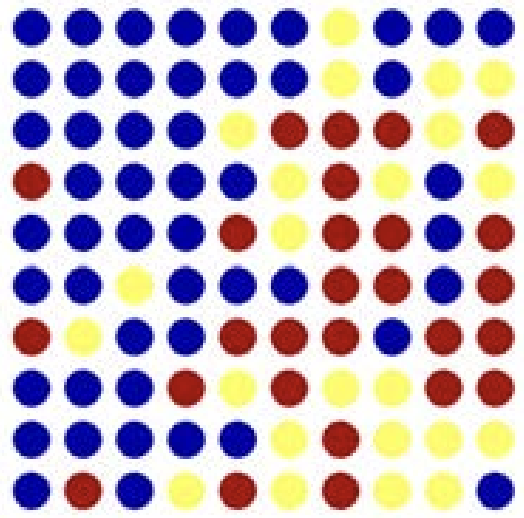

---

**[12]** Zahradní architekt navrhuje městské parky, které obsahují místa pokrytá zelení a chodníkem.
Vytvořte program, který usnadní navrhování plánu parků následovně:

- Plán parku se zakresluje do čtverečkové sítě o rozměru 60&times;40 čtverečků. Rozměr jednoho čtverečku v síti je 10&times;10 bodů.
- Program vykreslí plán – černou mřížku.
- Levým tlačítkem myši a tažením kreslíme do plánu zeleň (zelený čtvereček).
- Pravým tlačítkem myši a tažením kreslíme do plánu chodník (hnědý čtvereček).
- V programu je tlačítko **Krok zpět**, které nám umožní postupně vrátit všechny kroky zakreslování v
plánu. 
- Plán můžeme uložit a také načíst.
- Při ukládání program uloží jen zadaný výřez, prázdná políčka v něm automaticky doplní trávníkem.

Ukázky plánů:

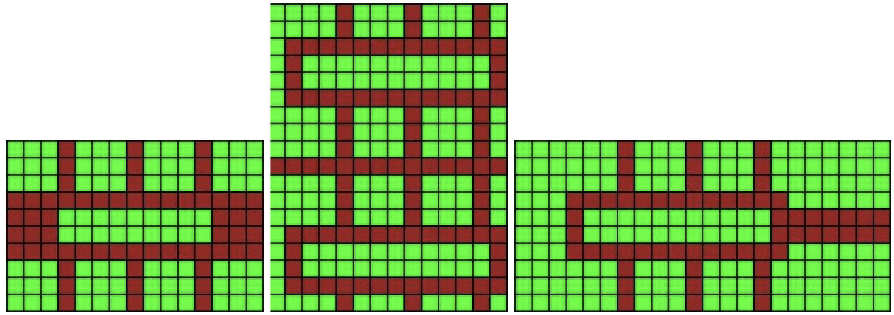

---

**[13]** Vytvořte následující hru:

- plán hry tvoří plocha 7&times;7 políček, plocha je na začátku prázdná,

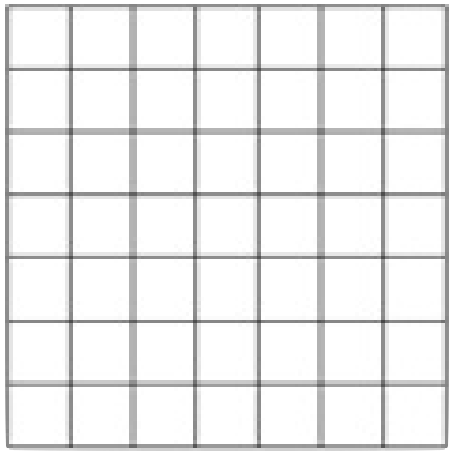


- hru hrají střídavě dva hráči - modrý a červený, kliknutím na prázdné políčko jej obarví svou barvou,
- počítač zobrazuje, který hráč je na tahu a také počet zabarvených políček jednotlivými hráči, 
- pokud hráč svým tahem obarví celý řádek nebo sloupec (libovolné kombinace zabarvení modrou
a červeně), získá 10 bodů (pokud současně zabarví i řádek a sloupec, získá 50 bodů) a zároveň se zabarvený řádek / sloupec ztratí,
- v případě ztracení řádku spadnou řádky nad ztraceným řádkem o jeden řádek dolů a první řádek bude prázdný. 
 
Ukázka hrací plochy před vymazáním řádku a po vymazání řádku:

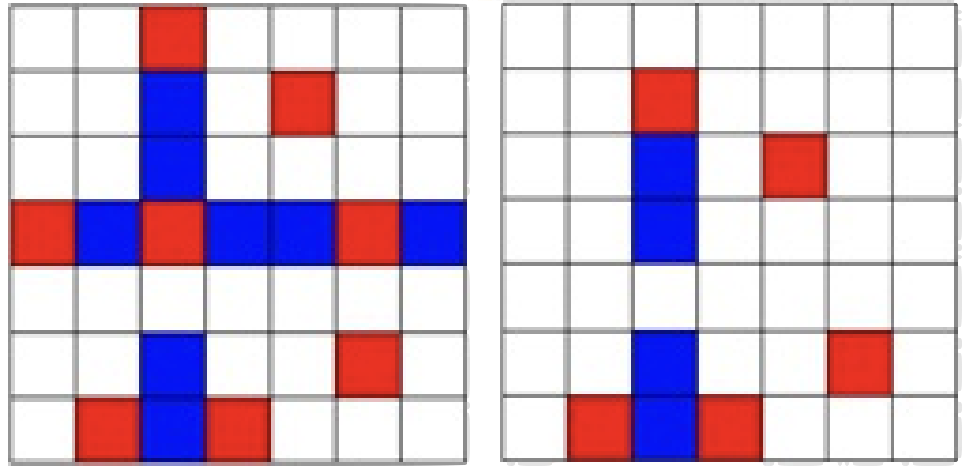

- v případě ztracení sloupce se posunou sloupce nacházející se vpravo směrem doleva o jeden sloupec a poslední sloupec bude prázdný. 

Ukázka hrací plochy před vymazáním sloupce a po vymazání sloupce:

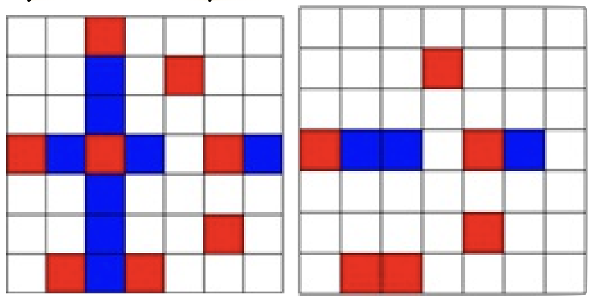

- v případě ztracení řádku i sloupce zároveň se nejprve provede ztracení řádku a následně ztracení sloupce (i když v tom momentě již není kompletně zabarven),
- tlačítkem **Save**, můžeme uložit rozehranou hru do textového souboru (se všemi potřebnými informacemi o rozehrané hře ve vhodném formátu),
- tlačítkem **Load** načteme z textového souboru rozehranou hru (se všemi potřebnými informacemi) a všechny informace se nastaví podle informací zapsaných v souboru.

---

**[14]** Vytvořte logickou hru **Robot 16** následovně:

Plán hry tvoří plocha 4&times;4 políček, ve kterých jsou náhodně zamíchána čísla z posloupnosti 1 až 16, velikost jednoho políčka je 110&times;150 bodů, cílem hry je uspořádat políčka do této výherní pozice:

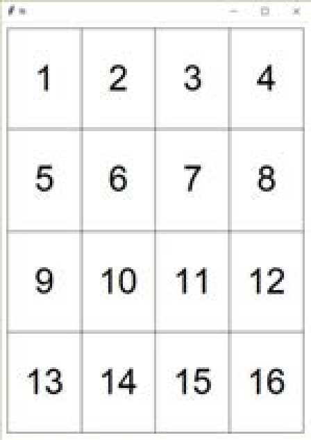

- Hráč ovládá hru tříznakovými příkazy, které zapisuje do entry a ke zpracování je odešle tlačítkem. Prvním znakem příkazu určuje, zda chce vyměňovat sloupec (`s`) nebo řádek (`r`). Druhým znakem (číslice) určuje, který sloupec, resp. řádek chce vyměňovat, a třetím znakem (`+` nebo `-`) určuje, se kterým prvkem (řádkem nebo sloupcem) chce daný prvek (sloupec nebo řádek) vyměňovat. `+` označuje následující a `-` označuje předchozí. Například:

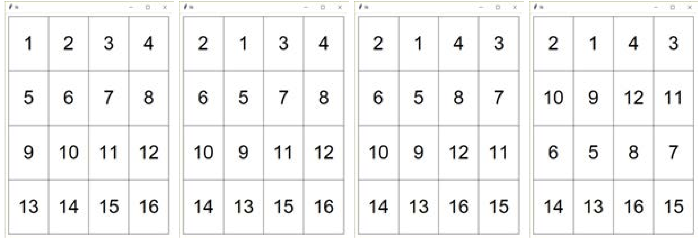

Popis obrázků (zleva): výchozí pozice | po příkazu `s1+` | po příkazu `s4-` | po příkazu `r2+`.

- po zadání příkazu se provede výměna, program nespadne při správném zadání příkazu dle naší definice,
- v programu je tlačítko, které zamíchá hrací plochu, ale pouze tak, že bude simulovat náhodně zadané příkazy hráče,
- v programu je tlačítko, které nám umožní během hry přepnout zobrazování obrázků (`r1.png` až `r16.png`) nebo zobrazování klasických číslic,
ukázka stavů zobrazených výše při zapnutém zobrazování obrázků:

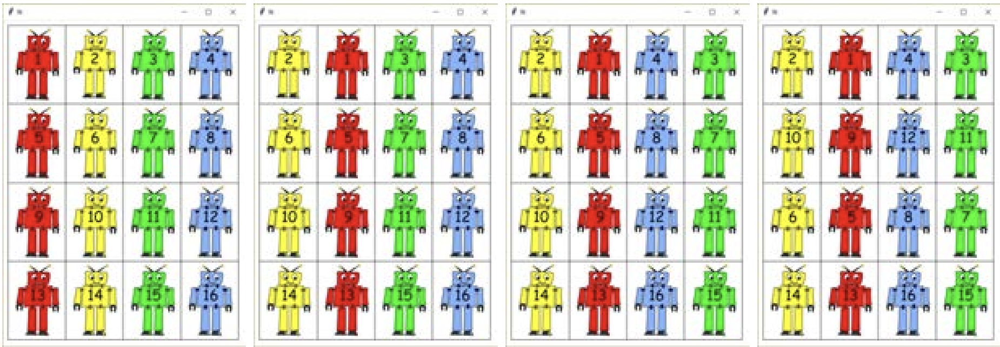

- v programu je tlačítko, které nám umožní otestovat, zda jsme ve výherní pozici, a vypíše nám o tom informaci.

---

**[15]** Vytvořte program Sudoku následovně:

- počáteční obsazení některých políček čísly je zadáno v souboru `sudoku1.txt` (resp. `sudoku2.txt` nebo `sudoku3.txt`). Soubor obsahuje v každém řádku tři celá čísla: sloupec, řádek a hodnotu políčka (každé z nich je z intervalu <1, 9>), které znamenají, že daný sloupec a řádek je v hrací ploše obsazen danou hodnotou,
- čísla v hrací ploše jsou zobrazena ze souborů `1.png` až `9.png`. Všechny obrázky i čtverečky hrací plochy jsou velikosti 50&times;50.
- obrázky s čísly program ze souboru čte jen jednou,
- program vykreslí mřížku a zobrazí obrázky s čísly podle informací v textovém souboru,
- čísla, která jsou v hrací ploše od začátku hry, jsou podbarvena žlutou barvou,
- v programu se textový soubor čte jen jednou,

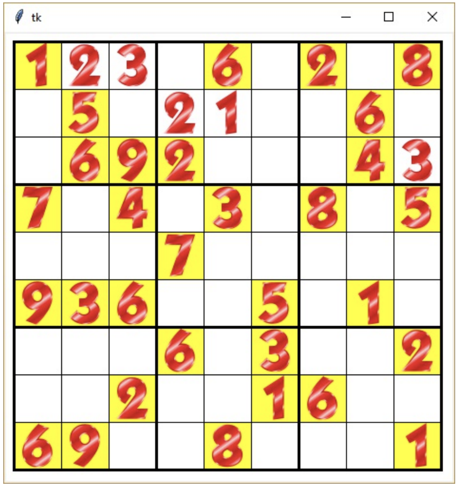

- hráč kliknutím myší na nepodbarvené políčko (políčko s předem nenastavenou hodnotou) postupně mění hodnoty políčka v rozsahu 1, 2, 3, 4, 5, 6, 7, 8, 9 a prázdné políčko. Změny se ihned graficky zobrazují.
- program kontroluje změněný řádek, zda neobsahuje duplicitní čísla, a nějakou formou zobrazuje o tom informaci,
- program kontroluje změněný sloupec, zda neobsahuje duplicitní čísla, a nějakou formou zobrazuje o tom informaci,
- program kontroluje změněný čtverec 3&times;3 (silněji orámovaný), zda neobsahuje duplicitní čísla, a nějakou formou zobrazuje o tom informaci.
- program kontroluje správné vyplnění celého sudoku a vypisuje informaci o výhře.

---

**[16]** Vytvořte program **Editor malované křížovky**. V programu uživatel pomocí myši vytváří obrázek ze čtverečků ve čtvercové síti. Program následně po kliknutí na tlačítko `Generuj` vygeneruje do textového souboru `krizovka.txt` číselnou předlohu pro malovanou křížovku. Program spočítá počty
nakreslených čtverečků jdoucí za sebou v jednotlivých řádcích a v jednotlivých sloupcích. Příslušná čísla pro řádky i sloupce obrázku zapíše do souboru, přičemž nejprve zapíše do samostatných řádků
souboru čísla získané z řádků křížovky. Pokud je celý řádek v křížovce prázdný, v souboru bude prázdný řádek (ne nula). Po číslech z řádků budou v souboru čísla ze sloupců a opět platí, že jeden řádek v souboru popisuje čísla z jednoho sloupce křížovky. Pokud ve sloupci křížovky není zabarven čtvereček, odpovídající řádek souboru bude prázdný.

Na obrázcích je ukázka obrazovky programu a výstupního textového souboru pro tento obrázek:

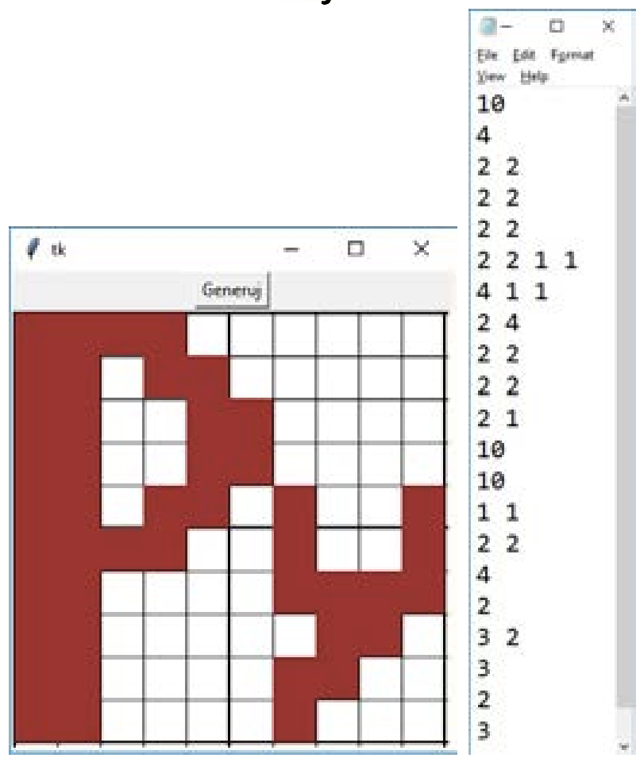

---

**[17]** Vytvořte program **Malovaná křížovka**, který načte číselnou předlohu malované křížovky z textového souboru `krizovka.txt` a vykreslí křížovku i s čísly, aby ji uživatel mohl řešit. Program tedy umožňuje klikáním myši vybarvovat políčka a kliknutím pravým tlačítkem myši označovat prázdná políčka – například šikmou čarou (tak, jak je to obvyklé při luštění malovaných křížovek).

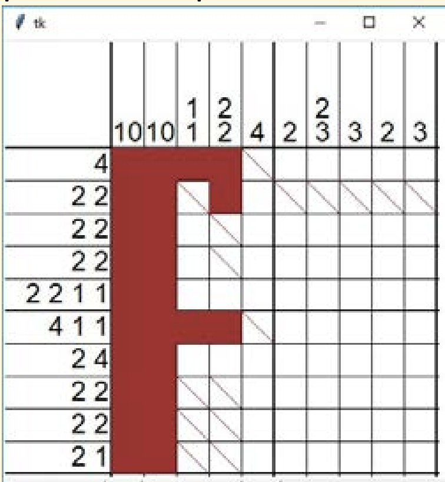

- Doplňte program o možnost uložení aktuálního stavu rozmalované křížovky do souboru, aby se uživatel mohl k dalšímu řešení vrátit příště.
- Doplňte do programu tlačítko **Zkontroluj**, které ověří, zda namalovaný obrázek přesně souhlasí s číselnou předlohou.

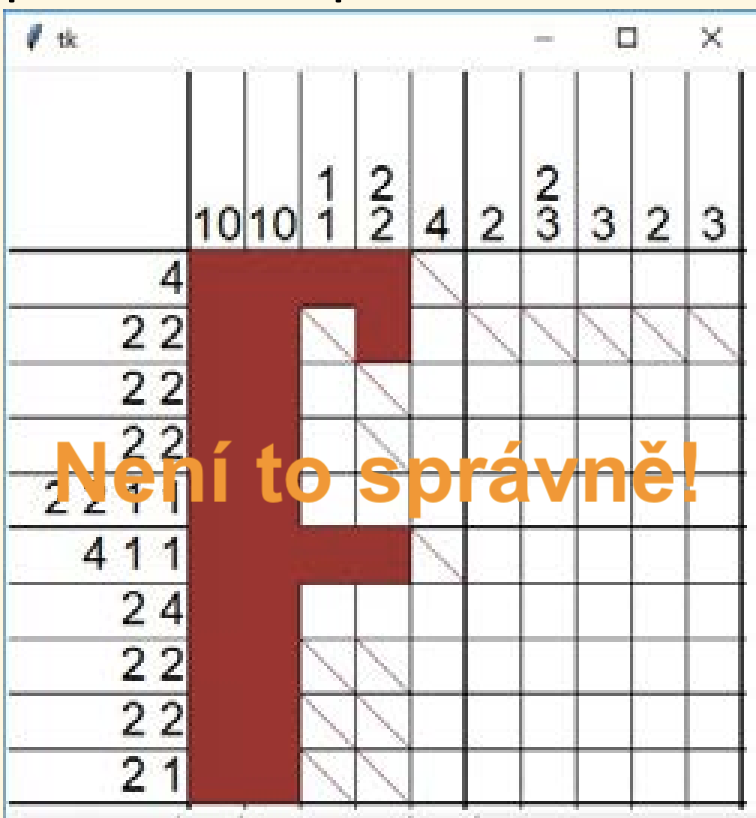


---

**[18]** Naprogramujte **Hru 15**. Jedná se o plochu 4&times;4 políček, ve kterých jsou zapsána čísla od 1 do 15 a jedno políčko je prázdné. Čísla se na začátku hry zamíchají. Uživatel se snaží posouváním čísel na
sousedící prázdné políčko uspořádat čísla shora od 1 po 15 (prázdné políčko na konci hry zůstane v pravém dolním rohu).

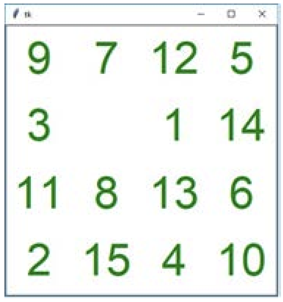


Ovládání:

1. Uživatel posouvá čísla na prázdné políčko klikáním na daná čísla.
2. Uživatel posouvá čísla na prázdné políčko mačkáním šipek. Například šipka dolů znamená, že číslo nad prázdným políčkem se přesune dolů.

Upravte hru podle svých představ – například:

- doplňte kontrolu vyřešení s oznámením o výhře,
- přidejte časomíru,
- přidejte tlačítko Restart hry,
- uložte nejrychlejší časy se jmény hráčů do souboru a zobrazte tabulku High Score,
- vytvořte možnost přestavit rozměry na 3&times;3 nebo 5&times;5 a můžete přidat i nějaké cheaty.


