# Lekce 33: Rastrové obrázky

Z hodin informatiky známe rastrové obrázky, označované také jako bitmapové. Víme, že je to mřížka bodů (rastr nebo dvourozměrná tabulka) obrázku. Každý bod obrázku představuje nějaké číslo, které kóduje konkrétní barvu tohoto bodu. Nyní si ukážeme, jak můžeme s touto dvourozměrnou tabulkou barev bodů pracovat. 


```python
#33-01a
import tkinter
canvas = tkinter.Canvas()
canvas.pack()

obrazek = tkinter.PhotoImage(file='fotky/rostlina.png')

sirka = obrazek.width()
vyska = obrazek.height()
print('Rozměry obrázku jsou {}x{} bodů'.format(sirka, vyska))

canvas['width'] = sirka
canvas['height'] = vyska

canvas.create_image(0, 0, anchor='nw', image=obrazek)
barva = obrazek.get(0, 0)
print(barva)
print(type(barva))
```

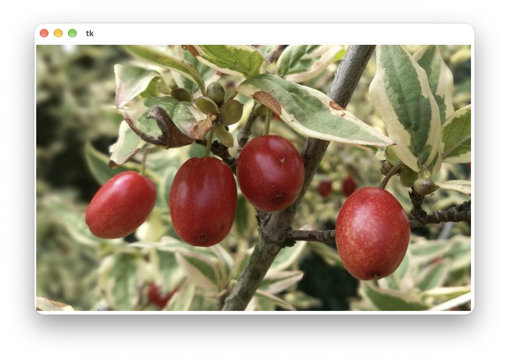


Do terminálu se vypíšou tyto informace:

```
Rozměry obrázku jsou 712x437 bodů
(120, 122, 73)
<class 'tuple'>
>>>
```

Do proměnné `obrazek` jsme načetli rastrový obrázek ze souboru `rostlina.png`. Ke zjištění rozměru obrázku jsme využili metodu `width()` a `height()`. Výstupem obou metod je celé číslo. Příkazem `canvas['width'] = sirka` jsme nastavili šířku canvasu podle šířky načteného obrázku a příkazem `canvas['width'] = vyska` jsme nastavili výšku canvasu. Pro zjištění barvy konkrétního bodu v obrázku jsme použili metodu `get()`. Parametrem metody `get()` je `x` a `y` požadovaného bodu. Výstupem je tříprvková n-tice celých čísel.

```python
>>> type(obrazek)
<class 'tkinter.PhotoImage'>
>>> obrazek.get(0, 0)
(120, 122, 73)
>>> obrazek.get(1, 0)
(123, 125, 76)
>>> barva = obrazek.get(1, 0)
>>> type(barva)
<class 'tuple'>
>>>
```

Tato tři čísla jsou hodnoty jednotlivých barevných složek v barevném modelu RGB (red, green, blue) v desítkové soustavě. Z naší ukázky to znamená, že bod se souřadnicí 0, 0 v obrázkové proměnné `obrazek` má barvu namíchanou z červené barvy s odstínem `120`, zelené barvy s odstínem `122` a modré barvy s odstínem `73`.

---

❓ Jaké barvy získáme, namícháme-li stejnou hodnotu pro všechny barevné složky (červenou, zelenou a modrou)?

❓ Jak namícháme barvu, jejíž hodnotu jednotlivých složek RGB jsme právě zjistili (pokud bychom jí chtěli něco nakreslit)?

---

K úpravě obrázku v obrázkové proměnné `obrazek` můžeme využít metodu `put()` ve tvaru `obrazek.put(barva, (x, y))`. Máme-li náš program `33-01a` spuštěn, můžeme přímo v příkazovém řádku zapsat: `obrazek.put('yellow', (350, 220))`. Hned po provedení vidíme, že bod se souřadnicí 350, 220 se zabarvil žlutě. Přestože jsme změnili barvu bodu pouze v proměnné `obrazek`, změnu barvy bodu vidíme hned i v canvasu, jelikož tento obrázek jsme již umístili do canvasu (resp. ve skutečnosti umístěný obrázek referuje na obrázkovou proměnnou).

Pokud bychom procházeli pomocí `for` cyklu po některých bodech obrázkové proměnné, můžeme je s využitím metod `get()` a `put()` zajímavě měnit. Například z barevného obrázku vytvoříme obrázek v odstínech šedé barvy (černobílou fotku). Postupně projedeme všechny body, například po řádcích. Zjistíme barvu bodu - hodnotu jednotlivých složek R, G a B. Z nich vypočítáme aritmetický průměr a namícháme novou barvu, kde bude R, G i B rovné vypočtenému průměru (jsou-li stejné všechny složky RGB, vznikne odstín šedé barvy). Touto novou barvou zabarvíme původně barevný bod.

```python
#33-01b
import tkinter
canvas = tkinter.Canvas()
canvas.pack()

obrazek = tkinter.PhotoImage(file='fotky/rostlina.png')

sirka, vyska = obrazek.width(), obrazek.height()
canvas['width'], canvas['height']  = sirka, vyska

canvas.create_image(0, 0, anchor='nw', image=obrazek)
canvas.update()
for y in range(vyska):
    for x in range(sirka):
        barva = obrazek.get(x, y)
        prumer = (barva[0] + barva[1] + barva[2]) // 3
        nova_barva = '#' + 3 * '{:02x}'.format(prumer)
        obrazek.put(nova_barva, (x, y))
    canvas.update()
```

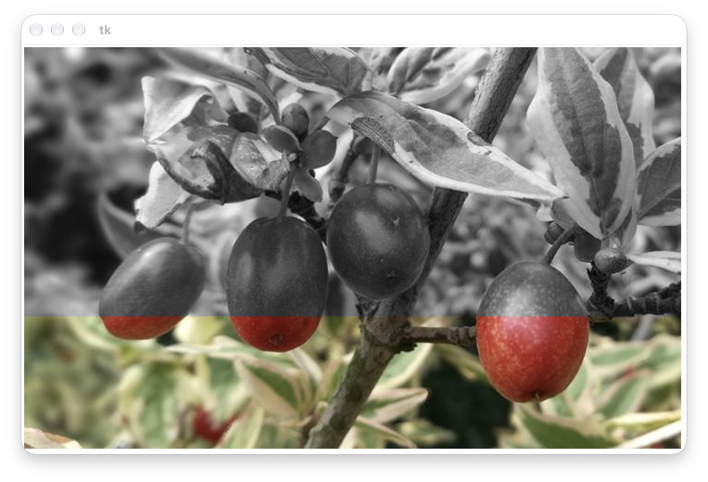

---

❓ Proč jsme v programu použili příkaz `canvas.update()`?

❓ Co se stane, když příkaz `canvas.update()` přesuneme do vnitřního `for` cyklu?

---


Mírně upravme program `33-01b`. Vytvoříme skutečně černobílý obrázek – bude obsahovat jen úplně černou a zcela bílou barvu. Nastavíme ji podle toho, ke které barvě je blíže vypočten průměr jednotlivých složek původní barvy.

```python
#33-01c
import tkinter
canvas = tkinter.Canvas()
canvas.pack()

obrazek = tkinter.PhotoImage(file='fotky/jezero.png')

sirka, vyska = obrazek.width(), obrazek.height()
canvas['width'], canvas['height']  = sirka, vyska

canvas.create_image(0, 0, anchor='nw', image=obrazek)
canvas.update()
for y in range(vyska):
    for x in range(sirka):
        barva = obrazek.get(x, y)
        prumer = (barva[0] + barva[1] + barva[2]) // 3
        if prumer > 127:
            nova_barva = 'white'
        else:
            nova_barva = 'black'
        obrazek.put(nova_barva, (x, y))
    canvas.update()
```

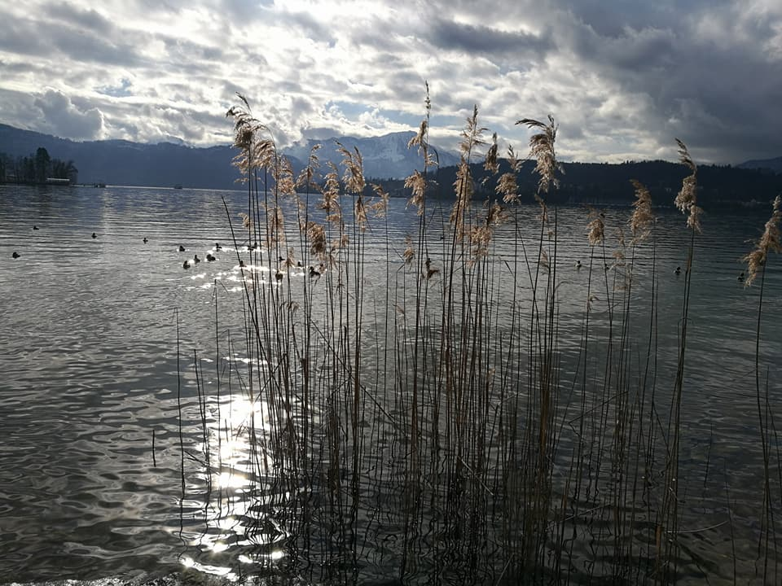
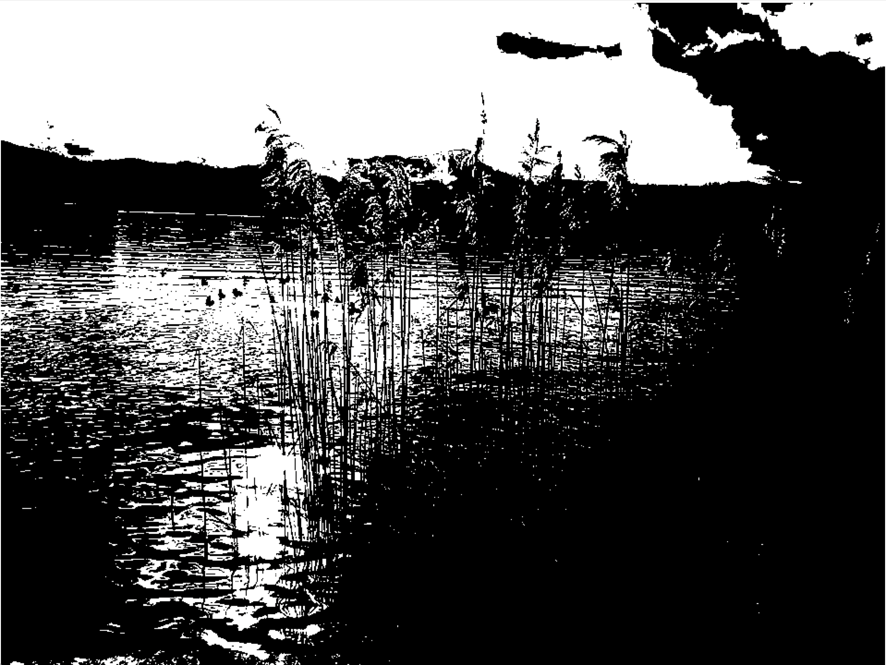

Pokud hodnotu jednotlivých barevných složek odečteme od jejich maximální hodnoty (převrátíme světlý odstín na tmavý a opačně) a znovu z nich namícháme barvu, vznikne nám barevný negativ.

```python
#33-01d
for y in range(vyska):
    for x in range(sirka):
        barva = obrazek.get(x, y)
        r, g, b = barva
        nr, ng, nb = 255-r, 255-g, 255-b
        nova_barva = '#{:02x}{:02x}{:02x}'.format(nr, ng, nb)
        obrazek.put(nova_barva, (x, y))
    canvas.update()
```

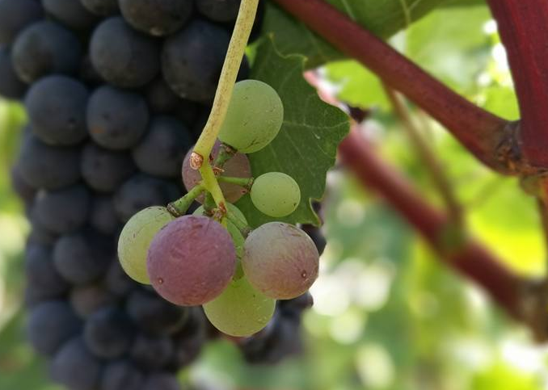
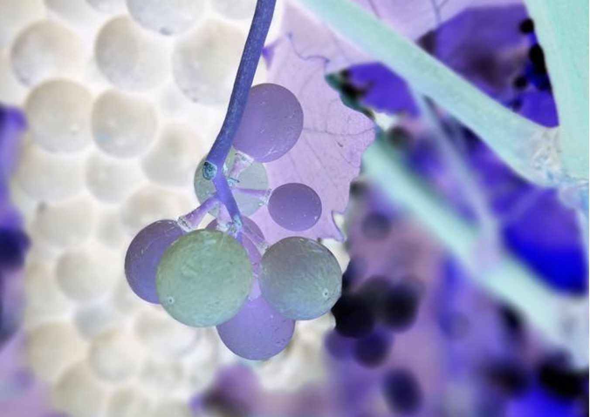

Můžeme si pohrát i se vzájemnou výměnou jednotlivých barevných složek RGB navzájem:

```python
#33-01e
for y in range(vyska):
    for x in range(sirka):
        barva = obrazek.get(x, y)
        r, g, b = barva
        nr, ng, nb =  g, b, r 
        nova_barva = '#{:02x}{:02x}{:02x}'.format(nr, ng, nb)
        obrazek.put(nova_barva, (x, y))
    canvas.update()
```

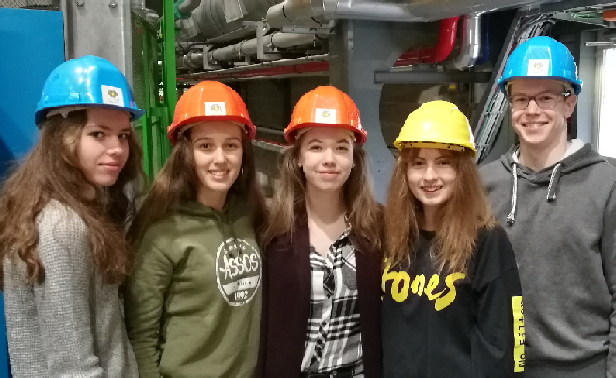
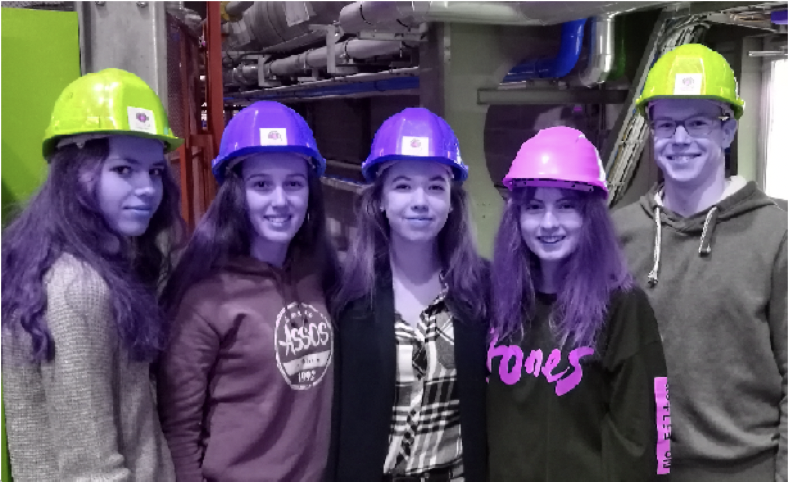

Zajímavý efekt udělá program `33-02`:

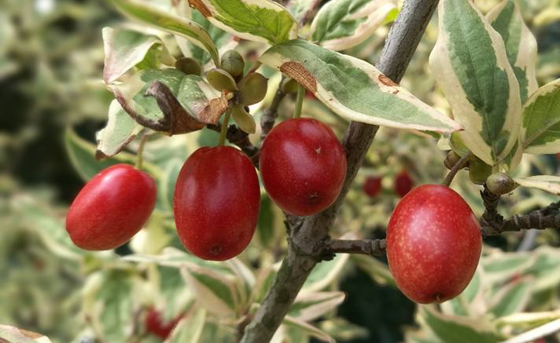
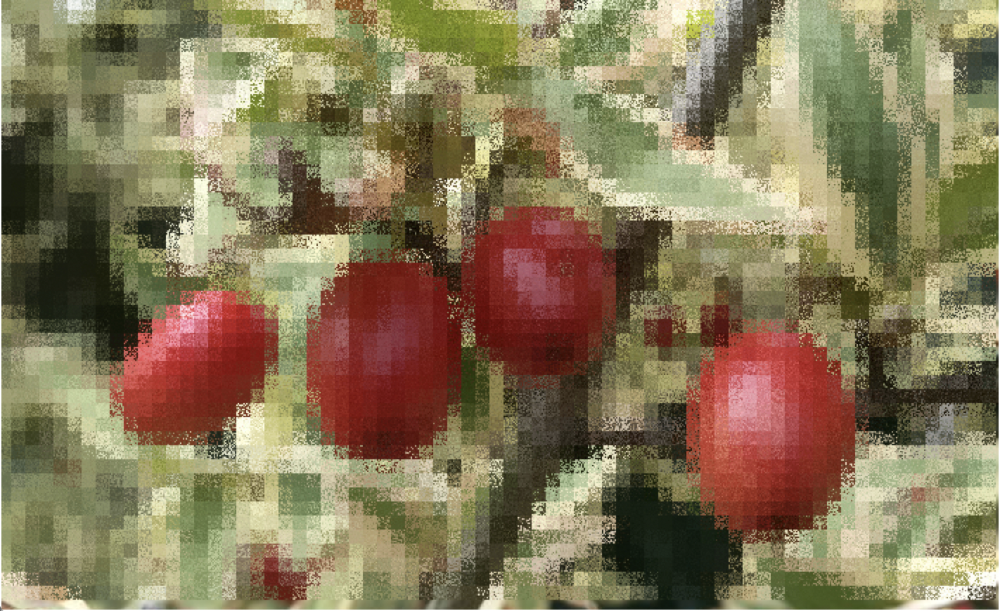


```python
#33-02
import tkinter
from random import *
canvas = tkinter.Canvas()
canvas.pack()

obrazek = tkinter.PhotoImage(file='fotky/rostlina.png')

sirka, vyska = obrazek.width(), obrazek.height()
canvas['width'], canvas['height']  = sirka, vyska

canvas.create_image(0, 0, anchor='nw', image=obrazek)
canvas.update()

def rgb_to_hex(barva):
    return '#{:02x}{:02x}{:02x}'.format(barva[0], barva[1], barva[2])

def promichej(zx, zy, velikost):
    for y1 in range(velikost):
        for x1 in range(velikost):
            x2, y2 = randrange(velikost), randrange(velikost)
            barva1 = obrazek.get(zx+x1, zy+y1)
            barva2 = obrazek.get(zx+x2, zy+y2)
            obrazek.put(rgb_to_hex(barva2), (zx+x1, zy+y1))
            obrazek.put(rgb_to_hex(barva1), (zx+x2, zy+y2))
    
velikost = 10
for y in range(0, vyska-velikost, velikost):
    for x in range(0, sirka-velikost, velikost):
        promichej(x, y, velikost)
    canvas.update()
```

---

❓ Co přesně dělá program `33-02`?

❓ Co se stane, když v programu změníme hodnotu proměnné velikost?

❓ Ve kterých situacích program `33-02` neaplikuje efekt změny obrázku na okrajové a spodní body?

❓ Jak bychom mohli program vylepšit, aby aplikoval změnu efektu na celý obrázek (i okraje vlevo a dolů)?

---

# 💾 Cvičení

**[1]** Vytvořte program, který z barevné fotografie vytvoří negativ ČB fotografie.

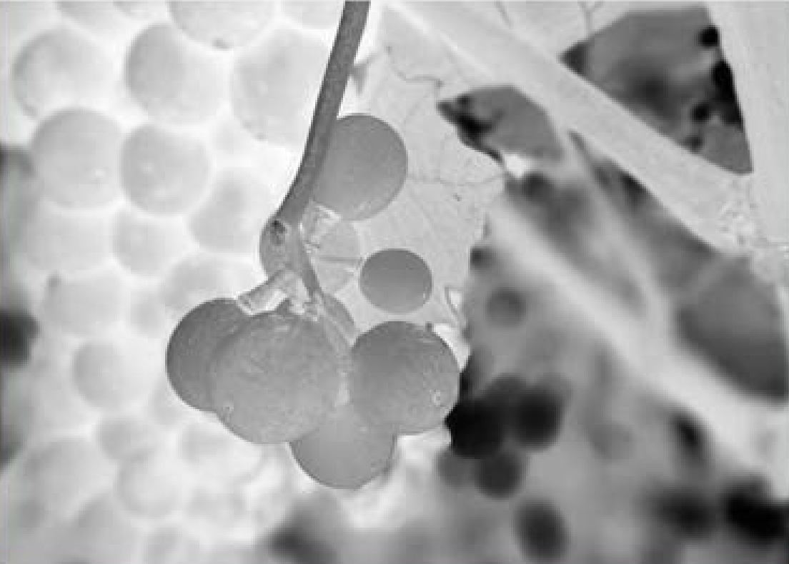

---

**[2]** Pomocí programu vytvořte obrázkový efekt, který postupně ve fiktivních čtverečcích nastavené velikosti (například 5&times;5, 10&times;10) náhodně vymění nastavené procento bodů (v programu 33-02 se vyměňují všechny). V ukázce vidíme efekt pro velikost čtverce 30 a míru záměny 10&nbsp;% a 20&nbsp;%.

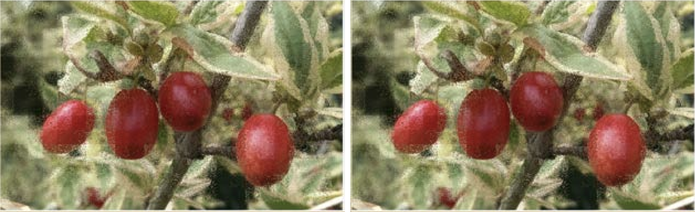

---

**[3]** Pomocí programu vytvořte obrázkový efekt, který rozčtverečkuje obrázek podle zadané velikosti čtverečků. Ukázka pro velikost čtverečku 10 a 30 bodů:

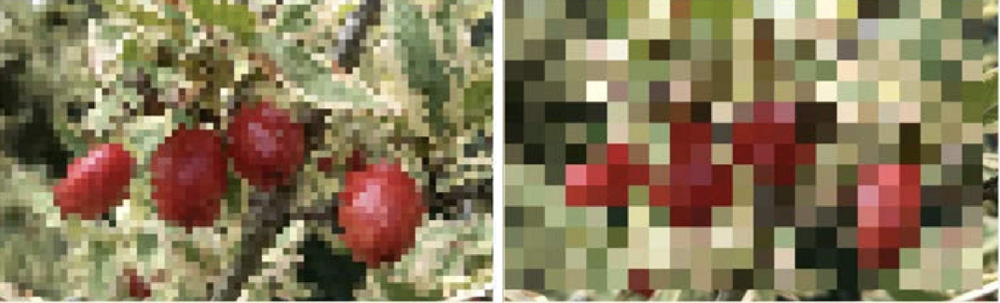

---

**[4]** Pomocí programu vytvořte impresionistický obrázkový efekt, který náhodné body z původního obrázku nakreslí jako kružnice. V programu můžeme nastavit velikost nakreslené kružnice i míru efektu (kolik procent bodů se má takto nakreslit). Ukázka pro velikost 10 a míru 0.01 a pro velikost 20 a míru 0.005:

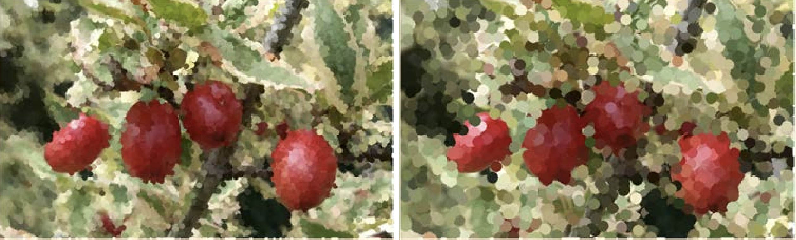

---


**[5]** Vytvořte program, který vytvoří v dolní polovině obrázku zrcadlový odraz horní poloviny obrázku.

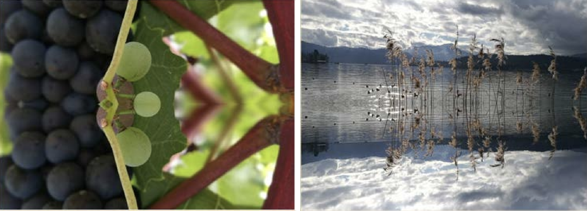

---


**[6]** Vytvořte program, který z levé horní čtvrtiny obrázku vytvoří zrcadlový obraz jak vertikálně, tak horizontálně (barvu jistého bodu můžete zjišťovat jen jednou a nemůžete použít seznam).

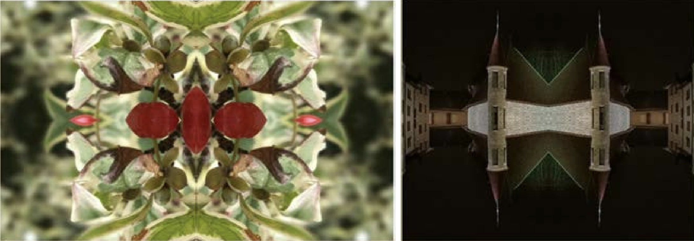

---
