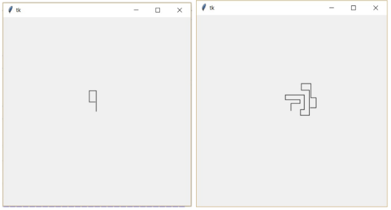

# (1) Had

> `[], Cnv, aft.`

Naprogramujte hru "Had".

- Hlavička hada je velikosti jeden bod. Had se neustále pohybuje určeným směrem a zanechává za sebou čáru. Na začátku má nastaven směr na sever.
- Směr pohybu měníme pomocí klávesnice (resp. tlačítek) ve čtyřech základních směrech (nahoru, dolu, vpravo, vlevo).
- Hra končí, pokud had narazí sám do sebe (resp. do čáry, kterou zanechal). Do terminálu se vypíše celkový počet bodů (pixelů), který had absolvoval.

Ukázka dvou ukončených her hada:

Otázky:

1. Jak zjistíme, jestli had narazil do sebe?
2. Co se stane, když hráč změní směr na opačný (otočí se čelem vzad)?
