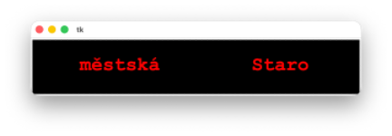
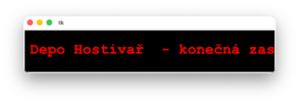

# (3) Displej v metru

> `"", [], txt, Cnv, fx(), aft.`

Do textového souboru `stanice.txt` si uložte názvy stanic metra linky A. Název každé je na novém řádku:

```
Nemocnice Motol
Petřiny
Nádraží Veleslavín
Bořislavka
Dejvická
Hradčanská
Malostranská
Staroměstská
Můstek
Muzeum
Náměstí Míru
Jiřího z Poděbrad
Flora
Želivského
Strašnická
Skalka
Depo Hostivař
```

Palubní počítač vlaku si vždy na konečné stanici načte aktuální textový soubor do paměti a na jednořádkovém dvacetiznakovém displeji vypisuje názvy stanic.

Vytvořte program, který bude simulovat činnost palubního počítače takto:

- načte si názvy zastávek do paměti, vypíše na displej název první zastávky, po stisku libovolné klávesy vypíše na displej název další zastávky,
- název zastávky se na displeji roluje zprava doleva, když nějaká část textu odejde z levé strany displeje,
- objeví se na pravé straně, pokud se na displeji vypisuje název poslední zastávky linky, tak se k názvu zastávky vypíše i upozornění, že je třeba vystoupit.

Ukázka displeje a průběh zobrazení při rolování obsahu displeje:





Otázky:

1. Která písma je vhodné použít, chceme-li mít displej přesně dvacetiznakový?
2. Co by se změnilo v programu, kdyby vlak jel opačným směrem a použijeme stejný textový soubor?
