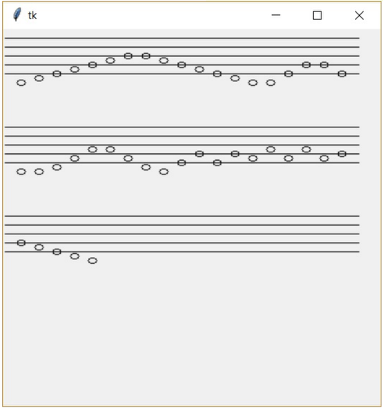

# (6) Noty

> `"", txt, Cnv, fx(), aft.`

Vytvořte program, který bude kreslit noty (celé) na notové osnově následovně:

- na ploše se nakreslí notová osnova,
- v textovém souboru `noty.txt` je v jednom řádku uložena posloupnost not (použity jsou pouze tyto: `c`, `d`, `e`, `f`, `g`, a `h`) – program přečte první notu a zobrazí ji na osnově,
- postupně přečte všechny noty a zapíše je na osnovu, pokud se noty nevejdou na jednu osnovu, 
- nakreslí se níže další osnova a na ní se pokračuje s kreslením not.

Ukázka textového souboru:

```
cdefgahcdahdecdefgahhagfdec
```

Například pro posloupnost `cdefgahhagfedcceggeccdfaafdcegegfafafggfedc` se nakreslí:



Pomůcka:

Celá nota se označuje prázdným oválem bez nožičky (svislé čáry). V hudební stupnici jsou tóny v pořadí `c d e f g h`. Rozdíl mezi dvěma tóny (jedna pozice) je polovina vzdálenosti mezi dvěma čarami na osnově. Tón `c` se zapisuje na druhé pozici pod spodní čarou osnovy (v naší úloze jej zapište bez čárky, která nahrazuje kousek osnovy).

Otázky:

1. Co je třeba udělat, chceme-li, aby byl program co nejflexibilnější, například. na změnu šířky grafického plátna?
2. Kterými způsoby můžeme z názvu noty určit její výšku (umístění na osnově)? Které z těchto způsobů řešení jsou vhodnější? Odpověď zdůvodněte.

