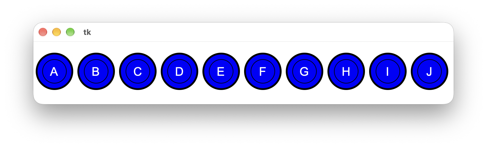
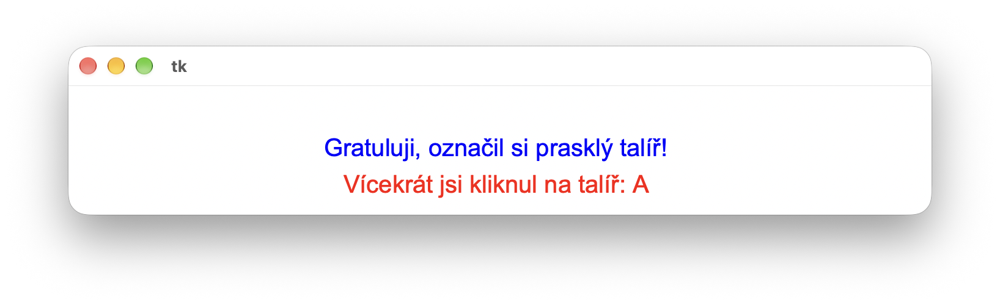

# (8) Najdi prasklý talíř

> `"", [], Cnv, fx()`

Vytvořte jednoduchou hru Najdi puklý talíř, která má tyto vlastnosti:

- v řadě vedle sebe je vykresleno 10 modrých talířů,
- každý talíř je označen písmeny A až J,
- po spuštění hry je jeden náhodně vybraný talíř prasklý, ale hráč to nevidí,
- úkolem hráče je kliknutím myší označit talíř, který je prasklý,
- hra končí, když hráč klikne na správný talíř: program smaže talíře a vypíše hráči gratulaci,
- na konci hry program vypíše písmena talířů, na která hráč klikl vícekrát.

Ukázky ze hry:

Otázka:

- Jak zajistíme, že program nebude padat po kliknutí mimo nakreslené talíře v případě, že grafické plátno má větší rozměry?

