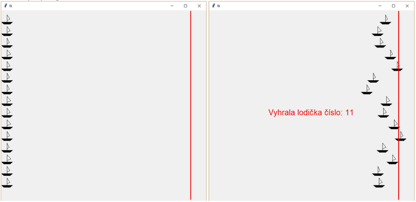

# (9) Závody lodiček

> `"", [], Cnv, fx()`

Vytvořte program, který simuluje závody lodiček. K dispozici máte funkci `lodicka(x, y)`. Funkce vykreslí na zadaném místě lodičku s náhodně napnutou plachtou. Využijte této funkce v programu. Funkci nemůžete upravovat.

```py
import tkinter, random
canvas = tkinter.Canvas(width=700, height=800)
canvas.pack()

def lodicka(x, y):
    plachta = random.randint(-3, 3)
    canvas.create_line(x, y, x, y-25, x+10+plachta, y-10, x, y-5)
    canvas.create_polygon(x-20, y, x+20, y, x+10, y+8, x-10, y+8)
```

Vytvořte program s následujícími vlastnostmi:

- Na levém okraji obrazovky se vykreslí 15 lodiček. Lodičky se nacházejí na svislé úsečce (startovací čáře).
- Na pravé straně je nakreslena cílová čára.
- Klepnutím spustíme animaci plavání lodiček. Lodičky se budou najednou pohybovat směrem vpravo, ale pokaždé se každá z nich posune náhodně o 1 až 10 bodů. Díky využití funkce lodicka bude při plavání lodičky hýbat plachta.
- Program skončí, když jedna z lodiček dosáhne pravého okraje obrazovky.
- Na obrazovce se vypíše číslo lodičky, která byla první.

Ukázky z programu:



Otázky:

1. Jak zajistíme, aby se závod po vícenásobném kliknutí myší nezrychloval?
2. Jak zajistíme, že závod se zastaví při výhře první lodičky?
3. Co je třeba upravit v programu, aby závod dokončil všechny lodičky?
4. Co se stane, když dojedou do cíle najednou dvě lodičky? Mohou dojet do cíle najednou dvě lodičky?

