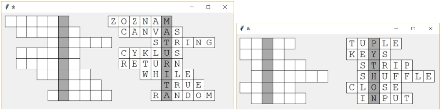

# (10) Vykreslení křížovky

> `"", (), [], txt, Cnv, fx()`

Vytvořte program, který ze vstupního souboru vykreslí křížovku. Můžete použít připravené textové soubory `krizovka1.txt`, `krizovka2.txt` a `krizovka3.txt`. V textovém souboru jeden řádek popisuje jeden řádek křížovky. Na začátku řádku je číslo, které určuje, který ze znaků tvoří tajenku. Například `3 WHILE` znamená, že v křížovce je řádek s textem `WHILE` a třetí znak tohoto textu je součástí tajenky.

Ukázka textového souboru:

```
6 SEZNAM
5 CANVAS
2 STRING
5 CYKLUS
5 RETURN
3 WHILE
1 TRUE
2 RANDOM
```

Vlastnosti programu:

- přečte do paměti obsah textového souboru,
- obsahuje funkci, která na zadaném místě vykreslí křížovku se zadanou velikostí čtverečků,
- křížovka je vykreslena tak, že čtverečky tajenky jsou podbarvené a jsou umístěny v jednom sloupci,
- pomocí funkce pro vykreslení křížovky můžeme vedle sebe nakreslit vyplněnou nebo nevyplněnou křížovku.

Ukázky vykreslených křížovek:


