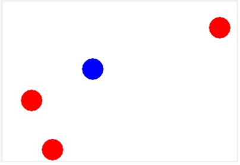

# (13) Jablkožrout

> `"", (), [], Cnv`

Vytvořte hru „Jablkožrout“. Po obrazovce se bude pohybovat brouk Žrout, jehož směr se mění pomocí kláves `w` `s` `a` `d` a bude jíst jablka z obrazovky. Po snědení jablka se velikost Žrouta nezmění.

Vytvořte program s následujícími vlastnostmi:

- Nakreslí na obrazovku v levém horním rohu Žrouta – modrý kruh.
- Na náhodné pozice nakreslí jablka – N červených kruhů (N je konstanta zadaná v programu).
- Jablka se mohou i překrývat, ale nesmí vyčuhovat z plochy ani se překrývat s počáteční pozicí Žrouta.
- Po spuštění programu se Žrout začne pohybovat směrem doprava.
- Směr pohybu Žrouta lze kdykoli změnit klávesami `w` `s` `a` `d`.
- Když Žrout přejede přes jablko, jablko zmizí. Hra se zastaví a skončí výherní hláškou, když Žrout sní všechna jablka.

Ukázka ze hry:

