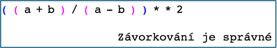

# (15) Kontrola závorek

> `"", [], Cnv`

V matematice i programování se často setkáváme s výrazy se závorkami. Pokud je těchto závorek více, často se stávají nepřehlednými – nevíme, která závorka má kde konec. Vytvořte program, který v zadaném zápisu zobrazí příslušné závorky stejnou barvou. Zápis kromě kulatých závorek může obsahovat různé znaky. S jiným typem závorek nepočítáme.

Vlastnosti programu:

- Načte zápis se závorkami z klávesnice a vypíše jej do grafické plochy.
- Vypíše, zda je zadaný výraz správně uzavřen.
- Výraz je správně uzávorkován tehdy, když splňuje dvě podmínky:
    1.	každá levá závorka má právě jednu pravou závorku,
    2.	pravá závorka následuje po své levé závorce,
- Například výraz `((xx)y(xx))` je správně uzavřen, `(aa))bb(` není správně uzavřen.
- Je-li výraz správně uzavřen, zobrazí příslušné závorky stejnou barvou. Můžeme předpokládat, že nebude potřeba použít více než 7 barev.

Ukázka programu:

