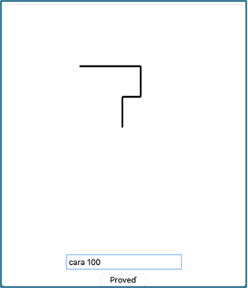

# (18) Kreslící robot

> `"", [], Cnv`

Kreslící robot poslouchá zadané příkazy a podle nich kreslí obrázky. Robot má svou pozici a směr, kterým je natočen (pouze nahoru/dolů/vpravo/vlevo). Robot zná následující příkazy:

- `cara <delka>` - nakreslí čáru zadané délky. Např. `cara 50` nakreslí čáru délky `50` a přesune se na konec této čáry,
- `vlevo` – otočí se o 90 stupňů vlevo (bez kreslení),
- `vpravo` – otočí se o 90 stupňů vpravo (bez kreslení).

Vytvořte program, který bude simulovat kreslícího robota. Robot se bude pohybovat v grafické ploše a provádět příkazy, které mu zadá uživatel. Samotného robota nezobrazujte. Na začátku programu je robot umístěn ve středu grafické plochy a je natočen směrem nahoru. Příkaz uživatel napíše do widgetu `entry` a potvrdí jej tlačítkem `Proveď`. Příkaz se ihned provede. Program bude mít i tyto vlastnosti:

- umožní zadávání příkazu `cara <delka>`; 
- robot tedy kreslí čáru směrem nahoru, umožní i zadávání příkazu `vlevo`; 
- další čára se tak už bude kreslit daným směrem, umožní i zadávání příkazu `vpravo`.

Například, pokud bude mít robot v zadání následující posloupnost příkazů:

```
cara 50
vpravo
cara 30
vlevo
cara 50
vlevo
cara 100
```

robot nakreslí:


