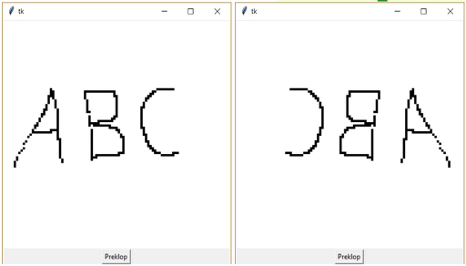

# (19) Překlopení obrázku

> `"", [], [[]], txt, Cnv`

V souboru `obrazek.txt` je zapsán černobílý obrázek. V prvním řádku souboru jsou rozměry obrázku – první číslo představuje šířku obrázku (počet pixelů v řádku), druhé číslo představuje jeho výšku (počet pixelů ve sloupci). Každý řádek obrázku je zapsán v samostatném řádku textového souboru. Tyto řádky následují postupně za prvním řádkem s jeho rozměry. Řádek obrázku je zapsán čísly `0` a `1`, přičemž `0` představuje bílou barvu a `1` černou. Čísla jsou oddělena mezerou.

Ukázka formátu textového souboru:

```
8 5
0 1 0 1 0 1 0 1 0 1
1 0 1 0 1 0 1 0 1 0
0 1 0 1 0 1 0 1 0 1
1 0 1 0 1 0 1 0 1 0
0 1 0 1 0 1 0 1 0 1
```

Vytvořte program, který:

- vypíše celkový počet pixelů obrázku a počet jednotek, 
- vykreslí obrázek zadaný v souboru na obrazovku; každý pixel vykreslí jako malý čtvereček. V programu nastavte jeho velikost pomocí proměnné `strana`.
- Po stisknutí tlačítka vykreslí původní obrázek překlopený podle osy Y.

Ukázka obrazovky podle popisu v souboru `obrazek.txt` a ukázka překlopeného obrázku:



Otázky:

1.	Co se změní v řešení úlohy, pokud bychom nulou kódovali černou barvu a jedničkou bílou barvu?
2.	Jaký formát textového souboru byste navrhli k ušetření jeho místa?
3.	Co by se změnilo v programu, kdyby čísla 0 a 1 ve vstupním souboru nebyla oddělena mezerou, ale následovala by těsně za sebou?

