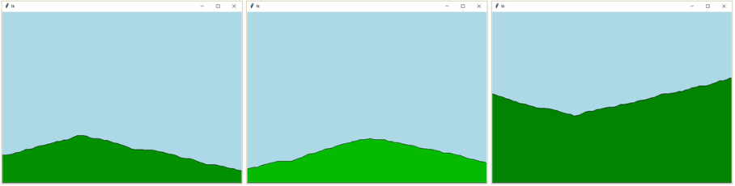
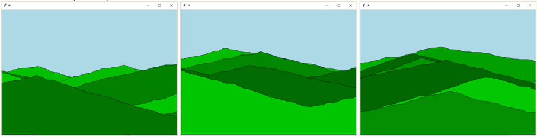

# (26) Krajina

> `[], Cnv, fx()`

Pomocí programu můžeme generovat a vykreslovat náhodnou krajinu. Vytvořte program, který:

- vygeneruje údaje pro kopec, přičemž si nejprve náhodně určí `x`-ovou pozici vrcholu a `y`-ovou souřadnici počáteční výšky kopce. Pro kopec platí, že jeho výška je v první části (před vrcholem) neklesající a za vrcholem nerostoucí. Změna v reliéfu kopce může být každých 10 bodů a je náhodná vůči předchozímu stavu výšky.
- vykreslí kopec pomocí příkazu `canvas.create_polygon()`. Barva kopce je některý náhodný odstín zelené barvy.
- se náhodně rozhodne, zda lze kreslit kopec nebo údolí (zda je nejprve neklesající posloupnost a potom nerostoucí nebo opačně) a vykreslí jeden kopec nebo jedno údolí.
- opakovaně vykreslí více náhodných kopců / údolí, čímž vznikne vygenerovaná krajina,
- po stisku mezery nakreslí novou sérii náhodných kopců a údolí.

Ukázka jednoho kopce nebo jednoho údolí:

Ukázka více kopců a údolí:

 
Otázky:

1.	Navrhněte formát textového souboru pro uložení dat nakreslené a vygenerované krajiny.
2.	Lze z ukázky určit, kolik kopců (resp. údolí) program vygeneroval? Zdůvodněte svou odpověď.

