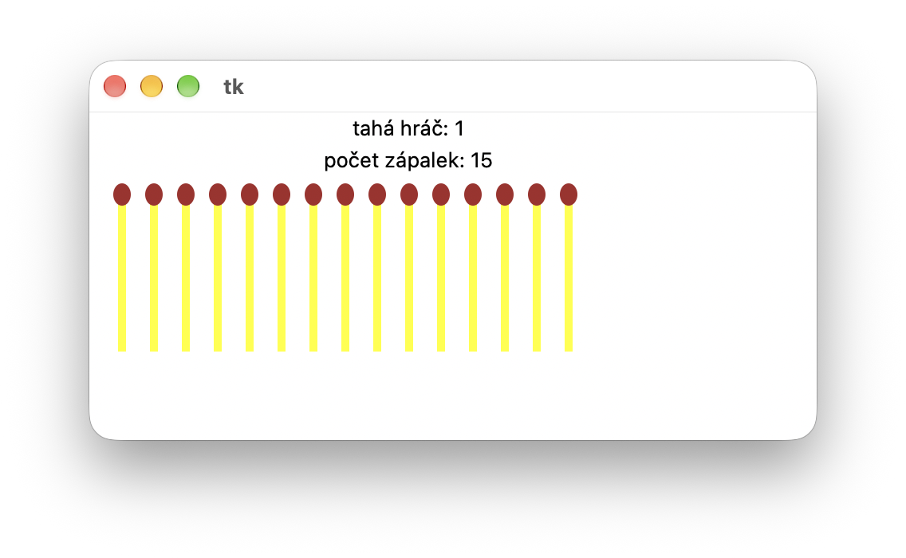

# (30) Hra NIM

> `"", Cnv, fx()`

Ve hře NIM dva hráči z 15 zápalek střídavě odebírají jednu, dvě nebo tři zápalky. Kdo odebere poslední zápalku, vyhrává. Ve zdrojovém kódu `NIM_zadani.py` je připravena funkce pro vykreslení jedné zápalky.

Připravený program s kreslením zápalky:

```py
import tkinter, random
canvas = tkinter.Canvas(width=650, height=200)
canvas.pack()

def zapalka(x, y):
    canvas.create_line(x, y, x, y+100, width=5, fill='yellow')
    canvas.create_oval(x-5, y-5, x+5, y+8, fill='brown', outline='brown')
```

Ukázka ze hry:



Ve svém řešení využijte tento program a doplňte jej tak, aby měl tyto vlastnosti:

- na obrazovku se vykreslí vedle sebe 15 zápalek a vypíše se jejich počet,
- program střídavě vyzývá hráče, aby zadali počet odebraných zápalek,
- pomocí klávesnice stisknutím kláves 1, 2 nebo 3 hráč určí počet odebraných zápalek,
- po každém tahu se aktualizuje obrazovka se zobrazenými zápalkami a jejich počtem,
- hráč, který odebere poslední zápalku, vyhrává a program mu zagratuluje.

Otázky:

1. Co se stane, jsou-li ve hře už jen dvě zápalky a hráč odebere 3?
2. Jak zabazpečíme, aby po vypsání gratulace jsme už netahali zápalky?