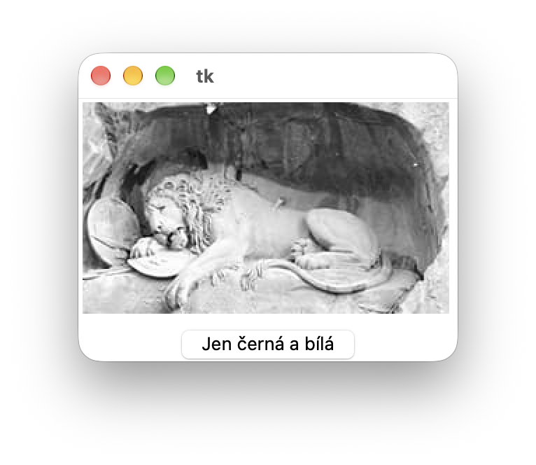
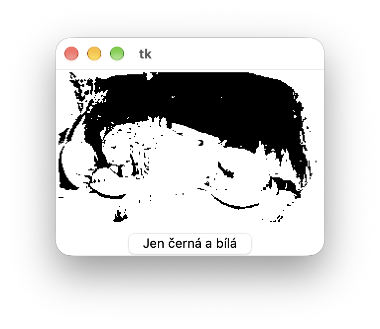
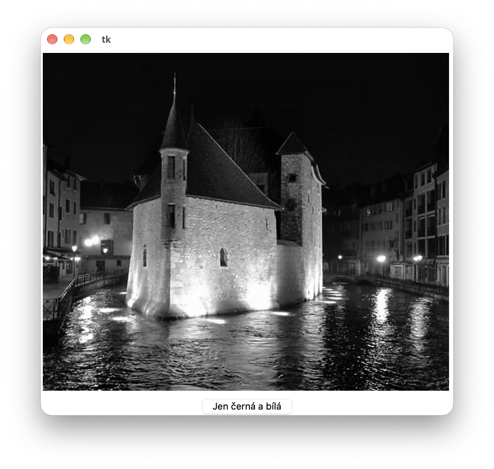
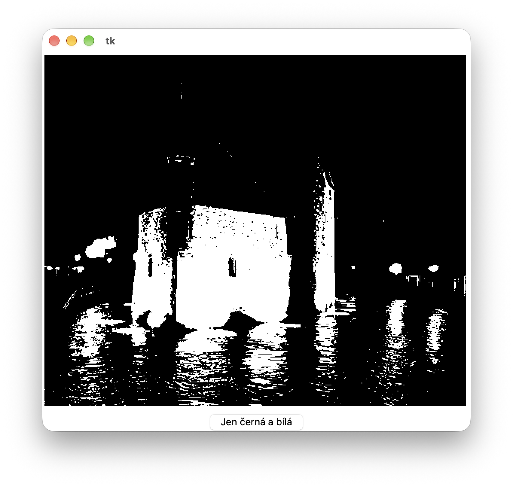

# (31) Černobílý obrázek

> `"", txt, Cnv, fx()`

V souboru `obrazek_1.txt` je zapsán černobílý obrázek (k dispozici jsou i soubory `obrazek_2.txt` a `obrazek_3.txt`). V prvním řádku souboru jsou rozměry obrázku - první číslo představuje šířku obrázku (počet pixelů v řádku) a druhé číslo představuje jeho výšku (počet pixelů ve sloupci). Každý řádek obrázku je zapsán v samostatném řádku textového souboru. Tyto řádky následují postupně za prvním řádkem s jeho rozměry. V řádku obrázku jsou uloženy barvy pixelů (odstín šedé barvy). Barva jednoho pixelu je zapsána dvouciferným číslem v šestnáctkové soustavě, tedy čísla od `00` do `ff`. Barva vyjadřuje odstín šedé barvy (*pouze si připomeňme, že všechny odstíny šedé barvy mají stejnou hodnotu červené, zelené a modré barvy v modelu RGB*). Čísla reprezentující pixely nejsou v řádku ničím oddělena (následují těsně za sebou).

Ukázka formátu textového souboru:

```
20 5
ffa315070300aa0000000000000000ffffffffff
00000000000000000000afbfcfdfef0000000000
0000000000ffffffffff0000000000ffffffffff
ffffffffff0000000000ffffffffff000000ffff
00102030405060708090a0b0c0d0e0f0001f2f3f
```

Vytvořte program, který:

- přečte ze souboru velikost obrázku a podle ní nastaví velikost grafické plochy,
- přečte první řádek obrázku a vykreslí jej do grafické plochy obdélníkem velikosti 1x1 pixel podle barvy v souboru (odstínů šedé),
- podle údajů v souboru vykreslí do grafické plochy celý obrázek, přičemž program nezatěžuje paměť a všechna data čte a vykresluje přímo ze souboru,
- po stisknutí tlačítka Jen černá a bílá vykreslí body obrázku jen s úplně bílou barvou nebo zcela černou barvou. Barvu program vypočítá podle odstínu šedé - určí, zda je ve spodní/horní polovině tmavosti šedých odstínů.

Ukázka vykreslení jednotlivých textových souborů a následné transformace obrázku jen do černé a
bílé barvy







Otázky:
1. Jak výrazně by se změnila velikost vstupního souboru, pokud by byly jednotlivé barvy pixelů odděleny například mezerou?
2. Zhodnoťte, zda je vhodnější v takových textových souborech používat čísla v šestnáctkové nebo desítkové soustavě.
3. Jak bychom zjistili číslo nejtmavší použité barvy?


