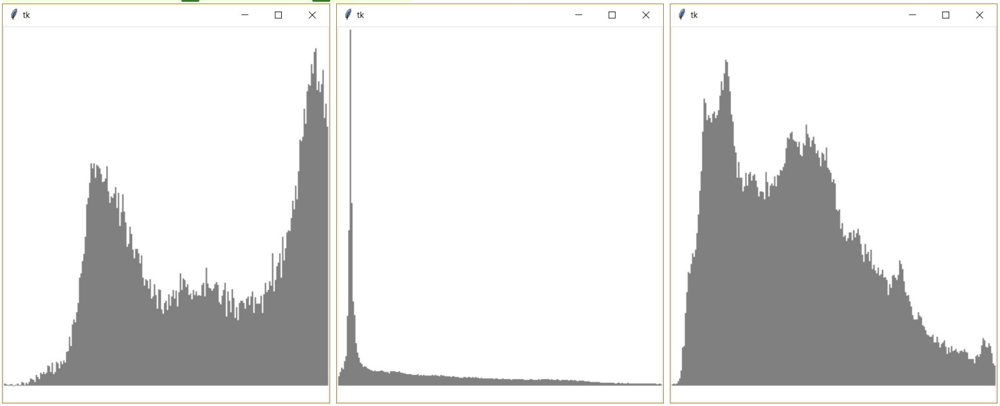

# (33) Histogram

> `"", [], txt, Cnv`

V souboru `obrazek_1.txt` je zapsán černobílý obrázek (k dispozici jsou i soubory `obrazek_2.txt` a `obrazek_3.txt`). V prvním řádku souboru jsou rozměry obrázku - první číslo představuje šířku obrázku (počet pixelů v řádku) a druhé číslo představuje jeho výšku (počet pixelů ve sloupci). Každý řádek obrázku je zapsán v samostatném řádku textového souboru. Tyto řádky následují postupně za prvním řádkem s jeho rozměry. V řádku obrázku jsou uloženy barvy pixelů (odstín šedé barvy). Barva jednoho pixelu je zapsána dvouciferným číslem v šestnáctkové soustavě, tedy čísla od `00` do `ff`. Barva vyjadřuje odstín šedé barvy (*pouze si připomeňme, že všechny odstíny šedé barvy mají stejnou hodnotu červené, zelené a modré barvy v modelu RGB*). Čísla reprezentující pixely nejsou v řádku ničím oddělena (následují těsně za sebou).

Ukázka formátu textového souboru:

```
20 5
ffa315070300aa0000000000000000ffffffffff
00000000000000000000afbfcfdfef0000000000
0000000000ffffffffff0000000000ffffffffff
ffffffffff0000000000ffffffffff000000ffff
00102030405060708090a0b0c0d0e0f0001f2f3f
```

Z textového souboru a použitých barev (odstínů šedé) můžeme zjistit, jak často jsou v obrázku zastoupeny jednotlivé odstíny šedé barvy. Vytvořte program, který:

- přečte a vypíše ze souboru šířku a výšku obrázku a počet všech bodů,
- zjistí a vypíše počet výskytů nejčastěji použitého odstínu,
- vykreslí histogram frekvence použití jednotlivých odstínů (podle ukázky), přičemž frekvence výskytu jedné hodnoty se vykreslí jako sloupec o šířce 2 body, jednotlivé sloupce jsou těsně vedle sebe a jejich maximální výška je 500 px,
- vykreslí histogram s vypočteným měřítkem (žádný z vykreslených sloupců nepřekročí výšku 500 px).

**Pomůcka:** Funkci `int()` můžeme využít i k převodu čísla do desítkové soustavy, stačí jako druhý
parametr uvést základ soustavy. Například: `int('ff', 16)` vrátí číslo `255`.

Ukázka vykreslených histogramů pro soubory `obrazek_1.txt` až `obrazek_3.txt`:



Otázky:

1. Jak si rychle ověříme, že zjištěná četnost výskytů není úplně špatná?
2. Co umíme vyčíst z výsledného histogramu a následně říci o vlastnostech obrázku ve vstupním souboru?

