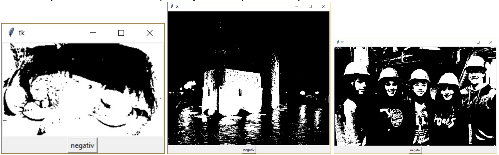

# (35) Vykreslení komprimovaného obrázku

> `[], txt, Cnv, fx()`

V souboru `obrazek_1.txt` je zapsán černobílý obrázek (k dispozici jsou i soubory `obrazek_2.txt` a `obrazek_3.txt`). V prvním řádku souboru jsou rozměry obrázku - první číslo představuje šířku obrázku (počet pixelů v řádku) a druhé číslo představuje jeho výšku (počet pixelů ve sloupci). Každý řádek obrázku je zapsán v samostatném řádku textového souboru. Tyto řádky následují postupně za prvním řádkem s jeho rozměry. První číslo v řádku vyjadřuje počet černých bodů vedle sebe v řádku obrázku. Další číslo vyjadřuje počet bílých bodů vedle sebe v řádku obrázku. Takto se střídají čísla vyjadřující počet bílých a černých bodů v jednom řádku obrázku. Wísla jsou oddělena jednou mezerou.

Vytvořte program, který vykreslí takto zapsaný obrázek. Program bude mít tyto vlastnosti:

- přečte ze souboru velikost obrázku a podle ní nastaví velikost grafické plochy,
- přečte první řádek obrázku a vykreslí jej do grafické plochy, jeden pixel nakreslí obdélníkem velikosti 1x1 pixel,
- podle údajů v souboru vykreslí do grafické plochy celý obrázek, přičemž program nezatěžuje paměť a všechna data čte a vykresluje přímo ze souboru,
- po stisku tlačítka `negativ` vykreslí body obrázku opačně, to, co je podle souboru bílé, nakreslí černé, a naopak, to, co je podle souboru černé, nakreslí bílé.

Ukázka vstupního textového souboru:

```
20 5
0 3 2 2 8 5
2 3 1 1 3 8 2
0 20
20
```

Ukázka zabarvení bodů (B - bílý, W - černý):

```
BBBWWBBWWWWWWWWBBBBB
WWBBBWBWWWBBBBBBBBWW
BBBBBBBBBBBBBBBBBBBB
WWWWWWWWWWWWWWWWWWWW
```

Ukázka vykreslení obrázků podle jednotlivých textových souborů:



Otázky:

1. Pro jaký řádek bude ve vstupním souboru jen jedno číslo?
2. Jaké řádky budou mít více čísel ve vstupním souboru?
3. Jak bude vypadat nejdelší možný vstupní řádek?
4. Jaký obrázek (při stejné velikosti celkového počtu bodů) bude mít nejkratší vstupní soubor?
5. V jakém vztahu bude velikost vstupního a výstupního souboru?
