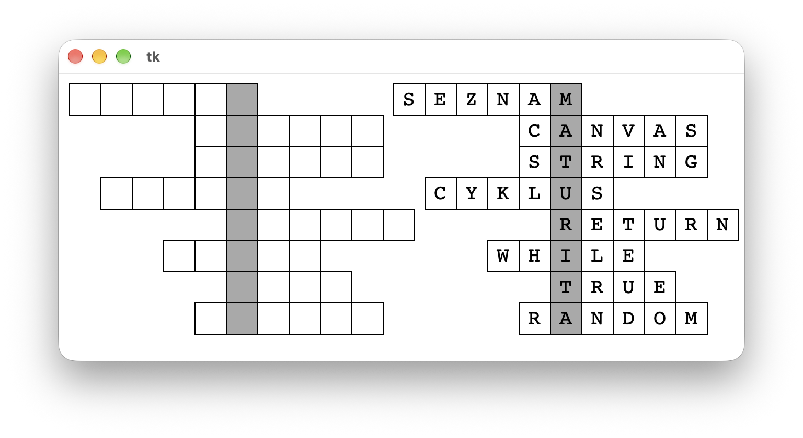
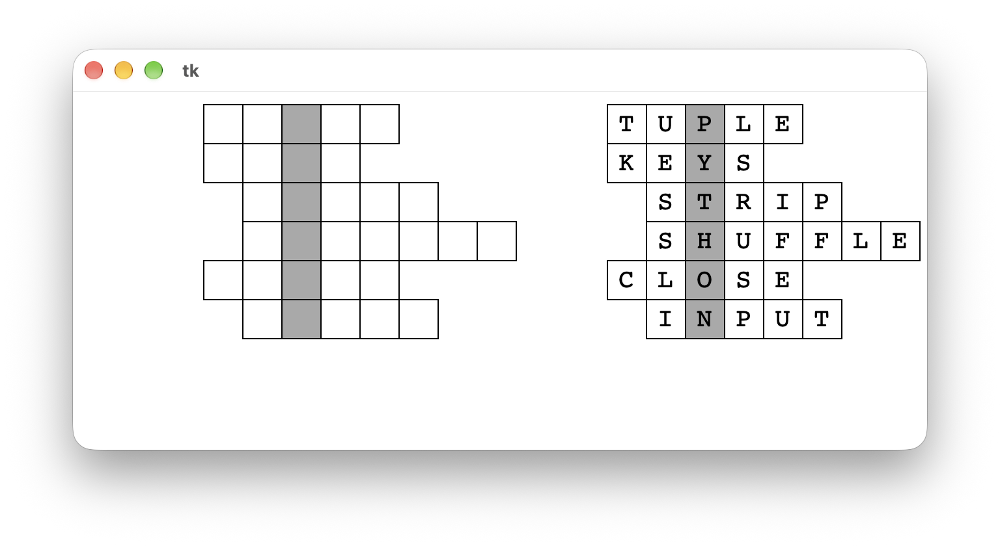

# (36) Vykreslení křížovky 2

> `"", (), [], txt, Cnv, fx()`

Vytvořte program, který ze vstupního souboru vykreslí křížovku. Můžete použít připravené textové soubory `krizovka2_1.txt` a `krizovka2_2.txt`. První řádek textového souboru obsahuje text tajenky. Každý další řádek popisuje jeden řádek křížovky.

Ukázka textového souboru:

```
MATURITA
SEZNAM
CANVAS
STRING
CYKLUS
RETURN
WHILE
TRUE
RANDOM
```

Vlastnosti programu:

- přečte do paměti obsah textového souboru,
- obsahuje funkci, která na zadaném místě vykreslí křížovku se zadanou velikostí čtverečků (zadané místo je souřadnice levého horního bodu sloupce s tajenkou),
- program si zjistí, o kolik je třeba posunout jednotlivé řádky křížovky, aby byla tajenka v jednom sloupci,
- křížovka je vykreslena tak, že čtverečky tajenky jsou podbarvené a jsou umístěny v jednom sloupci,
- pomocí funkce pro vykreslení křížovky můžeme vedle sebe nakreslit vyplněnou nebo nevyplněnou křížovku.

Ukázky vykreslených křížovek:





Otázky:


