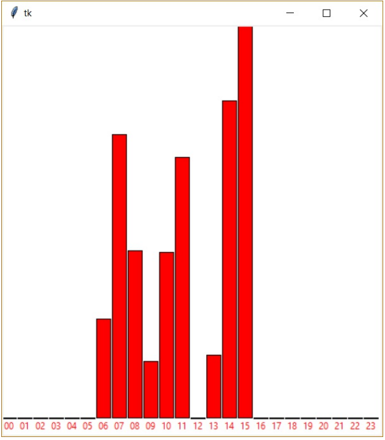

# (39) Spokojenost zákazníků 2

> `"", [], txt`

Lokální potraviny se rozhodly, že zjistí spokojenost s poskytnutými službami u svých zákazníků. Při východu z prodejny nainstalovali box, ve kterém zákazník vyjádří svou spokojenost/nespokojenost pomocí dotykové obrazovky. Všechna vyjádření se zapíší do textového souboru. Vyjádření jsou v textovém souboru `spokojenost_1.txt` (k dispozici jsou i soubory `spokojenost_2.txt` a `spokojenost_3.txt`). Na každém řádku je jedno vyjádření zákazníka. Vyjádření obsahuje čas zaznamenání ve tvaru `HH:MM`, poté následuje jedna mezera a text `ano` nebo `ne` podle toho, zda byl zákazník spokojen nebo nespokojen. V souboru jsou vyjádření z více dnů.

Ukázka části vstupního textového souboru `spokojenost_1.txt`:

```
08:39 ano
06:47 ano
10:52 ano
14:55 ne
15:30 ne
10:53 ano
```

Vytvořte program, který:


- zjistí a vypíše celkový počet negativních vyjádření,
- zjistí a vypíše, během které hodiny je nejvíce nespokojených zákazníků a jejich absolutní počet,
- zjistí a vypíše počet nespokojených zákazníků pro jednotlivé hodiny během dne, ale jen ty, ke kterým existují vyjádření,
- vykreslí histogram počtu nespokojených zákazníků ve všech hodinách dne. Na ose `x` budou napsány hodiny ve tvaru `00` až `23`. Grafická plocha má velikost 480x520 pixelů a nevadí nám, že v případě vysoké nespokojenosti se údaje nevejdou do zobrazované plochy.

Ukázka histogramu:




