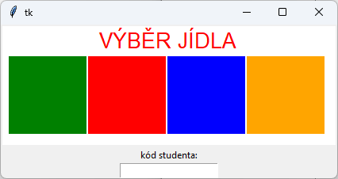

# (41) Výběr jídla

> `"", [], txt, Cnv`

Ve školní jídelně je elektronický stravovací systém. Studenti si mohou na následující den označit jídlo dle nabídky. Na výběr jsou vždy čtyři jídla označená barvami: zelená, červená, modrá a oranžová.

Vytvořte program pro výběr jídla s těmito vlastnostmi:

- Na obrazovce se vykreslí vedle sebe čtyři čtverce postupně vyplněné zelenou, červenou, modrou a oranžovou barvou a nadpis programu (viz ukázka).
- Jídlo si označujeme klepnutím myší na barevný čtverec.
- Programu pomocí `entry` zadáváme identifikační číslo studenta (u `entry` je zobrazen i popis - viz ukázka).
- Po kliknutí na některý čtverec se do textového souboru `vyber_jidla.txt` zapíše nový řádek, který obsahuje identifikační číslo studenta, mezeru a znak označující vybrané jídlo (`z` – zelené, `c` – červené, `m` – modré, `o` – oranžové).
- Program nereaguje na kliknutí mimo vykreslené obdélníky, objednávku nezapíše do souboru, když není vyplněn kód studenta.
- Po každém spuštění programu vymaže původní obsah souboru `vyber_jidla.txt`.

Ukázka výstupního textového souboru `vyber_jidla.txt`:

```
154 o
208 z
206 m
101 z
85 c
```

Ukázka obrazovky programu:

