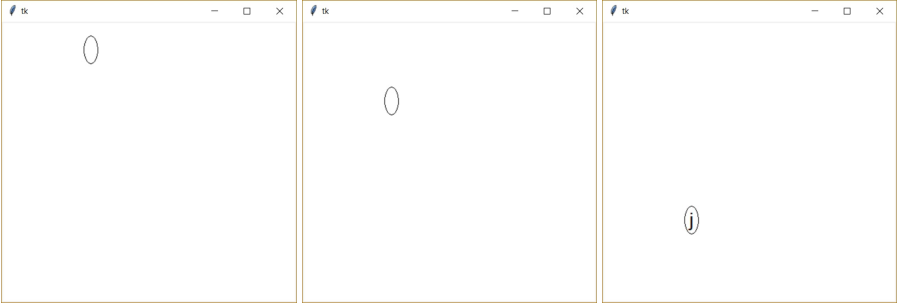

# (42) Zachraň padající vajíčko

> `"", Cnv, fx(), aft.`

Vytvořte program, který umožní uživateli hrát hru Zachraň padající vajíčko. Program má následující vlastnosti:

- Na obrazovce postupně z horního okraje a náhodné x-ové souřadnice padá vajíčko (elipsa).
- Uvnitř vajíčka je skryto náhodné malé písmeno anglické abecedy, které je třeba zmáčknout; v poslední třetině dráhy se skyté písmeno ve vajíčku ukáže.
- Stisknutím skrytého písmene (klávesu s písmenem) zachráníme vajíčko před spadnutím a rozbitím. Pokud nestihneme skryté písmeno zmáčknout včas, vajíčko spadne a hra končí.
- Po záchraně vajíčka padá nové vajíčko s novým náhodným písmenem.

Ukázka obrazovek animace programu:

