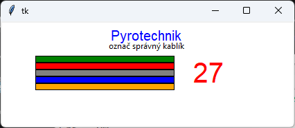
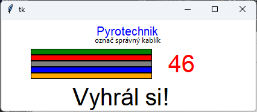
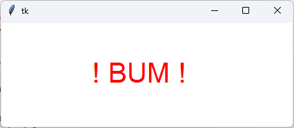

#  (43) Pyrotechnik

> `[], Cnv, fx(), aft.`

Úkolem pyrotechnika je přestřihnout správný kablík a zneškodnit výbušninu (resp. rozbušku). Vytvořte program - simulátor pro pyrotechnika, který má tyto vlastnosti:

- V programu je definován seznam použitých barev, počáteční souřadnice umístění kablíků a jejich délka (všechny kablíky jsou umístěny vodorovně pod sebou, jejich tloušťka je neměnná o velikosti 10&nbsp;px).
- Program vykreslí kablíky podle nastavených údajů, napíše nadpis (viz ukázka), náhodně si určí správný kablík a spustí odpočítávání času, které se zobrazuje na obrazovce.
- Hráč ovládá hru kliknutím na kablík. Pokud klikne na správný kablík, čas se zastaví a vypíše se informace o výhře (viz ukázka).
- Pokud nestihne v časovém intervalu kliknout na správný kablík, zobrazí se výrazný text BUM.

Ukázka obrazovek programu (během hry, výhra, prohra):

Otázky:

1. Jak zajistíme, aby program fungoval pro proměnlivý počet kablíků více barev?
2. Bude program správně fungovat i v případě, že dva různé kablíky mají stejnou barvu?

